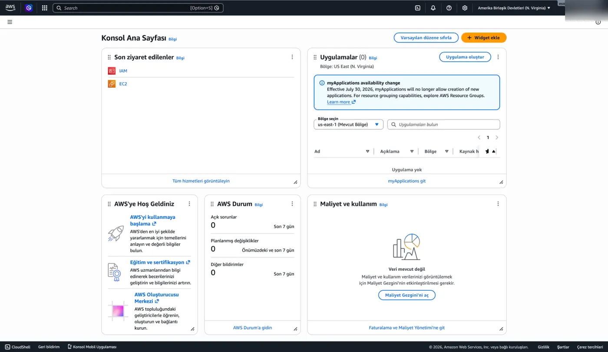
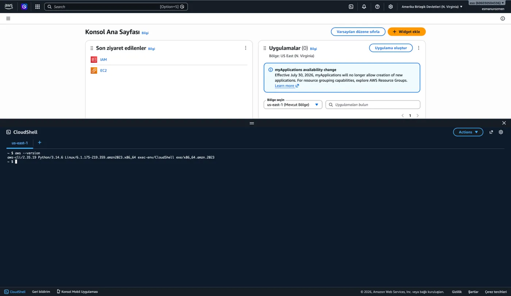
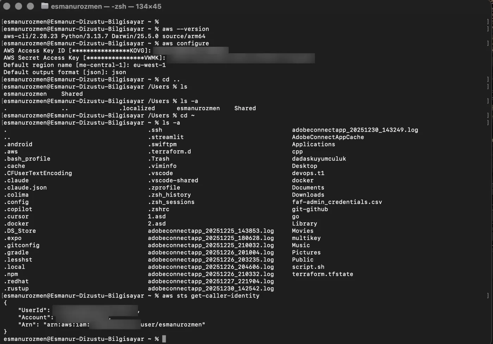
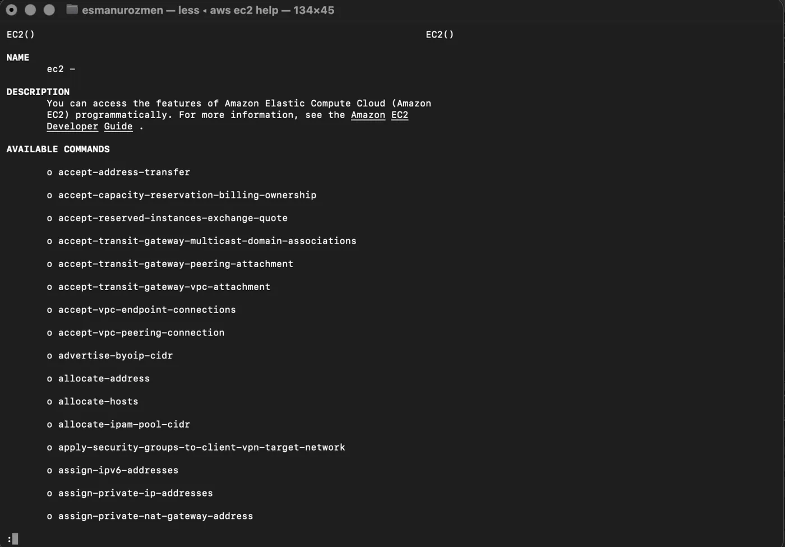
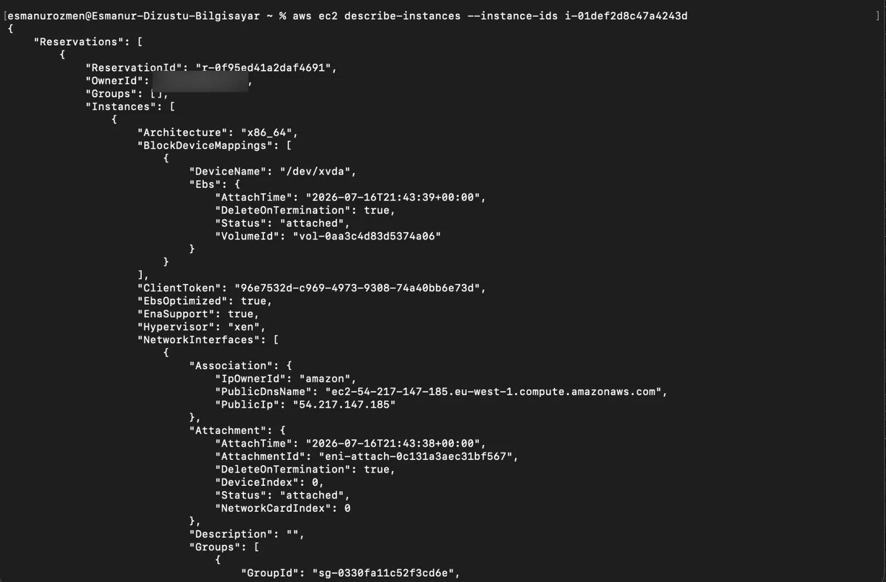

## CLI'a erişim

IAM servisini arkamızda bırakarak bir sonraki servis olan CLI hizmetine giriş yapalım. Daha önce de bahsettiğimiz gibi biz AWS hesaplarımıza üç şekilde bağlanabiliyorduk. Bu yöntemlerden biri de CLI servisi. CLI'ı bilgisayarımıza indirip kullanabildiğimiz gibi AWS üzerinden de aşağıdaki gibi sağ üstteki **CloudShell**'den ulaşabiliriz.



Gördüğünüz gibi `aws --version` komutunu çalıştırırsak burada yüklü olduğunu görürüz.



```bash frame="terminal"
aws --version
```

```text title="Çıktı"
aws-cli/2.35.19 Python/3.14.6 Linux/6.1.175-219.359.amzn2023.x86_64 exec-env/CloudShell exe/x86_64.amzn.2023
```

## aws configure

Daha önce [oluşturduğumuz access key](/aws/iam/kullanici-mfa-access-key/#access-key-oluşturma) ile CLI üzerinden giriş yapmak için ilk olarak terminalimizde `aws configure` komutunu çalıştırıyoruz.



```bash frame="terminal"
aws --version
```

```text title="Çıktı"
aws-cli/2.28.23 Python/3.13.7 Darwin/25.5.0 source/arm64
```

```bash frame="terminal"
aws configure
```

```text title="Çıktı"
AWS Access Key ID [****************]: <AWS_ACCESS_KEY_ID>
AWS Secret Access Key [****************]: <AWS_SECRET_ACCESS_KEY>
Default region name [me-central-1]: eu-west-1
Default output format [json]: json
```

```bash frame="terminal"
aws sts get-caller-identity
```

```json title="Çıktı"
{
    "UserId": "<AWS_USER_ID>",
    "Account": "<AWS_ACCOUNT_ID>",
    "Arn": "arn:aws:iam::<AWS_ACCOUNT_ID>:user/ornekkullanici"
}
```

1. Ardından **Access Key ID** ve **Secret Access Key** bilgilerimizi girerek enter diyoruz.
2. Sıradaki **region name** kısmına "Benim kodlarım ve verilerim dünya haritası üzerinde tam olarak hangi şehirdeki sunucularda barınsın?" sorusunun cevabına göre bir region yazarak devam ediyoruz.
3. Son olarak alacağımız çıktıların formatını JSON olarak belirlemek için `json` yazıp enter diyoruz.

Evet böylece artık CLI üzerinden oluşturmuş olduğumuz user ile AWS hesabımıza bağlanmış olduk.

## Komut yapısı

CLI üzerinden AWS kaynaklarımızı nasıl yönettiğimizi ve AWS CLI'ın arka planda nasıl çalıştığını gelin birlikte öğrenelim.

Kullanım syntax'ı temel olarak şu şekildedir: Komut satırına her zaman öncelikle `aws` anahtar kelimesini yazarız. Ardından işlem yapmak istediğimiz servisin adını (örneğin `ec2`, `s3` vb.) ve son olarak o serviste yapmak istediğimiz işlemi belirterek komutu oluştururuz. İhtiyaç halinde en sona o işleme ait parametreleri ekleriz.

Örnek olarak, EC2 servisi üzerindeki durdurulmuş bir sanal makineyi başlatmak için şu komutu kullanırız:

```bash frame="terminal"
aws ec2 start-instances --instance-ids i-1234567890abcdef0
```



```bash frame="terminal"
aws ec2 help
```

```text title="Çıktı"
EC2()                                                          EC2()

NAME
       ec2 -

DESCRIPTION
       You can access the features of Amazon Elastic Compute Cloud (Amazon
       EC2) programmatically. For more information, see the Amazon EC2
       Developer Guide .

AVAILABLE COMMANDS

       o accept-address-transfer

       o accept-capacity-reservation-billing-ownership

       o accept-reserved-instances-exchange-quote
...
```

Bir servis üzerinden kullanabileceğimiz eylemleri görmek için `aws <servis adı> help` komutunu kullanırız.

## Çıktıları filtreleme

AWS CLI kullanarak çalıştırdığımız komutların bize döndürdüğü uzun çıktılar üzerinde iki farklı yöntemle filtrelemeler yapabiliriz ve sonuçları özelleştirebiliriz. İlk olarak, `--filters` parametresini kullanarak AWS'nin bize sadece belirli özelliklere sahip kaynakları (örneğin sadece çalışan sanal makineleri) getirmesini sağlayabiliriz. İkinci olarak ise `--query` parametresini kullanırız. Bu parametre sayesinde, dönen detaylı veri yığını içinden sadece görmek istediğimiz özel değerlerin (örneğin sadece makinelerin IP adreslerinin) yolunu yazarak nokta atışı sonuçlar elde edebiliriz.



```bash frame="terminal"
aws ec2 describe-instances --instance-ids i-0123456789abcdef0
```

```json title="Çıktı"
{
    "Reservations": [
        {
            "ReservationId": "r-0123456789abcdef0",
            "OwnerId": "<AWS_ACCOUNT_ID>",
            "Groups": [],
            "Instances": [
                {
                    "Architecture": "x86_64",
                    "BlockDeviceMappings": [
                        {
                            "DeviceName": "/dev/xvda",
                            "Ebs": {
                                "AttachTime": "2026-07-16T21:43:39+00:00",
                                "DeleteOnTermination": true,
                                "Status": "attached",
                                "VolumeId": "vol-0123456789abcdef0"
                            }
                        }
                    ],
                    "EbsOptimized": true,
                    "EnaSupport": true,
                    "Hypervisor": "xen",
                    "NetworkInterfaces": [
                        {
                            "Association": {
                                "IpOwnerId": "amazon",
                                "PublicDnsName": "ec2-203-0-113-10.eu-west-1.compute.amazonaws.com",
                                "PublicIp": "203.0.113.10"
                            },
                            ...
```

Sadece tek bir makinenin özelliklerini görmek istiyorsak `aws ec2 describe-instances --instance-ids makine_id` komutunu kullanırız.
