## AMI nedir?

Daha önce de bahsettiğimiz AMI kavramını biraz daha detaylandıracak olursak; bunu sanal sunucularımızı kurmak için kullandığımız hazır bir kurulum kalıbı olarak düşünebiliriz. Bulutta bir sanal makineyi ayağa kaldırmak için işletim sistemi ve temel ayarlar gibi ihtiyaç duyduğumuz tüm başlangıç bilgileri bu paketin içinde hazır olarak gelir.

AWS üzerinde yeni bir sanal makine başlatırken sistem bizden mutlaka bir kaynak AMI seçmemizi ister. İşin en büyük avantajı şudur: Eğer tamamen aynı ayarlara ve altyapıya sahip birden fazla sunucuya ihtiyacınız varsa, her birini sıfırdan kurmakla uğraşmazsınız. Tek bir AMI kalıbını kullanarak ondan saniyeler içinde yüzlerce birebir aynı kopyayı başlatabilirsiniz. Elbette farklı özelliklerde sunuculara ihtiyacınız olduğunda, her biri için ihtiyacınıza uygun farklı bir AMI seçerek yolunuza devam edersiniz.

## AMI çeşitleri

Erişim haklarına ve lisans durumlarına göre AWS üzerinde 3 farklı AMI çeşidi bulunur:

- **Public (Herkese Açık) AMI:** AWS'nin kendisi veya topluluk tarafından hazırlanan, hepimizin varsayılan olarak erişip kullanabileceği standart kalıplardır.
- **Private (Özel/Gizli) AMI:** Sadece kendi hesabımızda oluşturduğumuz, dışarıya tamamen kapalı olan ve yalnızca bizim kullanabildiğimiz kalıplardır.
- **Paid (Ücretli) AMI:** AWS Marketplace üzerinde satılan, içinde özel lisanslı programlar veya kurumsal yazılımlar kurulu halde gelen ücretli kalıplardır.

Şimdi gelin birlikte kendi AMI kalıbımızı oluşturup, bu kalıptan yepyeni bir sanal makineyi AWS arayüzü üzerinden nasıl ayağa kaldıracağımızı öğrenelim.

## 1. Yöntem: Manuel olarak AMI oluşturma

1. Öncelikle **Volumes** sekmesinden ilgili diskimizi seçip bir [Snapshot](/aws/ebs-ve-ami/volume-ve-snapshot/) oluşturuyoruz.
2. Ardından **Snapshots** menüsüne gelerek **Actions** altından **Create image from snapshot** seçeneğine tıklıyoruz.
3. İşlem tamamlandığında soldaki menüden **AMIs** kısmına geldiğimizde, oluşturduğumuz kalıbın buraya yüklendiğini görüyoruz.
4. Daha sonra **Instances** menüsünden sanal makine oluşturma adımlarına geçiyoruz. Buradaki imaj seçim ekranında, kendi oluşturduğumuz bu AMI'yi seçerek yeni sanal makinemizi başarıyla ayağa kaldırıyoruz.

Ayrıca oluşturduğumuz AMI'ler varsayılan olarak Private durumdadır. Eğer bunu değiştirmek istersek, **AMIs** menüsü altındaki **Actions** kısmından **Edit AMI permissions** başlığına girerek imajımızı Public yapabilir veya Private durumdaki kalıpları farklı AWS hesaplarıyla paylaşabiliriz.

## 2. Yöntem: EC2 Image Builder ile süreci otomatikleştirme

İlk yöntemde gördüğümüz gibi her defasında manuel olarak makine açmak, güncellemeleri yapmak ve imaj almak bir süre sonra yorucu ve hataya açık bir hale gelebilir. İşte bu AMI oluşturma adımlarını otomatize etmek adına **EC2 Image Builder** özelliği devreye girer.

Bu servisin çalışma mantığı çok basittir: Bir **Pipeline** kurmaya dayanır.

1. EC2 servisi altında **AMIs** başlığına tıkladığımızda açılan ekranda `EC2 Image Builder` yazan butona tıklıyoruz.

   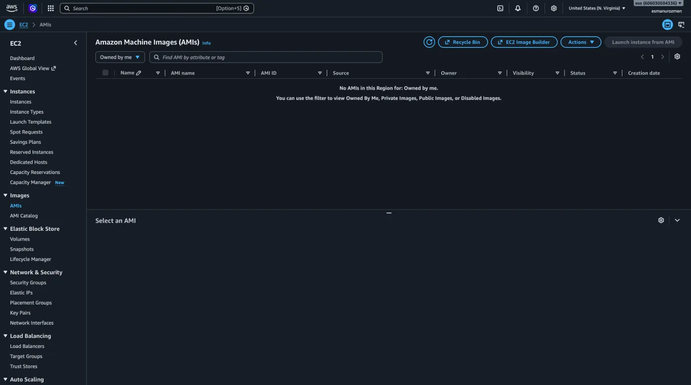

2. Ardından `Create image pipeline` butonuna tıklayarak Pipeline oluşturmaya başlıyoruz.

   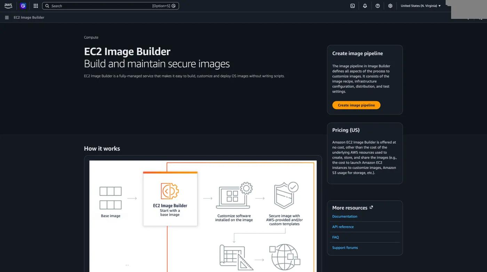

### Pipeline detayları

- **Pipeline name:** Oluşturacağımız bu otomatik imaj alma otomasyonuna vereceğimiz isimdir. Gelecekte yüzlerce kaynağın arasında kaybolmamak için projemizi anlatan, net ve açıklayıcı bir isim (örneğin: `aylik-ubuntu-guncel-imaj`) girmemiz istenir.
- **Description:** İsteğe bağlı bir alandır. Bu pipeline'ın tam olarak hangi amaca hizmet ettiğini veya hangi ekibin kullanacağını not düşebileceğimiz kısımdır.
- **Enhanced metadata collection:** Bu kutucuk işaretli olduğunda, AWS (Systems Manager Inventory aracılığıyla) oluşturacağımız imajın içindeki bileşenler hakkında çok daha detaylı bilgi (metadata) toplar. Kurduğumuz programların imajla uyumlu çalışıp çalışmadığını doğrulamak için bu seçeneği varsayılan olarak işaretli bırakmak iyi bir pratiktir.
- **Save a snapshot of vulnerability findings:** AWS'nin güvenlik aracı olan Amazon Inspector'ı kullanarak, hazırladığımız imajda herhangi bir işletim sistemi veya yazılım güvenlik açığı (vulnerability) olup olmadığını denetlediğimiz bölümdür. Ekrandaki kutucuklar şu an pasif görünse de, özellikle kurumsal güvenlik standartlarının yüksek olduğu projelerde bu tarama özelliklerini aktif hale getirebiliriz.

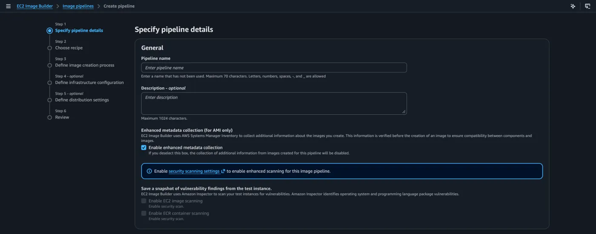

### Build schedule

**Schedule options:** İmaj alma işleminin nasıl tetikleneceğini seçtiğimiz kısımdır. Karşımıza üç seçenek çıkar:

- **Schedule builder:** Ekranda da seçili olan en pratik yöntemdir. İşlemi gün ve saat belirterek otomatikleştiririz. (Görseldeki ayara göre sistem; her hafta (Week), Cumartesi günü (Saturday), UTC saatiyle 14:00'te otomatik olarak çalışıp yeni bir imaj üretecektir).
- **cron expression:** İşlemin çalışma takvimini kod yazarak (cron formatında) çok daha detaylı ve karmaşık kurallarla belirlemek istersek bunu kullanırız.
- **Manual:** Otomasyonu bir takvime bağlamak yerine, sadece biz sisteme girip "Şimdi Çalıştır" butonuna bastığımızda imaj alınmasını istiyorsak bu seçeneği işaretleriz.

**Dependency update settings:** Sistemin belirlenen takvim geldiğinde nasıl davranacağını seçtiğimiz yerdir.

Ekranda seçili olan "Run pipeline based on schedule" seçeneği ile sistem, temel işletim sisteminde veya kurduğumuz programlarda bir güncelleme olup olmadığına bakmaksızın, takvime harfiyen uyar ve her hafta o saatte yeni bir imaj üretir.

**Auto-disable policy:** Maliyetleri ve sistem kaynaklarını koruyan harika bir güvenlik ayarıdır. Kurduğumuz otomasyon hattında bir şeyler ters giderse (örneğin yazdığımız bir kod hatalıysa ve imaj oluşturulamıyorsa), sistemin sürekli boş yere çalışıp hata vermesini engelleriz.

Ekranda bu sınır 5 olarak belirlenmiş. Yani sistem üst üste 5 kez başarısız olursa, birisi gelip hatayı çözene kadar bu Pipeline kendini otomatik olarak disable bırakacaktır.

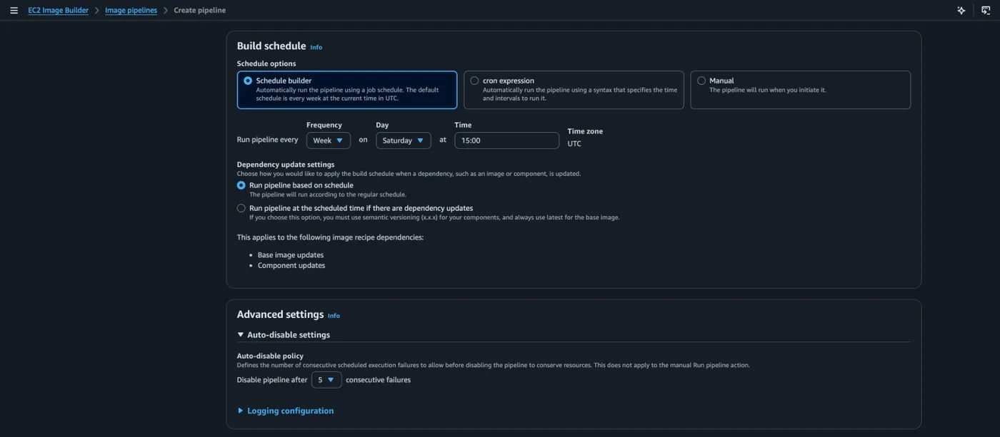

### Recipe (tarif)

- **Recipe configuration:** Burada "Create new recipe" seçeneğini işaretleyerek önceden kaydettiğimiz bir şablonu kullanmak yerine sıfırdan kendi tarifimizi oluşturacağımızı belirtiyoruz.
- **Image type:** Ne tür bir imaj üreteceğimizi seçtiğimiz yerdir. Biz standart bir sanal makine kalıbı istediğimiz için Amazon Machine Image (AMI) seçili. (Diğer seçenek olan Docker, konteyner altyapıları içindir).
- **Recipe details:** Tarifimize bir isim ve Versiyon (örneğin 1.0.0) veriyoruz. AWS'de tarifler sonradan değiştirilemediği için, yapılandırmada her değişiklik yaptığımızda bu versiyon numarasını artırarak ilerleriz.

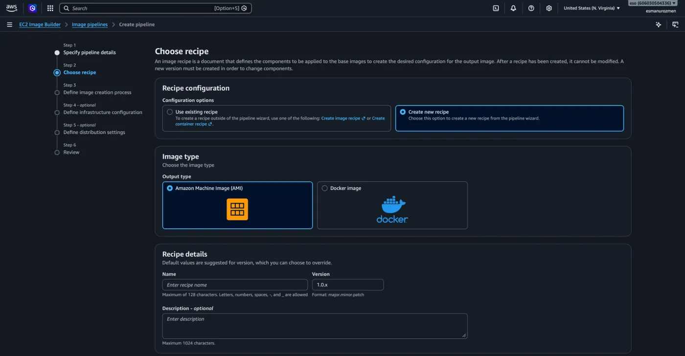

- **Select image:** Kalıbımızı hangi temelin üzerine inşa edeceğimizi seçtiğimiz kısımdır. "Select managed images" diyerek AWS'nin kendi yönettiği ve sunduğu güvenli imajları kullanacağımızı belirtiyoruz.
- **Image Operating System (OS):** Temel işletim sistemi olarak Amazon Linux seçilmiş. İhtiyaca göre buradan Ubuntu, Windows veya CentOS da seçilebilir.
- **Image origin:** "Quick start" diyerek AWS'nin kullanıma hazır olarak sunduğu, optimize edilmiş standart başlangıç kalıplarından birini seçiyoruz.

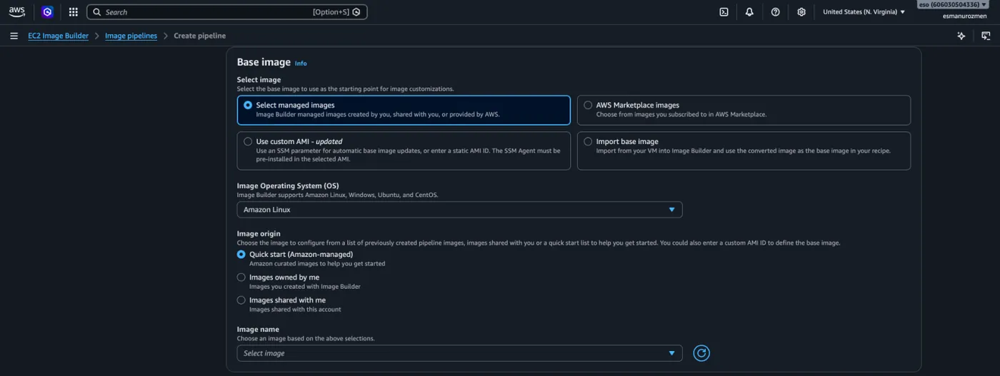

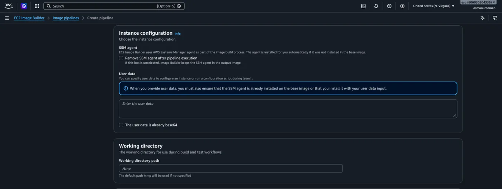

- **SSM agent:** AWS'nin imajı hazırlarken arka planda açtığı geçici makineye güvenli bir şekilde bağlanıp komutları (kurulumları) çalıştırabilmesi için gereken araçtır. İmaj bittikten sonra bu aracın yeni kalıbınızda yer almasını istemezseniz "Remove SSM agent" kutucuğunu işaretleyebilirsiniz.
- **User data:** Makine ilk ayağa kalkarken otomatik olarak çalışmasını istediğiniz özel başlangıç scriptleri varsa buraya yazarsınız.
- **Working directory:** AWS'nin kurulum yaparken indireceği dosyaları geçici olarak tutacağı ve çalıştıracağı sistem klasörüdür. Varsayılan olarak Linux'taki `/tmp` klasörü kullanılır.

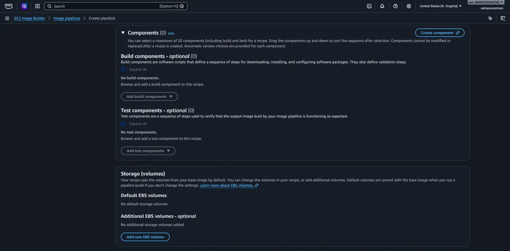

- **Build components:** İmajın içine tam olarak nelerin kurulacağını adım adım belirlediğimiz yerdir. Örneğin; "İşletim sistemini güncelle", "Şu yazılımı indir", "Güvenlik ayarlarını yap" gibi komut paketlerini buradan ekleriz.
- **Test components:** Kurulumlar bittikten sonra "Kurduğum programlar düzgün çalışıyor mu?" diye makineyi kontrol eden ufak doğrulama testlerini eklediğimiz kısımdır.
- **Storage (volumes):** Ürettiğimiz bu yeni AMI kalıbının diskinin kaç GB olacağını ve hangi tipte (örneğin gp3) çalışacağını ayarladığımız bölümdür. Temel imajın disk ayarları otomatik olarak buraya yansır ama istersek ek diskler de (Add new EBS volume) bağlayabiliriz.

**AMI watermarks:** İsteğe bağlı bir güvenlik ve takip adımıdır. Ürettiğimiz bu nihai imaja sistem üzerinden gizli bir filigran ekleriz. Böylece bu kalıp kopyalanıp başka yerlerde kullanılsa bile, kaynağının bizim oluşturduğumuz bu otomasyon hattı olduğunu kurumsal olarak rahatça takip edebiliriz.

### Image creation process

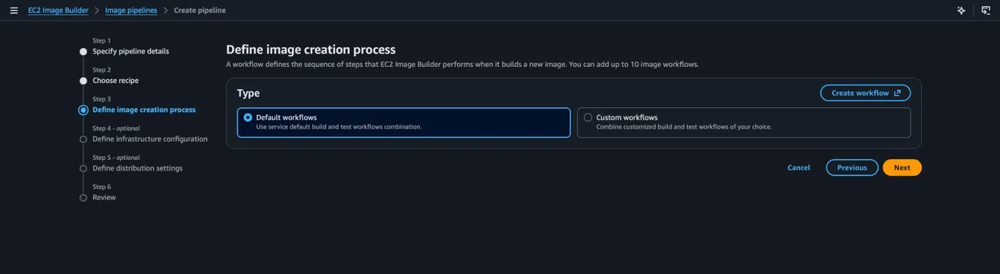

- **Type:** AWS'nin bu imajı üretirken işlemleri hangi sırayla yapacağını (workflow) belirlediğimiz kısımdır.
  - Ekranda Default workflows seçili. Yani AWS'ye "Standart derleme (build) ve test adımlarını kendi varsayılan sıranla yap" talimatını veriyoruz.
  - Eğer adımların sırasına tamamen kendimiz karar vermek isteseydik (örneğin önce şu testi yap, sonra bunu kur gibi) sağ taraftaki Custom workflows seçeneğini kullanabilirdik.

### Infrastructure configuration

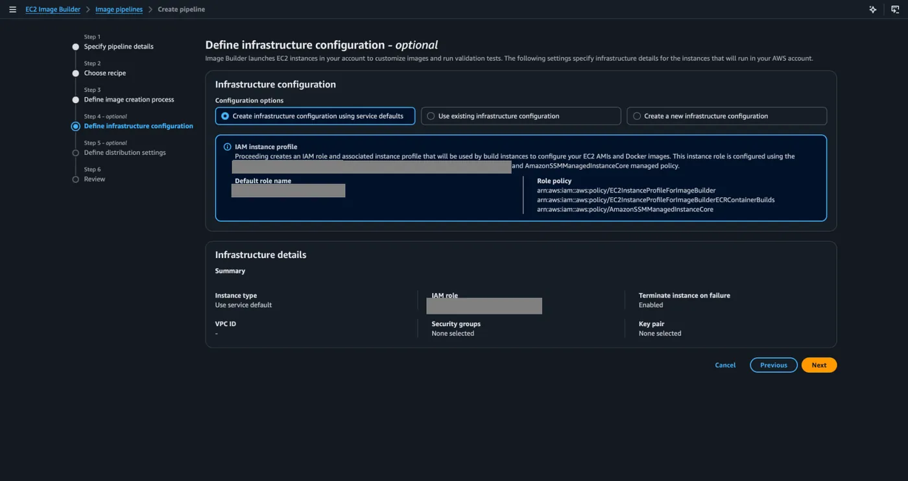

- **Configuration options:** AWS'nin imajı hazırlamak için arka planda açacağı o "geçici sanal makinenin" özelliklerini belirlediğimiz yerdir. Ekranda "Create infrastructure configuration using service defaults" seçili olduğu için sistemi AWS'nin kendi otomatik ayarlarına bırakıyoruz.
- **IAM instance profile:** O geçici makinenin içine program kurabilmesi ve AWS servisleriyle konuşabilmesi için bir kimliğe ihtiyacı vardır. AWS bu seçenekte makine için gereken IAM rollerini bizim yerimize otomatik olarak oluşturur ve tanımlar.
- **İsteğe Bağlı:** Eğer istersek alt kısımdaki ayarlardan bu geçici makinenin boyutunu (Instance type), hangi ağda (VPC) çalışacağını veya hangi ağ güvenlik kurallarına (Security groups) tabi olacağını manuel olarak da belirleyebilirdik.

### Distribution settings

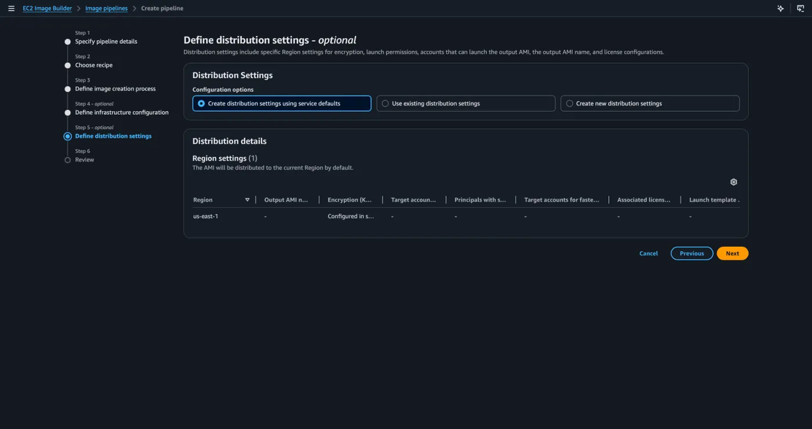

**Distribution Settings:** Her şey bitti, testler başarılı oldu ve imajımız üretildi. Peki bu yeni kalıp nereye gidecek? Bu ekranda imajın dağıtım kurallarını belirliyoruz.

**Region settings:** Yine varsayılan (service defaults) ayarları kullandığımız için, üretilen yeni AMI kalıbı sadece o an işlem yaptığımız AWS bölgesine (ekrandaki `us-east-1` bölgesine) kaydedilecektir.

**İsteğe Bağlı:** Eğer kapsamlı bir proje yönetiyorsak, gelişmiş ayarları kullanarak AWS'ye şunu diyebilirdik: "Ürettiğin bu imajı otomatik olarak Avrupa (Frankfurt) bölgesine de kopyala ve diğer ekiplerin kullandığı şu AWS hesaplarıyla da anında paylaş."
