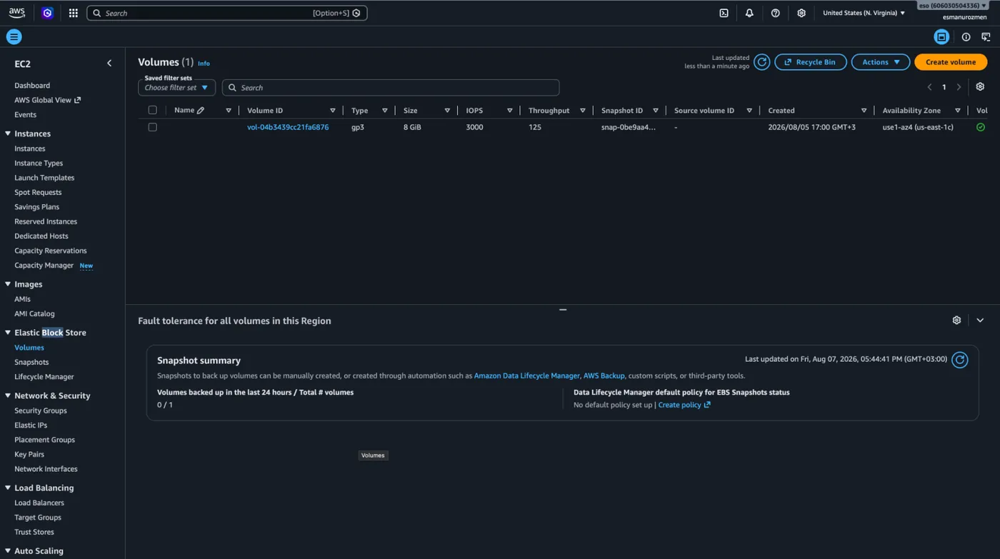
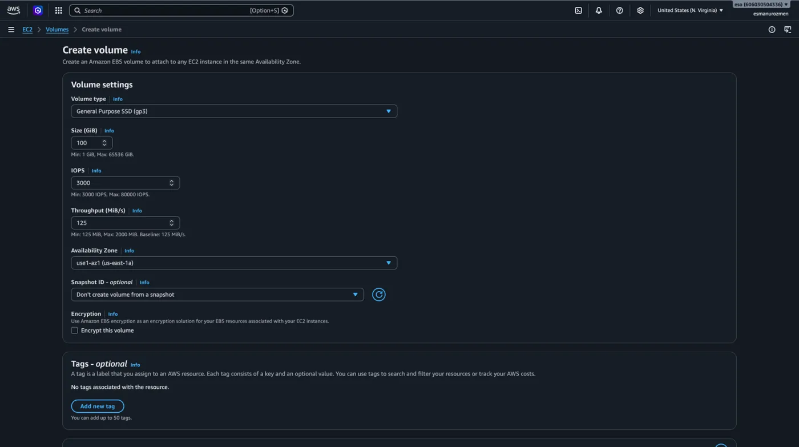
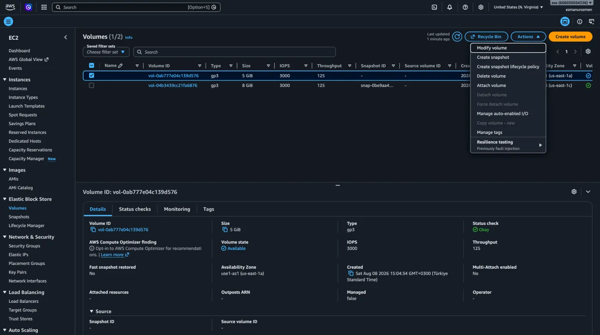
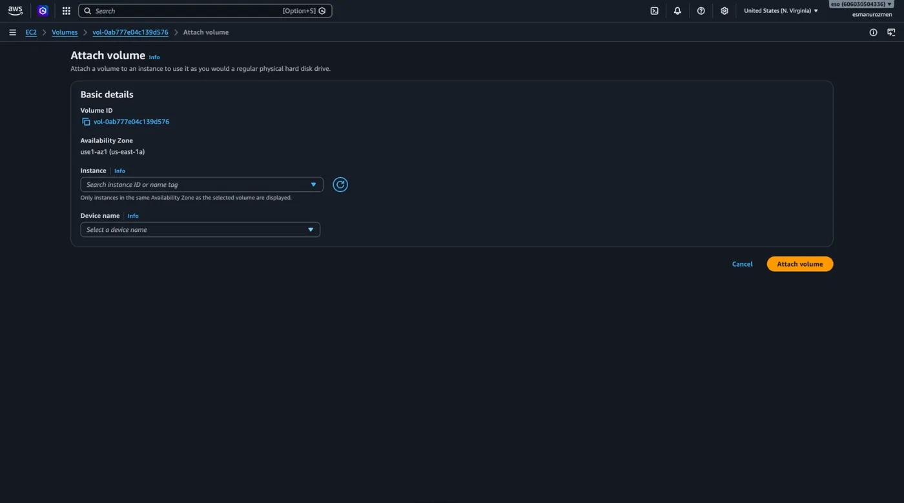
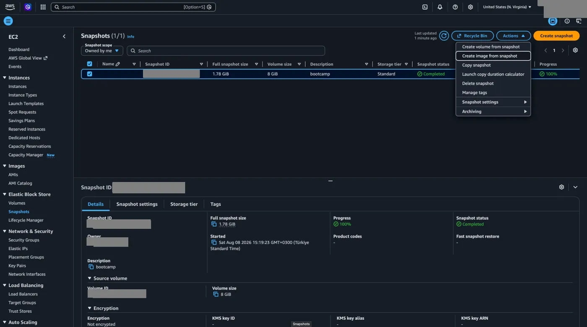
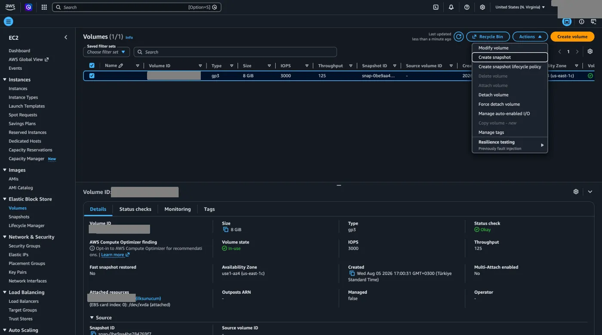

## Volume oluşturma

AWS üzerinden Elastic Block Store servisine EC2 altından ulaşabilir yeni volume'ler oluşturabiliriz.

- **Volume type:** İhtiyacımıza ve bütçemize en uygun disk teknolojisini, yani performans katmanını seçtiğimiz alandır. Ekranda gördüğünüz gibi genel amaçlı işlemler için harika bir fiyat/performans dengesi sunan gp3 modelini kullanıyoruz.
- **Size - GiB:** Yeni oluşturacağımız diskin toplam depolama kapasitesini gigabayt cinsinden belirlediğimiz kısımdır. İçine kuracağımız işletim sisteminin veya barındıracağımız verilerin büyüklüğüne göre buraya uygun bir alan girmemiz gerekiyor.
- **IOPS:** Diskimizin saniyede yapabileceği maksimum okuma/yazma işlemi sayısını belirleyerek tepki hızı sınırlarını çizdiğimiz yerdir. Yüksek trafikli uygulamalar veya veritabanları gibi saniyelik reaksiyonun önemli olduğu yoğun işlemler yapacaksak bu değeri artırabiliyoruz.
- **Throughput - MiB/s:** Saniyede ne kadar büyüklükte bir veri paketinin disk üzerinden aktarılabileceğini ayarladığımız bölümdür. Özellikle büyük dosyalarla veya hacimli veri analizleriyle çalışırken bu değerin yüksek olması aktarım hızımızı doğrudan etkiler.
- **Availability Zone:** Diskimizin AWS'nin hangi fiziksel veri merkezinde oluşturulacağını seçtiğimiz, mimari açıdan en kritik adımdır. Diskimizi EC2 makinemize sorunsuzca bağlayabilmemiz için, diskin makinemizle mutlaka aynı Availability Zone içinde bulunması gerekir.
- **Snapshot ID:** Daha önce yedeğini aldığımız bir disk varsa, yeni diski sıfırdan değil de o yedeğin içindeki verilerle başlatmak için kullandığımız alandır. Eğer sıfırdan tertemiz bir disk istiyorsak, ekrandaki gibi "Don't create volume from a snapshot" seçeneğinde bırakıp geçiyoruz.
- **Encryption:** Disk içindeki verilerimizin AWS tarafından arka planda otomatik olarak şifrelenip şifrelenmeyeceğine karar verdiğimiz güvenlik ayarıdır. Hassas veriler tutacaksak bu kutucuğu işaretlemek, olası yetkisiz erişimlere ve veri sızıntılarına karşı güçlü bir önlemdir.

## Volume'ü değiştirme ve makineye bağlama

Oluşturduğumuz volume özelliklerini **Actions** menüsü altından **Modify volume** diyerek değiştirebiliriz.

Actions menüsü altından yapabildiğimiz en önemli işlem **Attach volume** diyerek bu diski kullanacağımız makineyi seçiyoruz.

## Snapshot

Şimdi gelelim bir diğer başlığımız olan **Snapshots** kısmına. Adından da anlaşılacağı üzere bu işlem, diskimizin mevcut halinin bir anlık görüntüsünü çekerek yedeğini alma işlemidir. Daha sonra bu Snapshot'tan yeni bir Volume veya [AMI](/aws/ebs-ve-ami/ami-ve-image-builder/) oluşturabiliyoruz; yani aldığımız bu yedekten sıfır bir sanal makine veya disk türetebiliyoruz.

1. Bunu yapmak için öncelikle ilgili diskimizi seçerek **Create snapshot** diyoruz.
2. Ardından sol taraftaki **Elastic Block Store** menüsünden **Snapshots** başlığına gelip, oluşturduğumuz yedeği seçerek **Actions** altından **Create image from snapshot** seçeneğine tıklıyoruz.

   

   

:::caution
Snapshot alırken dikkat etmemiz gereken en kritik nokta, o esnada diske yeni bir verinin yazılmıyor olmasıdır. Veri kaybı veya dosya bozulması yaşamamak için işlem öncesinde ya sanal makinemizi kapatmalı ya da diski Detach ederek makineden güvenle ayırmalıyız.
:::
