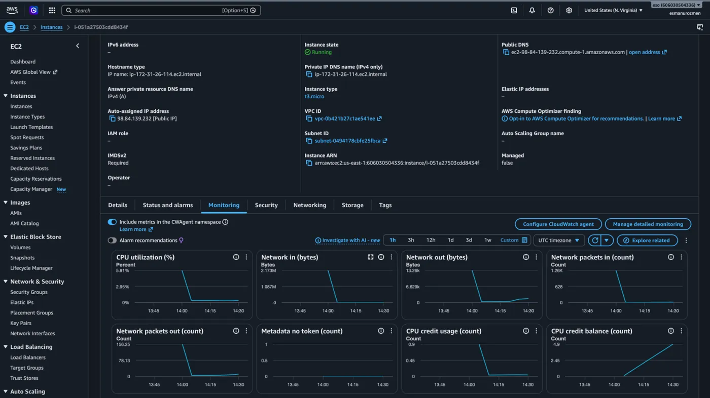
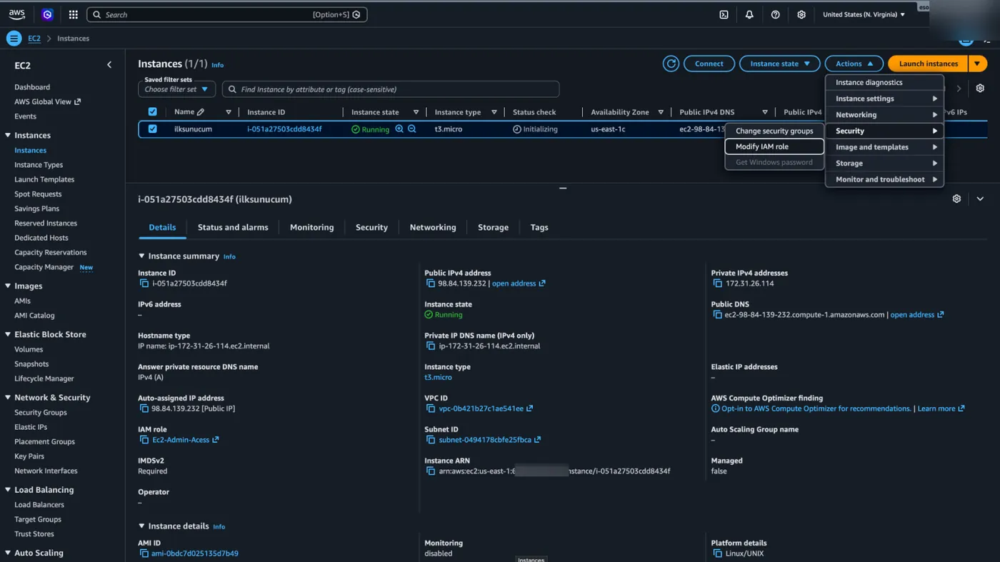
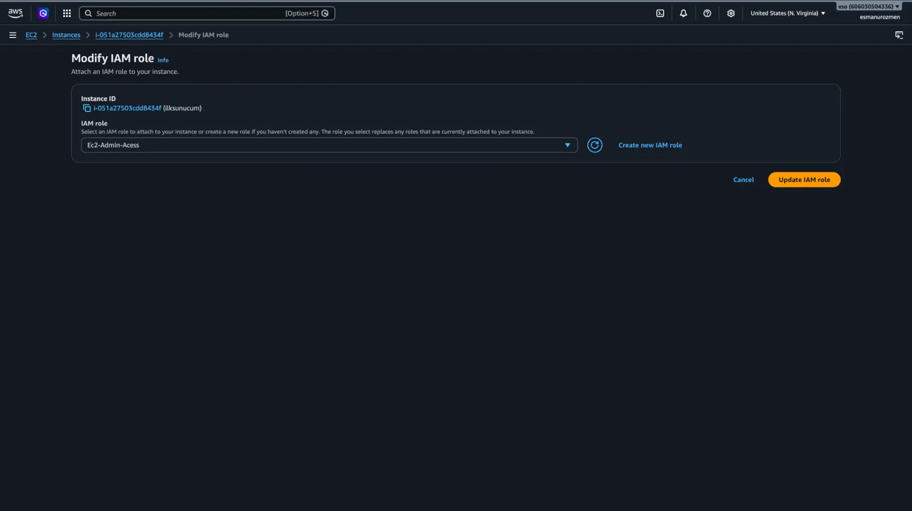
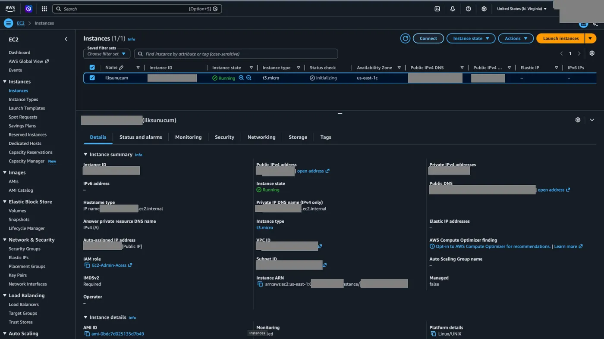
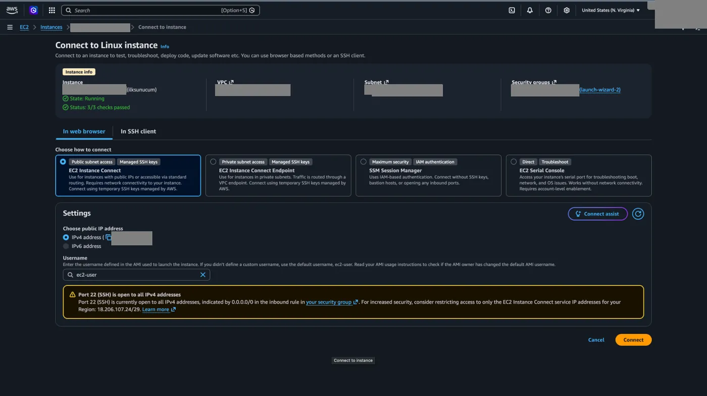
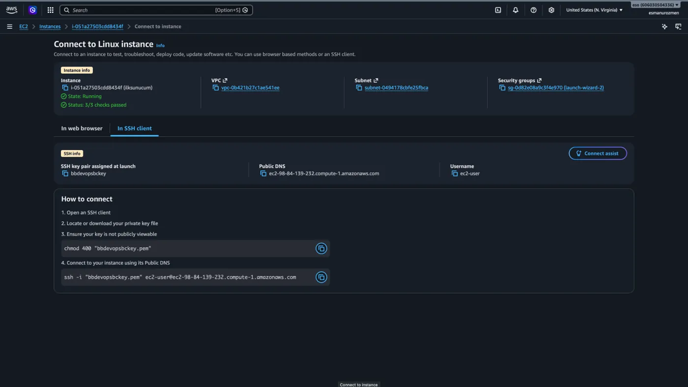
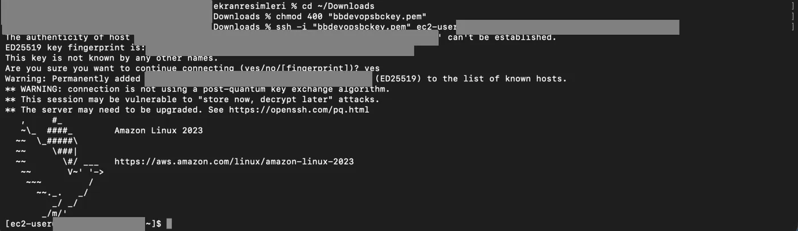
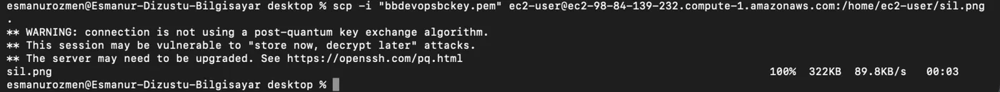

## Instance detayları

Sanal makinemizin **Instance ID**'sine tıklayarak hakkındaki detaylı bilgilere ulaşabiliriz.



## IAM rolü bağlama

Daha önce oluşturduğumuz [IAM role](/aws/iam/roller-ve-arn/) sanal makinemize bağlamak için:

1. **Actions** menüsü altından **Security** diyerek **Modify IAM role** seçeneğine tıklıyoruz.

   

2. Oluşturduğumuz role seçerek `Update IAM role` butonuna tıklıyoruz.

   

## Connect seçenekleri

Sanal makinemize bağlanmak için `Connect` butonuna tıklıyoruz.



- **EC2 Instance Connect:** Herhangi bir ekstra programa veya anahtar dosyasına ihtiyaç duymadan, doğrudan web tarayıcınız üzerinden AWS'nin sağladığı geçici anahtarlarla herkese açık makinenize saniyeler içinde bağlanmanızı sağlayan en pratik yöntemdir.
- **EC2 Instance Connect Endpoint:** İnternete doğrudan açık olmayan (özel ağ içindeki) makinelerinize, trafiği AWS içindeki güvenli bir köprüden (endpoint) geçirerek web üzerinden erişmenizi sağlar.
- **SSM Session Manager:** SSH anahtarlarına veya dışarıya açık portlara ihtiyaç bırakmayan, erişimi tamamen AWS kimlik ve yetki sistemiyle (IAM) yöneterek sunucunuza en yüksek güvenlik seviyesinde bağlanmanızı sağlayan profesyonel yöntemdir.
- **EC2 Serial Console:** Makinenizin internet bağlantısı tamamen kopsa veya işletim sistemi çökse de doğrudan donanım seviyesinden (seri port üzerinden) sisteme sızıp sorunları gidermenizi sağlayan acil durum müdahale yöntemidir.



## SSH ile bağlanma

**In SSH client** seçeneğiyle birlikte kendi terminal ekranlarımızdan bu sanal makineye bağlanmak için ekrandaki adımları uyguluyoruz.





```bash frame="terminal"
cd ~/Downloads
chmod 400 "ornek-key.pem"
ssh -i "ornek-key.pem" ec2-user@ec2-203-0-113-10.compute-1.amazonaws.com
```

```text title="Çıktı"
The authenticity of host 'ec2-203-0-113-10.compute-1.amazonaws.com (203.0.113.10)' can't be established.
ED25519 key fingerprint is: SHA256:...
This key is not known by any other names.
Are you sure you want to continue connecting (yes/no/[fingerprint])? yes
Warning: Permanently added 'ec2-203-0-113-10.compute-1.amazonaws.com' (ED25519) to the list of known hosts.
...
   ,     #_
   ~\_  ####_        Amazon Linux 2023
  ~~  \_#####\
  ~~     \###|
  ~~       \#/ ___   https://aws.amazon.com/linux/amazon-linux-2023
   ~~       V~' '->
    ~~~         /
      ~~._.   _/
         _/ _/
       _/m/'
```

Bir sunucuya SSH ile bağlanmak istediğimizde işlemlerimiz arka planda TCP 22. port üzerinden gerçekleşir. Bu yüzden sanal makinemizin güvenlik ayarlarında 22 numaralı portun bize açık olduğundan emin olmalıyız. SSH sadece sunucuyu yönetmemizi sağlamaz; çeşitli uygulamalar yardımıyla makinemize çok pratik ve güvenli bir şekilde dosya transferi yapmamıza da imkân verir.

## scp ile dosya transferi

Bağlandığımız sunucuya dosya göndermek için kullanacağımız komut:

```bash frame="terminal"
scp -i "anahtar_dosyasi.pem" gonderilecek_dosya.uzanti kullanici_adi@sunucu_ip_adresi:/hedef/klasor/yolu
```


Kendi bilgisayarımıza bir dosyayı çekmek istediğimizde ise şu komutu kullanırız:

```bash frame="terminal"
scp -i "anahtar_dosyasi.pem" kullanici_adi@sunucu_ip_adresi:/sunucudaki/dosyanin/tam/yolu /bilgisayarimizdaki/hedef/klasor
```



```bash frame="terminal"
scp -i "ornek-key.pem" ec2-user@ec2-203-0-113-10.compute-1.amazonaws.com:/home/ec2-user/sil.png .
```

```text title="Çıktı"
...
sil.png                                       100%  322KB  89.8KB/s   00:03
```

## SFTP

Dosya göndermenin daha gelişmiş bir yolu olan SFTP, tıpkı SCP gibi arka planda SSH altyapısını ve 22 numaralı portu kullanarak bilgisayarınla sunucu arasında güvenli dosya transferi yapmanı sağlayan bir protokoldür.

### SFTP ve SCP arasındaki fark nedir?

En basit tabirle; SCP bir "kurye", SFTP ise bir "dosya yöneticisi" (şube) gibidir.

- **SCP:** Tek seferlik, "at ve unut" tarzı bir işlemdir. Paketi (dosyayı) verirsin, tam adresi yazarsın, kurye dosyayı karşıya bırakıp bağlantıyı anında kapatır. Göndereceğin dosyanın ve hedefin tam yolunu ezbere bilmen gerekir.
- **SFTP:** Etkileşimli bir tünel açar. Sunucuya bağlandıktan sonra bağlantı açık kalır ve terminalin bir FTP programına dönüşür. Tıpkı kendi bilgisayarındaymışsın gibi sunucudaki klasörlerin içine girip çıkabilir, dosyaları listeleyip görebilir, silebilir ve istediğin zaman dosya çekip gönderebilirsin. İşin bitince bağlantıyı sen kapatırsın. (Ayrıca büyük dosyalarda bağlantı koparsa SFTP daha esnektir).

### 1. SFTP ile sunucuya bağlanma iskeleti

Önce komut satırından SFTP oturumunu başlatıp sunucuyla o güvenli köprüyü kurmamız gerekir. Mantık tamamen SSH'a benzer:

```bash frame="terminal"
sftp -i "anahtar_dosyasi.pem" kullanici_adi@sunucu_ip_adresi
```

Bu komutu yazıp Enter'a bastığında, terminalinin başındaki yazı `sftp>` olarak değişir. Bu, bağlantının başarıyla kurulduğu ve artık SFTP komutlarını dinlemeye hazır olduğu anlamına gelir.

### 2. Sunucuya dosya gönderme (upload) iskeleti

SFTP bağlantısının (yani `sftp>` ekranının) içindeyken, kendi bilgisayarından sunucuya dosya göndermek için `put` komutunu kullanırız.

```text
sftp> put /bilgisayarimdaki/dosyanin/yolu.uzanti /sunucudaki/hedef/klasor
```

Pratik Örnek: Terminali masaüstünde açtığını varsayalım. Sadece şu komutla masaüstündeki resmi sunucuya yollayabilirsin: `sftp> put sil.png`

### 3. Sunucudan dosya çekme (download) iskeleti

Sunucudaki bir dosyayı alıp kendi bilgisayarına indirmek için ise `get` komutunu kullanırız.

```text
sftp> get /sunucudaki/dosyanin/tam/yolu.uzanti /bilgisayarimizdaki/hedef/klasor
```

Pratik Örnek: Sunucunun içindeyken gördüğün bir dosyayı hemen kendi bilgisayarına (masaüstüne) indirmek için: `sftp> get rapor.txt`

### SFTP'de hayat kurtaran "gezinme" komutları

SFTP'nin en büyük avantajı sunucuda gezinebilmektir. Aşağıdaki komutlar sık kullanılır:

- `ls`: Sunucunun içindeki dosyaları listeler. Görmeden işlem yapmamış oluruz.
- `lls`: Kendi bilgisayarımızdaki dosyaları listeler. (Başına L harfi gelince Local anlamına gelir).
- `cd klasor_adi`: Sunucunun içinde başka bir klasöre girmemizi sağlar.
- `lcd klasor_adi`: Kendi bilgisayarımızda başka bir klasöre geçmeyi sağlar.
- `exit`: Dosya transferleriyle işimiz bittiğinde güvenli bağlantıyı kapatıp normal Mac terminaline dönmeyi sağlar.
