Diğer başlıkların ayrıntısına girmeden önce, gelin hep birlikte bir sanal makine oluşturma adımlarını detaylıca inceleyelim. Bunun için sol menüdeki **Instances** başlığına gidiyor ve açılan ekrandaki `Launch instances` butonuna tıklayarak ilk adımımızı atıyoruz.

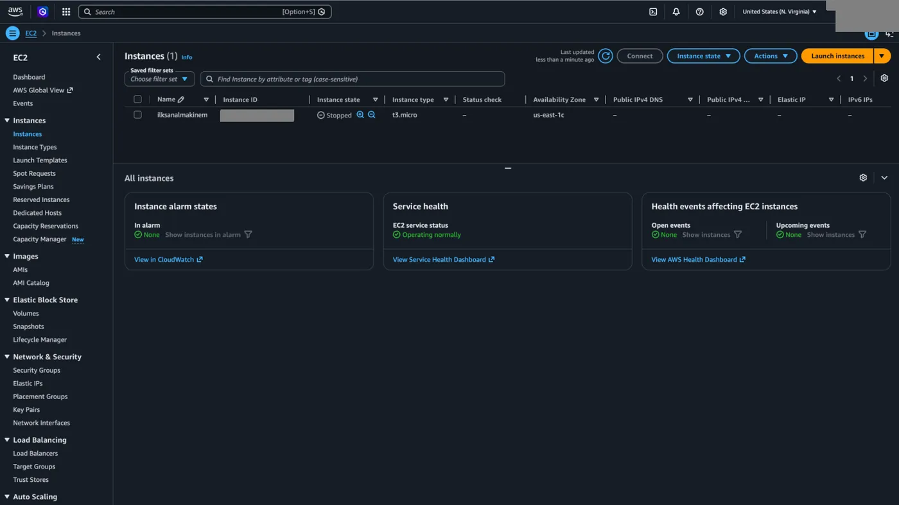

## Name and tags

EC2 oluşturmak için ilk adım ona bir isim vermektir. Ancak burada vereceğimiz isim S3 için yaptığımız isimlendirmeden farklı olarak özelleşmiş bir isim vermek yerine tag oluşturmuş oluyoruz. Bunu belirtmemizin sebebi buraya yazdığımız isim üzerinden herhangi bir etkileşim kuramayışımızdır.

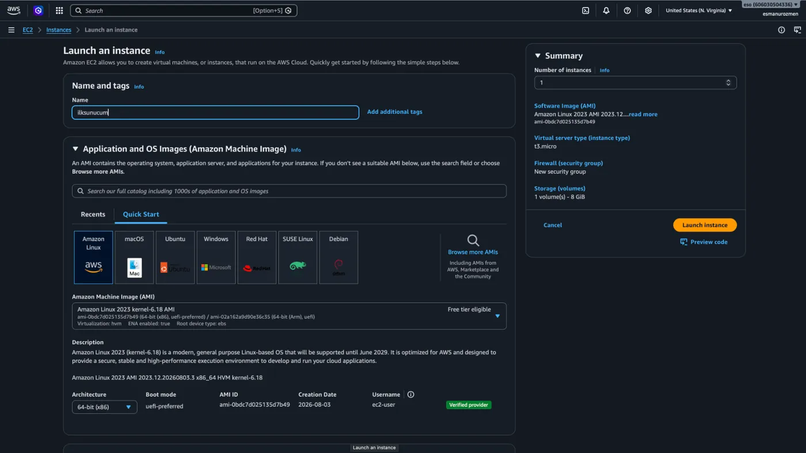

İsteğe bağlı olarak ilave tag da ekleyebiliriz. Bunun için isim yazdığımız kutucuğun yanındaki `Add additional tags` yazısına tıklayarak açılan ekranda istediğimiz **Key** ve **Value** isimlerini gireriz. Bu makineye bağladığımız diğer objelere de bu tagı eklemek istersek **Resource types** başlığı altından bunu seçebiliriz.

Ekranın sağında bulunan **Number of instances** kısmından seçtiğimiz özelliklerde kaç tane sanal makine oluşturacağımızı yazabiliriz. Hemen altından da seçtiğimiz özelliklerin özetini görebiliyoruz.

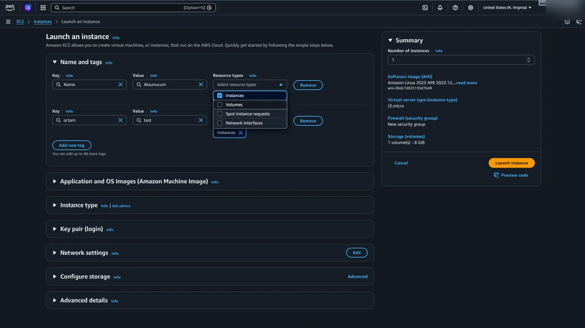

## Application and OS Images (AMI)

Bulut dediğimizde aklımıza genellikle soyut bir kavram gelse de, EC2 servisinde oluşturduğumuz her sanal makine aslında AWS'nin devasa veri merkezlerindeki fiziksel bir sunucu üzerinde çalışır. Siz "Oluştur" butonuna bastığınız an, AWS kendi makine parkını tarar, boş kapasitesi olan uygun bir donanımı bulur ve sanal makinenizi bu fiziksel sunucunun üzerinde ayağa kaldırır.

Peki bu boş donanımın içinde tam olarak ne çalışacak? Hangi işletim sistemi kurulacak veya başlangıçta hangi programlar yer alacak?

İşte tam bu noktada karşımıza **Application and OS Images**, yani sektördeki bilinen adıyla **AMI (Amazon Machine Image)** kavramı çıkıyor. AMI'yi, sanal makinenizin altyapısını oluşturan bir "ana şablon" olarak düşünebilirsiniz.

AWS bize başlangıç için içinde sadece işletim sistemi (Linux, Windows vb.) bulunan hazır şablonlar sunar. Ancak bu işin asıl avantajı kendi özel imajımızı yaratabilmemizdir. Diyelim ki standart bir sanal makine açtınız, içine projeniz için gereken tüm yazılımları kurdunuz, güncellemeleri tamamladınız ve sistemi tam ihtiyacınız olan yapılandırmaya getirdiniz. Ardından bu makineyi durduruyor ve tam o anki güncel halinin bir kopyasını alıyorsunuz. Tebrikler, artık tamamen size özel bir AMI'niz var.

İleride yeni bir makineye ihtiyacınız olduğunda tüm bu kurulum adımlarını sıfırdan yapmakla uğraşmazsınız. Kendi hazırladığınız bu imajı kullanırsınız ve AWS, tıpkı bir fotokopi makinesi gibi, seçtiğiniz tüm özelliklerle donatılmış yeni sanal makinenizi saniyeler içinde sizin için klonlar. Aşağıdaki görselde `Browse more AMIs` butonuna tıklayarak hazır veya kendi oluşturduğumuz AMI'lere ulaşabiliriz.

Biz şimdilik Amazon Linux işletim sistemini seçerek devam ediyoruz.

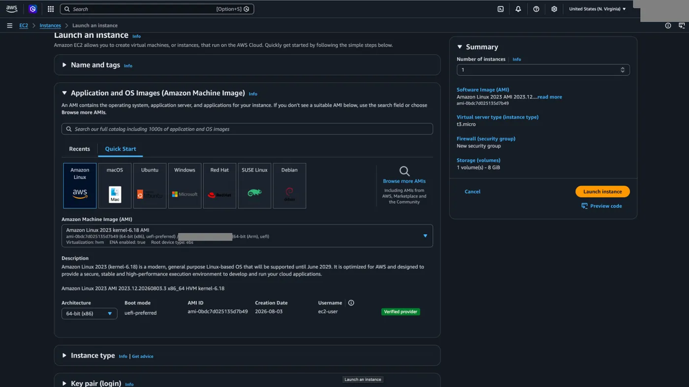

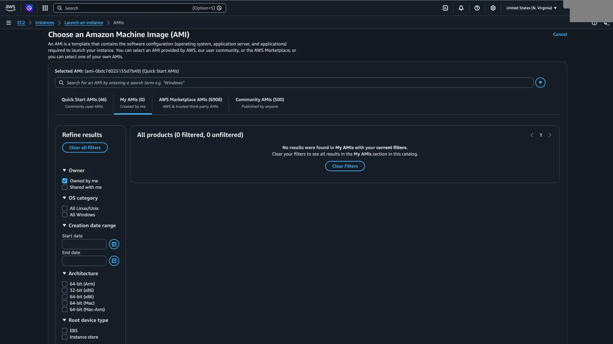

## Instance type

Ardından **Instance type** kısmından ihtiyacımıza göre sanal makinemizin tipini seçiyoruz.

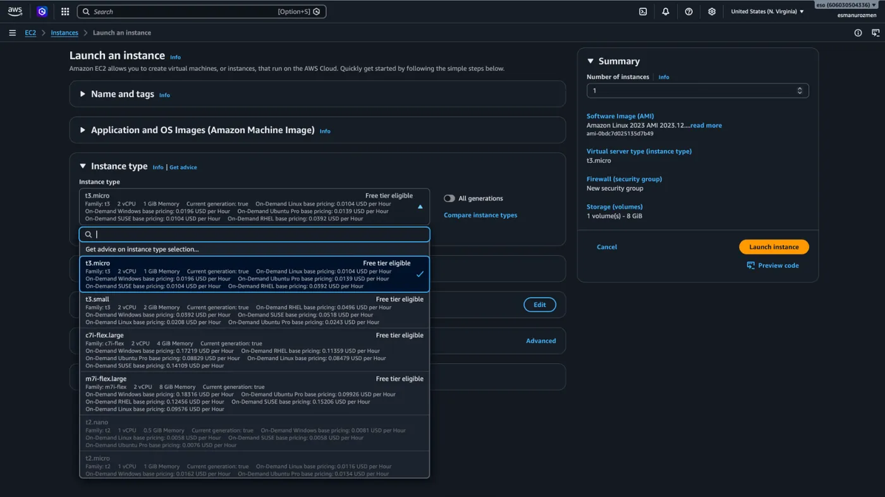

## Key pair (login)

Artık makinemizin temel özelliklerini belirlediğimize göre, bağlantı güvenliğimizi sağlayacak olan Key Pair adımına geçebiliriz. Sanal makinelerimize klasik kullanıcı adı ve parolalarla bağlanmak yerine, şifre çalınma riskini ortadan kaldıran çok daha güvenli bir yöntem olan Key Pair yapısını birlikte oluşturalım.

1. Öncelikle `Create new key pair` yazan yere tıklıyoruz.

   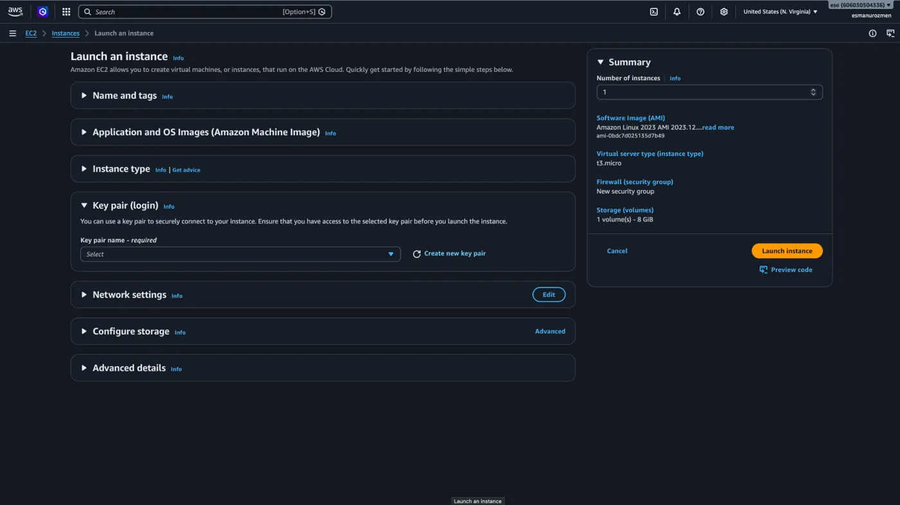

2. Açılan pencerede key pair için bir isim belirliyoruz.
3. Ve aşağıdaki seçenekleri seçerek `Create key pair` butonuna tıklıyoruz.

   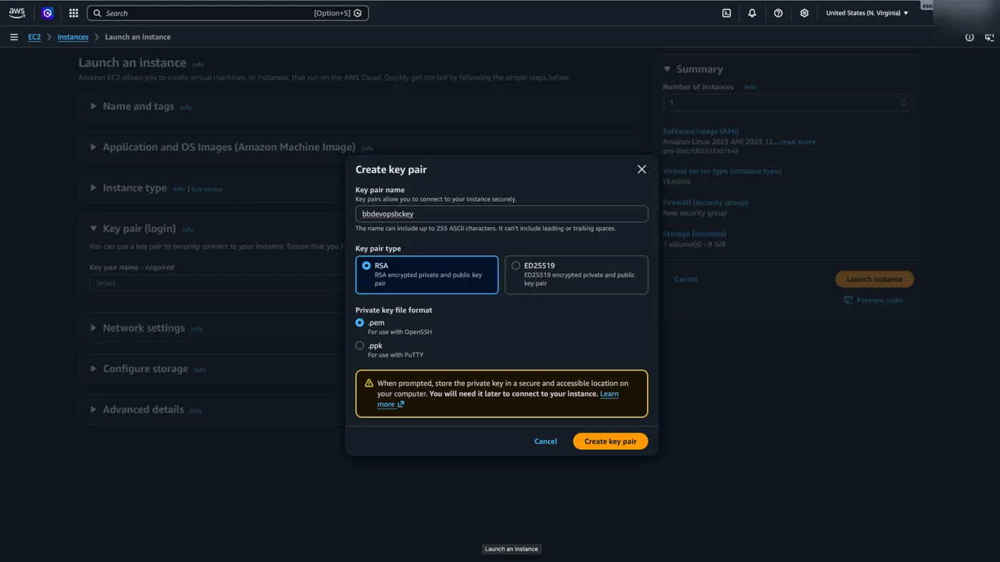

## Configure storage

Hangi tarzda kaç GB bir disk oluşturmak istediğimizi **Configure storage** başlığı altından belirliyoruz. Sanal makinemizin işletim sisteminin kurulu olduğu yer bu disk olacak.

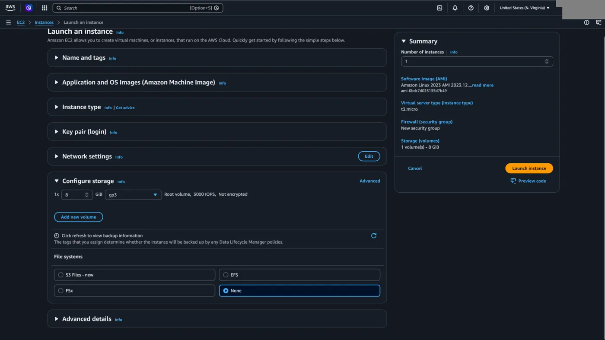

## Network settings

**Network settings** başlığı altından sanal makinemize dış dünyadan herkesin erişebilmesi için aşağıdaki seçimleri yapıyoruz. Network ile ilgili konumuzda buradaki ayarların ne anlama geldiğini daha ayrıntılı öğreneceğiz.

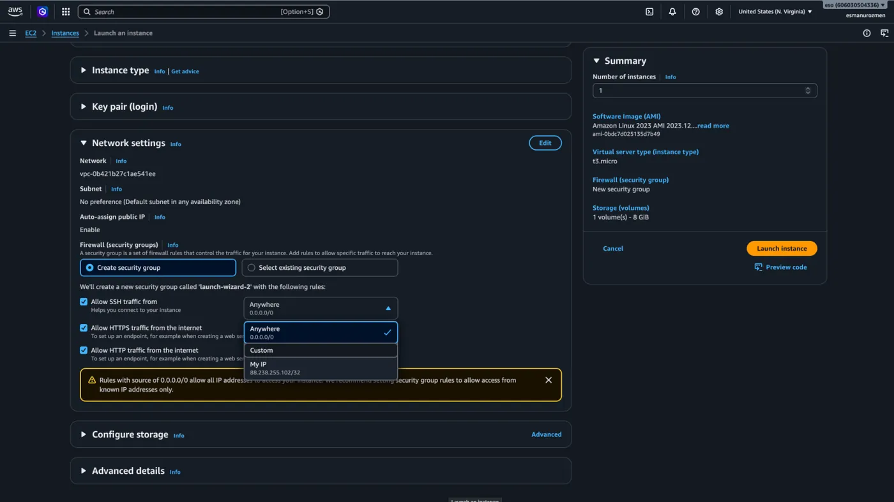

## Advanced details

Son olarak **Advanced details** başlığı altındaki ayarları varsayılan olarak bırakıyoruz. Ancak ne anlama geldiklerini açıklayalım.

- **Domain join directory:** Kurumsal ağlarda sıkça kullanılan Microsoft Active Directory yapısına sanal makinemizi otomatik olarak dahil etmemizi sağlar. Bu sayede şirketinizin mevcut kullanıcı hesapları ve yetkilendirme kurallarıyla sunucuya sorunsuzca giriş yapabilirsiniz.
- **IAM instance profile:** Sanal makinemize AWS ekosistemi içinde bir "kimlik kartı" atadığımız kısımdır. Bu profil sayesinde sunucumuz, (örneğin S3'ten dosya okumak veya veritabanına yazmak gibi) diğer AWS servislerine manuel şifre girmesine gerek kalmadan, güvenli bir şekilde erişim izni kazanır.
- **Hostname type & DNS Hostname:** Makinenizin iç ağ üzerindeki adını ve bu adın IP adresleriyle nasıl eşleştirileceğini belirlediğimiz ayarlardır. Sunucunuza karmaşık IP numaraları yerine daha anlaşılır ve yönetilebilir isimlerle iletişim kurmasını mümkün kılar.
- **Instance auto-recovery:** Donanımsal bir arıza durumunda AWS'nin sanal makinenizi otomatik olarak başka bir sağlıklı fiziksel donanıma taşıyıp yeniden başlatmasını sağlar. Bu sayede altyapısal krizlerden minimum kesintiyle ve müdahaleye gerek kalmadan kurtulursunuz.
- **Shutdown behavior:** Makinenin içinden "kapat" komutu verdiğinizde makinenin sadece durdurulmasını (Stop) veya tamamen silinmesini seçtiğiniz ayardır. Yanlışlıkla veri kaybetmemek için genellikle varsayılan ayar olan "Stop" olarak bırakılır.
- **Stop - Hibernate behavior:** Tıpkı bilgisayarınızın kapağını kapattığınızdaki gibi, makineyi durdurduğunuzda RAM'deki anlık verilerin diske kaydedilmesini sağlar. Böylece makineyi tekrar açtığınızda uygulamalarınız sıfırdan başlamak yerine kaldığı yerden çok daha hızlı bir şekilde çalışmaya devam eder.
- **Termination protection:** Dalgınlıkla veya yanlış bir tıklamayla sunucunuzun kazara tamamen silinmesini engeller. Kritik iş yükleri barındıran makineler için kesinlikle açılması gereken çok önemli bir emniyet kemeridir.
- **Stop protection:** Tıpkı silinme koruması gibi, sunucunun kazara "Stop" konumuna getirilmesini engeller. Sürekli çalışması gereken ve anlık kesintilere tahammülü olmayan canlı ortam makineleri için tercih edilir.
- **Detailed CloudWatch monitoring:** AWS'nin standart olarak sunduğu 5 dakikada bir yapılan metrik ölçümlerini 1 dakikalık aralıklara indirir. Sistem performansınızı anlık olarak detaylı incelemek isterseniz bu ayarı ek bir ücret karşılığında açabilirsiniz.
- **Credit specification:** T serisi makinelerin işlemci kapasitesi dolduğunda ekstra performans sergilemeye devam edip etmeyeceğini belirler. "Unlimited" seçerseniz makineniz darboğaza girmez ancak aştığınız limit kadar faturanıza ekstra ücret yansır.

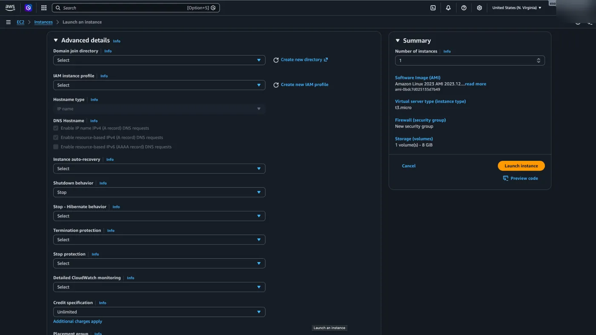

- **Placement group:** Birden fazla sanal makine kuruyorsanız, bu makinelerin AWS veri merkezinde fiziksel olarak nasıl konumlandırılacağını seçtiğiniz kısımdır. Makineleri ağ hızını artırmak için birbirine çok yakın veya donanım arızası riskini dağıtmak için farklı donanımlara yerleştirebilirsiniz.
- **EBS-optimized instance:** Sanal makineniz ile bağlı olduğu depolama diski arasında özel ve ayrılmış bir veri yolu tahsis eder. Veri okuma/yazma hızının kritik olduğu yoğun disk işlemlerinde performansı garanti altına alır.
- **Instance bandwidth configuration:** Sanal makinenizin ağ trafiği için özel bir bant genişliği limiti veya garantisi belirlemenizi sağlar. Özellikle yüksek veri transferi gerektiren uygulamalarda ağ darboğazlarını önlemek için bu ayarı yapılandırabilirsiniz.
- **Purchasing option:** Sanal makinenizi hangi ödeme modeliyle alacağınızı seçtiğiniz alandır. Daha önce bahsettiğimiz borsa mantığındaki "Spot" makineleri buradan talep edebilir, hiçbirini seçmezseniz standart kullandığın kadar öde modelinden devam edebilirsiniz.
- **Capacity reservation:** Daha önceden AWS'de belirli bir bölge için donanım kapasitesi ayırttıysanız, bu makineyi o ayrılmış kapasitenin içine dahil etmenizi sağlar. Böylece "uygun donanım kalmadı" hatası alma riskini sıfıra indirerek makinenizi garantili bir şekilde ayağa kaldırırsınız.
- **Tenancy:** Makinenizin AWS veri merkezinde diğer müşterilerle aynı fiziksel donanımı paylaşıp paylaşmayacağını belirler. Eğer önceki bölümlerde bahsettiğimiz gibi güvenlik veya lisans nedenleriyle donanımın tamamen size ve şirketinize özel olmasını istiyorsanız buradan "Dedicated" seçeneğini işaretleyebilirsiniz.
- **RAM disk ID & Kernel ID:** Bu ayarlar, makinenizin işletim sistemi çekirdeğini veya başlangıç RAM diskini manuel olarak değiştirmenize olanak tanır. Güncel AMI'lerde bu ayarlar imajın içine zaten gömülü olduğu için, çok eski ve spesifik sistemlerle uyumluluk gerektiren özel senaryolar dışında genellikle boş bırakılır.
- **Nitro Enclave:** Sunucunuzun içinde dış dünyadan ve hatta sunucu yöneticilerinden bile tamamen izole edilmiş, ekstra güvenli bir "kasa" oluşturmanızı sağlar. Sağlık verileri veya finansal şifreleme anahtarları gibi son derece hassas bilgileri işleyen uygulamalar için üst düzey bir donanım yalıtımı sunar.
- **License configurations:** Şirketinize ait mevcut Windows veya SQL Server gibi yazılım lisanslarınızı (BYOL - Kendi Lisansını Getir) bu sanal makineyle ilişkilendirmenizi sağlar. Böylece bulutta ekstra lisans ücreti ödemeden yasal olarak kendi haklarınızı kullanmaya devam edebilirsiniz.
- **CPU options:** Sanal makinenizin sahip olacağı çekirdek sayısını veya işlemci iş parçacığı özelliklerini manuel olarak kısmanıza (kapatmanıza) olanak tanır. Özellikle işlemci çekirdek sayısına göre ücretlendirilen pahalı yazılım lisanslarından tasarruf etmek istediğinizde bütçenizi koruyan bir özelliktir.

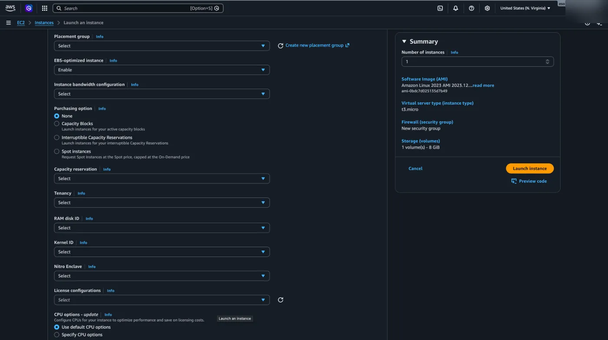

- **Nested virtualization:** Sanal makinenizin içinde başka sanal makineler (örneğin Hyper-V veya KVM) çalıştırmanıza olanak tanıyan gelişmiş bir özelliktir. Kendi sanal laboratuvarlarınızı test etmek için harikadır, ancak her EC2 makine tipinde desteklenmez.
- **Metadata accessible & Metadata version:** Makinenizin içinden IP adresi veya ID'si gibi AWS kimlik bilgilerine ulaşmasını sağlar. Bunun için `Enabled` olarak seçmemiz gerekir. Metadata version kısmını "V2 only" olarak seçmek, ekstra bir oturum anahtarı zorunluluğu getirerek sunucunuzu olası güvenlik açıklarına karşı çok daha korunaklı hale getirir.
- **Metadata response hop limit:** Makine içindeki kimlik (metadata) isteklerinin ağ üzerinde en fazla kaç duraktan (router/hop) geçebileceğini belirler. Eğer sunucunuzun içinde Docker gibi konteyner yapıları çalıştıracaksanız, ağ iletişiminin kesilmemesi için bu sayıyı yükseltmeniz gerekir.
- **Allow tags in metadata:** Önceki adımlarda makineye atadığımız o meşhur "Additional Tags" verilerinin, doğrudan makinenin içinden komut satırıyla da okunabilmesini sağlar.
- **User data:** Sanal makineniz hayatında ilk kez ayağa kalkarken arka planda otomatik olarak çalıştırılmasını istediğiniz komutları yazdığınız hayat kurtarıcı alandır. Örneğin; sunucu açılır açılmaz bir web servisi kurdurmak veya sistem güncellemelerini başlatmak istiyorsanız bash komutlarınızı buraya yapıştırmanız yeterlidir. Sizi aynı işlemleri tekrar tekrar elle yapma zahmetinden kurtarır.

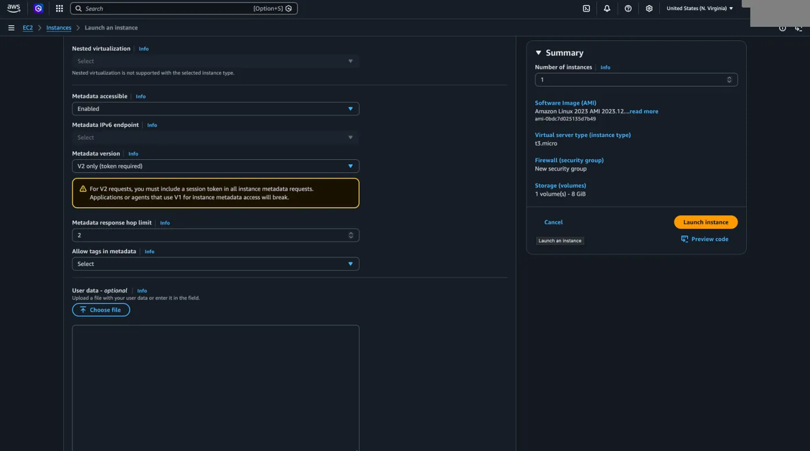

### User data script'i

**User data - optional** başlığı altındaki boşluğa aşağıdaki scripti yazıyoruz. Anlamlarıyla birlikte aşağıdaki görselden ulaşabilirsiniz.

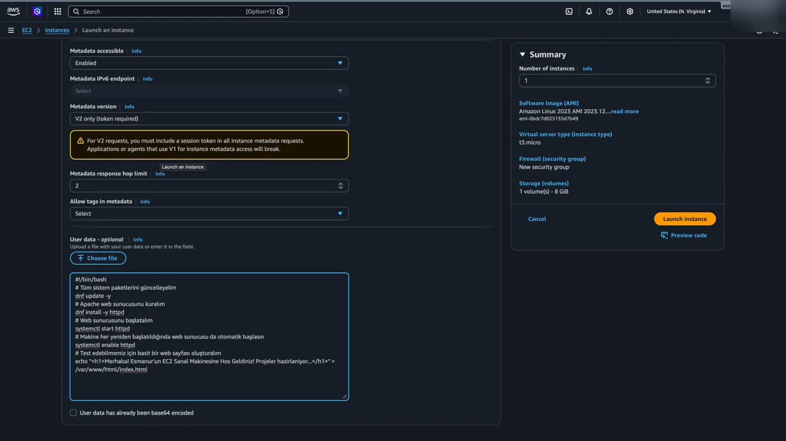

```bash title="user-data.sh"
#!/bin/bash
# Tüm sistem paketlerini güncelleyelim
dnf update -y
# Apache web sunucusunu kuralım
dnf install -y httpd
# Web sunucusunu başlatalım
systemctl start httpd
# Makine her yeniden başlatıldığında web sunucusu da otomatik başlasın
systemctl enable httpd
# Test edebilmemiz için basit bir web sayfası oluşturalım
echo "<h1>Merhaba! Ornek EC2 Sanal Makinesine Hos Geldiniz! Projeler hazirlaniyor...</h1>" > /var/www/html/index.html
```

## Launch instance

Yaptığımız bu son ayarla birlikte `Launch instance` butonuna tıklayarak ilk sanal makinemizi oluşturuyoruz.

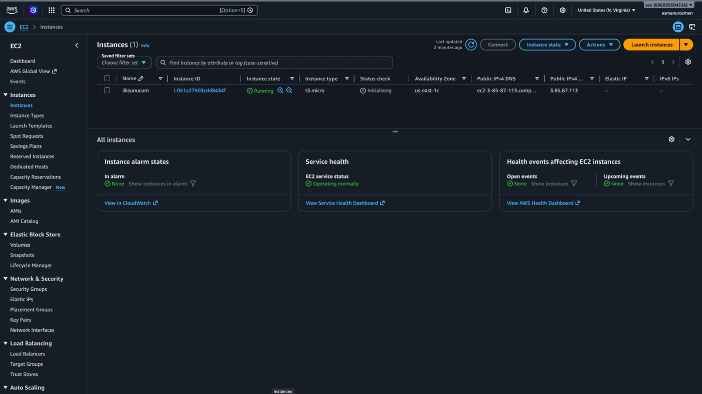
