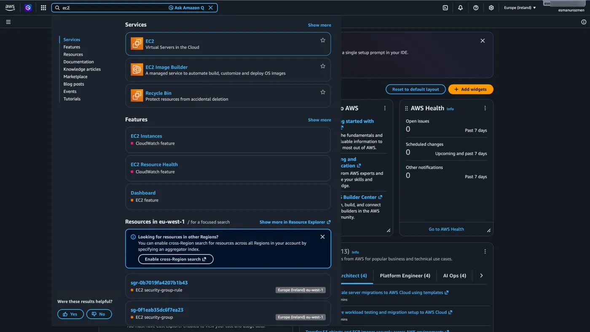
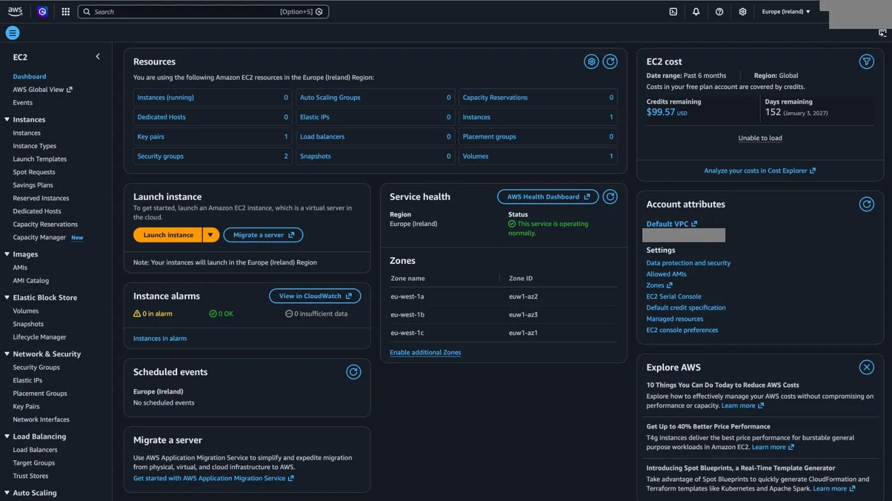
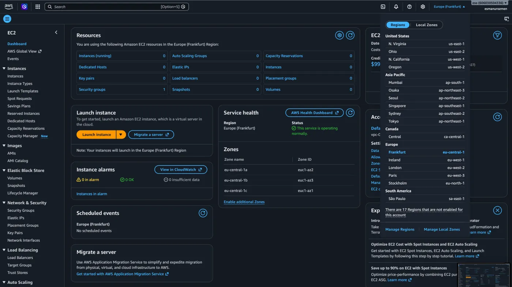
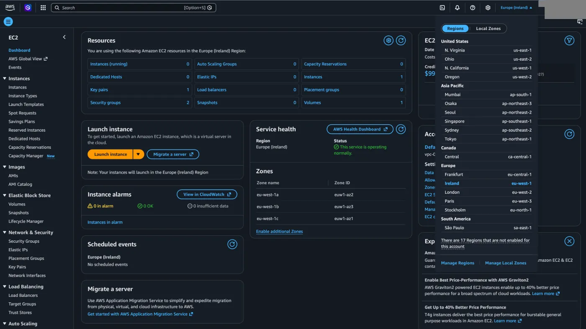
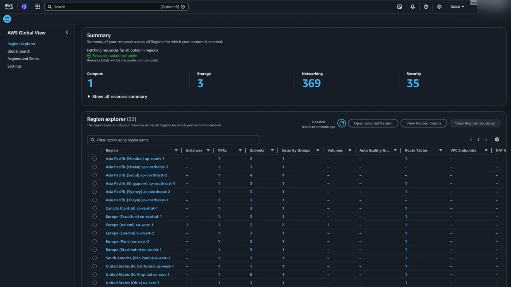
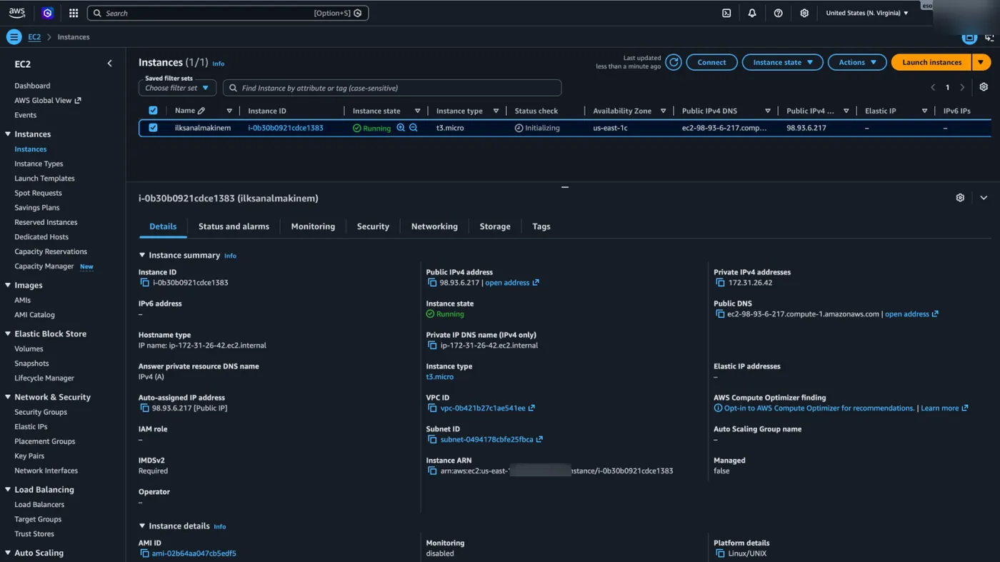
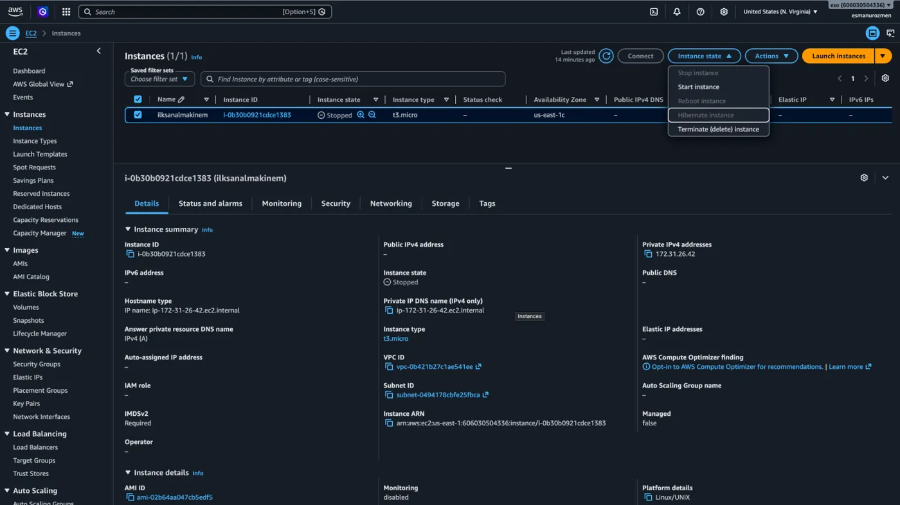
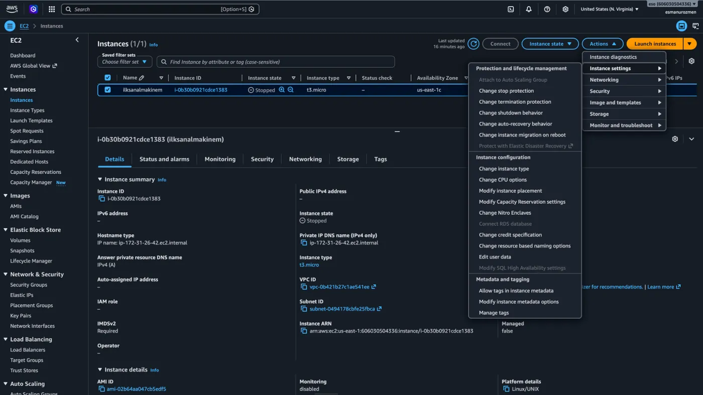
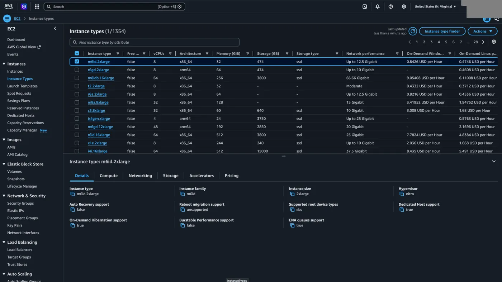
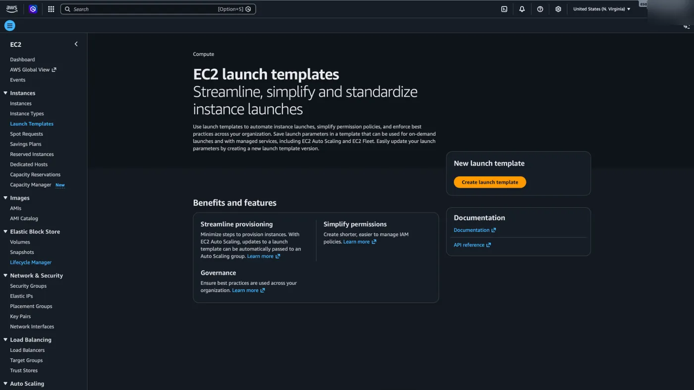

Teori kısmını geride bırakıp AWS ekranlarımızdan EC2 öğrenmeye geçebiliriz. Arama kısmına `EC2` yazarak ilk sıradaki seçeneğe tıklayalım.

## Dashboard

İlk öğreneceğimiz **Dashboard** sayfası. **Resources** kısmında tüm sanal makineleri ve ayrıca çalışmakta olan sanal makineleri, oluşturmuş olduğumuz volume'leri, kısaca oluşturduğumuz EC2 kaynaklarıyla ilgili temel bilgilere erişebiliriz. Hemen altında **Service health** menüsünden regionlar ile ilgili bir servis sıkıntısı varsa onlara ulaşabiliriz. Service health menüsünün solundan da yeni bir sanal makine oluşturmak için `Launch instances` butonuna tıklayabiliriz.

## Bölge seçimi ve AWS Global View

Farklı bölgelerde oluşturduğumuz sanal makineleri görmek için sağ üstten seçerek görebiliriz.

Farklı bölgelerdeki tüm makineleri tek bir ekranda görmek için ise soldaki menüden **AWS Global View** seçeneğine tıklıyoruz.

## Instances

Şimdi en çok kullanacağımız menü olan **Instances** başlığı altındakileri inceleyelim. Öncelikle Instances başlığına bakalım. Burada sanal makinelerimizi listelediğimiz ekran bulunur. Yanındaki kutucuktan seçerek aşağıdaki gibi sanal makinemiz hakkındaki tüm bilgilere erişebiliriz. AWS üzerindeki her EC2 makinenin unique bir **Instance ID**'si vardır.

Sanal makinemizin başlatma, durdurma gibi özelliklerini **Instance state** butonundan kontrol edebiliriz.

Hemen yanında bulunan **Actions** butonundan ise sanal makinemizin değiştirilmesi gereken özellikler varsa onları ayarlayabiliriz.

## Instance Types

**Instance Types** başlığından da anlaşılacağı üzere sanal makinelerimizin tiplerini listeleyebileceğimiz kısım vardır. İstediğimizi seçerek detaylarına aşağıdaki gibi ulaşabiliriz.

## Launch Templates

Sürekli aynı özelliklere sahip sanal makineler oluşturmanız gerekiyorsa ve bu süreci hızlandıracak bir kısayol arıyorsanız, [Launch Templates](/aws/ec2/launch-template/) başlığı altındaki `Create launch template` butonuna tıklayarak kendi şablonlarınızı hazırlayabilirsiniz.

