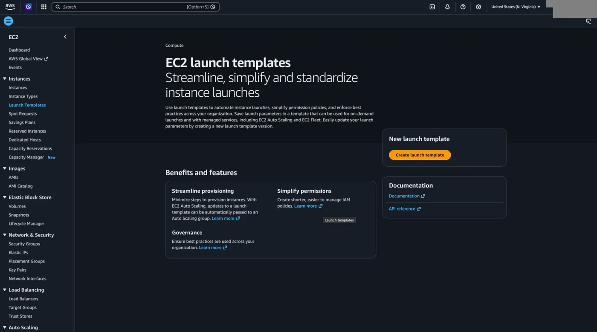
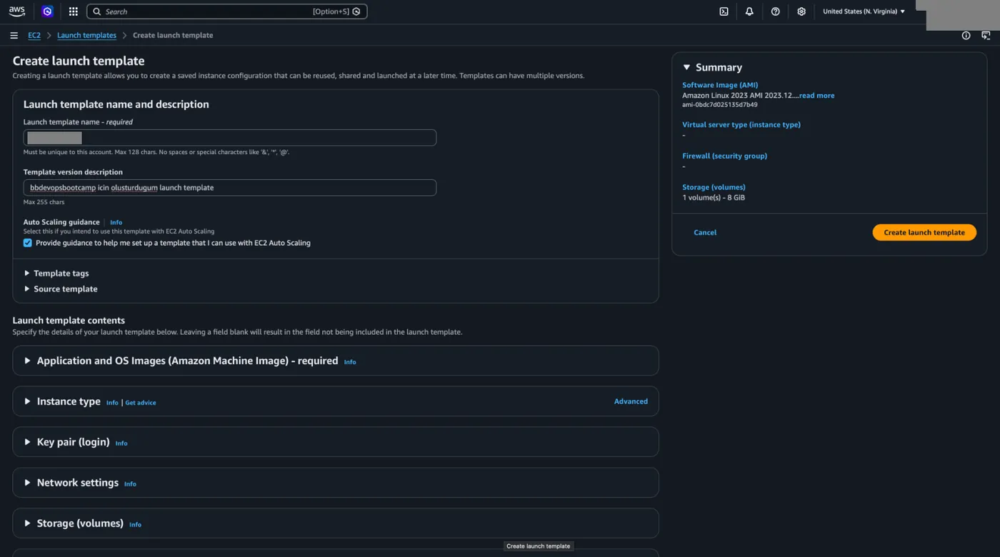
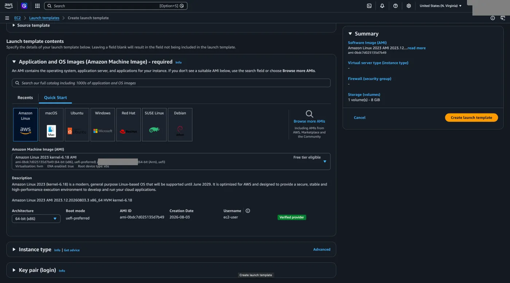
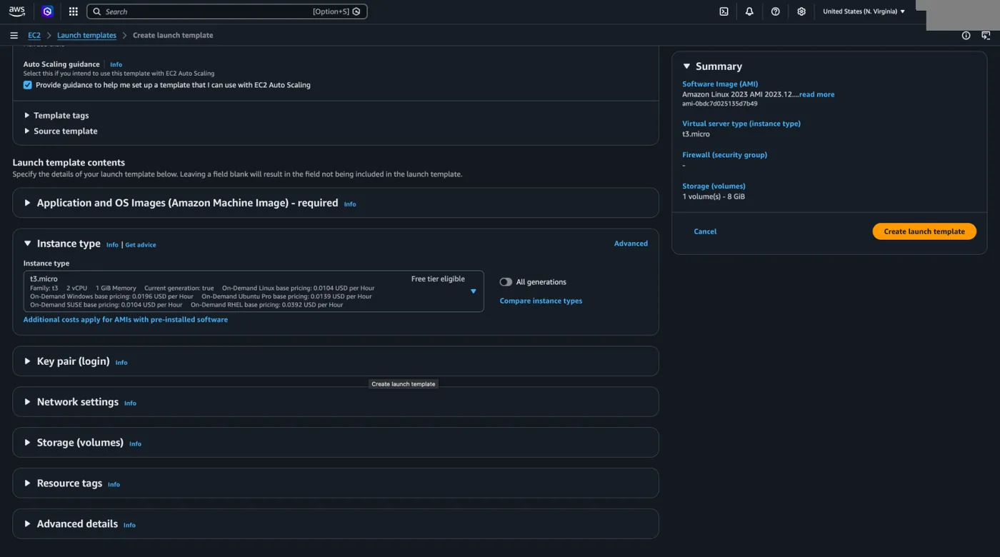
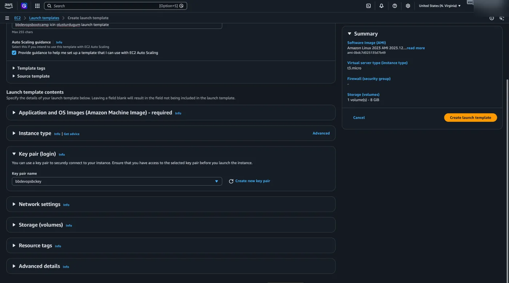
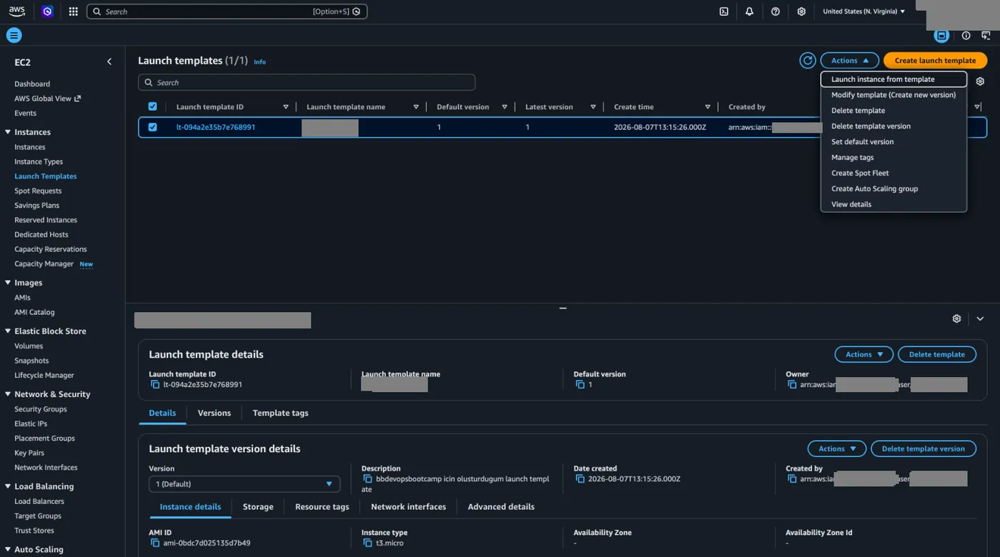
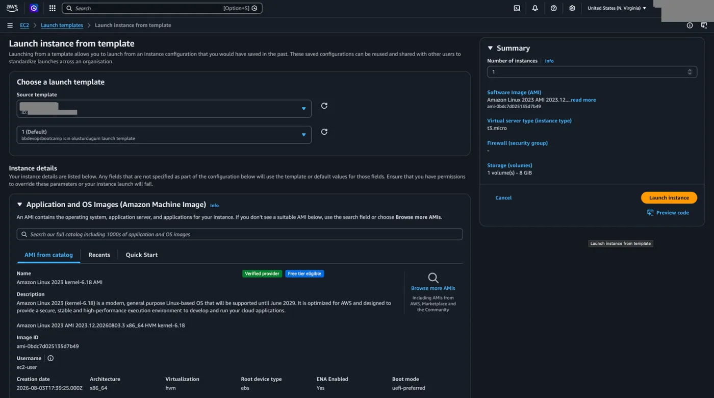

Instance oluşturmayı seçtiğimiz özelliklerde otomatize etmek istersek **Launch Templates** menüsünden ayarlayabiliriz.

## Şablon oluşturma

1. `Create launch template` butonuna tıklayarak başlayalım.

   

2. Bir isim ve açıklama ekleyerek devam edelim.

   

3. Sanal makinelerimizi oluşturacağımız AMI ile devam ediyoruz.

   

   

4. Sanal makine tipini seçiyoruz.

   

5. Kullanmak istediğimiz key pair'i seçiyoruz.
6. Sanal makine oluştururken öğrendiğimiz tüm ayarları istediğimiz şekilde düzenleyerek `Create launch template` diyoruz.

## Şablondan instance başlatma

Ve oluşturduğumuz launch template'i seçerek **Actions** menüsü altından **Launch instance from template** seçeneğine tıklıyoruz.

Artık belirlediğimiz özellikleri bir şablon olarak kullanıp daha hızlı sanal makineler oluşturabiliriz. Bunun için yalnızca `Launch instances` butonuna tıklamamız yeterli.

