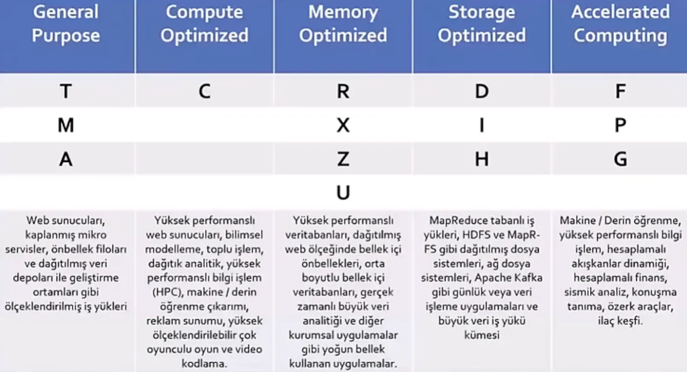

Ödeme yöntemlerini öğrendiğimize göre şimdi hangi EC2 makine çeşitlerini oluşturabileceğimize bakalım.

## Makine aileleri özet tablosu

Sanal makine çeşitlerini anlatan özet tabloyu aşağıya bırakarak detaylandırmaya başlayalım.

| | General Purpose | Compute Optimized | Memory Optimized | Storage Optimized | Accelerated Computing |
|---|---|---|---|---|---|
| **Aileler** | T, M, A | C | R, X, Z, U | D, I, H | F, P, G |
| **Kullanım alanları** | Web sunucuları, kaplanmış mikro servisler, önbellek filoları ve dağıtılmış veri depoları ile geliştirme ortamları gibi ölçeklendirilmiş iş yükleri | Yüksek performanslı web sunucuları, bilimsel modelleme, toplu işlem, dağıtık analitik, yüksek performanslı bilgi işlem (HPC), makine / derin öğrenme çıkarımı, reklam sunumu, yüksek ölçeklendirilebilir çok oyunculu oyun ve video kodlama | Yüksek performanslı veritabanları, dağıtılmış web ölçeğinde bellek içi önbellekleri, orta boyutlu bellek içi veritabanları, gerçek zamanlı büyük veri analitiği ve diğer kurumsal uygulamalar gibi yoğun bellek kullanan uygulamalar | MapReduce tabanlı iş yükleri, HDFS ve MapR-FS gibi dağıtılmış dosya sistemleri, ağ dosya sistemleri, Apache Kafka gibi günlük veya veri işleme uygulamaları ve büyük veri iş yükü kümesi | Makine / derin öğrenme, yüksek performanslı bilgi işlem, hesaplamalı akışkanlar dinamiği, hesaplamalı finans, sismik analiz, konuşma tanıma, özerk araçlar, ilaç keşfi |

## Aileler

### 1. General Purpose (Genel Amaçlı - T, M, A Ailesi)

Bu sunucu tipi; işlemci, bellek ve ağ kaynaklarını dengeli bir şekilde sunarak sistemleriniz için çok yönlü ve stabil bir temel oluşturur. Henüz projenizin ne kadar kaynak tüketeceğinden emin değilseniz veya trafiğinizde anlık devasa dalgalanmalar beklemiyorsanız en güvenli başlangıç noktasıdır. Kurumsal uygulamaların arka plan süreçlerinde, küçük ve orta ölçekli veri tabanlarında veya test ortamlarında sıklıkla tercih edilir. Kaynakların eşit dağılımı sayesinde maliyet ve performans açısından harika bir orta yol sunar.

### 2. Compute Optimized (İşlemci Optimize Edilmiş - C Ailesi)

Odak noktası tamamen yüksek işlemci gücü olan bu makineler, standart sunucuların zorlanacağı karmaşık matematiksel hesaplamaları saniyeler içinde çözmek üzere tasarlanmıştır. Uygulamanız bellekten ziyade doğrudan beyin gücüne ihtiyaç duyuyorsa, bu makine ailesi işlemlerinizi hiçbir darboğaz yaşamadan sürdürmenizi sağlar. Arkasında yatan güçlü donanım sayesinde, sürekli olarak CPU sınırlarını zorlayan algoritmalarla başa çıkmak için idealdir. Özellikle büyük verileri şifreleme veya medya dönüştürme gibi yoğun işlem gerektiren durumlarda kullanılır.

### 3. Memory Optimized (Bellek Optimize Edilmiş - R, X, Z, U Ailesi)

Bazı sistemler veriyi diske yazmak yerine anlık olarak devasa RAM kapasitelerinde tutarak ışık hızında işlem yapmak ister; işte bu makineler tam olarak bunun için üretilmiştir. Devasa boyutlardaki verileri doğrudan hafızaya yükleyerek milisaniyelik tepki süreleri elde etmenizi sağlarlar. İşlemciden ziyade çok daha geniş bir çalışma alanına ihtiyaç duyan uygulamaların vazgeçilmezidir. Özellikle milyonlarca satırlık verinin anında işlenmesi ve filtrelenmesi gereken durumlarda hayat kurtarır.

### 4. Storage Optimized (Depolama Optimize Edilmiş - D, I, H Ailesi)

Bu aile, yerel disklerde on binlerce saniyelik okuma ve yazma işlemi gerçekleştirmeniz gerektiğinde sahneye çıkar. Verilerinizi uzak bir ağ üzerinde değil, doğrudan makinenin içine gömülü ultra hızlı disklerde tutarak veri erişim gecikmelerini sıfıra indirir. Sürekli olarak diske devasa boyutlarda veri yazıp okuyan kayıt sistemleri veya dev veri ambarları için biçilmiş kaftandır. Kısacası, uygulamanızın performansı disk hızına takılıyorsa, bu makineler o sorunu kökünden çözer.

:::caution[Düzeltme]
Kastedilen, saniyede on binlerce (hatta yüz binlerce) okuma/yazma işlemidir, yani yüksek IOPS. Yerel diskler gecikmeyi çok azaltır ama sıfıra indirmez.
:::

### 5. Accelerated Computing (Hızlandırılmış İşlem - F, P, G Ailesi)

Standart işlemcilerin yetersiz kaldığı, çok daha spesifik ve paralel hesaplama gerektiren görevler için özel donanımlarla güçlendirilmiş makinelerdir. Bu aile, standart bir sunucunun sınırlarının ötesine geçerek donanımsal düzeyde maksimum kapasiteye ve hıza ulaşmanızı sağlar. Eğer sanal makinemizin doğrudan GPU'ya ya da özel donanım hızlandırıcılarına erişmesini istiyorsak kullandığımız EC2 çeşididir. Bu sayede karmaşık yapay zeka eğitimleri, 3D render işlemleri veya ağır simülasyonlar gibi yüklerin altından kolayca kalkabiliriz.

## EC2 isimlendirme mantığı ve boyutlandırma (T-Shirt Sizing)

Hangi makine ailesini kullanacağımıza karar verdikten sonra, sıra tam olarak ihtiyacımız olan donanım kapasitesini seçmeye geliyor. AWS, sanal makineleri isimlendirirken işimizi çok kolaylaştıran ve tıpkı kıyafet bedenlerine benzeyen bir **T-Shirt Sizing** mantığı kullanır.

Karşımıza çıkan sanal makine seçeneklerini anlamak için `m5.large` örneğini parçalara ayıralım:

- **M (Aile / Sınıf):** Makinenin hangi aileye ait olduğunu gösterir. Görseldeki listeden de görebileceğimiz üzere 'M' harfi, bu makinenin General Purpose bir sunucu olduğunu ifade eder. (Örneğin bellek odaklı olsaydı 'R', işlemci odaklı olsaydı 'C' harfini görecektik.)
- **5 (Nesil):** Donanımın kaçıncı nesil olduğunu belirtir. Tıpkı telefon modelleri gibi, bu sayı ne kadar yüksekse arka plandaki fiziksel işlemci ve teknoloji o kadar yeni demektir (1'den başlayıp 6'ya ve ötesine kadar gidebilir).
- **Large (Boyut / Kapasite):** Noktadan sonraki kısım, makinenin içindeki CPU ve RAM miktarını belirleyen asıl beden kısmıdır.

### Boyutları (kapasiteleri) nasıl okumalıyız?

AWS bulutunda kaynaklar ihtiyaca göre çok küçük donanımlardan devasa sunuculara kadar uzanır. Boyut büyüdükçe, makinenin sahip olduğu işlemci ve bellek miktarı da genellikle ikiye katlanarak artar:

- **Nano / Micro / Small:** Ailenin en küçük üyeleridir. Düşük trafikli kişisel bloglar, ufak test ortamları veya geliştirme aşamasındaki basit projeler için yeterlidir. Maliyetleri en düşük olan gruptur (Örneğin `t2.micro`, AWS'nin ücretsiz deneme katmanında sıkça kullanılır).
- **Medium / Large:** Standart ve kararlı iş yükleri için tatlı nokta diyebileceğimiz orta segment donanımlardır. Kurumsal web siteleri, orta ölçekli veri tabanları ve standart arka plan uygulamaları için en çok tercih edilen boyutlardır (Örneğin görseldeki `m5.large` makinesi 2 vCPU ve 8 GB RAM sunar).
- **XLarge ve Katları (2XLarge, 4XLarge ... 24XLarge):** Kurumsal seviyedeki ağır iş yükleri için tasarlanmış devasa sistemlerdir. Milyonlarca kullanıcısı olan uygulamalar, saniyede binlerce işlem yapan büyük veri tabanları veya ağır analiz motorları için kullanılır. Sayı arttıkça makinenin barındırdığı çekirdek sayısı ve bellek kapasitesi devasa boyutlara ulaşır.
