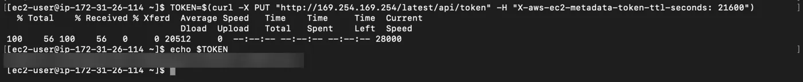
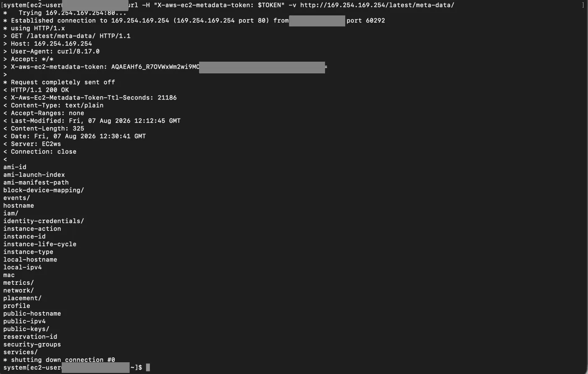
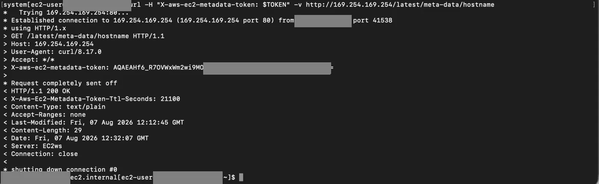

## Metadata servisi

Sanal makinemizin (EC2) içine bağlandıktan sonra, terminal ekranımız üzerinden Metadata servisine erişerek sunucumuzla ilgili temel verileri listeleyebiliriz. Bu işlem için makine içinden özel bir HTTP endpoint'i ile iletişim kurarız ve bu servis AWS üzerinde her zaman sabit olan **169.254.169.254** IP adresi üzerinden çalışır. Güvenlik gereği oluşturduğumuz token'ı kullanarak EC2 makinemizin içinden `curl -H "X-aws-ec2-metadata-token: $TOKEN" -v http://169.254.169.254/latest/meta-data/` komutunu çalıştırdığımızda, makinemize ait tüm metadata başlıklarına ulaşabilir ve ihtiyacımız olan spesifik bilgileri (örneğin makinenin ID'si, IP adresi vb.) komut satırına çekebiliriz.

**curl** (Client URL), terminal üzerinden internetteki veya ağdaki bir sunucuya veri göndermeni ya da oradan veri çekmemizi sağlayan bir komut satırı aracıdır. En basit haliyle, ekranı ve tıklanacak butonları olmayan bir web tarayıcısı gibi çalışır. Hedef adresi yazarız, arka planda o adrese gider ve bulduğu sonucu terminal ekranına basar.

## Neden artık direkt IP'ye gidemiyoruz? (Token zorunluluğu)

Eskiden EC2 makinesinin içindeyken 169.254.169.254 adresine doğrudan bir curl isteği atıp tüm metadata bilgilerini anında görebiliyorduk. Ancak bu durum güvenlik açığı yaratıyordu; makineye sızan zararlı bir bot veya yazılım da aynı kolaylıkla bu verilere erişebiliyordu.

AWS, güvenliği artırmak için sistemi güncelledi (buna **IMDSv2** deniyor). Artık sisteme direkt soru soramıyoruz. Önce kapıyı çalıp "Ben yetkili bir kullanıcıyım, bana geçici bir giriş anahtarı (token) ver" dememiz gerekiyor. Sistemi ancak bu token'ı aldıktan sonra, o token'ı her sorunun yanına iliştirerek kullanabiliyoruz.

## Token almak için kullanılan PUT istekli curl komutu

Token'ı oluşturup makineye tanımlamak için şu komutu çalıştırmamız gerekir.

```bash frame="terminal"
TOKEN=$(curl -X PUT "http://169.254.169.254/latest/api/token" -H "X-aws-ec2-metadata-token-ttl-seconds: 21600")
```

Komutun parçaları ve anlamları:

- `TOKEN=$(...)`: curl komutunun bize vereceği karmaşık şifreyi kaybetmemek için onu `TOKEN` adında bir değişkene atar. Böylece sonraki adımlarda sadece `$TOKEN` yazarak bu şifreyi otomatik kullanabilirsin.
- `curl -X PUT`: Normalde curl sadece veri okur (GET isteği). Biz burada `-X PUT` diyerek sunucuya, "Sadece okumayacağım, bana yeni bir token yaratıp vermeni talep ediyorum" demiş oluyoruz.
- `"http://169.254.169.254/latest/api/token"`: Yeni anahtarın üretilip dağıtıldığı tam adres.
- `-H "X-aws-ec2-metadata-token-ttl-seconds: 21600"`: Token'ın ne kadar süre geçerli olacağını belirten başlık (Header) kuralıdır. 21600 saniye, bu şifrenin 6 saat boyunca geçerli olacağını sisteme söyler. 6 saat sonra bu token iptal olur ve yeni bir tane alman gerekir.



```text title="Çıktı"
  % Total    % Received % Xferd  Average Speed   Time    Time     Time  Current
                                 Dload  Upload   Total   Spent    Left  Speed
100    56 100    56   0     0 20512      0 --:--:-- --:--:-- --:--:-- 28000
```

```bash frame="terminal"
echo $TOKEN
```

```text title="Çıktı"
********************************************************
```

## Metadata listesi

Şimdi `curl -H "X-aws-ec2-metadata-token: $TOKEN" -v http://169.254.169.254/latest/meta-data/` komutunu kullanarak metadata listesine ulaşabiliriz.



```bash frame="terminal"
curl -H "X-aws-ec2-metadata-token: $TOKEN" -v http://169.254.169.254/latest/meta-data/
```

```text title="Çıktı"
*   Trying 169.254.169.254:80...
* Established connection to 169.254.169.254 (169.254.169.254 port 80) from 172.31.0.10 port 60292
* using HTTP/1.x
> GET /latest/meta-data/ HTTP/1.1
> Host: 169.254.169.254
> User-Agent: curl/8.17.0
> Accept: */*
> X-aws-ec2-metadata-token: ********************************************************
>
* Request completely sent off
< HTTP/1.1 200 OK
< X-Aws-Ec2-Metadata-Token-Ttl-Seconds: 21186
< Content-Type: text/plain
< Accept-Ranges: none
< Last-Modified: Fri, 07 Aug 2026 12:12:45 GMT
< Content-Length: 325
< Date: Fri, 07 Aug 2026 12:30:41 GMT
< Server: EC2ws
< Connection: close
<
ami-id
ami-launch-index
ami-manifest-path
block-device-mapping/
events/
hostname
iam/
identity-credentials/
instance-action
instance-id
instance-life-cycle
instance-type
local-hostname
local-ipv4
mac
metrics/
network/
placement/
profile
public-hostname
public-ipv4
public-keys/
reservation-id
security-groups
services/
* shutting down connection #0
```

## Belirli bir veriyi çekme

Gelin bu listelenen bilgilerden spesifik olarak görmek istediğimiz bir veriyi çekelim. Kullandığımız komutun sonuna verinin ismini yazarak yeniden çalıştırmamız yeterli olacaktır. `curl -H "X-aws-ec2-metadata-token: $TOKEN" -v http://169.254.169.254/latest/meta-data/hostname` gibi.



```bash frame="terminal"
curl -H "X-aws-ec2-metadata-token: $TOKEN" -v http://169.254.169.254/latest/meta-data/hostname
```

```text title="Çıktı"
...
> GET /latest/meta-data/hostname HTTP/1.1
...
< HTTP/1.1 200 OK
...
< Content-Length: 29
...
* shutting down connection #0
ip-172-31-0-10.ec2.internal
```
