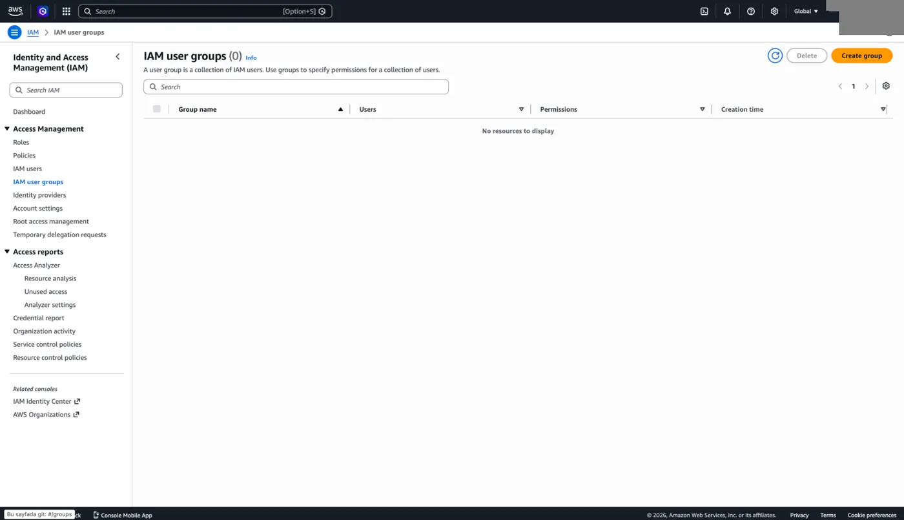
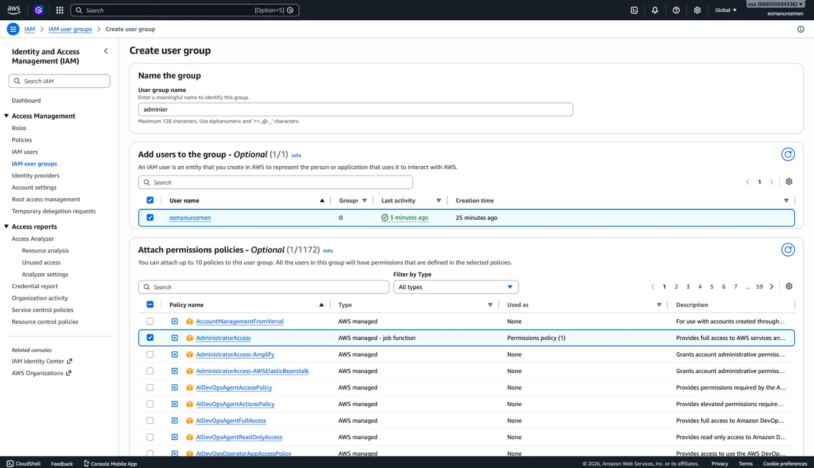
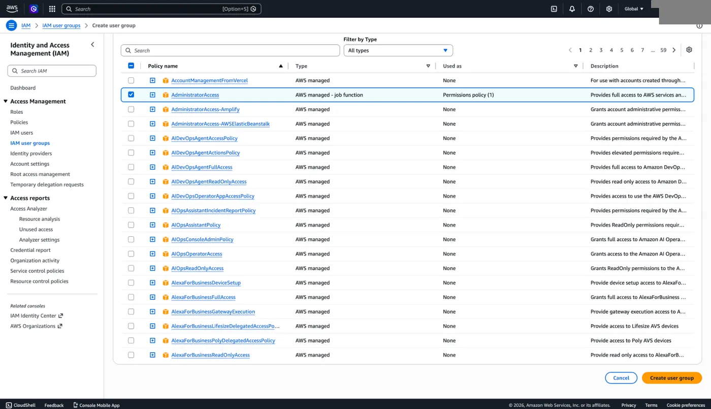
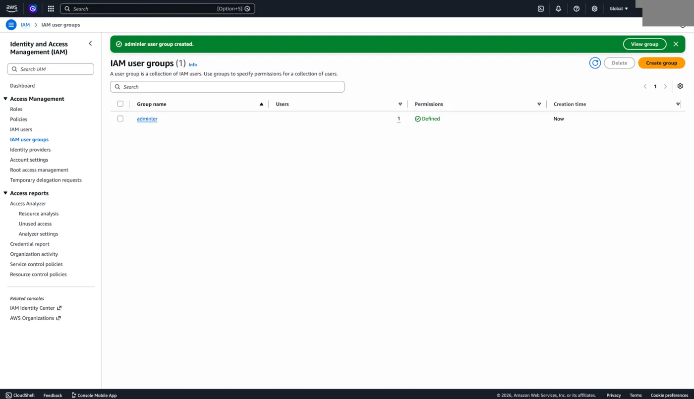
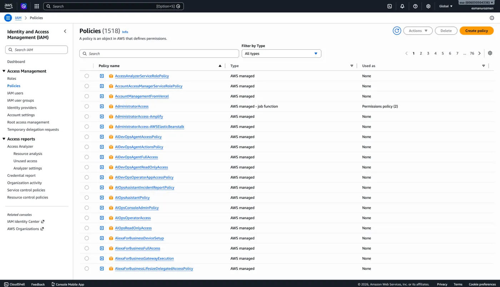
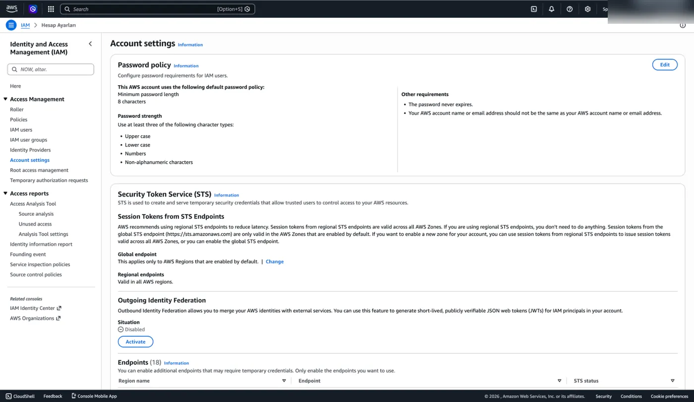
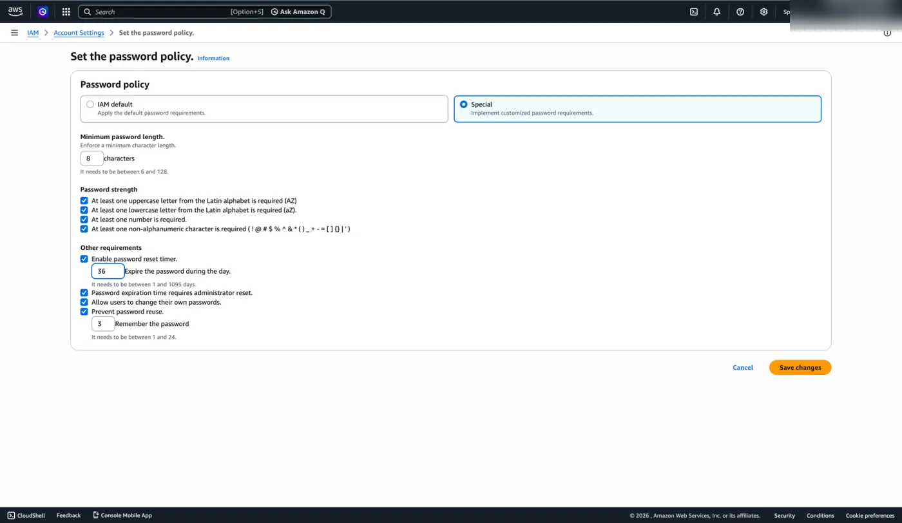
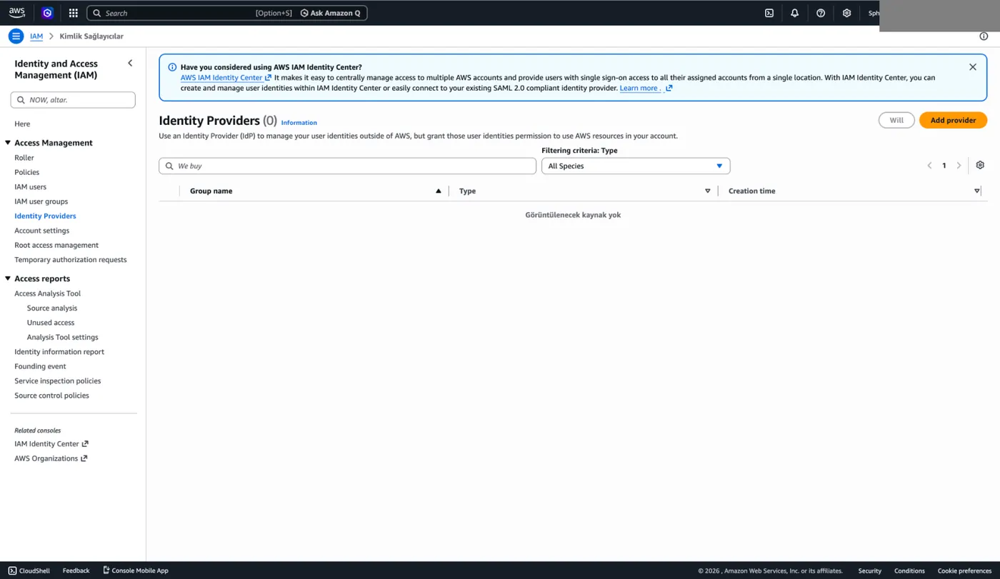

## User group oluşturma

1. IAM servisi üzerinden sağdaki menüde bulunan **IAM user groups** yazan seçeneğe tıklıyoruz.

   :::caution[Düzeltme]
   **IAM user groups** seçeneği sol taraftaki menüde yer alır.
   :::

   

2. Sağ üstte bulunan **Create group** diyerek devam ediyoruz. Grubumuza isim vererek hangi kullanıcıları ekleyeceğimizi ve yetkilerini belirliyoruz.

   

3. Sağ altta bulunan **Create user group** diyerek grubumuzu oluşturuyoruz.

   

   

:::note
Oluşturulan bir user'ın yetkisi eklendiği gruptaki yetkilerden farklı olursa neticede bu user'ın yetkileri hem kendisine verilmiş olan hem de eklendiği grupta bulunan yetkilerin birleşimi olacaktır.
:::

## Policy listesi

İstediğimiz yetkilere uygun policy'yi aşağıdaki menüden bulabiliriz. Veya kendimiz bir policy oluşturabiliriz.

## Parola politikası

IAM altında yönetebileceğimiz hesap ayarlarından biri de **Account settings** menüsünden yapacağımız şifre ayarıdır. Aşağıdaki gibi **Edit** diyerek kullanıcılarımızın şifrelerini en az kaç karakterli oluşturabileceğini, hangi özel karakterleri kullanması gerektiğini, şifrenin kaç günde bir değiştirileceği ve kullanıcıların kendi şifrelerini değiştirmesine izin verip verilmeyeceğini, son kaç şifresini kullanmasına izin verilmeyeceği gibi kuralları belirleyebiliyoruz.

| Ayar | Örnekteki değer |
| --- | --- |
| Minimum şifre uzunluğu (6-128) | 8 karakter |
| En az bir büyük harf | İşaretli |
| En az bir küçük harf | İşaretli |
| En az bir rakam | İşaretli |
| En az bir alfanümerik olmayan karakter | İşaretli |
| Şifre süresinin dolması (1-1095 gün) | 36 gün |
| Süresi dolan şifre için yönetici sıfırlaması gerekmesi | İşaretli |
| Kullanıcıların kendi şifrelerini değiştirebilmesi | İşaretli |
| Eski şifrelerin tekrar kullanılmasını engelleme (1-24) | Son 3 şifre |

## Security Token Service (STS)

Aynı menü altında bir de **Security Token Service (STS)** servisi vardır. Bu servis esasında bir API hizmetidir. API'ye bir çağrı göndeririz ve gönderdiğimiz çağrıya göre bir cevap alırız. Peki ne tür çağrılarda bulunabiliriz? Bir kullanıcıya varsayılan olarak çok az hakkı olan bir policy atayalım ama bu kullanıcı atadığımız policy dışında da başka policy'leri assume edebilsin. Yani başlangıçta en az yetkiyi verip sonrasında talebe göre kullanıcılara farklı izinleri geçici olarak örneğin 30 dakikalığına verebiliyoruz. İleride bu konuyu daha detaylı ele alacağız.

## Identity Providers

IAM altında kullanılan bir diğer hizmet **Identity Providers** hizmetidir. Bu servisin kullanım amacı AWS içinde tek tek kullanıcı oluşturmak yerine, dışarıdaki şirketinizde mevcut kullanıcıları AWS'ye entegre etmektir. Kullanıcılar AWS için yeni bir şifre ezberlemek yerine, kendi şirket veya dış hesaplarıyla giriş yaparlar. Girişin ardından Identity Provider, AWS'ye "Bu kişi onaylıdır" der ve AWS de bu dış kullanıcıya arka planda geçici bir Rol (Role) giydirir. Böylece yüzlerce çalışana ayrı ayrı AWS hesabı açmak yerine, mevcut sisteminiz üzerinden onlara güvenli ve geçici erişim yetkisi vermiş olursunuz.
