## IAM konsoluna giriş

Şimdi AWS konsolumuza bağlanarak IAM servisini daha yakından tanıyalım.

AWS hesabımıza giriş yaptıktan sonra açılan ekrandan arama kısmına `iam` yazarak ilk çıkan seçeneğe tıklıyoruz.

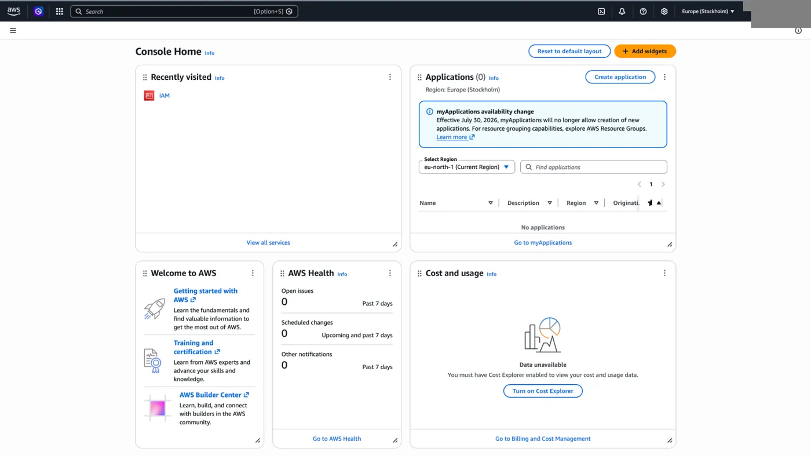

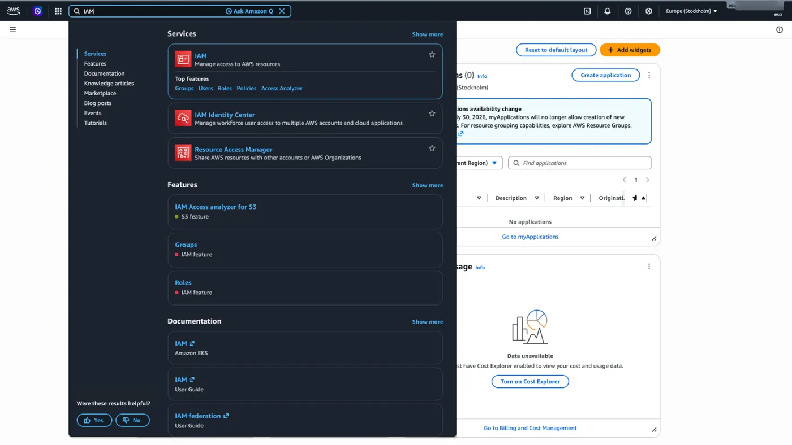

## IAM kullanıcısıyla giriş ve alias

AWS hesabımıza giriş yaparken root üzerinden değil de oluşturduğumuz kullanıcıları kullandığımızı söylemiştik. Bu kullanıcılarla giriş yapmak için aşağıdaki görüntüde bulunan ekranın sağındaki URL adresini kullanıyoruz.

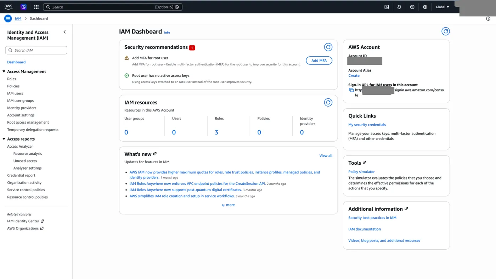

```text
https://<AWS_ACCOUNT_ID>.signin.aws.amazon.com/console
```

Buradaki numarayı akılda tutmak zor olacağından **Create** diyerek bu numaraya bir alias atayabiliyoruz.

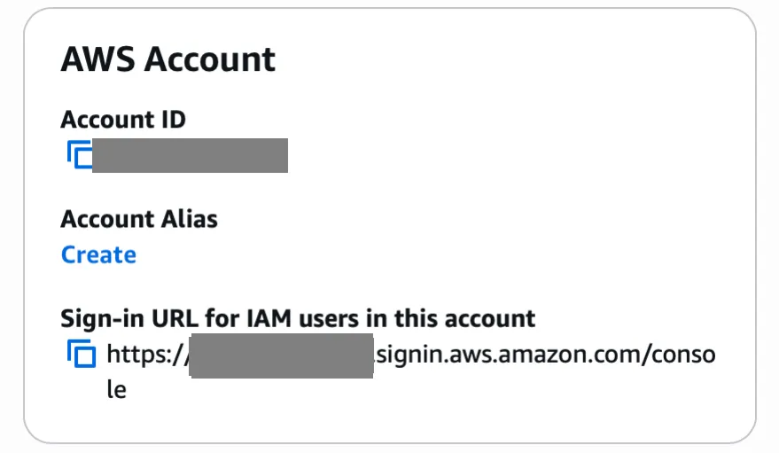

Oluşturduğumuz alias'ı kullanarak aşağıdaki ekrandan giriş yapabiliriz.

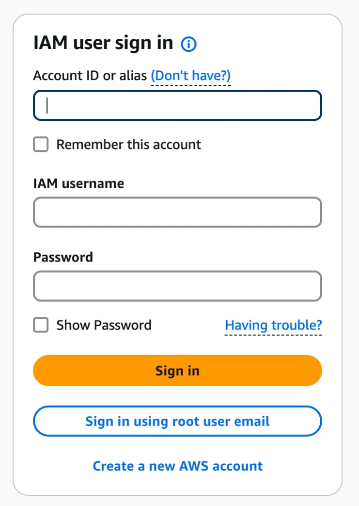

## MFA ekleme

Root user üzerinden giriş yapacaksak bile çift aşamalı kimlik doğrulama yöntemlerinden birini kullanmamız güvenlik açısından iyi olacaktır.

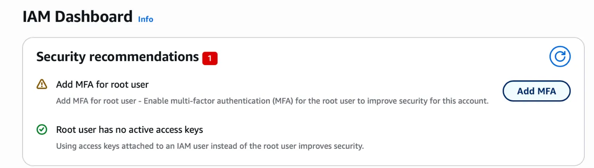

Bunun için yukarıdaki **Add MFA** butonuna tıklayarak açılan ekrandan alternatiflerden birini seçiyoruz.

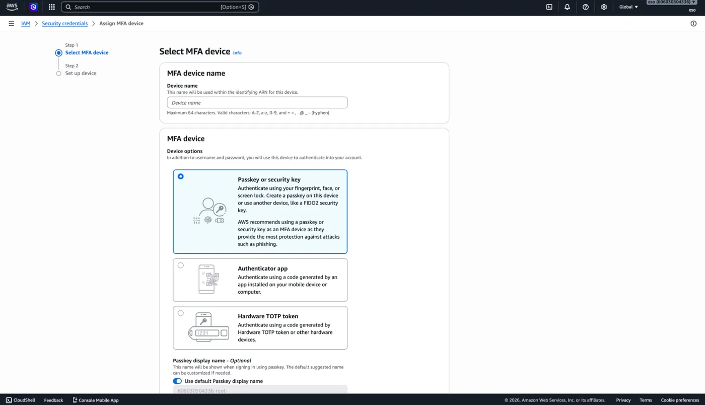

## IAM kullanıcısı oluşturma

Şimdi bahsettiğimiz user oluşturmayı birlikte yapalım.

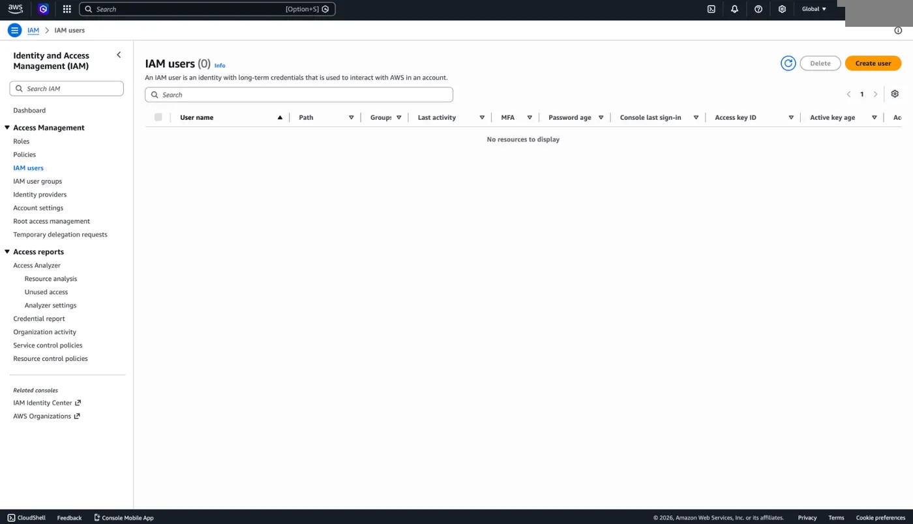

1. Sol tarafta bulunan menüden **IAM users**'a tıklayarak açılan ekranda sağ üstteki buton ile **Create user** diyelim ve kullanıcımıza bir isim verelim.
2. Oluşturduğumuz kullanıcının konsola bağlanmasını istiyorsak alttaki butonu aktifleştirmeyi unutmayalım.
3. **Next** diyerek devam ediyoruz.

   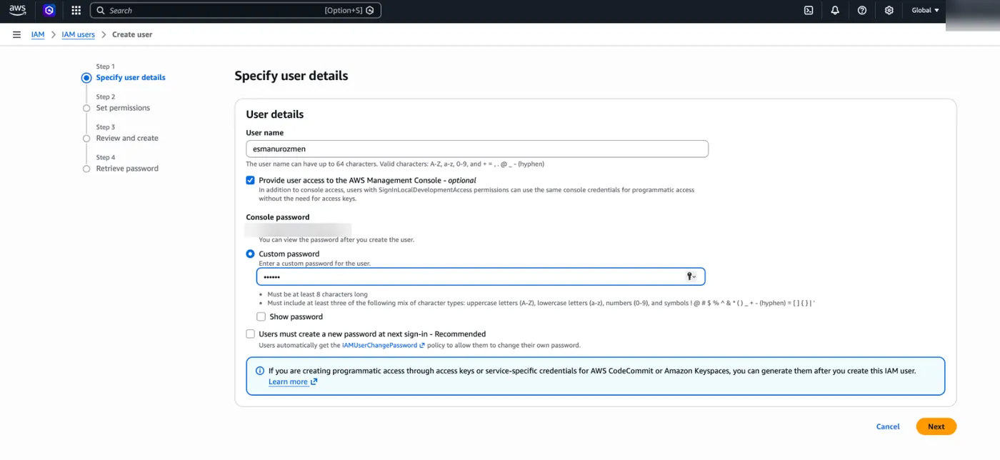

### Yetki verme

[Teoride bahsettiğimiz gibi](/aws/iam/kavramlar/#policy) oluşturduğumuz bu user bir yetkiye sahip değil. İstediğimiz yetkileri açılan ekranda belirleyeceğiz. Bunun için bir policy oluşturup bu kullanıcıya atayacağız. Aşağıda bunu üç şekilde yapabileceğimizi söylüyor.

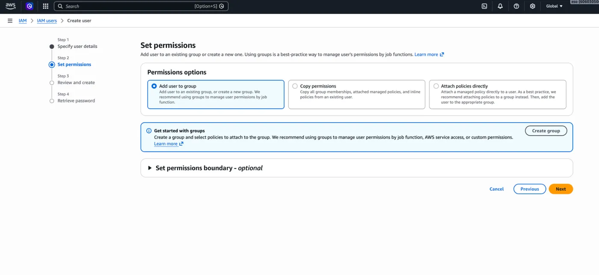

| Seçenek | Açıklama |
| --- | --- |
| Add user to group | Kullanıcıyı mevcut bir gruba ekler veya yeni grup oluşturur. AWS, yetkileri iş fonksiyonuna göre gruplarla yönetmeyi önerir. |
| Copy permissions | Mevcut bir kullanıcının grup üyeliklerini, managed ve inline policy'lerini kopyalar. |
| Attach policies directly | Managed policy'yi doğrudan kullanıcıya bağlar. |

Üçüncü seçeneği seçerek istediğimiz yetkileri işaretleyerek devam ediyoruz.

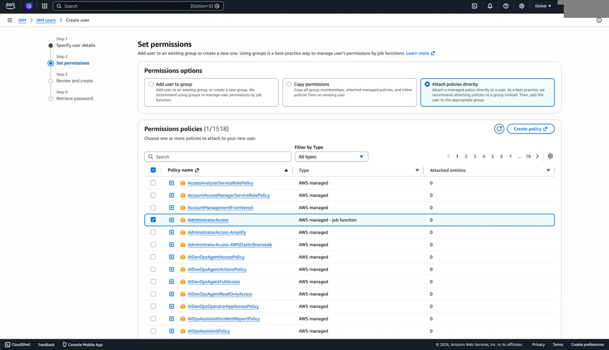

Biraz aşağı kaydırdığımızda görünen butonu aktif ettiğimiz takdirde üstte işaretlediğimiz yetkilerin sadece burada seçeceğimiz yerlerde geçerli olmasını sağlayan bir sınırlandırma koymuş oluyoruz.

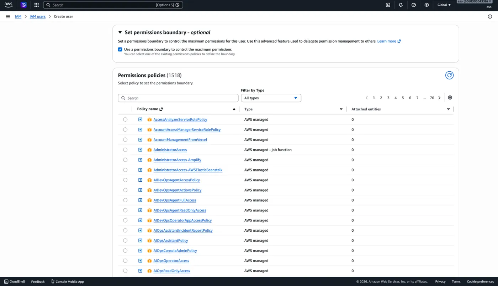

**Next** diyerek devam ettiğimizde aşağıdaki gibi açılan ekrandaki bilgileri kontrol ederek **Create user** butonuna tıklayarak yeni kullanıcımızı oluşturuyoruz.

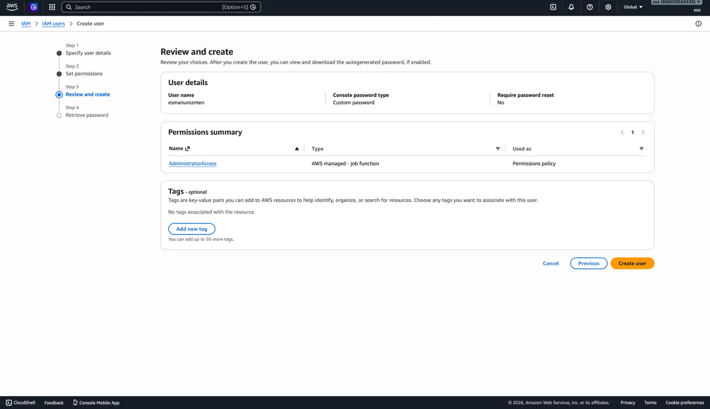

Bu aşamada oluşturduğumuz user ile ilgili olan bilgileri dilersek bilgisayarımıza indirebiliriz. Şimdi son olarak **Return to users list** diyoruz. Tebrikler yeni bir kullanıcı eklediniz.

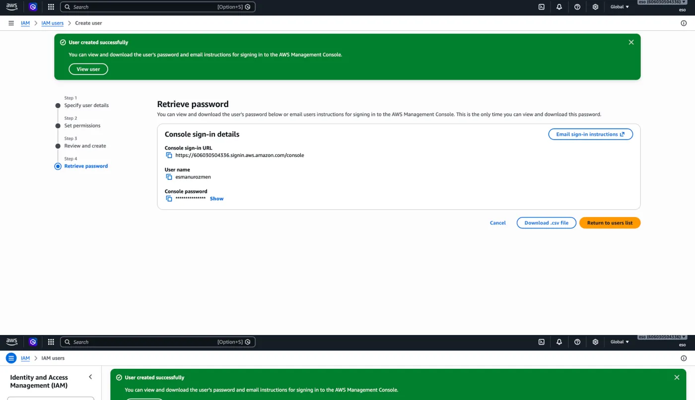

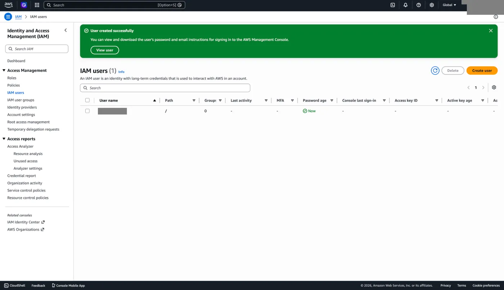

## Access key oluşturma

Oluşturulan bu kullanıcı aracılığıyla CLI veya konsol üzerinden işlem yapmak istiyorsak access key oluşturmamız gerekiyor.

:::caution[Düzeltme]
Access key yalnızca CLI, SDK ve API erişimi için gerekir. Konsola giriş kullanıcı adı ve şifreyle yapılır; bunun için access key gerekmez.
:::

1. Yukarıdaki ekranda oluşturduğumuz user'a tıklayarak aşağıdaki **Create access key** yazan kısma tıklıyoruz.

   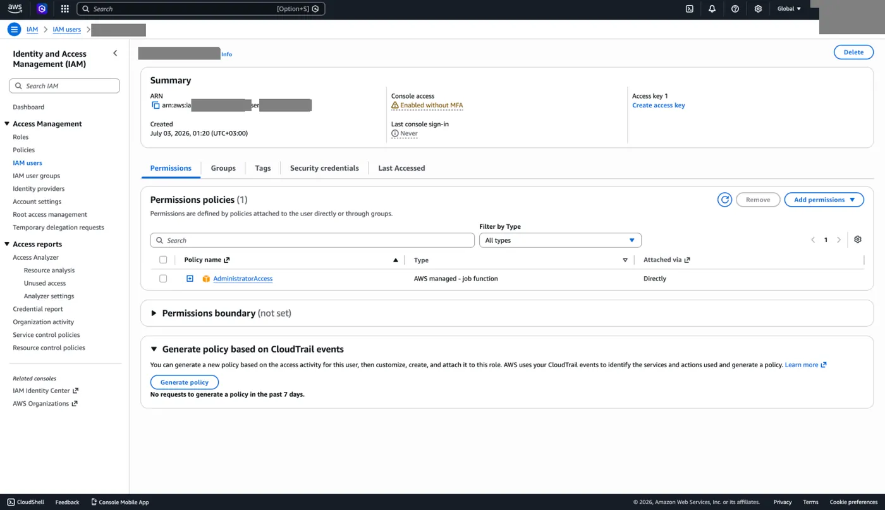

2. Erişmek istediğimiz yerleri seçerek devam ediyoruz.

   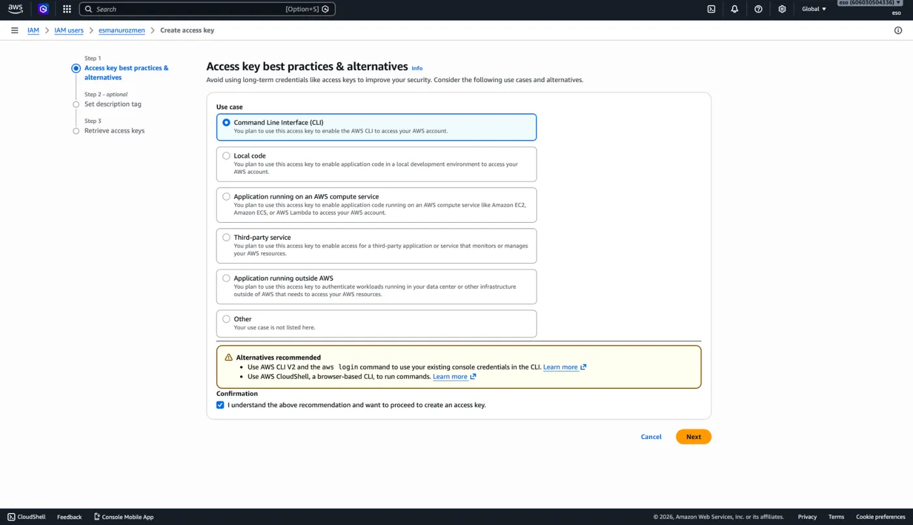

3. Bu anahtarı ne için oluşturduğumuz hakkında isteğe bağlı olarak aşağıdaki boşluğu doldurarak **Create access key** diyerek devam ediyoruz.

   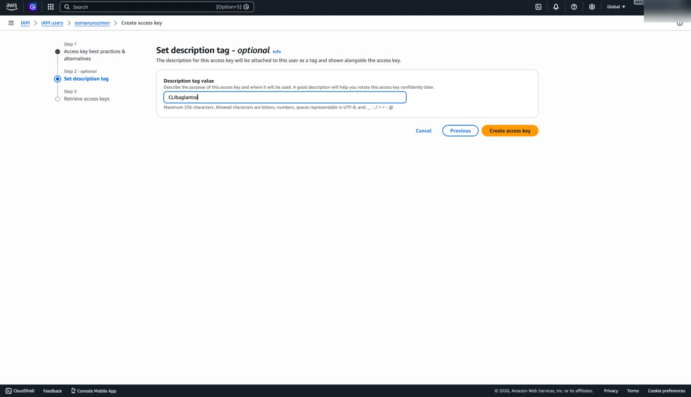

Oluşturulan access key ve secret access key değerlerini **Done** butonuna tıkladıktan sonra bir daha göremeyeceğimiz için bu bilgileri not etmeyi unutmayalım.

:::caution[Düzeltme]
Done'dan sonra tekrar görülemeyen değer yalnızca secret access key'dir. Access key ID kullanıcının sayfasında görünmeye devam eder.
:::

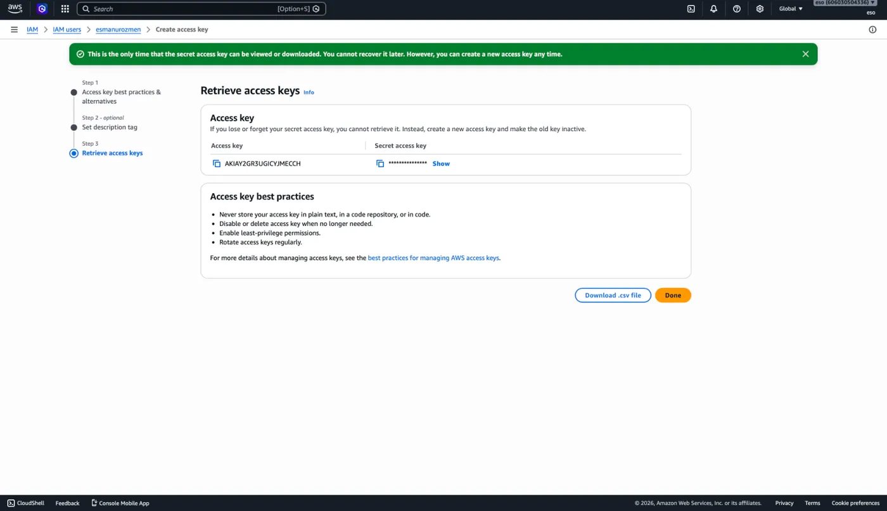

## Yeni kullanıcıyla giriş

Şimdi gelin oluşturduğumuz bu kullanıcı ile giriş yapalım. Ve bir sonraki objemiz olan [gruplara](/aws/iam/gruplar-parola-sts/) göz atalım.

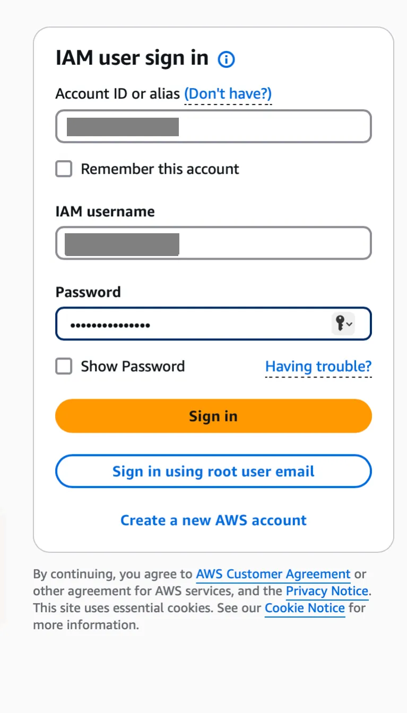
