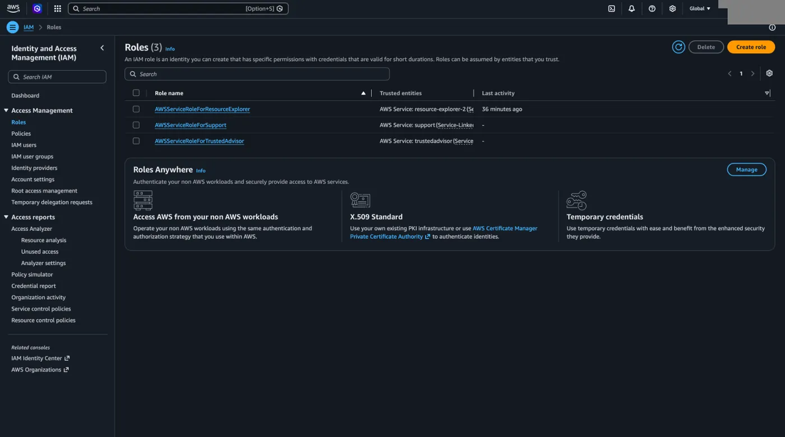
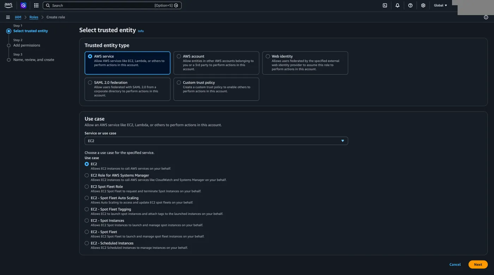
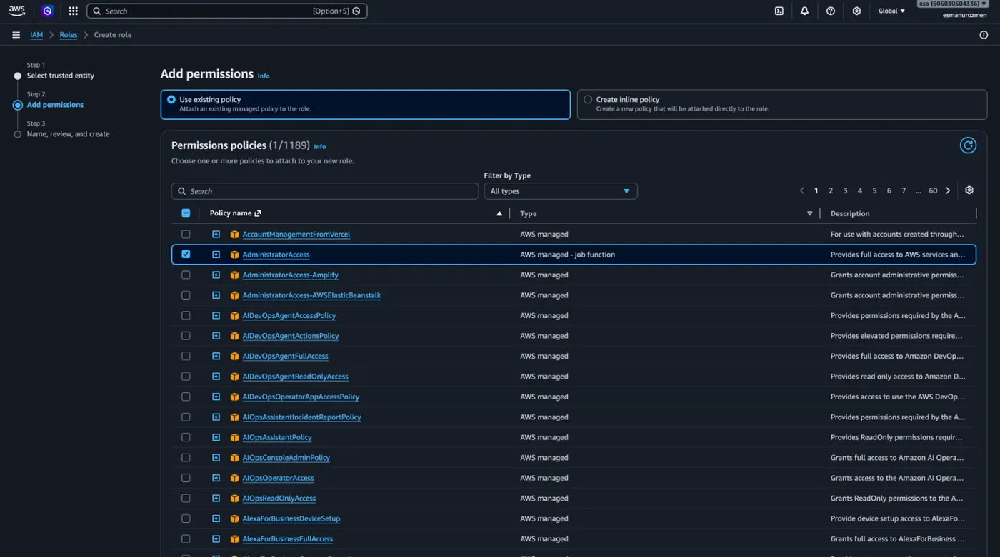
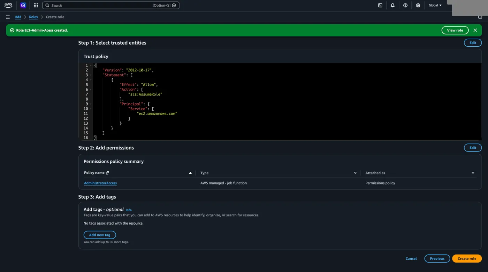
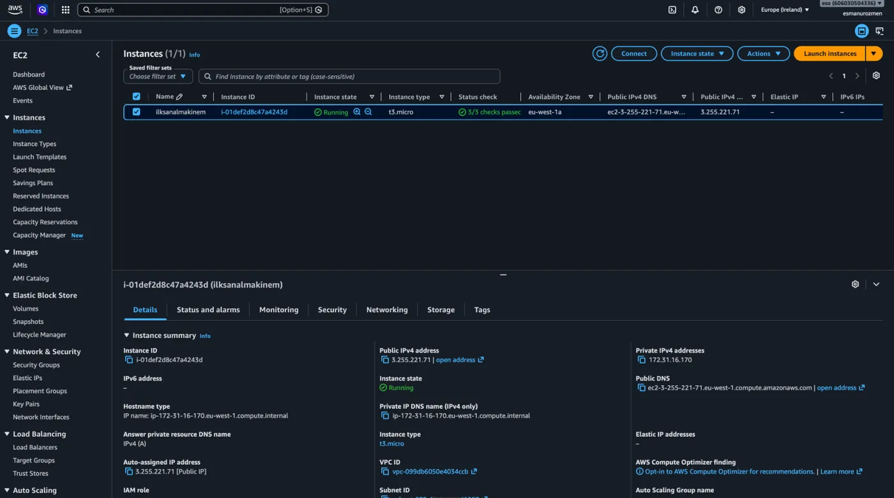
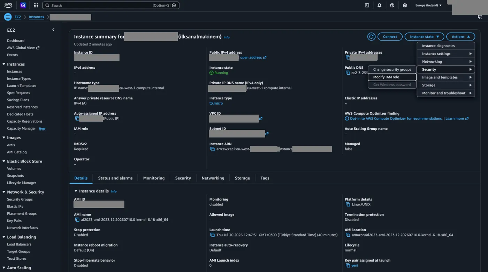
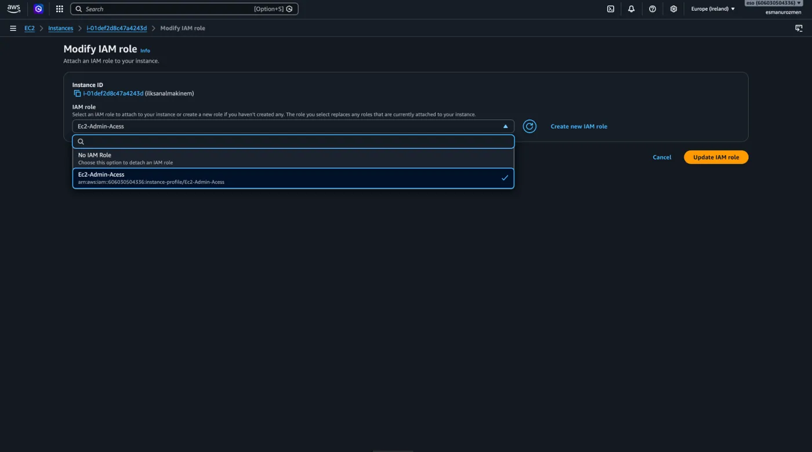
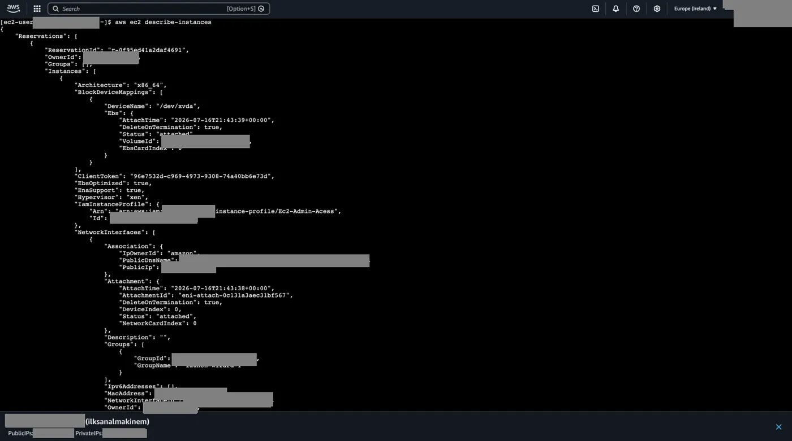
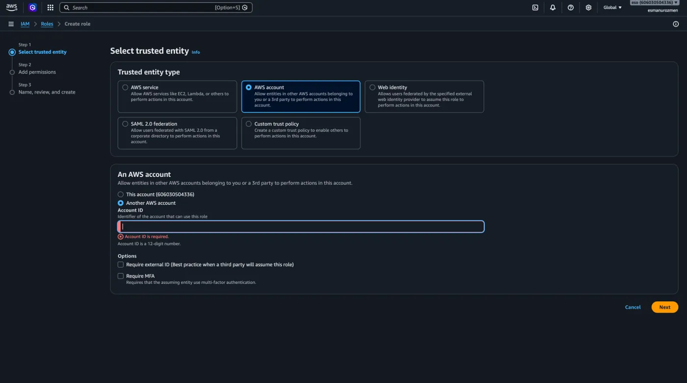

## Neden rol kullanılır

Oluşturduğumuz EC2 servisimizin AWS ile iletişime geçerek istediğimiz işlemleri gerçekleştirmesi için öncelikle bu servise bağlanmamız gerekir. Bağlanma işlemi için giriş bilgilerimizi bu sanal makineye text dosyası olarak gömmek güvenlik açısından uygun olmayacağından [rol](/aws/iam/kavramlar/#role) kullanırız. Öncelikle bu makineye bir rol atarız ardından bu rol için de bir policy atayarak bu policy üzerinde olan yetkileri makinemize sağlamış oluruz. Şimdi gelin nasıl rol oluşturabileceğimizi öğrenelim.

## EC2 için rol oluşturma

1. İlk olarak IAM servisi altından **Roles**'a tıklıyoruz. Ve **Create role** diyerek devam ediyoruz.

   

2. **AWS service** seçeneğini seçerek aşağıda belirttiğimiz servise bu AWS hesabından yetki vermek istediğimizi söylüyoruz. **Next** diyerek devam ediyoruz.

   

3. Ardından oluşturduğumuz rol için istediğimiz policy'leri seçerek gerekli yetkileri verip devam ediyoruz.

   

4. Oluşturacağımız rol için bir isim vererek **Create role** diyoruz ve işlemi tamamlıyoruz.

   

   ```json title="Trust policy"
   {
       "Version": "2012-10-17",
       "Statement": [
           {
               "Effect": "Allow",
               "Action": [
                   "sts:AssumeRole"
               ],
               "Principal": {
                   "Service": [
                       "ec2.amazonaws.com"
                   ]
               }
           }
       ]
   }
   ```

## Rolü EC2 instance'ına atama

1. Şimdi EC2 servisine gelerek **Instance ID** altındaki ID numaramıza tıklayarak sanal makinemizin ayarlarını açalım.

   

2. Sağ üstte bulunan **Actions** menüsü altından **Security**'ye tıklayalım. Ve **Modify IAM role** diyerek devam edelim.

   

3. Açılan ekranda az önce oluşturduğumuz rolü seçerek **Update IAM role** diyelim ve sanal makinemize atamış oluyoruz.

   

Şimdi tekrar sanal makinemize bağlanıp `aws ec2 describe-instances` komutunu çalıştırdığımızda artık makinemiz ile güvenilir şekilde haberleşebilir duruma geldik.



```bash frame="terminal"
aws ec2 describe-instances
```

```json title="Çıktı"
{
    "Reservations": [
        {
            "ReservationId": "r-0123456789abcdef0",
            "OwnerId": "************",
            "Groups": [],
            "Instances": [
                {
                    "Architecture": "x86_64",
                    ...
                    "Hypervisor": "xen",
                    "IamInstanceProfile": {
                        "Arn": "arn:aws:iam::************:instance-profile/Ec2-Admin-Acess",
                        "Id": "*********************"
                    },
                    "NetworkInterfaces": [
                        {
                            "Association": {
                                "IpOwnerId": "amazon",
                                "PublicDnsName": "ec2-203-0-113-11.eu-west-1.compute.amazonaws.com",
                                "PublicIp": "203.0.113.11"
                            },
                            ...
```

## Diğer rol türleri

### AWS account

Rolleri servislere atayabildiğimiz gibi farklı AWS hesaplarına da istediğimiz yetkileri atayabiliriz. Başka AWS hesaplarına kendi hesabımızda bazı işlemler yaptırmak istiyorsak onlara user açıp kullanıcı adı şifre verip bağlanmasını sağlamak yerine role oluşturup istediğimiz yetkileri atarız. Bunun için aşağıdaki ekrandan **AWS account**'u seçeriz.



### Web identity ve SAML 2.0 federation

Bir diğer rol oluşturma seçeneğimiz **web identity**. Bu rol ile dışarıdan gelen kullanıcılara veya uygulamalara da yetki verebiliriz. Örneğin; kullanıcıların kendi Google, Facebook veya Amazon gibi hesaplarıyla giriş yaparak AWS üzerinde bazı işlemler (örneğin bir dosyayı okumak) yapmasını istiyorsak, onlara sistemde tek tek IAM User açıp şifre vermek mantıklı değildir. Bunun yerine Web Identity (Web Kimliği) kullanarak, dışarıdan kimlik doğrulaması yapmış bu kişilere geçici bir rol atarız ve sadece belirlediğimiz sınırda işlem yapmalarını sağlarız. Bunun için **Web Identity** seçeneğini seçeriz.

Rolleri servislere, farklı hesaplara ve dış uygulamalara atayabildiğimiz gibi, şirketimizin kendi iç sistemindeki kurumsal kullanıcılara da atayabiliriz. Örneğin, çalıştığımız şirkette Microsoft Active Directory gibi bir kimlik sisteminde kayıtlı yüzlerce çalışan var ve bazılarının AWS hesabımıza girip işlem yapması gerekiyor. Her bir çalışana AWS üzerinde tek tek kullanıcı açıp şifre vermek ve işten ayrıldıklarında bunları silmekle uğraşmak çok büyük bir yüktür. Bunun yerine **SAML 2.0 Federation** kullanarak şirketimizin kimlik sistemini AWS ile konuştururuz. Böylece çalışanlar her gün kullandıkları şirket şifreleriyle güvenli bir şekilde giriş yapar ve AWS tarafında bizim oluşturduğumuz role bürünerek (assume role) sadece istediğimiz yetkilerle çalışırlar.

## Amazon Resource Names (ARN)

Böylece IAM servisini burada noktalayarak bir sonraki servisimiz olan [S3](/aws/s3/giris-ve-ilk-bucket/)'e geçmeden önce kısaca Amazon Resource Names (ARNs) konusuna değinelim.

Amazon servisleri altında yaptığımız işlemlerin tümünde esasında kaynaklar oluşturur ve onları yönetiriz. AWS dünyasında bu kaynakların her birini tanımlayan isme ARN denir.

### Partition

Ayrıca AWS, genel ticari bölgelerinin yanı sıra yasal gereksinimler, veri gizliliği ve güvenlik politikaları nedeniyle ABD ve Çin için tamamen izole özel bulut altyapıları sunar.

Partition, bir AWS kaynağının hangi tamamen izole edilmiş bağımsız altyapı ağında barındığını belirten ana kategoridir. Standart AWS hesaplarında kaynakların ARN (Amazon Resource Name) adresindeki partition değeri `aws` olarak geçerken; yasal regülasyonlar nedeniyle özel kurulan ABD GovCloud altyapısında bu değer `aws-us-gov`, Çin bölgelerinde ise `aws-cn` olarak farklılık gösterir.

### ARN nerede kullanılır

Peki bu ARN'yi gerçek hayatta nerede kullanıyoruz? ARN'yi, AWS dünyasındaki kaynakların T.C. Kimlik Numarası veya tam açık ev adresi gibi düşünebilirsiniz. En temel kullanım yeri ise yetkilendirme işlemleridir.

Diyelim ki oluşturduğumuz bir Role'e, Frankfurt bölgesinde (`eu-central-1`) çalışan belirli bir EC2 sanal sunucusunu yeniden başlatma yetkisi vereceğiz. Hesabımızda onlarca sunucu olabilir ancak biz sadece bir tanesine işlem yapılmasını istiyoruz. AWS'ye "Sadece bu spesifik sunucuya izin ver" demek için hedefin tam adresini belirtmemiz gerekir. Standart bir ARN formatı sırasıyla şu şekildedir:

```text
arn:partition:service:region:account-id:resource-id
```

Bu formata göre yetki vereceğimiz sunucunun tam adresi şöyle görünür:

```text
arn:aws:ec2:eu-central-1:123456789012:instance/i-0abcd1234efgh5678
```

Bu yapıyı parçalara ayırırsak:

- `arn`: Sabit başlangıç kelimesi.
- `aws`: Standart AWS altyapısında olduğumuzu belirtir (Partition).
- `ec2`: Yetki verdiğimiz AWS servisi.
- `eu-central-1`: Sunucumuzun bulunduğu bölge (Region).
- `123456789012`: 12 haneli AWS hesap numaramız.
- `instance/i-0abcd...`: Sunucunun kendisine ait benzersiz kimliği (Resource ID).

Kısacası ARN, yetki verirken veya otomasyon araçları (Terraform, Ansible vb.) kullanırken AWS'ye hedefi nokta atışı göstermemizi sağlar.
