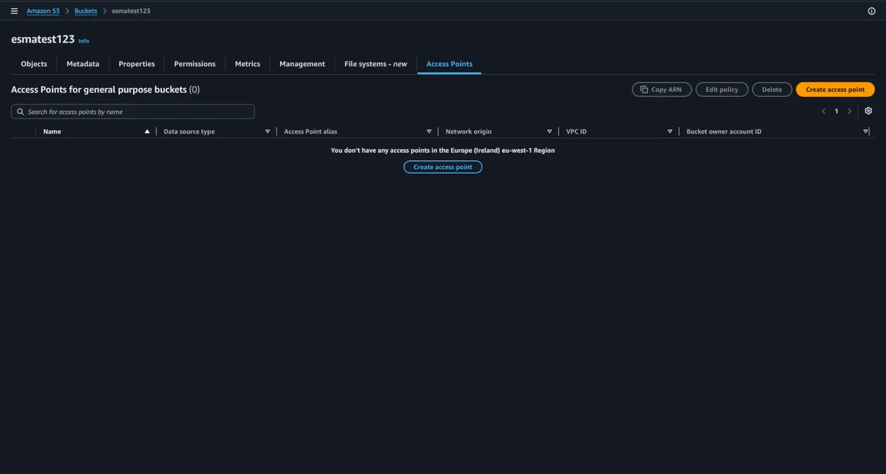
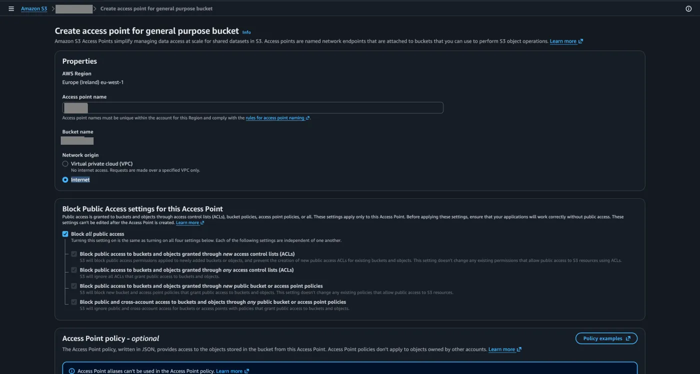

## Access Points nedir

Gelelim S3 yönetimindeki son ve en hayat kurtarıcı özelliklerden biri olan Access Points kavramına. Access Points; tek bir S3 bucket'ına bağlanan farklı uygulamaların erişim yetkilerini karmaşıklaşmadan yönetmemizi sağlayan özel giriş kapılarıdır.

Mantığı çok basittir: Büyük projelerde onlarca farklı uygulama aynı S3 bucket'ını kullanabilir. Herkesin yetkisini tek bir "[Bucket Policy](/aws/s3/bucket-policy-ve-statik-site/)" içinde yazmaya çalışırsanız, o kural listesi binlerce satıra ulaşır, yönetimi zorlaşır ve güvenlik açığı verme riski artar.

Bunun yerine Access Points kullanarak farklı kapılar açarız. Örneğin;

- Finans Ekibi için bir Access Point oluşturup sadece finans klasörünü okuma yetkisi veririz.
- Geliştirici Ekibi için ayrı bir Access Point oluşturup sadece test klasörüne dosya yükleme yetkisi veririz.

Kısacası, koca bir binaya karmaşık kuralları olan tek bir ana kapıdan giriş sağlamak yerine; her ekibe kendi departmanına açılan ve sadece kendi kurallarını içeren özel kapılar tahsis etmemizi sağlar. Bu da yönetimi ve güvenliği inanılmaz derecede kolaylaştırır.

## Access Point oluşturma

Gelin birlikte bir access point oluşturalım ve bunun üzerinden anlamaya çalışalım.

1. Sağ üstteki **Create access point** yazan butona tıklayarak başlayalım.

   

2. Öncelikle Access Point için unique bir isim belirleyerek başlıyoruz.
3. Ardından bu servisin en belirleyici özelliğine, yani ağ kaynağını seçtiğimiz adıma geliyoruz.

Bulut ortamına lokal bir bağlantı olarak düşünebileceğimiz bu özellik sayesinde, S3'e internet üzerinden değil de VPC aracılığıyla tamamen kapalı ve güvenli bir ağ üzerinden ulaşılmasını sağlayabiliriz. Bunun için erişimi kısıtlamak istediğimiz ağın ID'sini **VPC ID** yazan yere girebiliriz. Eğer böyle bir kapalı ağ zorunluluğumuz yoksa, **Internet** seçeneğini aktif ederek S3'e oluşturduğumuz bu Access Point üzerinden normal yollarla bağlanmaya da devam edebiliriz.

## Access Point policy

Sıradaki Access Point oluşturma adımı olan **Access Point Policy** kısmına geliyoruz. Bunu tıpkı [IAM](/aws/iam/kavramlar/) ve Bucket konularında öğrendiğimiz policy mantığı gibi düşünebiliriz. Böylelikle ana bucket yetkilerine dokunmadan, açtığımız bu özel kapılar üzerinden birden fazla uygulamaya veya ekibe çeşit çeşit, tamamen birbirinden bağımsız haklar verme şansımız oluyor.
