Bucket konusunu biraz daha detaylandıracak olursak öncelikle yeni bir bucket oluşturmak için `Create bucket` diyerek başlıyoruz.

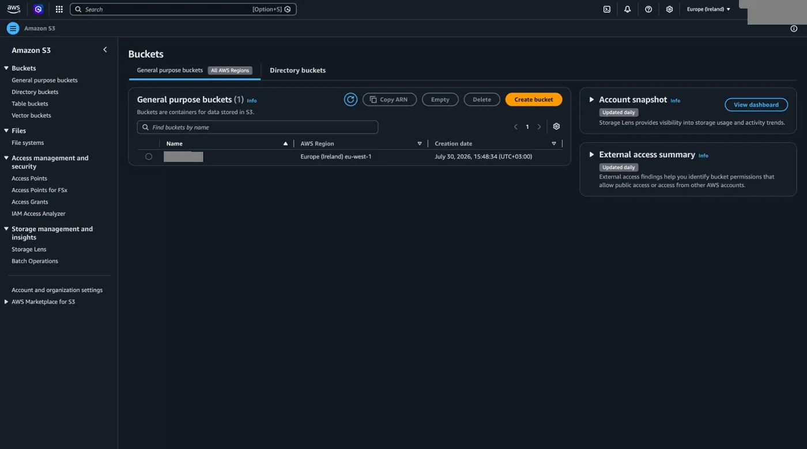

## General configuration

Daha önce bahsettiğimiz gibi unique bir isim giriyoruz. Eğer oluşturduğumuz başka bir bucket'ın özelliklerini oluşturacağımız bucket'a aktarmak istersek `Choose bucket` butonundan seçim yapabiliriz.

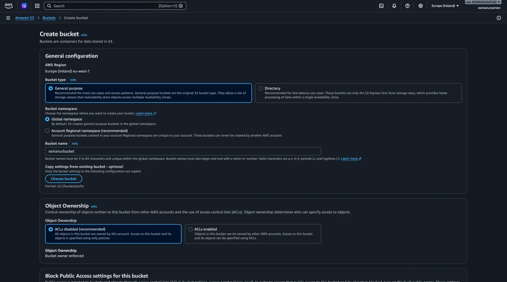

## IAM Policies ve ACL

AWS, S3 servisi ilk çıktığında bucket'lara erişimi yönetmek için iki temel yol sunuyordu. Bunlardan ilki **IAM Policies**, diğeri ise **ACL (Access Control List)** yöntemiydi.

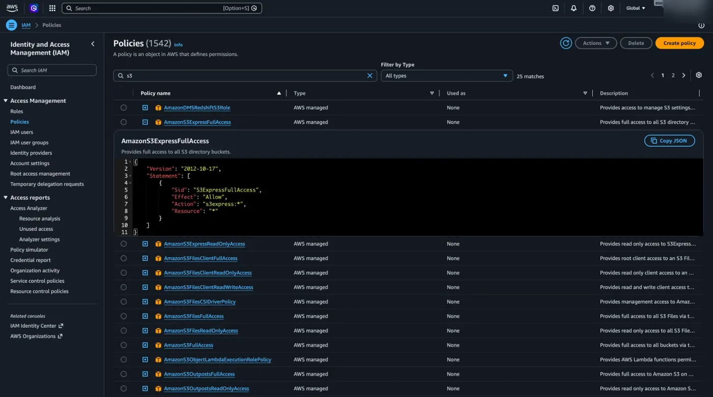

```json
{
    "Version": "2012-10-17",
    "Statement": [
        {
            "Sid": "S3ExpressFullAccess",
            "Effect": "Allow",
            "Action": "s3express:*",
            "Resource": "*"
        }
    ]
}
```

## Object Ownership

ACL sayesinde, ister farklı AWS hesaplarındaki kullanıcılara istersek de doğrudan dış dünyaya manuel olarak dosya bazında erişim yetkisi verebiliyorduk. Günümüzde de `ACLs enabled` seçeneğini seçerek bu şekilde manuel izinler tanımlamak hâlâ mümkün. Bu seçeneği aktif ettiğimizde aşağıda görüldüğü gibi iki kısım açılıyor.

- **Object writer:** Bucket'a yüklenen dosyaların sahipliğinin ve yetki haklarının, o dosyayı yükleyen kişiye (hesaba) ait olmasıdır.
- **Bucket owner preferred:** Bucket'a dışarıdan kim dosya yüklerse yüklesin, yüklenen o dosyaların sahipliğinin ve üzerindeki hakları belirleme yetkisinin doğrudan bucket'ın asıl sahibinde (yani bizde) kalmasıdır.

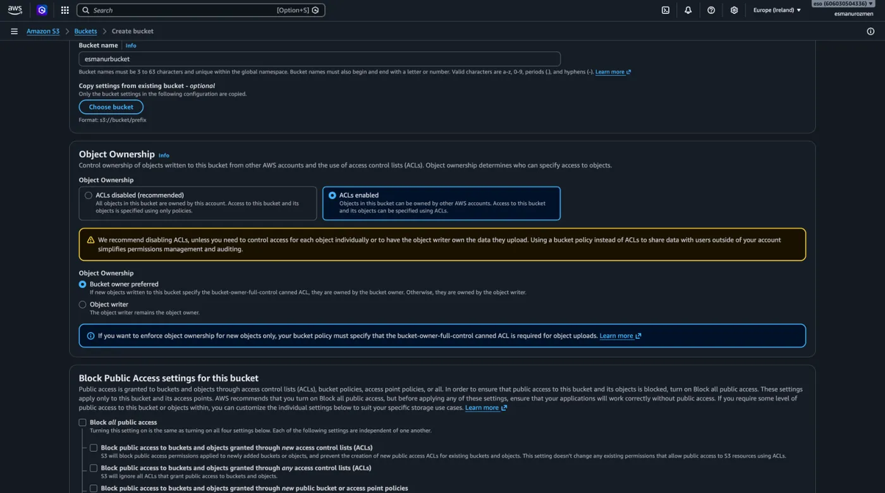

## Block Public Access ve Bucket Policies

Fakat zamanla S3 kullanımı o kadar yoğunlaştı ki, yapılan ufak konfigürasyon hataları yüzünden gizli kalması gereken bucket'ların yanlışlıkla tüm internete açılması büyük güvenlik sorunlarını beraberinde getirdi. AWS bu sorunların önüne geçmek için iki önemli adım attı.

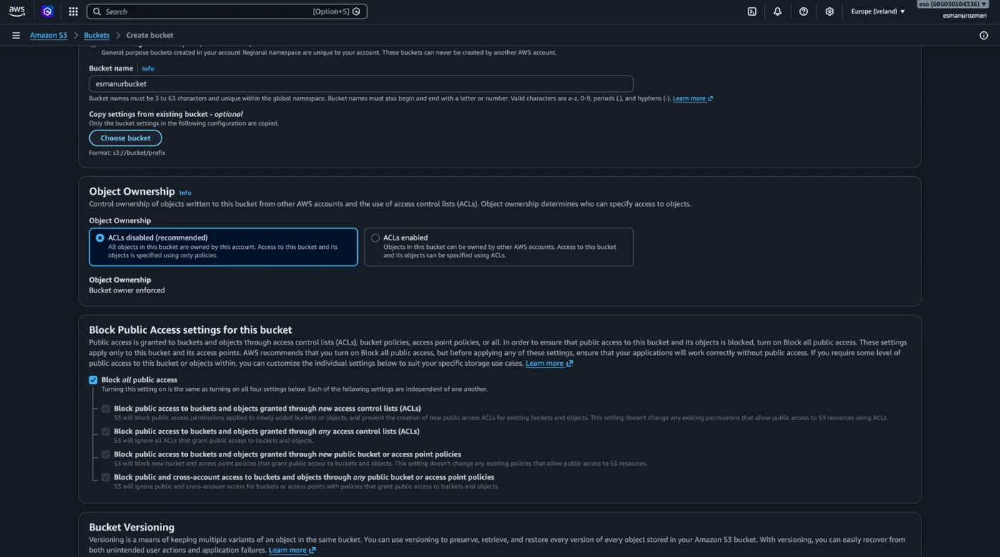

İlk olarak; bir bucket'ı public yapmak istediğinizde, olası tehlikeleri açıkça kabul ettiğinizi onaylamanızı isteyen ekstra güvenlik uyarıları getirdi. İkinci ve en büyük adım olarak ise, erişimi yönetmek için çok daha güvenli olan üçüncü bir yol geliştirdi: **Bucket Policies**.

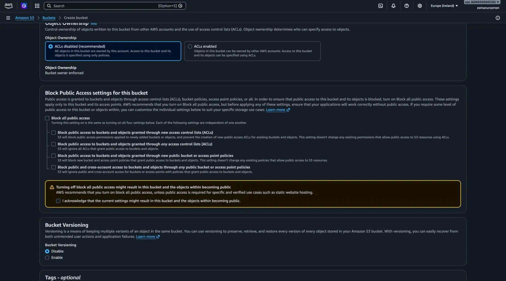

Peki nedir bu Bucket Policies? ACL'lerdeki gibi her dosya veya kullanıcı için tek tek izin ayarlamakla uğraşmak yerine, tüm bucket'ı veya içindeki belirli klasörleri tek bir JSON dosyası üzerinden yönetmemizi sağlayan yapıdır. Bu sayede 'Sadece bizim şirketimizin IP adresinden girilebilsin' veya 'Sadece şu hesaptaki kullanıcılar okuma yapabilsin' gibi çok daha detaylı ve gelişmiş kuralları tek bir merkezden kolayca yazabiliriz. Günümüzde AWS'nin de erişim yönetimi için en çok tavsiye ettiği yöntem tam olarak budur.

## Bucket Versioning

Bucket oluşturma aşamalarını öğrenmeye devam edecek olursak sıradaki karşımıza çıkan **Bucket Versioning** oluyor. Bu ayarı aktif ederek aynı isimli bir dosyayı AWS'ye atmaya devam ettiğimiz sürece AWS her yeni gönderilen dosyayı bize gösterir ancak önceki gönderdiğimiz aynı isimli dosyaları da silmez ve versiyonlanır. Dolayısıyla dosyamızdaki değişimlere de S3 üzerinden ulaşabiliriz.

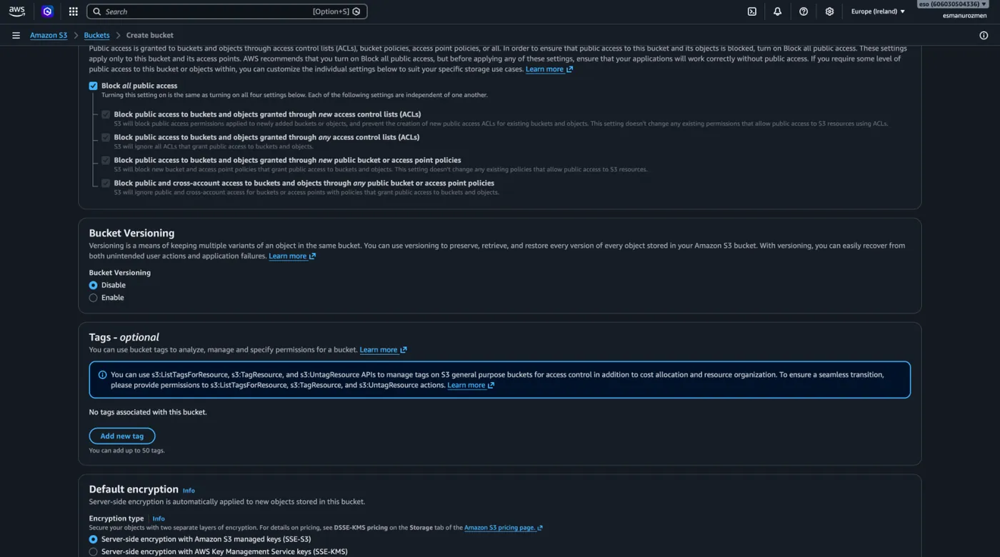

### Örnek

Gelin bu anlatımı bir örnekle somutlaştıralım. Öncelikle oluşturduğumuz txt dosyasını bucket'ımıza yüklüyoruz.

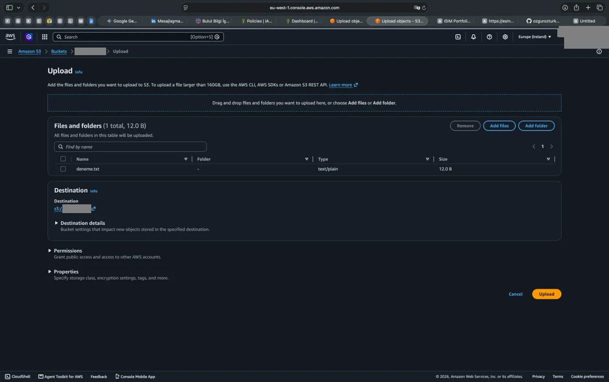

Dosyayı açtığımızda içerisinde yazdığımız metni görüyoruz.

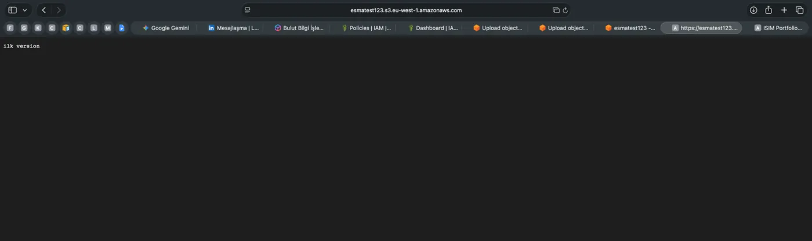

```text title="deneme.txt"
ilk version
```

Şimdi bilgisayarımızdaki dosya üzerinde değişiklikler yapalım ve bu yeni dosyayı aynı isimle S3'e tekrar yükleyelim. S3 arayüzünde **Objects** menüsüne gelip `Show versions` düğmesini aktif ettiğimizde, dosyamızın hem ilk halini hem de üzerinde değişiklik yapılmış güncel versiyonunu alt alta görebiliriz.

### Delete Marker

Burada bilmemiz gereken çok önemli bir silme kuralı var: Versiyonlama açıkken arayüzden dosyayı normal bir şekilde sildiğinizde, dosyanın geçmiş versiyonları aslında silinmez. AWS bunun yerine dosyanın en üstüne **Delete Marker** adında, 0 byte yer kaplayan özel bir etiket yerleştirir.

Eğer `Show versions` açıkken dosyanın altındaki tüm gerçek versiyonları silerseniz, dosyanın içeriği gitse bile bu Delete Marker bucket'ınızda kalmaya devam eder. AWS buna Süresi Dolmuş Silme İşaretçisi der. Bu etiketi daha önce öğrendiğimiz [Lifecycle Rule](/aws/s3/management/) ayarlarını kullanarak bucket'ta kalan bu içi boş Delete Marker'ların otomatik olarak temizlenmesini sağlamaktır.

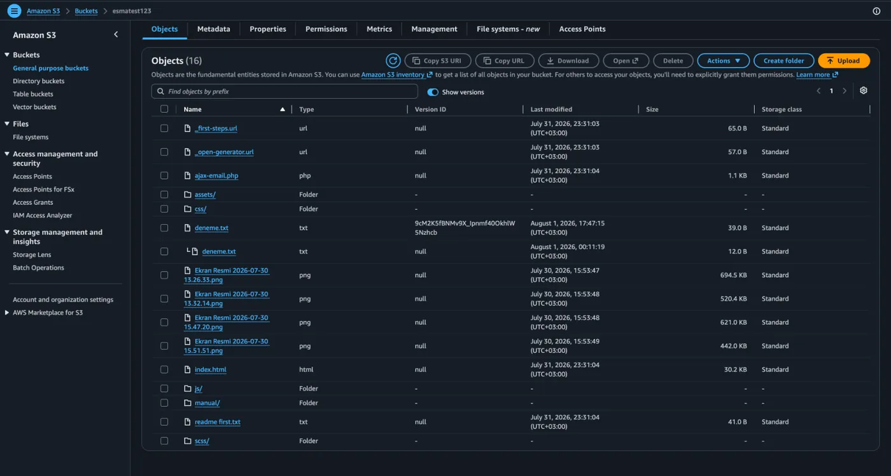

1. **Management** menüsü altından `Create lifecycle rule` butonuna tıkladıktan sonra açılan ekranda `Delete expired object delete markers or incomplete multipart uploads` yazan kutucuğu işaretliyoruz.
2. Hemen altındaki kutucuğu da işaretleyip devam ediyoruz.

   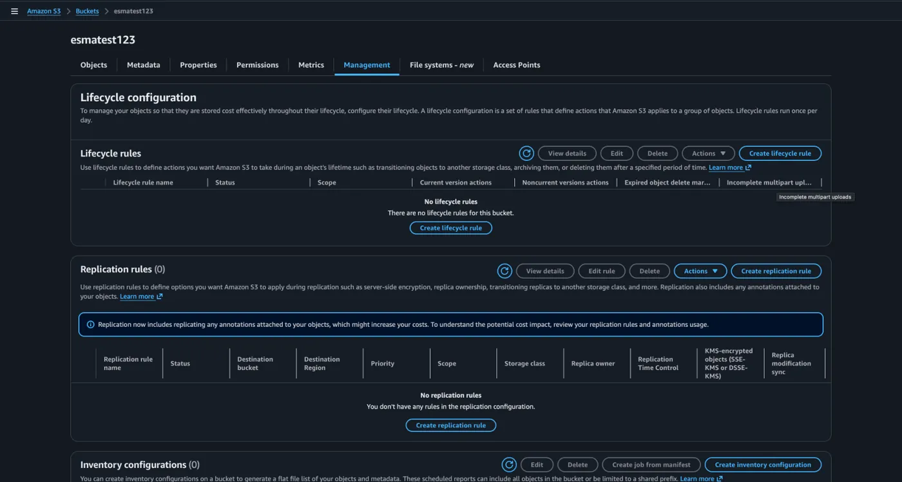

Böylece Lifecycle Rule sayesinde bucket'ımızı bu içi boş kalıntılardan arındırarak çok daha temiz ve profesyonel bir yönetim sağlamış oluyoruz. Kuralımızı en alttan kaydederek bu otomasyonu başarıyla devreye alıyoruz.

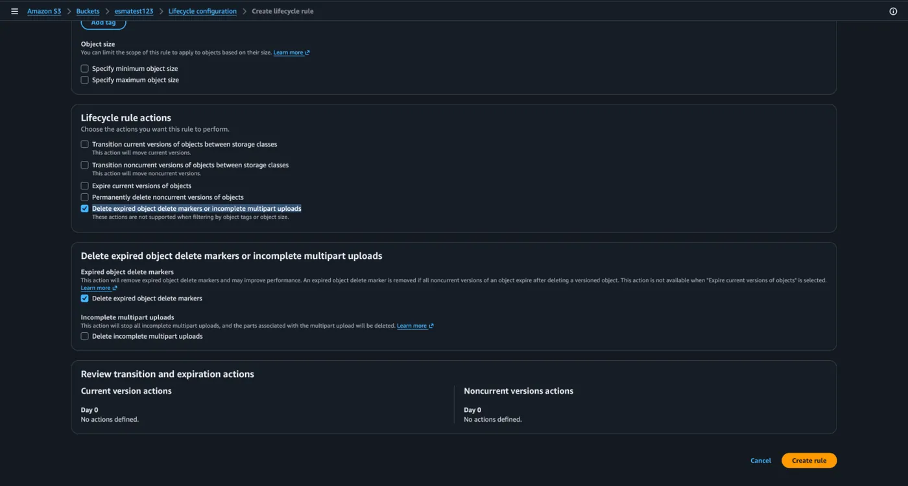

## Default encryption

AWS üzerindeki verilerimizi dış dünyaya karşı nasıl koruma altına aldığımızdan bahsetmiştik peki ya bu verileri AWS'ye karşı nasıl koruyacağız? Yani verilerimizin depolandığı fiziksel makineler, diskler üzerindeyken saf verimizin güvenliğini nasıl sağlayacağız? İşte bunun cevabı aşağıdaki görselde **Default encryption** ayarıyla sağlarız. Bu ayar bizlere üç farklı seçenekle sunuluyor. Bunlardan ilkini seçersek oluşturulan key dahil her şeyin yönetimini tamamen AWS'ye bırakmış oluruz.

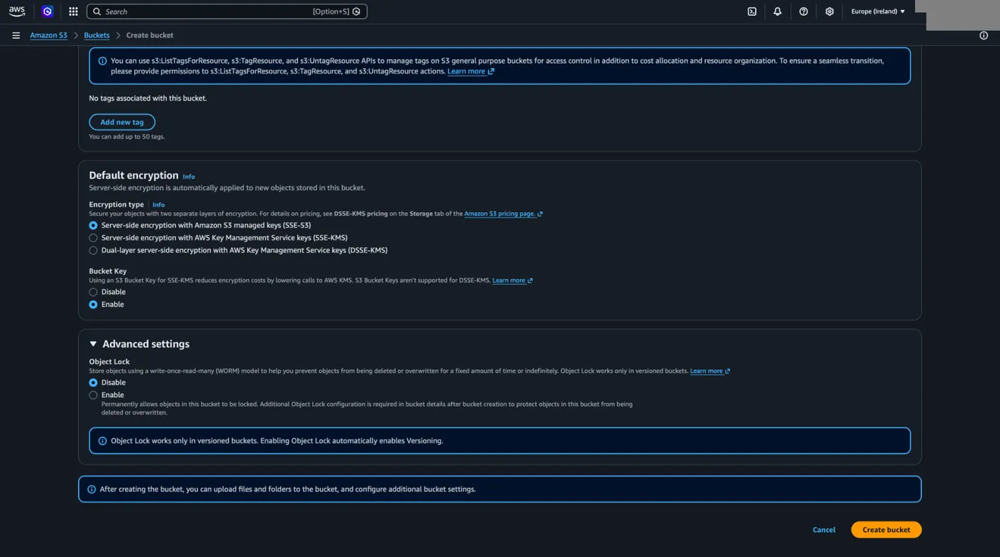

Eğer kendimiz bir key oluşturmak istersek ikinci seçeneği aktif ederiz. Key oluşturmak için dilersek AWS KMS key üzerinden dilersek kendi key management sistemimizde oluşturduğumuz key'i kullanıyoruz. İkisi arasındaki temel fark oluşturduğumuz key için belli aralıklarla yapılması gereken bakımları (belirli aralıklarla değiştirilmesi, saklanması vb.) AWS'nin yönetiyor oluşudur.

Eğer verimizi iki katman şifrelemeyle koruyarak güvenliği artırmak istersek de üçüncü seçeneği seçebiliriz. (DSSE-KMS)

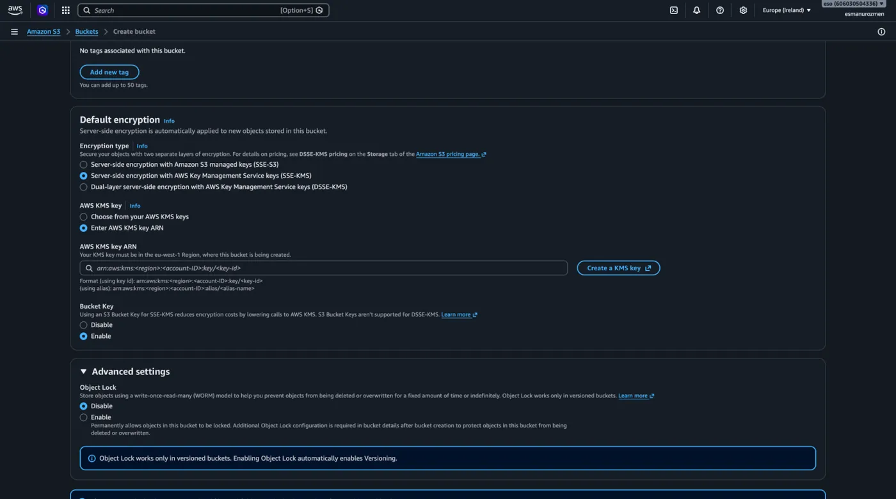

```text
arn:aws:kms:<region>:<account-ID>:key/<key-id>
```

## Object Lock

Ve bucket oluştururken yapabileceğimiz son ayar ise **Advanced settings** menüsü altındaki **Object Lock** ayarıdır. Bu seçeneği aktif ederek hiçbir şekilde silinmemesi ve değiştirilmemesi gereken dosyalarınızı muhafaza edebilirsiniz.
