## Block public access ayarını kapatma

Sıradaki **Permissions** başlığı altında neler yapabildiğimizi öğrenmeye başlayalım. Eğer oluşturduğumuz bir bucket public değilse ve bunu public olarak ayarlamak istiyorsak ilk olarak yapmamız gereken bu başlık altındaki block public access ayarını değiştirmek olmalıdır.

1. Bunun için **Block public access** yazan başlığın yanındaki **Edit** butonuna tıklıyoruz.

   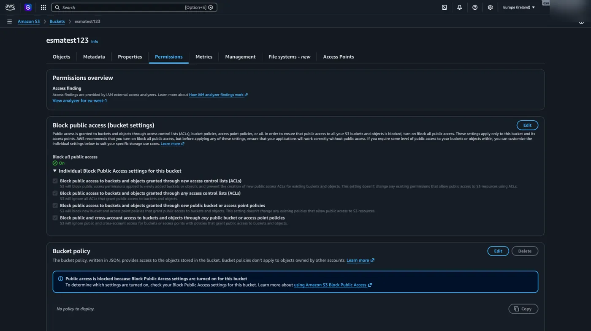

2. Bu şekilde işaretlenmiş olarak açılan sayfada tik işaretlerini kaldırıyoruz ve **Save changes** diyoruz.

   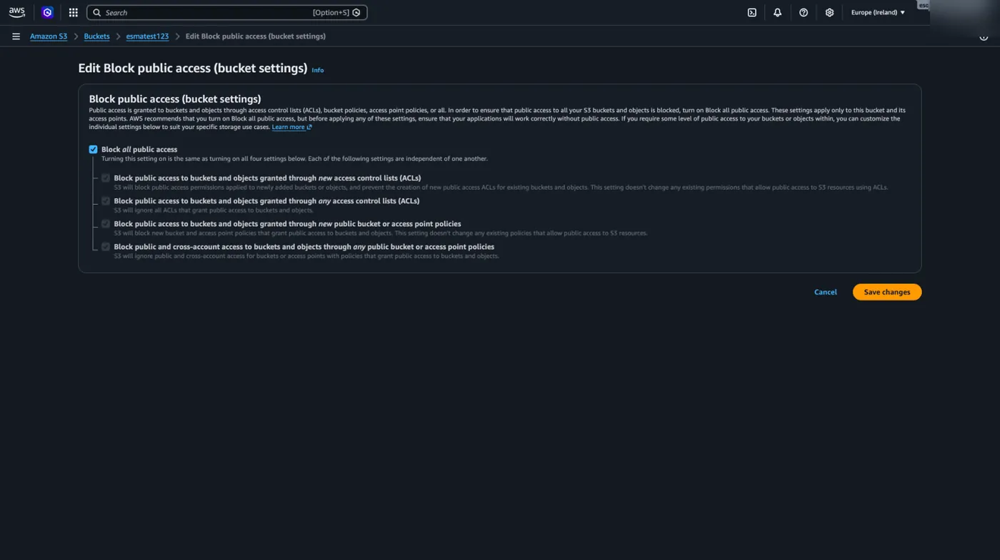

3. Ekrana gelen onayı da hallettikten sonra ilk aşamayı tamamlamış oluyoruz.

   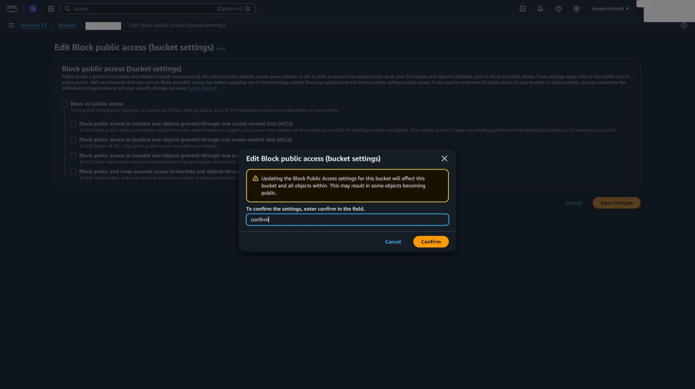

Ardından bundan sonra bucket'a kimin erişip erişemeyeceğini, ne şekilde erişeceğini belirlemek adına Bucket policy yazmamız gerekiyor.

## Bucket policy nedir

Peki nedir bu Bucket Policy ve nasıl yazılır? Kısaca özetlemek gerekirse Bucket Policy, S3 bucket girişinde duran güvenlik görevlisidir. AWS'nin anlayacağı JSON formatında yazılan bu kurallar bütünü, kimin hangi dosyaya ne yapabileceğini veya ne yapamayacağını çok ince detaylarına kadar belirlememizi sağlar.

Bir policy yazarken AWS'ye temelde şu 4 ana sorunun cevabını veririz:

- **Principal (Kim?):** Bu kural kimin için geçerli? Belirli bir IAM kullanıcısı mı, farklı bir AWS hesabı mı, yoksa internetteki herkes mi?
- **Action (Ne yapacak?):** Hangi işleme izin veriyoruz? Dosya okuma, dosya yükleme veya dosya silme gibi spesifik yetkiler.
- **Resource (Nerede?):** Bu işlem hangi kaynakta yapılacak? (Hatırlarsanız önceki kısımlarda öğrendiğimiz [ARN](/aws/iam/roller-ve-arn/) değerini işte tam burada, hedefin tam açık adresini noktası noktasına göstermek için kullanıyoruz.)
- **Effect (Sonuç ne?):** Bu işleme izin mi veriyoruz, yoksa kesin olarak yasaklıyor muyuz?

## Örnek bir senaryo: dosyalarımızı dış dünyaya açmak

Madem bir önceki adımda "Block Public Access" ayarını kapattık ve dış erişimin önündeki kalkanı kaldırdık, şimdi de policy yazarak içerdeki dosyalarımızın herkes tarafından sadece "okunabilmesini" (görüntülenebilmesini) sağlayalım.

Bunun için Bucket Policy editörüne şu şekilde çok temel bir JSON kodu yazarız bunun için **Edit** butonuna tıklayarak yazmaya başlayabiliriz.

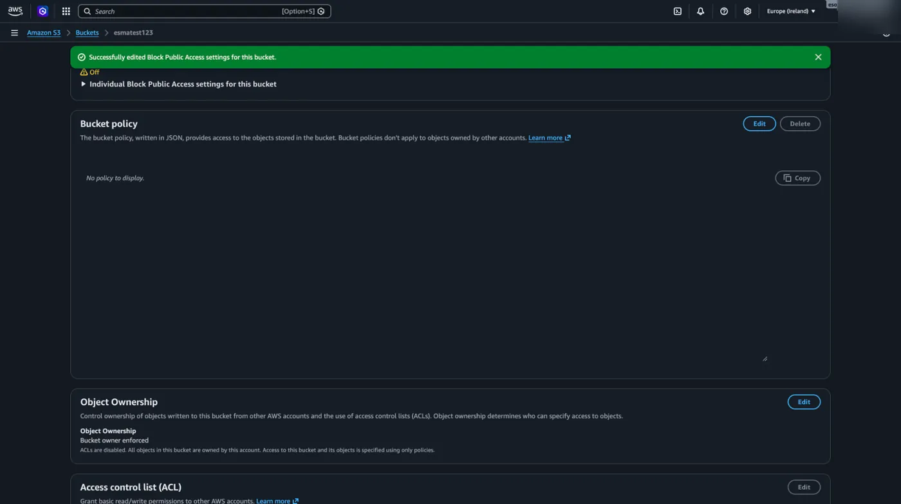

```json title="Bucket policy"
{
    "Version": "2012-10-17",
    "Statement": [
        {
            "Effect": "Allow",
            "Principal": "*",
            "Action": "s3:GetObject",
            "Resource": "arn:aws:s3:::ornek-bucket-123/*"
        }
    ]
}
```

Bu koda baktığımızda; Effect kısmındaki `"Allow"` ifadesi, tanımladığımız bu erişim işlemine izin verdiğimizi belirtir (eğer buraya `"Deny"` yazsaydık işlemi kesin bir şekilde yasaklamış olurduk). Principal kısmındaki `*` (yıldız) işareti "internetteki herkes" anlamına gelir. Action kısmındaki `s3:GetObject` ise bu kişilere sadece "dosyayı alıp görüntüleme/indirme" yetkisi verdiğimizi; kimsenin dışarıdan gelip bucket'ımıza dosya yükleyemeyeceğini veya silemeyeceğini garanti eder. Resource kısmının sonundaki `/*` ise bu okuma izninin bucket içindeki tüm dosyalar için geçerli olduğunu gösterir.

Yazdığımız kodu kaydetmek için **Save changes** butonuna tıklamamız yeterli olacaktır.

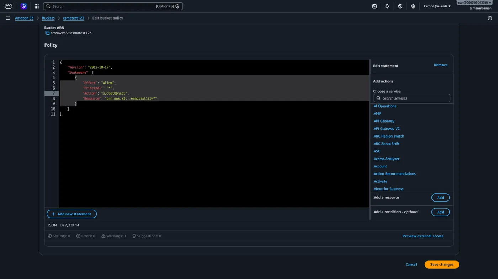

## Statik web sitesi yayınlama

Eğer tüm ayarlamaları yaptıysak artık Static website hosting için küçük bir çalışma yapabiliriz. Önceden bucket policy'miz olmadığı için dış dünyadan erişim yoktu.

### Static website hosting'i açma

1. Öncelikle **Properties** menüsü altından **Static website hosting** başlığında **Edit** butonuna tıklıyoruz.

   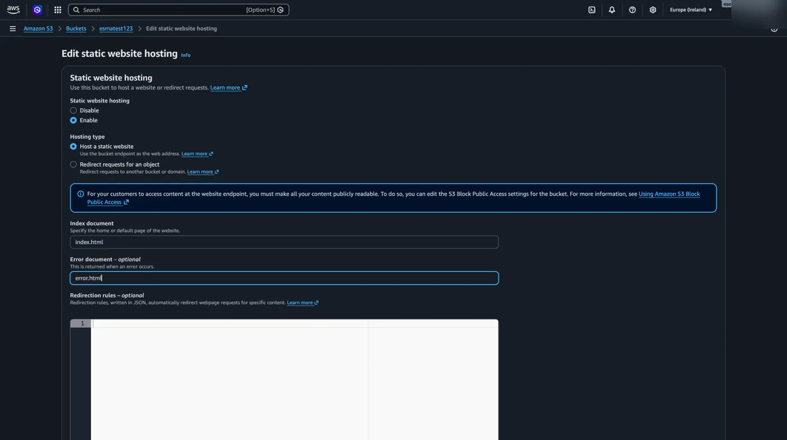

2. Açılan ekrandaki seçimi **Enable** olarak değiştiriyoruz ve istenilen yazıları boşluklara yazarak **Save changes** diyerek devam ediyoruz.

   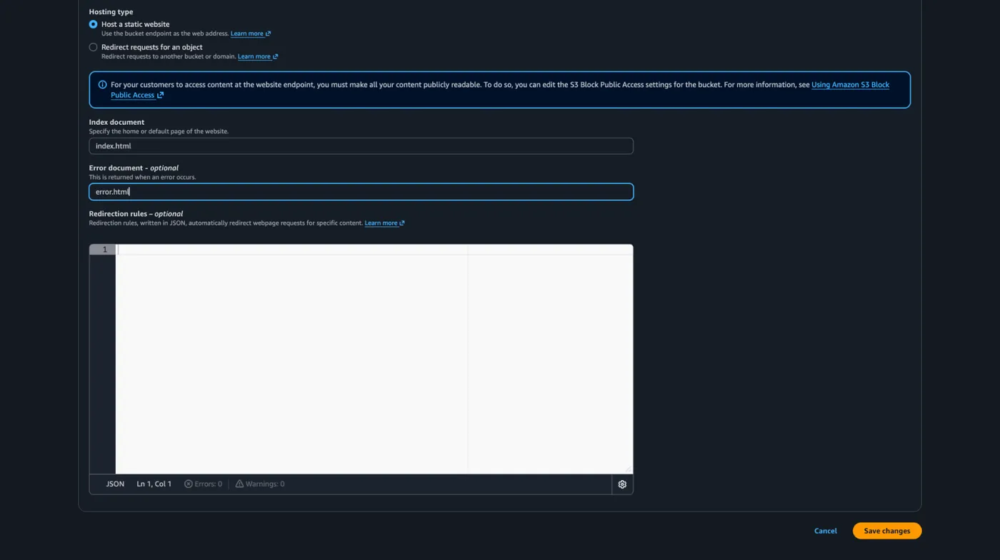

   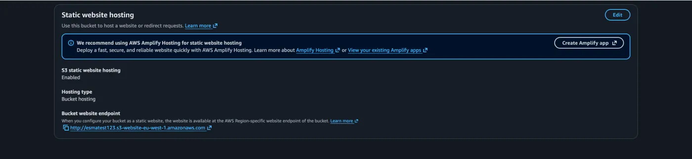

   ```text
   http://ornek-bucket-123.s3-website-eu-west-1.amazonaws.com
   ```

Static website hosting altında oluşan bizim erişeceğimiz web sitemizin linkini oluşturuyor.

### Site dosyalarını yükleme

1. Ardından **Objects** menüsüne gelerek **Upload** butonuna tıklıyoruz ve https://github.com/aytitech/public/raw/main/sayfa.tgz linkte bulunan dosyaları buraya yüklüyoruz.

   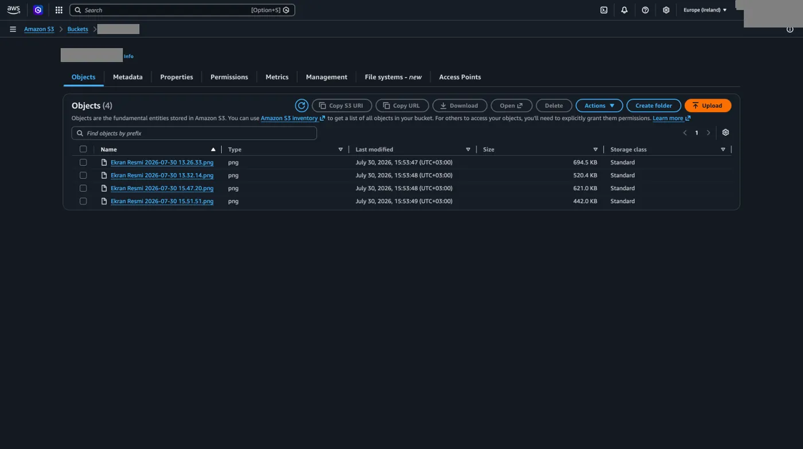

2. Gerekli dosyaları seçtikten sonra **Upload** butonuna tıklıyoruz.

   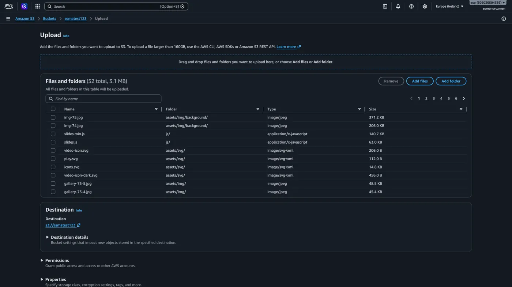

   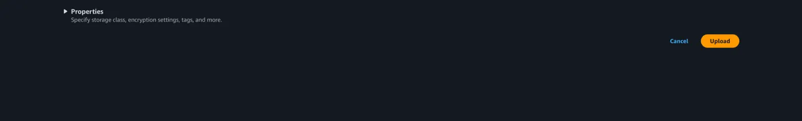

3. İşlememizin gerçekleşmesini bekliyoruz.

   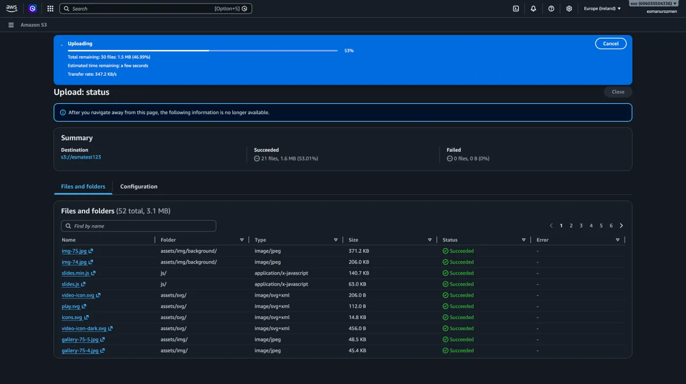

Tebrikler! Web sitemiz artık erişime açık. Static website hosting başlığı altındaki linki tarayıcınıza yapıştırıp sonucu kendiniz görebilirsiniz.

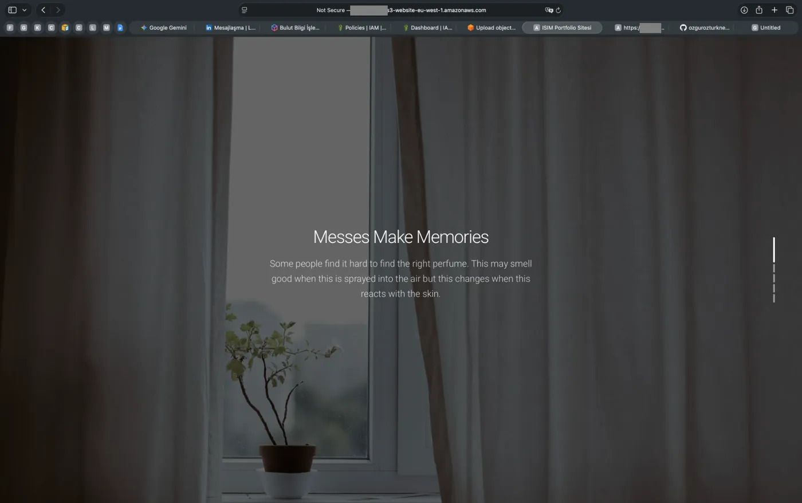
