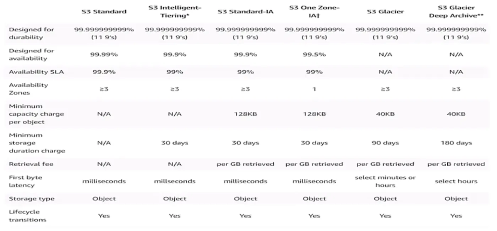
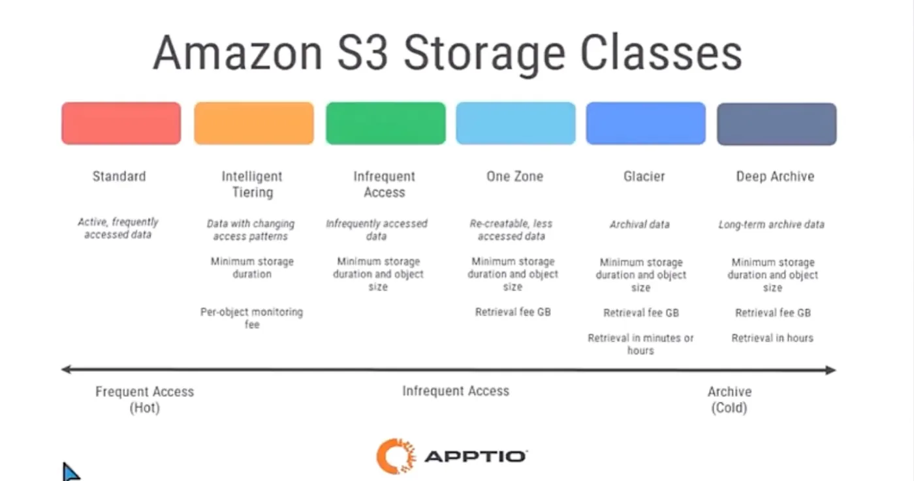

## Depolama sınıfları (Storage Classes)

S3 konusunda ilerlemeye depolama sınıflarıyla (Storage Classes) devam edelim. S3 tek bir servis olmasına rağmen, objeleri kullanım senaryomuza göre tutabileceğimiz farklı depolama sınıfları mevcuttur.

Biz bir S3 servisini kullandığımızda arka tarafta aslında şu olur: AWS'nin veri merkezlerinde çok büyük disklerden oluşan depolama altyapıları vardır ve bunların tamamını AWS yönetir. Biz bir objeyi S3'e yüklediğimiz zaman, arka planda bu verinin makinelere nasıl dağıtılacağını ve nasıl saklanacağını depolama sınıflarını seçerek biz belirleriz.

## S3 Standard

Bu sınıflardan ilki **S3 Standard**'dır. Değiştirilmediği sürece yüklediğimiz her dosya varsayılan olarak bu sınıfa yüklenir. Bunun anlamı şudur: Yüklediğimiz dosya, veri merkezindeki birden fazla makineye yedeklenir ki makinelerden biri bozulursa verimiz kaybolmasın. Aynı zamanda o bölgedeki diğer veri merkezlerine de kopyalanır. Bu sayede bir veri merkezine komple erişilemiyor olsa bile verimize her zaman ulaşabiliriz. AWS, S3 Standard seçeneğinde bizlere (%99.999999999) dayanıklılık sunarak, zaman içerisinde bir milyar dosyadan en fazla bir tanesini kaybedebileceğinin garantisini verir.

:::caution[Düzeltme]
%99.999999999 (11 dokuz) bir garanti değil, yıllık dayanıklılık için tasarım hedefidir (Designed for durability). AWS'nin ifadesiyle 10 milyon obje saklarsanız ortalama 10.000 yılda bir obje kaybı beklenir.
:::

| | S3 Standard | S3 Intelligent-Tiering* | S3 Standard-IA | S3 One Zone-IA† | S3 Glacier | S3 Glacier Deep Archive** |
| --- | --- | --- | --- | --- | --- | --- |
| Designed for durability | 99.999999999% (11 9's) | 99.999999999% (11 9's) | 99.999999999% (11 9's) | 99.999999999% (11 9's) | 99.999999999% (11 9's) | 99.999999999% (11 9's) |
| Designed for availability | 99.99% | 99.9% | 99.9% | 99.5% | N/A | N/A |
| Availability SLA | 99.9% | 99% | 99% | 99% | N/A | N/A |
| Availability Zones | ≥3 | ≥3 | ≥3 | 1 | ≥3 | ≥3 |
| Minimum capacity charge per object | N/A | N/A | 128KB | 128KB | 40KB | 40KB |
| Minimum storage duration charge | N/A | 30 days | 30 days | 30 days | 90 days | 180 days |
| Retrieval fee | N/A | N/A | per GB retrieved | per GB retrieved | per GB retrieved | per GB retrieved |
| First byte latency | milliseconds | milliseconds | milliseconds | milliseconds | select minutes or hours | select hours |
| Storage type | Object | Object | Object | Object | Object | Object |
| Lifecycle transitions | Yes | Yes | Yes | Yes | Yes | Yes |

Diğer bir garanti ettiği özellik ise %99.99 oranında Availability SLA'idir. Bu, bir ay içerisinde en fazla 4 dakika 21 saniye erişim kesintisi yaşayabilirsin, diğer tüm zamanlarda dosyalarına kesintisiz erişirsin anlamına gelir. En sık ve sürekli erişmemiz gereken objeleri bu sınıfta tutarız. Depolama maliyeti en yüksek olan sınıf da burasıdır.

:::caution[Düzeltme]
Tablodaki gibi S3 Standard'ın %99.99 değeri tasarlanan erişilebilirliktir (Designed for availability); Availability SLA ise %99.9'dur. Ayda yaklaşık 4 dakika 21 saniyelik kesinti %99.99'a karşılık gelir.
:::

## Diğer sınıflar

İkinci olarak en çok kullandığımız sınıf **S3 Standard-IA (Infrequent Access)** sınıfıdır. Burada teknik özellikler hemen hemen aynı olmakla birlikte, Standard sınıfa göre depolama için yarı fiyatına ödeme yaparsınız; ancak yüklediğiniz dosyaya her eriştiğinizde ekstra bir veri çekme ücreti ödersiniz. Buradaki amaç; nadir eriştiğimiz ancak gerektiğinde anında ulaşmak istediğimiz dosyaları maliyet avantajıyla saklamaktır.

Bir diğer seçenek ise **S3 One Zone-IA** sınıfıdır. Bu sınıfın en büyük farkı, dosyaların üç farklı veri merkezinde değil, tek bir veri merkezinde tutulmasıdır. Dolayısıyla o veri merkezinde yaşanan bir felakette dosyalarınıza erişemeyebilir veya kaybedebilirsiniz. Ancak bu risk karşılığında diğer iki sınıfa göre daha ucuz bir depolama sunar.

Bu sınıfları seçmenin üç yolu vardır: Dosyaları yüklerken seçebiliriz, yükledikten sonra değiştirebiliriz ya da [Lifecycle Rule](/aws/s3/management/) kuralları koyarak belirli bir süre sonra dosyaların otomatik olarak diğer sınıflara taşınmasını sağlayabiliriz.

Ya da bu sınıflardan hiçbirini seçmekle uğraşmazsınız ve AWS'nin kullanım alışkanlıklarınızı izleyerek dosyayı en uygun maliyetli yere otomatik taşımasına izin vermek adına **S3 Intelligent-Tiering** (Akıllı Katmanlandırma) sınıfını seçersiniz.

Eğer erişme süresinin önemsiz olduğu, dosyayı istediğinizde gelmesinin birkaç saat sürmesinin sorun yaratmayacağı, ama yıllarca yasal zorunluluk gibi sebeplerle saklanması gereken dosyalarınız varsa, bunları **Glacier Deep Archive** sınıfında tutabilirsiniz. S3'ün depolama maliyeti açık ara en ucuz olan sınıfıdır.

Dosyalarınızı arşivlemeniz gereken ancak istediğinizde anında erişmek istediğiniz dosyalar için ise **S3 Glacier Instant Retrieval** sınıfını kullanabilirsiniz. Ancak burada Glacier sınıflarında aylık depolama ücretleri çok ucuz olsa da, dosyayı okumak/indirmek istediğinizde kesilen veri çekme ücretleri yüksektir. Eğer bu sınıftaki bir dosyaya sürekli erişmeye çalışırsanız, faturanız S3 Standard sınıfından bile çok daha pahalıya gelebilir.

| Sınıf | Kullanım | Dikkat edilecekler |
| --- | --- | --- |
| Standard | Active, frequently accessed data | |
| Intelligent Tiering | Data with changing access patterns | Minimum storage duration; per-object monitoring fee |
| Infrequent Access | Infrequently accessed data | Minimum storage duration and object size |
| One Zone | Re-creatable, less accessed data | Minimum storage duration and object size; retrieval fee GB |
| Glacier | Archival data | Minimum storage duration and object size; retrieval fee GB; retrieval in minutes or hours |
| Deep Archive | Long-term archive data | Minimum storage duration and object size; retrieval fee GB; retrieval in hours |

## S3 fiyatlandırması

S3 servislerindeki fiyat hesaplaması;

- toplam depolanan veri boyutu (GB cinsinden),
- S3'ten dış dünyaya transfer edilen veri boyutu ve
- toplam obje erişim isteği sayısına göre yapılır.

Ayrıca her region için fiyatlandırma değişebilir ve AWS kullanımınız ne kadar artarsa fiyat o kadar düşer.

Kullanımınız sonucunda ne kadar bir ücret ödeyeceğinizi hesaplamak isterseniz [https://calculator.aws/#/](https://calculator.aws/#/) adresini ziyaret edebilirsiniz.
