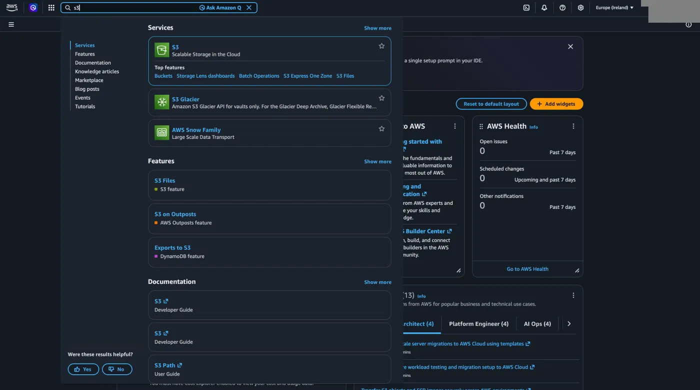
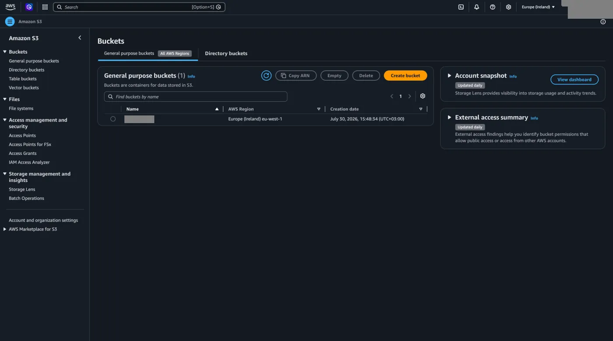
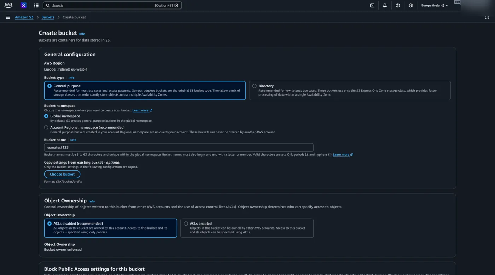
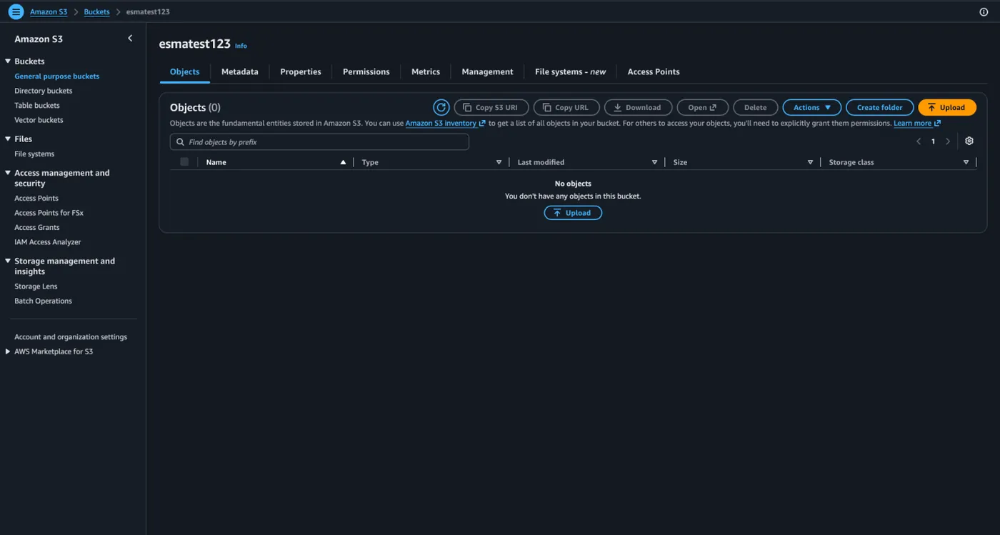
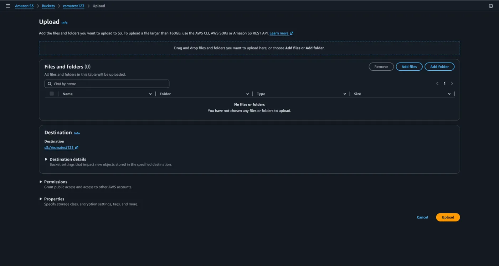
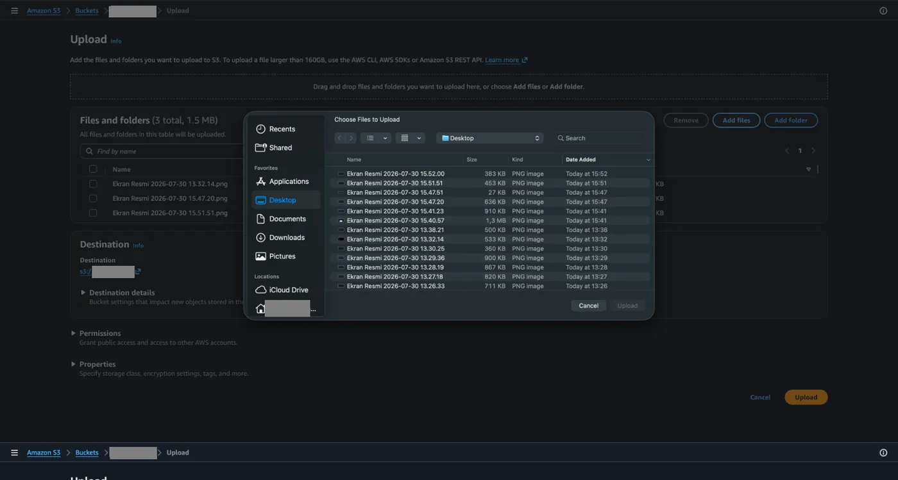
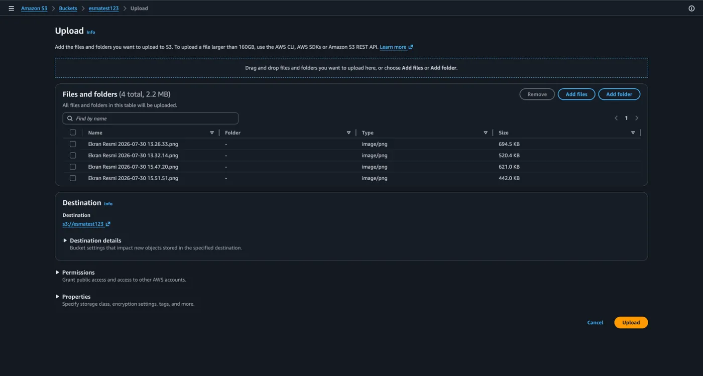
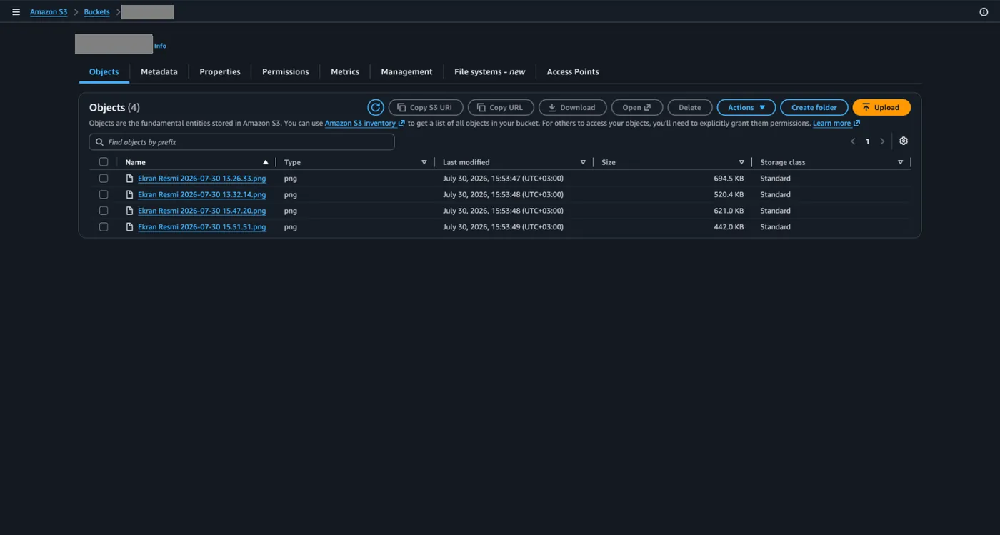
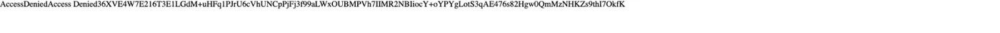
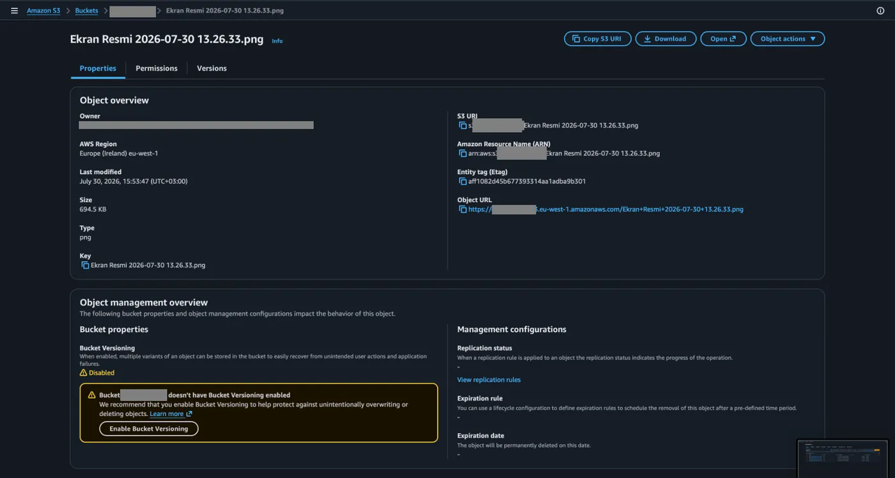

Evet, şimdi S3 konusuna giriş yapma zamanı!

## S3 nedir?

Öncelikle bu ismin nereden geldiğine bir bakalım: S3 kısaltması, adını İngilizce **S**imple **S**torage **S**ervice (Basit Depolama Servisi) kelimelerinin baş harflerindeki üç adet 'S' harfinden alıyor.

S3'ü en basit haliyle bir OneDrive ya da Google Drive olarak düşünebiliriz. Nasıl ki Google Drive'a kendimiz dosyalar gönderiyoruz ve orada saklayabiliyoruz, AWS dünyasında da bunu S3 hizmeti sağlar. Elbette S3 servisi kendi kişisel dosyalarımızı tutmamız için oluşturulmuş bir servis değildir ancak temelde yaptığı iş aynıdır. Resim, PDF, log dosyaları gibi dosya olarak tutabildiğimiz tüm verileri saklayabildiğimiz obje tabanlı bir servistir.

## Blok ve obje tabanlı depolama

Burada obje tabanlı olarak neyi kastettiğimize basitçe değinelim;

Depolama olarak kullanabileceğimiz temelde 2 çeşit sistem vardır. Bunlardan biri blok tabanlı diğeri obje tabanlı veri depolama sistemleridir. Aralarındaki en temel fark blok tabanlı sistemlerin esasında birer disk imajı şeklinde olmasıdır. Bir bilgisayara bağlanarak işletim sistemi, uygulama, veritabanı vs. kurulabilmektedir. Obje tabanlı depolama sistemleri makineye bağlanamaz. Web üzerinden, API veya uygulamalar üzerinden vs. erişebiliriz. Obje tabanlı sistemlerde aklınıza gelebilecek her türlü dosyayı barındırabiliriz. Ayrıca objelerle ilgili metadataları da depolayabiliriz.

## S3 obje özellikleri

S3 obje özellikleri şunlardır;

0 KB'tan 5 TB'a kadar büyüklükte dosyaları depolayabilirsiniz.

5 TB tek bir dosyanın maksimum büyüklüğüdür. S3 limitsizdir. İstediğiniz kadar dosya koyabilirsiniz. S3 depolama birimlerine **bucket** (kova) denilir. **Metadata**, veri hakkındaki veri demektir. Örneğin objenin yaratılma tarihi `Date`, boyutu `Content-Length` değişkenleri o obje ile birlikte tutulan metadatalardır.

## İlk bucket'ı oluşturma

AWS üzerinden bir bucket nasıl oluşturulur öğrenelim;

1. Öncelikle ana sayfadan arama yerine `s3` yazıp ilk seçeneğe tıklıyoruz.

   

2. Ardından açılan ekrandan sağ üstteki `Create bucket` butonuna tıklıyoruz.

   

Öncelikle şunu bilmeliyiz ki AWS üzerinden oluşturduğumuz bucket'ların temel olarak unique bir isme sahip olması gerekir. Çünkü buradaki isim tüm AWS hesaplarında unique olmak zorundadır. Bu kurala göre bir isim vererek diğer ayarları şimdilik geçip `Create bucket` diyoruz.




## Bucket'a dosya yükleme

Oluşturduğumuz bucket'a girerek içine birkaç görsel yükleyelim.

1. Bunun için öncelikle `Upload` butonuna tıklıyoruz.

   

2. Ardından açılan ekranda `Add files` diyerek istediğimiz görselleri seçiyoruz ve `Upload` diyerek yüklüyoruz.

   

   

   

## Obje bilgileri ve obje URL'si

Yüklediğimiz görsellerin bilgilerine **Name** altındaki mavi yazılara tıklayarak erişebiliriz.



| Alan | Örnek değer |
| --- | --- |
| AWS Region | `Europe (Ireland) eu-west-1` |
| Size | `694.5 KB` |
| Type | `png` |
| Key | `Ekran Resmi 2026-07-30 13.26.33.png` |
| S3 URI | `s3://ornek-bucket-123/Ekran Resmi 2026-07-30 13.26.33.png` |
| Amazon Resource Name (ARN) | `arn:aws:s3:::ornek-bucket-123/Ekran Resmi 2026-07-30 13.26.33.png` |
| Object URL | `https://ornek-bucket-123.s3.eu-west-1.amazonaws.com/Ekran+Resmi+2026-07-30+13.26.33.png` |

Burada objemizin URL'sine gitmeye çalıştığımızda aşağıdaki gibi bir hatayla karşılaşırız. Bu URL'ye dikkat edecek olursak, linkin içinde bucket oluştururken verdiğimiz ismi görürüz. İşte bucket isimlerinin unique olma zorunluluğu tam olarak bundan kaynaklanır. Çünkü S3 üzerinde oluşturduğunuz her bucket aslında internette bir web adresi üretir ve internet dünyasında aynı URL'den iki tane olamayacağı için, başka hiçbir AWS kullanıcısıyla aynı ismi paylaşamazsınız. Ayrıca burada aldığımız hatanın sebebi; bu URL yapısı teorik olarak dünyanın her yerinden dosyamıza erişim imkanı sunsa da, güvenlik gereği bucket'ı dışarıya (Public Access) açık hale getirmemiş olmamızdır. AWS varsayılan olarak bu erişimi kapalı tutar.



```text title="Tarayıcı çıktısı"
AccessDenied
Access Denied
...
```


