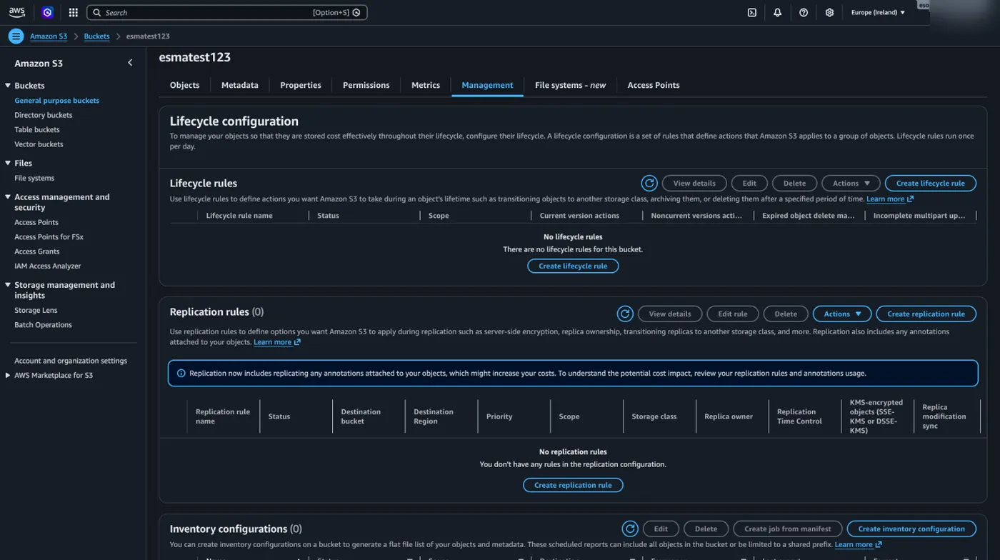
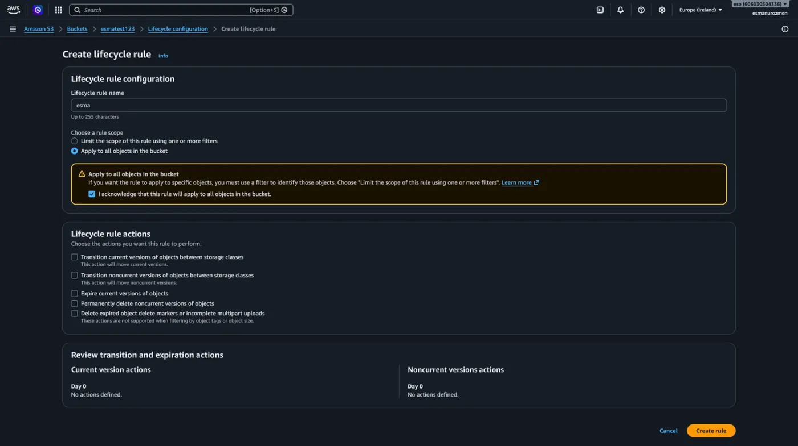
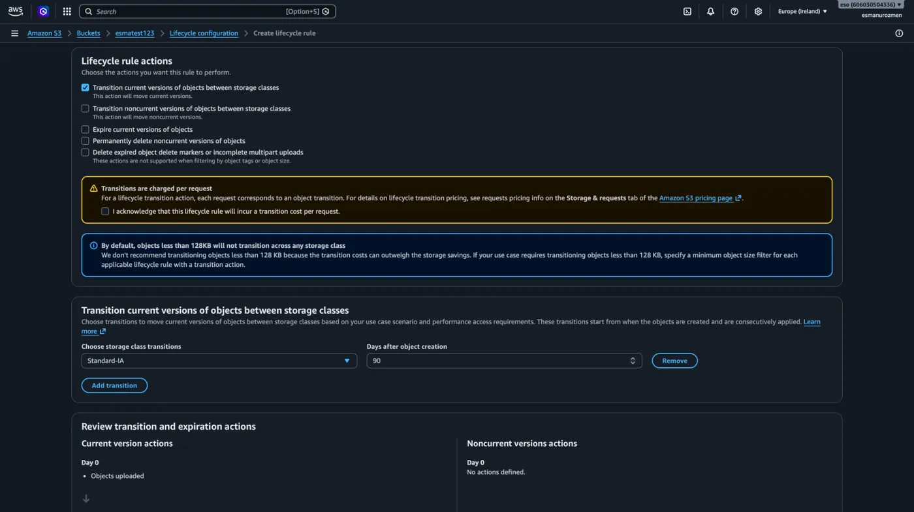
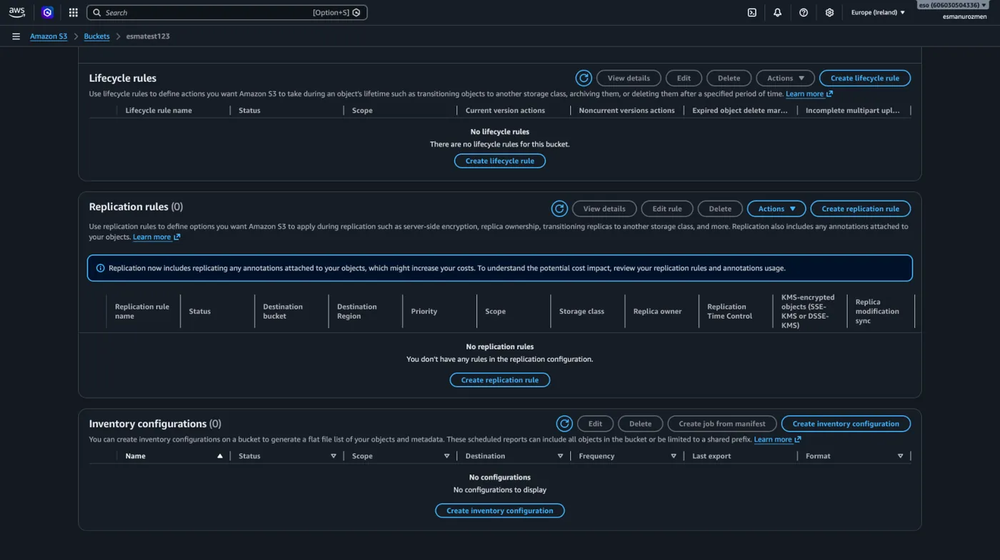
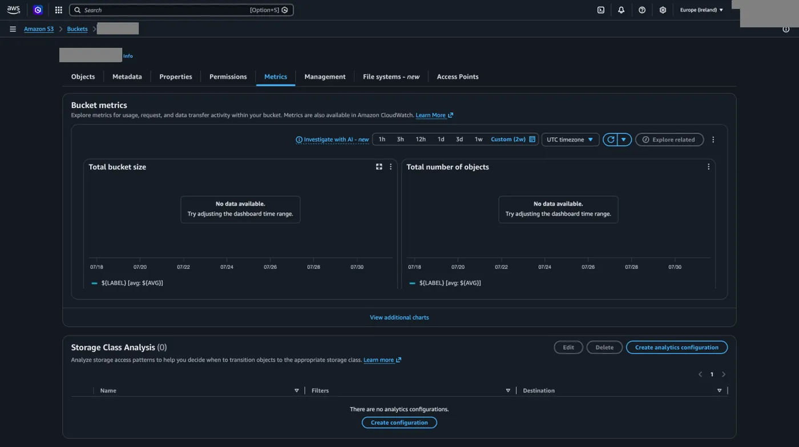

## Lifecycle rules

**Management** menüsünün ilk başlığıyla bucket özelliklerini öğrenmeye devam edelim. Bir dosyayı yüklerken istediğimiz [depolama sınıfını (storage class)](/aws/s3/depolama-siniflari/) seçebileceğimizden ve S3 Intelligent-Tiering sınıfını seçtiğimizde sistemin dosyamızı kullanım sıklığımıza göre en uygun erişim katmanına yerleştireceğinden bahsetmiştik. Şimdi ise dosyalarımızı bu farklı depolama sınıfları arasında taşıyabileceğimiz kurallar oluşturmamıza imkan veren Lifecycle Rule konusuna geçiyoruz.

1. Bunu öğrenmeye başlamak için **Create lifecycle rule** butonuna tıklayarak başlayalım.

   

2. Ardından bir isim belirleyerek devam edelim ve bucket altındaki tüm objelere bunun uygulaması için kutucuğu işaretliyoruz.

   

### Lifecycle aksiyonları

Aşağıda gördüğünüz gibi burada seçebileceğimiz çeşitli lifecycle aksiyonları var. İlkini seçersek mevcut olan versiyonları aşağıda belirleyeceğimiz belirli kurallara göre classlar arasında gönder. Örneğin bir dosya oluşturulduktan sonra 90 gün geçtiğinde Standard-IA katmanına gönder.

## Replication rules

Management başlığı altındaki ikinci göreceğimiz kavram **Replication rules**. Bu özellik, S3 bucket'ımızdaki dosyaların otomatik olarak bir kopyasını başka bir bucket'a aktarmamızı sağlar. Örneğin; Frankfurt bölgesinde çalışan ve sürekli yeni dosyalar yüklenen bir ana bucket'ımız olduğunu düşünelim. Olası bir sistem arızası veya felaket senaryosuna karşı verilerimizi yedekli tutmak amacıyla, buraya yüklenen her dosyanın anında Amerika'daki farklı bir bucket'a kopyalanmasını isteyebiliriz. İşte Replication rules oluşturduğumuzda, biz dosyayı ana bucket'a attığımız an AWS arka planda bu dosyanın birebir kopyasını otomatik olarak hedef bucket'a da gönderir. Bu kopyalama işlemini tamamen farklı bir coğrafi bölgeye yapabileceğimiz gibi, aynı bölge içindeki başka bir bucket'a da yapabiliriz. Kuralı oluştururken tek yapmamız gereken; hedef bucket'ı seçmek ve AWS'nin arka planda bu kopyalama işlemini bizim adımıza yapabilmesi için ona gerekli yetkiyi vermektir.

### Yedekleme dışındaki kullanım: performans

Replikasyon işleminin yedekleme dışında bir görevi daha vardır: Kullanıcılara daha hızlı hizmet vermek. Örneğin; küresel çapta hizmet veren bir projeniz olduğunu düşünelim. Ana bucket'ınız Avrupa'da bulunuyor olsun. Amerika'daki bir kullanıcı uygulamanıza girip büyük bir dosya indirmek istediğinde, verinin okyanusu aşıp gitmesi zaman alacak ve dosya yavaş yüklenecektir. İşte bu sorunu çözmek için Amerika bölgesinde de bir bucket oluşturur ve Replikasyon kuralı ile dosyalarınızın bir kopyasını otomatik olarak oraya gönderirsiniz. Böylece Amerika'daki kullanıcılar veriyi Avrupa'dan çekmek yerine, kendilerine en yakın olan Amerika'daki bucket'tan çok daha hızlı bir şekilde alırlar. Yani replikasyon, dünyanın farklı yerlerindeki kullanıcılara yüksek performanslı bir deneyim sunmak için de kritik bir rol oynar.

## Inventory configurations

Management başlığı altındaki son öğreneceğimiz kavram ise **Inventory configurations**. S3 bucket'ınızda sadece birkaç yüz dosya varken nelerin yüklü olduğunu görmek veya listesi üzerinden arama yapmak çok kolaydır. Ancak dosya sayınız milyonlara, hatta milyarlara ulaştığında içeride tam olarak nelerin olduğunu, boyutlarını, hangi depolama sınıfında (storage class) tutulduklarını veya şifrelenip şifrelenmediklerini tek tek sorgulamak ve listelemek hem çok yavaş hem de maliyetli bir hale gelir. İşte bu noktada S3 Inventory devreye girer. Bu yapılandırmayı açtığınızda, AWS sizin belirlediğiniz periyotlarda (günlük veya haftalık olarak) bucket'ınızın içindeki tüm objelerin ve onlara ait detaylı verilerin bir dökümünü çıkarır. Çıkardığı bu kapsamlı raporu CSV veya Parquet gibi formatlarda yine belirlediğiniz bir S3 bucket'ına dosya olarak bırakır. Kısacası Inventory; devasa boyutlardaki depolama alanlarında nelerin bulunduğunu raporlamak, denetlemek ve arka planda otomatik bir "depo sayımı" yapmak için kullanılan yönetim aracıdır.

## Metrics

**Metrics** başlığına geldiğimizde ise bucket'ımızla ilgili genel tabloyu görebiliyoruz. Burada günlük, haftalık veya aylık periyotlarla bucket'ın toplam ne kadar depolama alanı kapladığı veya içinde kaç adet obje barındırdığı gibi temel istatistiklere grafikler üzerinden kolayca erişebiliyoruz.

| Grafik | Gösterdiği |
| --- | --- |
| Total bucket size | Bucket'ın toplam boyutu |
| Total number of objects | Bucket'taki toplam obje sayısı |
