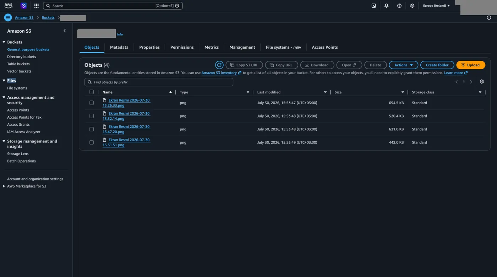
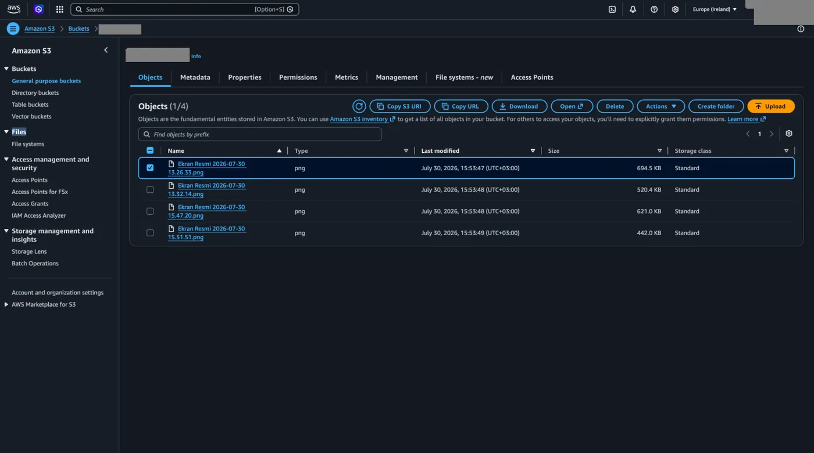
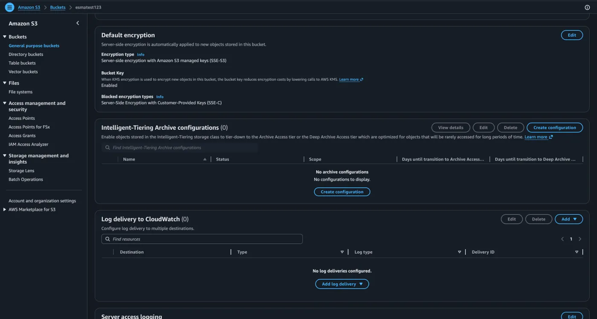
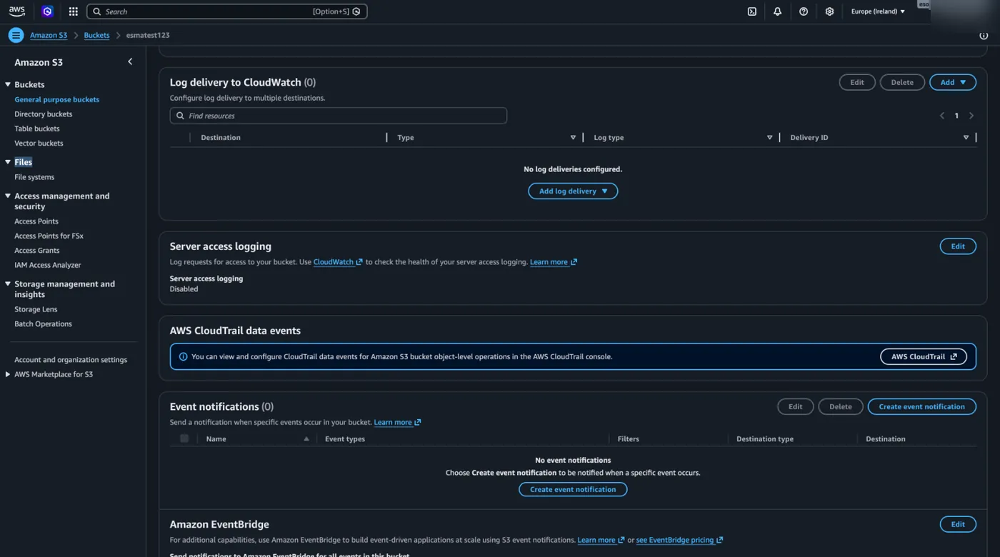
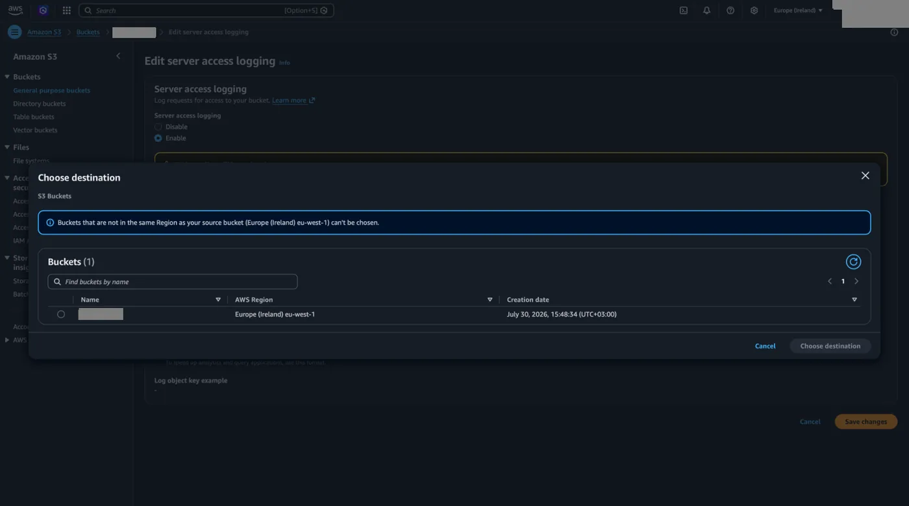
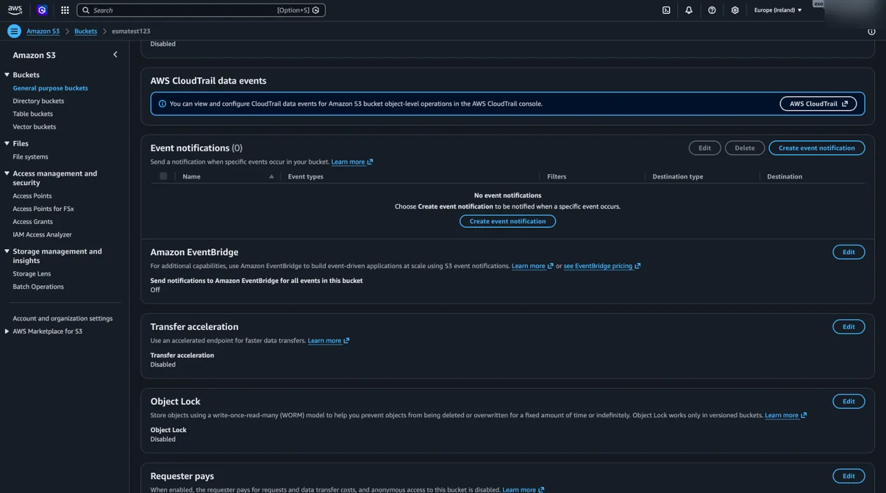
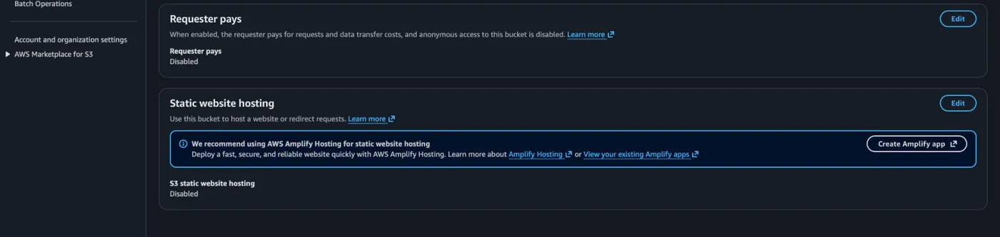

Son ayarı da öğrenerek bir bucket oluştururken nelere dikkat edilmesi gerektiğini öğrenmiş olduk. Şimdi gelin AWS üzerindeki S3 servisinin konsolunu tanımaya başlayalım.

## Objects sekmesi

Aşağıda gördüğümüz ekran daha önce oluşturduğumuz bucket içerisine dosyalarımızı yüklediğimiz ve her yüklenen dosyanın birer obje olarak tutulduğu, bu objeleri yönetebildiğimiz, işlemler yapabildiğimiz yerdir.

Ayrıca daha önce gördüğümüz public URL gibi bir de istediğimiz objeye tıkladığımızda `Copy S3 URI` butonuna tıklayarak [CLI](/aws/s3/s3-cli/) üzerinde işlemler için kullanabileceğimiz bir URL'ye erişebiliriz. `Download` diyerek objeyi bilgisayarımıza indirebilir, `Open` ile açıp `Delete` ile silebiliriz. `Actions` menüsünden yapabileceğimiz işlemleri objelerin içindeki ayarlar kısmında göreceğiz. Son olarak `Create folder` diyerek bir klasör oluşturup objemizi klasöre taşıyabiliriz. Bu işlemden sonra objemizin URL'sinin değişeceğini unutmayalım.

## Properties sekmesi

Bucket oluştururken yaptığımız tüm ayarlara **Properties** menüsü altından erişebiliriz. Ekstra yapabileceğimiz birkaç ayara daha buradan ulaşabiliriz, gelin bunları birlikte inceleyelim.

### Intelligent-Tiering Archive configurations

Daha önce [Intelligent-Tiering](/aws/s3/depolama-siniflari/) (Akıllı Katmanlandırma) özelliğinin nasıl çalıştığından ve dosyamızı kullanımımıza göre en uygun maliyetli katmana otomatik taşıdığından bahsetmiştik. Ancak bu otomatik taşıma işlemi varsayılan olarak Frequent Access, Infrequent Access ve Archive Instant Access katmanları arasında gerçekleşir. Eğer dosyamızın belirli bir süre hiç kullanılmadığında en ucuz depolama seçenekleri olan Glacier katmanlarına da otomatik olarak inmesini istiyorsak, bu izni **Intelligent-Tiering Archive configurations** başlığı altından özel olarak konfigüre etmemiz gerekir.

### Server access logging

Kim hangi dosyayı yazmış, erişmiş gibi S3 üzerinden yapılmış olan API üzerinden gelen tüm işlemlerin loglarına **Server access logging** başlığı altından erişebiliriz. Bunun için 2. bir bucket oluşturup buradaki tüm logları oraya yazmasını istiyoruz.

`Edit` diyerek hangi bucket'a yazmasını istiyorsak onun seçimini yapıyoruz.

### AWS CloudTrail data events

S3 servisinde olan tüm eventleri logladığımız, kim ne şekilde hangi tarihte buraya erişmiş, hangi değişiklikleri yaptı gibi logları tuttuğumuz başlık aşağıdaki **AWS CloudTrail data events**'tir.

### Event notifications

Hemen altında bulunan **Event notifications** başlığı altından da örneğin bu S3 bucket'a yeni bir `jpg` uzantılı dosya atılırsa git bir işlem gerçekleştir diyebiliyoruz. Bu işlem de örneğin Lambda'daki bir kodun tetiklenmesini istemek olabilir.

### Transfer acceleration

**Transfer acceleration** uzak mesafelerden yapılan dosya transferlerini büyük ölçüde hızlandırmamızı sağlar. Örneğin bucket'ımızı Amerika'da oluşturduğumuzu düşünelim. Eğer Türkiye'den veya dünyanın öbür ucundan bu bucket'a gigabaytlarca büyüklükte bir video dosyası yüklemeye çalışırsak standart internet üzerinden bu işlem epey yavaş olabilir. İşte bu özelliği aktif ettiğimizde, AWS dosyayı bize en yakın olan merkezinden teslim alıp, kendi yüksek hızlı özel ağı üzerinden bucket'a ulaştırır. Yani dünyanın neresinde olursak olalım büyük dosyaları yükleme ve indirme hızımızı ciddi şekilde artırır. Ancak AWS, sunduğu bu ekstra hızlandırma hizmeti için veri transferi başına faturamıza ek bir ücret yansıtır.

### Requester pays

Sıradaki başlığımız ilginç bir özellik sağlayan **Requester pays**. Daha önce AWS'nin verimizi saklaması için bir ücret aldığını, veriyi dış dünyaya çıkartırken de ayrıca bir ücret ödememizi istediğinden bahsetmiştik. Bu özelliği aktif ederek veriyi dış dünyaya açtığımız, yani veriyi çeken tarafın bahsettiğimiz ücrete tabi tutulmasını sağlayabiliriz. Bunun için veriyi çekmek isteyen kişinin AWS hesabına sahip olması gerekir çünkü ücret onun hesabına yansıtılacaktır.

### Static website hosting

Son olarak S3 servisinin en sevilen özelliği olan **Static website hosting** başlığını öğrenerek Properties menüsünü burada noktalayacağız. Bu özellik sayesinde, hazırladığımız HTML, CSS ve JavaScript dosyalarından oluşan statik bir web sitesini, hiçbir sunucuya (örneğin bir EC2 sanal sunucusuna) ihtiyaç duymadan doğrudan S3 üzerinden yayınlayabiliriz. Örneğin; kendiniz için sadece tanıtım amaçlı bir portfolyo sitesi tasarladınız ve arka planda çalışan karmaşık bir veritabanı veya üyelik sistemi yok. Bu site dosyalarını doğrudan bucket'a yükleyip [Static website hosting](/aws/s3/bucket-policy-ve-statik-site/) özelliğini aktif ettiğinizde, AWS size anında sitenize ait bir web adresi verir. Böylece sitenizi yayınlamak için işletim sistemi kurma, sunucu yönetme veya bakım yapma gibi dertlerden tamamen kurtulmuş olursunuz. Üstelik bu yöntem, geleneksel bir sunucu kiralamaya kıyasla çok daha pratik ve maliyet açısından oldukça avantajlıdır.

