## s3 ve s3api

S3 üzerinden anlatacağımız son konu [CLI](/aws/cli/) üzerinden S3 servisini nasıl kullanacağımıza dair bilgileri öğrenmek olacak.

İlk öğrenmemiz gereken `s3` ve `s3api` olmak üzere iki CLI salt commandleri ile kullanabileceğimiz.

Obje üzerinde standart işlemleri (bucket oluşturma, silme, dosya çekme, yükleme) `s3` ile

Diğer kalan işlemleri (bucket policy) ise `s3api` ile gerçekleştiriyoruz.

Şimdi gelin terminal ekranlarımızı açalım ve komutları öğrenmeye başlayalım.

## Bucket'ları listeleme

Öncelikle S3 bucketlarını görelim. Bunun için `aws s3 ls` komutunu kullanmamız yeterli olacaktır.

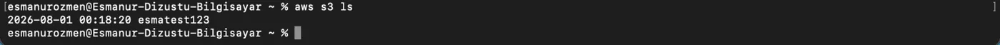

```bash frame="terminal"
aws s3 ls
```

```text title="Çıktı"
2026-08-01 00:18:20 ornek-bucket-123
```

## Bucket oluşturma

Yeni bir bucket oluşturmak istersek `aws s3 mb s3://bucket_ismi` komutunu kullanırız.

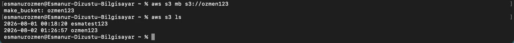

```bash frame="terminal"
aws s3 mb s3://ornek-yeni-bucket
```

```text title="Çıktı"
make_bucket: ornek-yeni-bucket
```

```bash frame="terminal"
aws s3 ls
```

```text title="Çıktı"
2026-08-01 00:18:20 ornek-bucket-123
2026-08-02 01:26:57 ornek-yeni-bucket
```

## Bucket içeriğini listeleme

Bir bucket içerisinde yer alan dosyaları listelemek için de `aws s3 ls s3://bucket_ismi` komutunu kullanıyoruz.

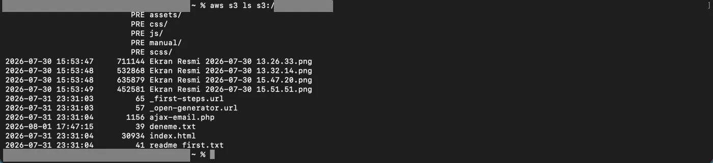

```bash frame="terminal"
aws s3 ls s3://ornek-bucket-123
```

```text title="Çıktı"
                           PRE assets/
                           PRE css/
                           PRE js/
                           PRE manual/
                           PRE scss/
2026-07-30 15:53:47     711144 Ekran Resmi 2026-07-30 13.26.33.png
2026-07-30 15:53:48     532868 Ekran Resmi 2026-07-30 13.32.14.png
2026-07-30 15:53:48     635879 Ekran Resmi 2026-07-30 15.47.20.png
2026-07-30 15:53:49     452581 Ekran Resmi 2026-07-30 15.51.51.png
2026-07-31 23:31:03         65 _first-steps.url
2026-07-31 23:31:03         57 _open-generator.url
2026-07-31 23:31:04       1156 ajax-email.php
2026-08-01 17:47:15         39 deneme.txt
2026-07-31 23:31:04      30934 index.html
2026-07-31 23:31:04         41 readme first.txt
```

## Bucket silme

Bir bucket silmek istersek `aws s3 rb s3://bucket_ismi` komutunu kullanırız. Ancak içi dolu olan bir bucket silmek mümkün değildir. Öncelikle içini temizlememiz gerekir.

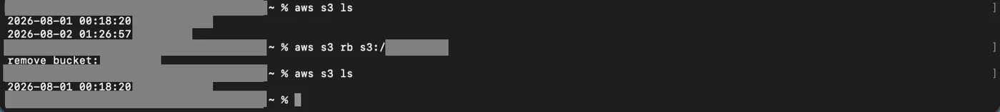

```bash frame="terminal"
aws s3 rb s3://ornek-yeni-bucket
```

```text title="Çıktı"
remove_bucket: ornek-yeni-bucket
```

## Bucket'tan dosya silme

Bucket içerisinden bir dosya silmek istersek kullanacağımız komut `aws s3 rm s3://bucket_adı/silinecek_dosya_adi` olmalıdır.

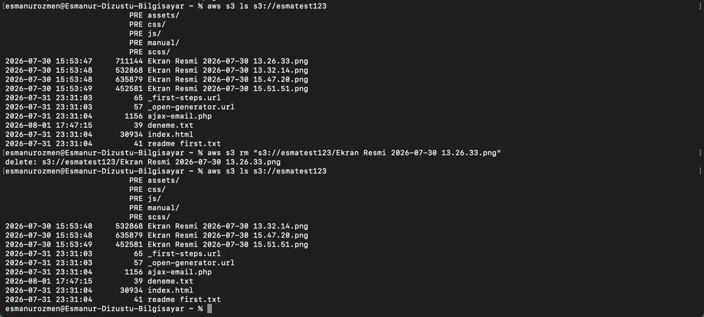

```bash frame="terminal"
aws s3 rm "s3://ornek-bucket-123/Ekran Resmi 2026-07-30 13.26.33.png"
```

```text title="Çıktı"
delete: s3://ornek-bucket-123/Ekran Resmi 2026-07-30 13.26.33.png
```

Bucket içerisinde bulunan bir klasörün yalnızca içeriğini silmek istersek `aws s3 rm s3://bucket_ismi/klasor_ismi --recursive` komutunu kullanırız.

## Bucket'lar arasında dosya taşıma

Bir dosyayı bucketlar arasında taşımak için `aws s3 mv s3://kaynak_bucket_ismi/dosya_adi s3://hedef_bucket_ismi/` komutunu kullanırız.

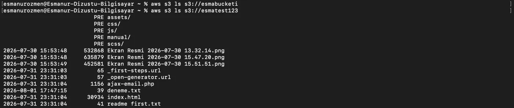

```bash frame="terminal"
aws s3 mv s3://ornek-bucket-123/deneme.txt s3://ornek-hedef-bucket
```

```text title="Çıktı"
move: s3://ornek-bucket-123/deneme.txt to s3://ornek-hedef-bucket/deneme.txt
```

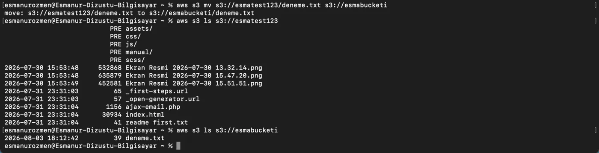

```bash frame="terminal"
aws s3 ls s3://ornek-hedef-bucket
```

```text title="Çıktı"
2026-08-03 18:12:42         39 deneme.txt
```

## Dosya kopyalama (cp)

Lokalde bulunan bir dosyayı bucket'a `aws s3 cp kopyalanacak_dosya_ismi s3://kopyalanacak_bucket_ismi` komutuyla

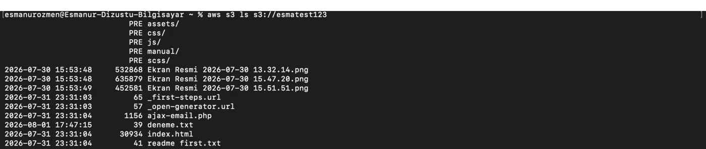

```bash frame="terminal"
aws s3 cp "Ekran Resmi 2026-08-01 00.11.17.png" s3://ornek-bucket-123
```

```text title="Çıktı"
upload: ./Ekran Resmi 2026-08-01 00.11.17.png to s3://ornek-bucket-123/Ekran Resmi 2026-08-01 00.11.17.png
```

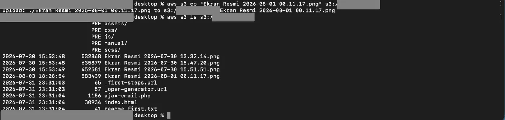

bucket içerisindeki bir dosyayı locale kopyalamak istersek de `aws s3 cp s3://kopyalanacak_bucket_ismi/kopyalanacak_dosya_ismi .` komutuyla işlemimizi gerçekleştirebiliriz.

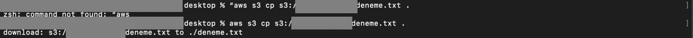

```bash frame="terminal"
aws s3 cp s3://ornek-hedef-bucket/deneme.txt .
```

```text title="Çıktı"
download: s3://ornek-hedef-bucket/deneme.txt to ./deneme.txt
```

## Klasörü bucket ile eşitleme (sync)

Bulunduğumuz klasör ve altında bulunan her şeyi karşı folder'a yollamamızı sağlayan komut `aws s3 sync . s3://bucket_ismi/hedef_klasor_ismi/`

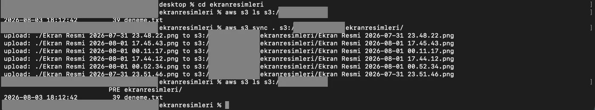

```bash frame="terminal"
cd ekranresimleri
aws s3 sync . s3://ornek-hedef-bucket/ekranresimleri/
```

```text title="Çıktı"
upload: ./Ekran Resmi 2026-07-31 23.48.22.png to s3://ornek-hedef-bucket/ekranresimleri/Ekran Resmi 2026-07-31 23.48.22.png
upload: ./Ekran Resmi 2026-08-01 17.45.43.png to s3://ornek-hedef-bucket/ekranresimleri/Ekran Resmi 2026-08-01 17.45.43.png
...
upload: ./Ekran Resmi 2026-07-31 23.51.46.png to s3://ornek-hedef-bucket/ekranresimleri/Ekran Resmi 2026-07-31 23.51.46.png
```

```bash frame="terminal"
aws s3 ls s3://ornek-hedef-bucket
```

```text title="Çıktı"
                           PRE ekranresimleri/
2026-08-03 18:12:42         39 deneme.txt
```

## Dosya bilgilerini görüntüleme (head-object)

Bir dosyayı bilgisayarımıza indirmeye gerek kalmadan, sadece o dosyanın boyutu, oluşturulma tarihi, içerik türü ve etiketleri gibi arka plan kimlik bilgilerini detaylıca görüntülemek için `aws s3api head-object --bucket bucket_ismi --key dosya_adi`

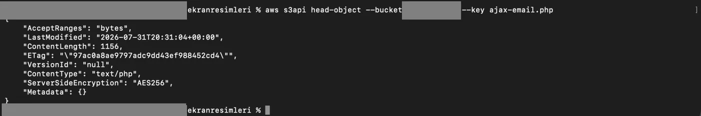

```bash frame="terminal"
aws s3api head-object --bucket ornek-bucket-123 --key ajax-email.php
```

```json title="Çıktı"
{
    "AcceptRanges": "bytes",
    "LastModified": "2026-07-31T20:31:04+00:00",
    "ContentLength": 1156,
    "ETag": "\"97ac0a8ae9797adc9dd43ef988452cd4\"",
    "VersionId": "null",
    "ContentType": "text/php",
    "ServerSideEncryption": "AES256",
    "Metadata": {}
}
```
