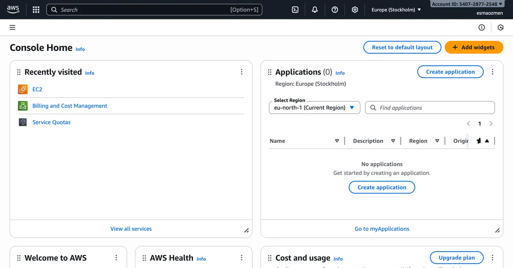
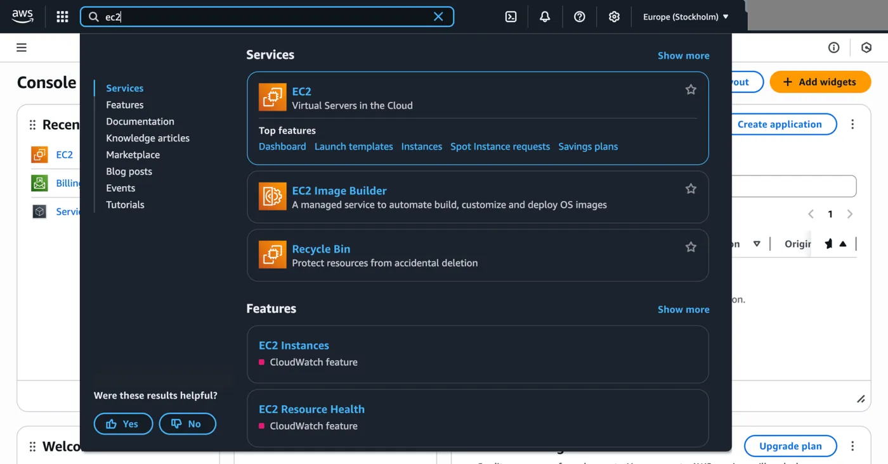
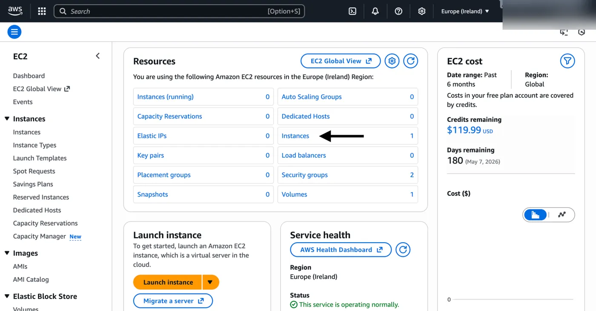
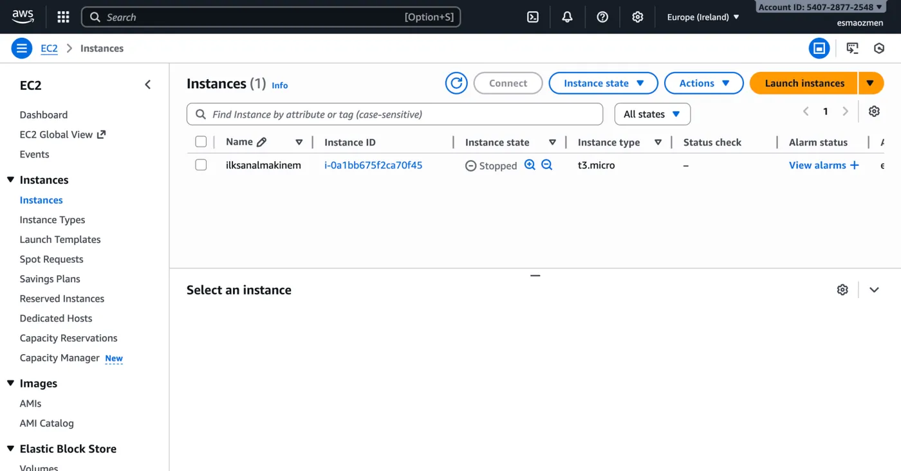
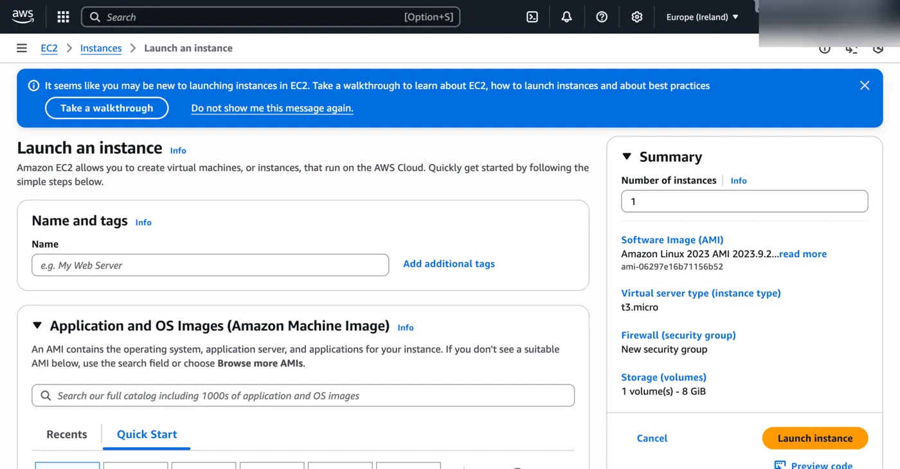

## EC2 ekranına ulaşma

1. Sanal bir makine oluşturmak için öncelikle https://aws.amazon.com/tr/console/ sitesi üzerinden amazon hesabımıza giriş yaparak aşağıdaki ekrana ulaşıyoruz.

   

2. Arama kısmına `EC2` yazarak çıkan ilk seçeneği seçerek devam ediyoruz.

   

3. Açılan sayfada okla gösterilen **Instances** bölümüne tıklıyoruz.

   

Burada oluşturduğumuz sanal makineleri görebileceğimiz, yeni sanal makineler oluşturup silebileceğimiz ekranla karşılaşıyoruz.

## Yeni sanal makine oluşturma

1. Yeni bir sanal makine oluşturmak için sağ üstte görünen **Launch instance** butonuna tıklayarak aşağıdaki ekranın açılmasını sağlıyoruz.

   

2. Burada oluşturacağımız sanal makinenin özelliklerini belirterek ilerliyoruz.
3. Ve sağ alttaki **Launch instance** butonuyla sanal makinemizi oluşturuyoruz.
