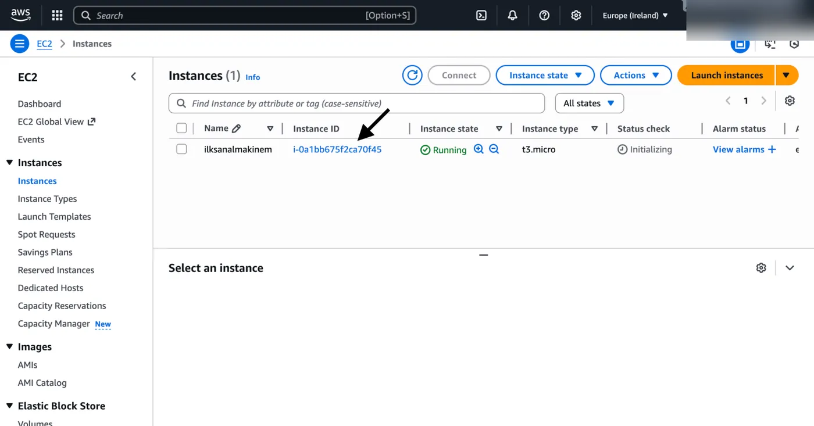
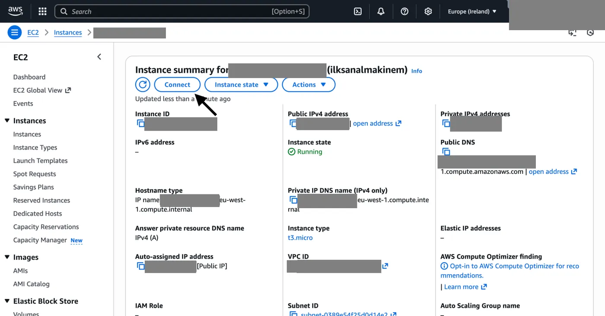
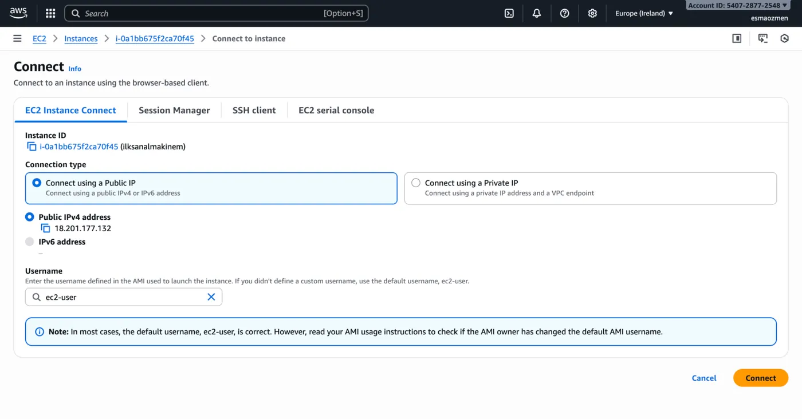
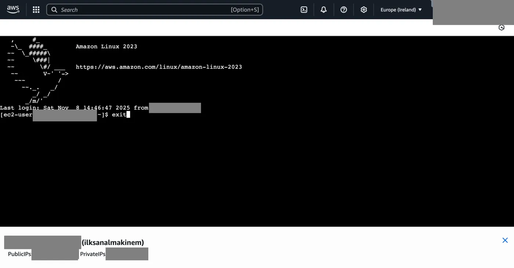

1. Oluşturduğumuz sanal makineye hızlı ve kolay şekilde bağlanıp işlemlerimizi gerçekleştirmek için sanal makinemiz çalışır durumdayken **Instance ID** tıklıyoruz.

   

2. Açılan sayfada **Connect** butonuna basarak devam ediyoruz.

   

3. Daha sonra hiçbir ayarı değiştirmeden sağ alttaki **Connect** yazan butona tıklıyoruz.

   

Böylece sanal makinemize erişmiş olduk. Çıkmak için `exit` komutunu yazıp enter'a tıklamamız yeterlidir.



```text title="Çıktı"
Last login: Sat Nov  8 14:46:47 2025 from 203.0.113.11
```

```bash frame="terminal"
exit
```
