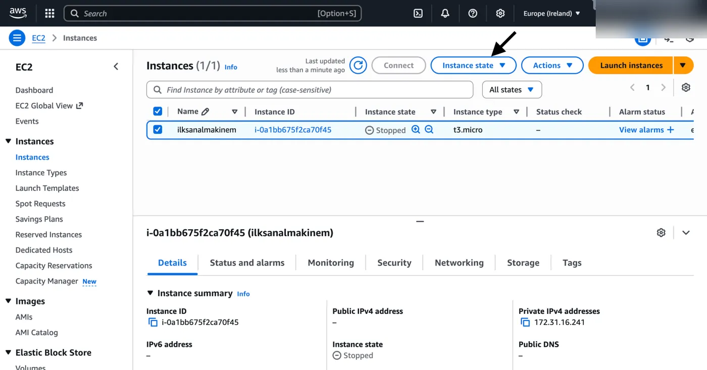
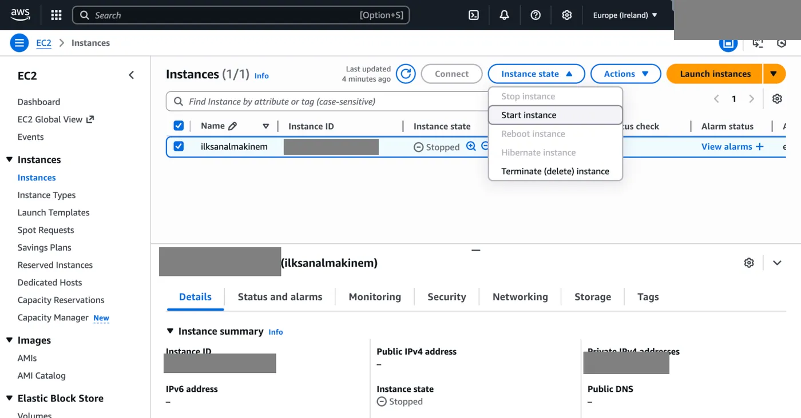

1. Oluşturduğumuz sanal makineyi durdurmak veya tekrar başlatmak için **Instances** kısmına gelerek istediğimiz sanal makineleri yanındaki buton yardımıyla seçiyoruz.

   

2. Burada okla gösterilen **Instance state** menüsüne tıklayarak açılan pencereden gerçekleştirmek istediğimiz işlemi seçiyoruz.

   
