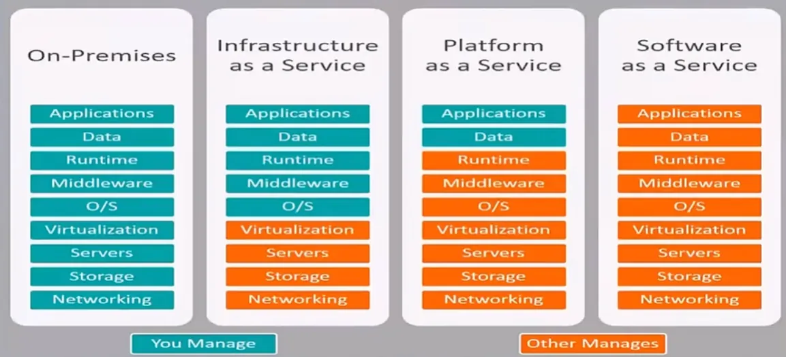
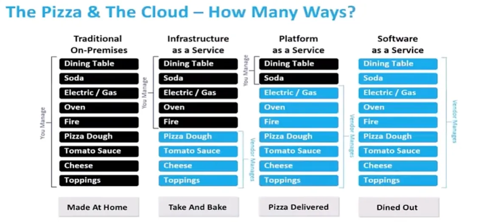

## IaaS, PaaS ve SaaS

Bu hizmeti satın alma şekli her zaman Infrastructure as a Service şeklinde devam etmedi. On premises sisteme kıyasla Infrastructure as a Service hizmetini kullanan şirketler kullandıkları altyapının hiçbir fiziksel sorunu veya bakımıyla ilgilenmezken bu sistemde kuracakları uygulamanın tüm sorumluluklarını üstleniyorlardı.

Infrastructure as a Service sistemden sonra gelen Platform as a Service kavramı ile artık runtime, middleware ve O/S sistemlerin yönetimi de hizmeti verenler tarafından sağlanmaya başlandı.

Platform as a Service ile artık sanal makineler üzerine kurulan işletim sistemleri, isteğe bağlı örneğin java runtime ve gerekli kütüphaneler de hizmeti sağlayan firmalar tarafından yönetilir oldu. Bu sayede örneğin bir java developer sadece uygulamayı oluşturup yüklesin, bu uygulamanın yazılması ve verilerinin yönetilmesi onun sorumluluğunda olsun demiş oluyoruz.

Bundan sonra gelen hizmet ise Software as a Service. Bu yalnızca bir uygulamayı kullanmak isteyen arka planda gerçekleşen hiçbir işlemle ilgilenmeyen şirketlerin kullandığı bir paket olarak ortaya çıkmıştır. Software as a Service bütün altyapının firmalar tarafından karşılanarak yalnızca bir arayüz yardımıyla kullanıcı şifre girerek sisteme bağlanıp bu hizmeti kullanmamızı sağlar.

## Kim neyi yönetir

| Katman | On-Premises | IaaS | PaaS | SaaS |
| --- | --- | --- | --- | --- |
| Applications | Siz | Siz | Siz | Sağlayıcı |
| Data | Siz | Siz | Siz | Sağlayıcı |
| Runtime | Siz | Siz | Sağlayıcı | Sağlayıcı |
| Middleware | Siz | Siz | Sağlayıcı | Sağlayıcı |
| O/S | Siz | Siz | Sağlayıcı | Sağlayıcı |
| Virtualization | Siz | Sağlayıcı | Sağlayıcı | Sağlayıcı |
| Servers | Siz | Sağlayıcı | Sağlayıcı | Sağlayıcı |
| Storage | Siz | Sağlayıcı | Sağlayıcı | Sağlayıcı |
| Networking | Siz | Sağlayıcı | Sağlayıcı | Sağlayıcı |

## Pizza benzetmesi

| Katman | On-Premises | IaaS | PaaS | SaaS |
| --- | --- | --- | --- | --- |
| Dining Table | Siz | Siz | Siz | Sağlayıcı |
| Soda | Siz | Siz | Siz | Sağlayıcı |
| Electric / Gas | Siz | Siz | Sağlayıcı | Sağlayıcı |
| Oven | Siz | Siz | Sağlayıcı | Sağlayıcı |
| Fire | Siz | Siz | Sağlayıcı | Sağlayıcı |
| Pizza Dough | Siz | Sağlayıcı | Sağlayıcı | Sağlayıcı |
| Tomato Sauce | Siz | Sağlayıcı | Sağlayıcı | Sağlayıcı |
| Cheese | Siz | Sağlayıcı | Sağlayıcı | Sağlayıcı |
| Toppings | Siz | Sağlayıcı | Sağlayıcı | Sağlayıcı |

Gelin bu yöntemleri tek bir örnek üzerinden lezzetli bir yöntemle anlamaya çalışalım.

Pizza yemek istediğimizi düşünelim ve bunu 4 farklı şekilde nasıl yapabiliriz bakalım.

İlk yöntemde pizzanın hamurunun yapılmasından pizzanın pişirilmesine, yemek masasının kuruluşundan içeceğine kadar her şeyiyle ilgilenirseniz bu On Premises için bir örnek haline gelir.

Eğer marketten hazır pizza alıp bunu evde pişirip masayı kurduktan sonra yerseniz bu Infrastructure as a Service yöntemine benzetilir.

Yemek istediğiniz pizzayı internetten sipariş vererek hiçbir yapım aşamasına karışmadan sadece masayı kurarak yerseniz bu ise Platform as a Service yöntemi olmuş olur.

Siz bir restorana gidip masanın kuruluşu dahil hiçbir aşamada çaba sarf etmeden yalnızca pizzanızı yerseniz de bunu Software as a Service yöntemine örnek olarak verebiliriz.

## Modellerin birbirine göre avantajları

Bu yöntemlerin bazı durumlarda birbirlerine göre avantajları olabilir. Örneğin on premises sistemin hala kullanılmasının sebebi, bazı durumlarda uzaktaki bir sunucuda bir şeyleri barındırmak localdeki bir sunucuda barındırmaktan çok daha yavaştır. Bir diğer sebebi güvenlik, tamamen kapalı sistemlere ihtiyaç duyulması, verilerin gizliliği. Başka bir sebep ve en önemlisi bazı regülasyonlardan dolayı verilerin başka bir yerde tutulmasına izin verilmiyor oluşu örneğin bankalar, devlet kurumları vb.

Infrastructure as a Service günümüzde hala kullanılıyor olma sebebi PaaS yönteminde runtime, middleware ve işletim sistemi karşı firma tarafından yönetildiği için burada daha eski sürümü kullandığımız bir uygulamayı çalıştırmaya imkan sağlamıyor oluşu. Yani bu üç kısımda bir değişikliğe ihtiyaç duyduğumuz noktalarda IaaS kullanmak daha avantajlı olur. IaaS kullanmanın PaaS kullanmaya göre bir diğer avantajı örneğin 100-200 gibi çok sayıda uygulamamız varsa bunların PaaS'ta yönetilmesinin sağlanması için ödeyeceğimiz ücret IaaS'ta bu uygulamaları yönetmek için kuracağımız altyapı için gerekli ücretten çok daha fazla oluyor ayrıca verimli.

SaaS kullanmak yerine PaaS kullanmanın avantajları ise uygulamada değişiklik yapmak istediğimiz durumlarda tercih ederiz.
