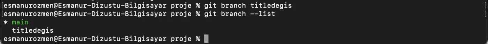
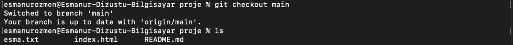
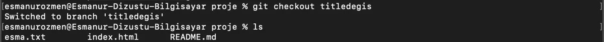
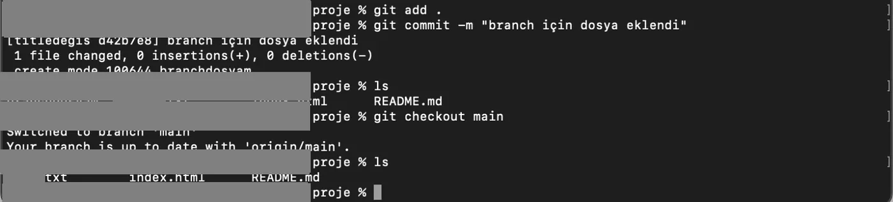
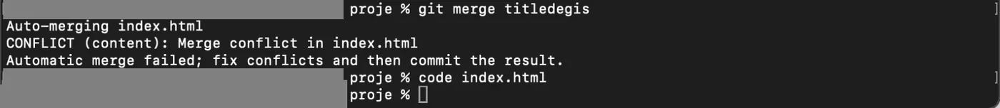
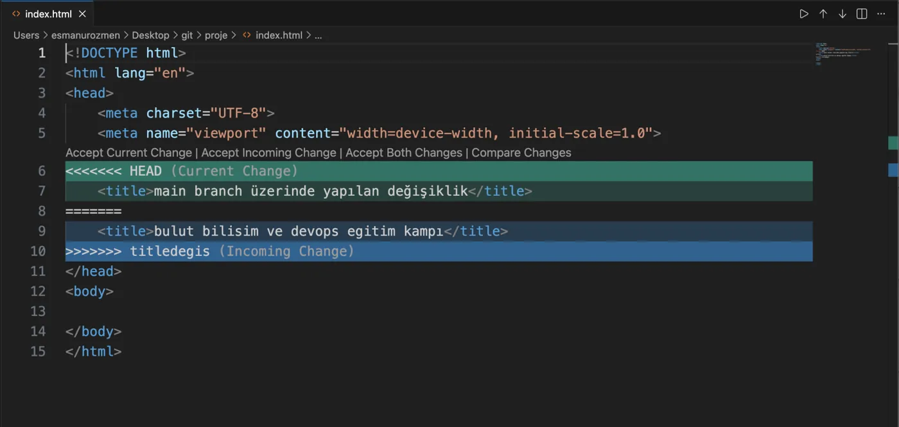
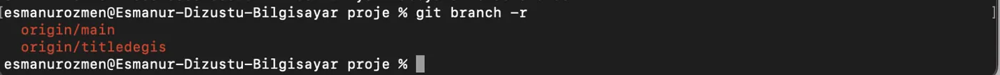

## Branch nedir

Şimdi gelin GitHub’ın en önemli konseptlerinden biri olan branch konusuna geçelim. Bir tez yazdığımızı düşünelim. Yazımızı bitirdik ve son halini kaydettik. Ardından eklememiz gereken yeni bir kısım oldu. Burada yapılacak en mantıklı işlem tezimizin son halinin bir kopyasını çıkarıp değişikliği onun üzerinde denemek olacaktır. Branch’ler de tam olarak bu işe yarar. Bir projenin çalışan ve kararlı haline yeni bir özellik eklemek istediğimizde, bunu doğrudan main branch (ana dal) üzerinde yapıp olası hatalarla projeyi çalışmaz hale getirmek yerine, kendimize yeni bir dal oluştururuz. Değişikliklerimizi bu güvenli alanda tamamlayıp her şeyin sorunsuz çalıştığından emin olduktan sonra, bu dalı ana dalımızla birleştiririz.

## Branch oluşturma ve listeleme



```bash frame="terminal"
git branch titledegis
git branch --list
```

```text title="Çıktı"
* main
  titledegis
```

Yeni bir branch oluşturmak için `git branch branchismi` komutunu, branch’leri listelemek için ise `git branch --list` komutunu kullanırız.

## Branch'ler arasında geçiş



```bash frame="terminal"
git checkout main
ls
```

```text title="Çıktı"
Switched to branch 'main'
Your branch is up to date with 'origin/main'.
ornek.txt       index.html      README.md
```



```bash frame="terminal"
git checkout titledegis
touch branchdosyam
git add .
git commit -m "branch için dosya eklendi"
ls
```

```text title="Çıktı"
Switched to branch 'titledegis'
[titledegis d42b7e8] branch için dosya eklendi
 1 file changed, 0 insertions(+), 0 deletions(-)
 create mode 100644 branchdosyam
branchdosyam    ornek.txt       index.html      README.md
```



```bash frame="terminal"
git checkout main
ls
```

```text title="Çıktı"
Switched to branch 'main'
Your branch is up to date with 'origin/main'.
ornek.txt       index.html      README.md
```

Oluşturduğumuz bu branch’e gitmek için `git checkout branchadı` komutunu kullanıyoruz. Burada yaptığımız değişikliğin örneğin aşağıda olduğu gibi yeni bir dosya oluşturma işleminin main branch’te gözükmediğini görüyoruz.

Bir branch oluşturup aynı zamanda o branch’e checkout olmak istiyorsak `git checkout -b branchadi` komutunu kullanırız.

Bir branch’i silmek için ise `git branch -d branchadi` komutunu kullanırız.

## Merge

Oluşturduğumuz branch üzerinde yaptığımız değişikliklerin ardından bu değişiklikleri ana projeye dahil etme işlemine "merge" denir. Bu işlemle yan yolda geliştirdiğimiz özellikleri ana yola (main) bağlamış oluruz. Bunun için main branch’deyken `git merge branchadi` komutunu kullanırız.

## Branch'i GitHub'a gönderme

Kendi makinemizde oluşturduğumuz branch’i GitHub’a atmak istersek öncelikle `git checkout branchadı` komutuyla branch’e geçiyoruz ve `git push -u origin branchadı` komutunu kullanırız.

## Merge conflict

Biz main branch’i bilgisayarımıza çekip kendi dalımız üzerinde çalışırken aynı zamanda main branch üzerine de eklenen yeni commitler olacaktır. Eğer bu değişiklikler dosyanın farklı satırlarındaysa, Git bunları kendisi kolayca birleştirir. Ancak, eğer her iki dalda da aynı dosyanın aynı satırı üzerinde farklı değişiklikler yapılmışsa, Git hangi bilginin doğru olduğuna karar veremez. Bu durumda ortaya çıkan duruma 'Merge Conflict' (Birleştirme Çakışması) denir.



```bash frame="terminal"
git merge titledegis
```

```text title="Çıktı"
Auto-merging index.html
CONFLICT (content): Merge conflict in index.html
Automatic merge failed; fix conflicts and then commit the result.
```

:::note
Bu durum bir hata değil, Git'in veri kaybını önlemek için aldığı bir güvenlik önlemidir.
:::

Bunu çözmenin iki yolu vardır. İlki böyle bir durum yaşandığında Git dosya üzerinde aynı satırda yapılan değişiklikleri dosyaya yazar ve hangisinin doğru olduğunu sorar. Bunu manuel şekilde istemediğimiz satırları silerek yaparız.



```html title="index.html"
<!DOCTYPE html>
<html lang="en">
<head>
    <meta charset="UTF-8">
    <meta name="viewport" content="width=device-width, initial-scale=1.0">
<<<<<<< HEAD
    <title>main branch üzerinde yapılan değişiklik</title>
=======
    <title>bulut bilisim ve devops egitim kampı</title>
>>>>>>> titledegis
</head>
<body>

</body>
</html>
```

## Uzak branch'leri listeleme

Normalde `git branch` komutu sadece kendi bilgisayarımızda oluşturduğumuz dalları gösterir. Ancak projenin GitHub (uzak sunucu) tarafında hangi dalların bulunduğunu görmek istersek `git branch -r` komutunu kullanırız.



```bash frame="terminal"
git branch -r
```

```text title="Çıktı"
  origin/main
  origin/titledegis
```
