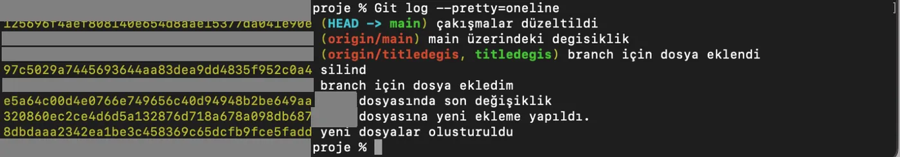
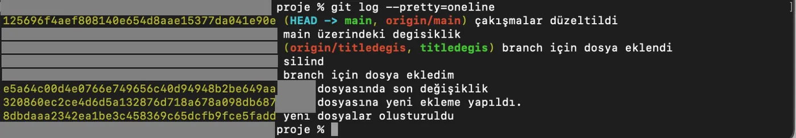

## git cherry-pick

Bazen bir branch’te onlarca commit yaparsınız ama sadece bir tanesi o kadar kritiktir ki, diğer tüm değişiklikleri almadan sadece o tek bir commit’i ana dalınıza veya başka bir dala taşımak istersiniz. İşte cherry-pick, başka bir daldaki tüm commit'leri değil, sadece istediğiniz spesifik bir commit'i çekip bulunduğunuz dala yapıştırmanızı sağlar. Bunun için `git cherry-pick commit_id` komutunu kullanırız.

## .gitignore

Bir proje klasöründe her şeyin GitHub'a gitmesi gerekmez. Bazı dosyalar hem yer kaplar hem de güvenlik riski oluşturur. Proje klasörümüzde duran ama GitHub'a gitmesini istemediğimiz her şeyi `.gitignore` dosyasının içine yazarız. Git bu dosyayı okur ve o dosyaları sanki hiç yokmuş gibi davranarak görmezden gelir. Böylece hem projemiz daha güvenli olur hem de sadece gerekli olan dosyalar paylaşılır. Bunun için root klasörünün içinde `.gitignore` isimli bir dosya oluşturmamız gerekir. Diğer dosyalarda yaptığımız gibi bunda da sırasıyla `git add` ve `git commit` komutlarını çalıştırıyoruz.

## git tag

Daha önce bahsi geçen commit ID’ler çok karmaşıktır ve akılda tutulamaz. Tag sayesinde bu karmaşık ID’lere istediğimiz isimleri verebiliriz. Bunun için şu iki yöntemi kullanırız:

- `git tag etiket_ismi commit_id` ile sadece basit bir etiket koyarız.
- `git tag -a etiket_ismi commit_id -m "mesaj"` Bu komutla 'açıklamalı etiket' oluştururuz. Bu tag’in ne zaman, kim tarafından ve niçin eklendiği bilgilerini de verir.

Eğer `git tag etiket_ismi` komutunu yazıp enter dersek son commit için geçerli olacak şekilde çalışır.

Oluşturduğumuz tag’leri standart `git push` komutu ile GitHub’a gönderemeyiz. Bunun için `git push origin etiket_ismi` komutunu kullanmamız gerekir.

Eğer tag’leri tek tek göndermek yerine hepsini tek seferde yollamak istersek `git push origin --tags` komutunu kullanırız.

Bir tag’i silmek istersek de `git tag -d etiket_ismi` komutunu kullanırız.

## git log --pretty=oneline



```bash frame="terminal"
git log --pretty=oneline
```

```text title="Çıktı"
125696f4aef808140e654d8aae15377da041e90e (HEAD -> main) çakışmalar düzeltildi
9584415128c469d600d0b7bdcc6998f40dd684dc (origin/main) main üzerindeki degisiklik
d42b7e8ab22a6584d81eacca5c828a3ef94fdfd7 (origin/titledegis, titledegis) branch için dosya eklendi
97c5029a7445693644aa83dea9dd4835f952c0a4 silind
aaa45a57c312b9207b3edb7668f79e886da961f0 branch için dosya ekledim
e5a64c00d4e0766e749656c40d94948b2be649aa ornek dosyasında son değişiklik
320860ec2ce4d6d5a132876d718a678a098db687 ornek dosyasına yeni ekleme yapıldı.
8dbdaaa2342ea1be3c458369c65dcfb9fce5fadd yeni dosyalar olusturuldu
```

Normalde `git log` komutunu kullandığımızda her kayıt; yazar, tarih, commit ID ve mesajı gibi 4-5 satırlık yer kaplar. Eğer projemizde 50 tane commit varsa aradığımızı bulmak için sayfalarca aşağı inmemiz gerekir.

Her bir commit bilgisini (ID ve mesajını) tek bir satıra sığdırarak listelemek için `git log --pretty=oneline` komutunu kullanırız. Böylece ekranı kaplayan satırlardan kurtulup, projenin tüm geçmişini tek bir bakışta, çok daha hızlı bir şekilde inceleyebiliriz.

İlk satırda gördüğümüz `HEAD -> main` ifadesi, bilgisayarımızdaki çalışma alanımızla en son yaptığımız commit’in eşleştiğini yani yerel sistemimizin güncel olduğunu gösterir.

İkinci satırda ise GitHub üzerinde oluşturduğumuz origin isimli sunucuda main dalının bilgisayarımızda bulunan son commit ile eşleşmediğini görüyoruz. Bunu düzeltip bilgisayarımızda yaptığımız bir değişikliği GitHub’a atarak ikisini eşlemek için `git push` komutunu kullanmamız gerektiğini öğrenmiştik.



```text title="Çıktı"
125696f4aef808140e654d8aae15377da041e90e (HEAD -> main, origin/main) çakışmalar düzeltildi
9584415128c469d600d0b7bdcc6998f40dd684dc main üzerindeki degisiklik
...
```

## git fetch origin

GitHub üzerinde yaptığımız bir değişikliği lokalde görmek istersek de `git pull` komutunu kullandığımızdan bahsetmiştik.

Ancak her zaman gelen değişiklikleri anında kodlarımıza dahil etmek istemeyebiliriz. Bu değişikliklerin hemen uygulanmasını değil de sadece "neler değişmiş" bilgisini görmek istersek, `git fetch origin` komutunu kullanırız. İşte burada hayati bir fark ortaya çıkar: `git fetch origin` komutu, gelen değişiklikleri bilgisayarımıza indirse de mevcut kodlarımızla birleştirmez, yani merge işlemini otomatik olarak yapmaz. Bu komutu kullanmamızdaki asıl amaç, yapılan değişiklikleri önce güvenli bir şekilde görüp, ardından her şeyden emin olarak kontrollü bir şekilde sistemimize dahil etmektir.
