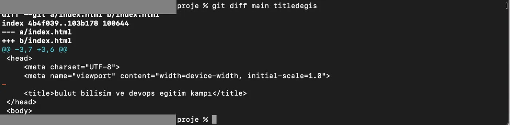
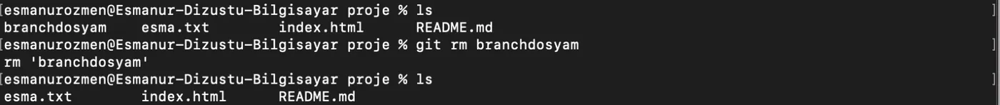
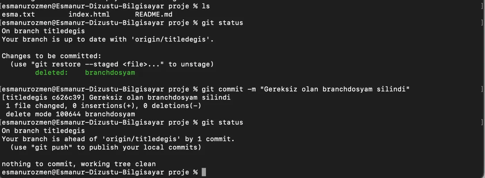

## Detached HEAD

Bilgisayarımızda bir dala değil doğrudan bir commit'e checkout olduysak buna Detached HEAD denir.

Bilgisayarımıza çekmek istediğimiz spesifik bir commit varsa:

1. Öncelikle `git log --pretty=oneline` komutuyla commitleri listeliyoruz.
2. İstediğimiz commit ID’yi kopyalıyoruz ve buraya checkout oluyoruz.
3. Burada yeni bir branch oluşturuyoruz.
4. Ardından main branch’e geçip `git merge branch_adı` komutuyla istediğimiz commit’i sistemimize çekmiş oluruz.

## git diff



```bash frame="terminal"
git diff main titledegis
```

```text title="Çıktı"
diff --git a/index.html b/index.html
index 4b4f039..103b178 100644
--- a/index.html
+++ b/index.html
@@ -3,7 +3,6 @@
 <head>
     <meta charset="UTF-8">
     <meta name="viewport" content="width=device-width, initial-scale=1.0">
-
     <title>bulut bilisim ve devops egitim kampı</title>
 </head>
 <body>
```

`git diff` komutunu kullanarak dosyalar ve commit’ler arasındaki farklara bakabiliriz. Opsiyonsuz olarak sadece `git diff` komutunu girersek henüz `git add` ile hazırlık alanına alınmamış değişiklikleri görürüz. Branch’ler arası farka bakmak istersek `git diff branch_adi1 branch_adi2` komutunu kullanırız. Commitler arasındaki farkı görmek için de benzer şekilde `git diff commit_id1 commit_id2` komutunu kullanırız.

## git rm



```bash frame="terminal"
ls
git rm branchdosyam
ls
git status
```

```text title="Çıktı"
branchdosyam    ornek.txt       index.html      README.md
rm 'branchdosyam'
ornek.txt       index.html      README.md
On branch titledegis
Your branch is up to date with 'origin/titledegis'.

Changes to be committed:
  (use "git restore --staged <file>..." to unstage)
        deleted:    branchdosyam
```



```bash frame="terminal"
git commit -m "Gereksiz olan branchdosyam silindi"
git status
```

```text title="Çıktı"
[titledegis c626c39] Gereksiz olan branchdosyam silindi
 1 file changed, 0 insertions(+), 0 deletions(-)
 delete mode 100644 branchdosyam
On branch titledegis
Your branch is ahead of 'origin/titledegis' by 1 commit.
  (use "git push" to publish your local commits)

nothing to commit, working tree clean
```

Bir dosyayı oluşturup `git add` ile takibe aldıktan sonra, eğer bu dosyadan vazgeçersek `git rm dosya_adi` komutunu kullanarak dosyayı hem bilgisayarımızdan hem de projemizden tamamen silebiliriz. Eğer dosyayı sadece Git'in takibinden çıkarmak ama bilgisayarımızda tutmaya devam etmek istiyorsak, komutun sonuna `--cached` parametresini eklememiz yeterlidir. Her iki durumda da işlemin kalıcı olması için sonrasında mutlaka bir commit yapmamız gerektiğini unutmamalıyız.

## Merge ve rebase

Projemizde ana daldan ayrılarak farklı dallarda çalışmak, özgürce kod yazmamızı sağlar. Ancak işleri bitirip bu dalları ana dal ile birleştirmek istediğimizde karşımıza iki farklı yol çıkar. Eğer bu birleştirme işlemini klasik Merge yöntemiyle yaparsak, dalların ayrılıp tekrar birleştiği o karmaşık "örümcek ağı" görüntüsü ana geçmişte (history) kalmaya devam eder. Bu da proje büyüdükçe geçmişin okunmasını zorlaştırabilir.

Eğer projenin geçmişini tek bir düz çizgi üzerinde, sanki her şey sırayla yapılmış gibi tertemiz görmek istiyorsak; burada Rebase kullanırız. Rebase, farklı bir dalda yaptığımız tüm işlemleri alır ve ana dalın en ucuna ekleyerek tüm geçmişi tek bir satıra (single line) dizer. Böylece karmaşık dallanma görüntüleri ortadan kalkar ve projenin gelişim süreci bir kitap gibi sayfa sayfa, dümdüz bir çizgide okunabilir hale gelir.

## git reset

Projenizde çalışırken bazen işler istediğiniz gibi gitmez; hatalı bir commit yapabilir, yanlış dosyaları hazırlık alanına (staging area) ekleyebilir veya sadece projenizi birkaç adım öncesine döndürmek isteyebilirsiniz. İşte bu noktada `git reset`, Git'in sunduğu en güçlü "geri alma" aracı olarak imdadımıza yetişir.

En temel haliyle `git reset`, projemizin o anki durumunu geçmişteki belirli bir commit’e veya duruma geri döndürmemizi sağlar. Ancak bu geri dönüşün "sertliği", kullanacağımız parametreye göre değişir:

- `git reset --soft commit_id` Sadece commit'i iptal eder. Yazdığımız kodlara dokunmaz, onları "hazırlık alanında" (staged) tutmaya devam eder. Yani "Commit mesajını yanlış yazdım ama kodlarım kalsın" dediğimizde kullanılır.
- `git reset --mixed commit_id` (Varsayılan): Commit'i iptal eder ve dosyaları hazırlık alanından çıkarır. Kodlarımız hala bilgisayarımızdadır ama Git onları henüz "takip etmiyor" gibidir.
- `git reset --hard commit_id` Bu en tehlikeli ve kesin olanıdır. Belirlediğimiz commit'ten sonra yaptığımız tüm değişiklikleri fiziksel olarak siler ve projeyi o ana tamamen geri döndürür.

Yanlışlıkla `git add .` diyerek tüm klasörü hazırlık alanına eklediğinizde, sadece o dosyaları çıkarmak için `git reset` kullanmamız yeterlidir.

## git stash

Bir işlem üzerinde çalışırken henüz yaptığımız değişiklikleri commitlemeye hazır hale gelmeden başka bir branch’e geçmemiz gerekebilir. Bu durumlarda `git stash` komutunu kullanırız. `git stash` komutuyla mevcut directory üzerindeki o anki tamamlanmamış değişikliklerimizi bir yere kaydederiz. Başka bir daldaki yapmamız gerekenleri tamamladıktan sonra `git stash list` komutuyla kaydettiğimiz işlemleri listeledikten sonra `git stash pop` komutuyla yarım bıraktığımız işlemimize devam edebiliriz. Eğer kaydettiğimiz bu dosyayı silmek istersek `git stash drop` komutunu kullanırız.

:::note
Eğer birden fazla stash kaydınız varsa, `git stash pop` sadece en sonuncuyu geri getirir. Belirli bir kaydı geri getirmek isterseniz list komutundaki ID'sini (örneğin `stash@{0}`) kullanabilirsiniz.
:::

## Yerelden GitHub'a

Şu ana kadar öğrendiğimiz her şeyi sadece kendi bilgisayarımızda, yani yerelde yaptık. Ancak gerçek hayatta projeler sadece kişisel bilgisayarlarda kalmaz; başkalarıyla paylaşılması, yedeklenmesi ve ekipçe yönetilmesi gerekir.

Git bir versiyon kontrol sistemiyken, GitHub bu sistemin üzerine kurulmuş bir bulut platformudur. Terminaldeki siyah ekrandan çıkıp GitHub'ın görsel arayüzüne geçmemizin temel sebebi, projelerimizi internete taşıyarak dünyanın her yerinden erişilebilir hale getirmek ve diğer yazılımcılarla iş birliği yapabilmektir.
