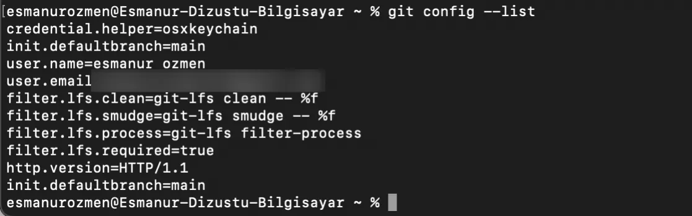
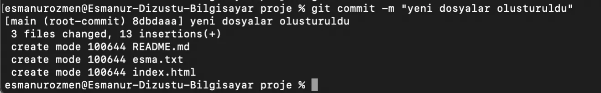

## Versiyon kontrol sistemleri

Günümüzde yazılım geliştirme süreçlerinde karşılaşılan en büyük zorluk; birden fazla kişinin aynı dosyalar üzerinde çalışırken birbirinin emeğini ezmeden projeyi ilerletebilmesidir. Birden fazla kişi aynı anda birden fazla dosya üzerinde birlikte değişiklik yapılıyorsa bu değişikliklerin bir araya getirilip tek bir dosya, proje haline getirilmesinde kullanılan araçlar vardır.

Tek başımıza bir proje üzerinde çalışıyor olsak bile her gün yeni eklediğimiz veya çıkardığımız kod satırlarını takip etmek, yanlışlıkla yaptığımız bir işlemin farkında olmadığımız şekilde programı çalışmaz hale getirmesi gibi sorunlarla da karşılaşırız. Yaptığımız tüm değişikliklerin kaydı olsaydı ne zaman nasıl bir değişiklik yaptığımızı görseydik hatamızı bulmak daha kolay olurdu. İşte tüm bu sorunları çözmek için versiyon kontrol sistemleri geliştirilmiştir.

Versiyon kontrol sistemleri yönetim altına aldığımız dosyaların birden fazla insan tarafından aynı anda modifiye edilmesine bu modifikasyon sırasında da çıkabilecek sorunların çözülmesine ve dosyalar üzerinde yapılan değişikliklerin kim ne zaman neyi değiştirmiş gibi bilgileri kayıt altına alınmasını sağlayan araçlara verilen isimdir. Bu araçlardan en bilindik olanı Git Versiyon Kontrol Sistemidir.

## Git

Git, projelerdeki her satır değişikliğinin kim tarafından ve ne zaman yapıldığını kaydeden, dağıtık yapısı sayesinde projenin tam bir kopyasını her geliştiricide saklayan modern bir versiyon kontrol sistemidir. Hem ekip içi çakışmaları önler hem de projenin geçmişine güvenli bir yolculuk yapmamızı sağlar.

Git diğer versiyon kontrol sistemlerinden farkı decentralized oluşudur. Decentralized yani dağıtık yapı, projenin sadece merkez bir sunucuda değil, projeye dahil olan herkesin bilgisayarında tam bir kopyasının bulunması anlamına gelir. Bu sayede internet olmasa bile çalışabilir ve ana sunucu çökse bile projemizi kaybetmeyiz.

Şimdi gelin bahsettiğimiz Git’in komut satırındaki işlevlerine bakalım. Git’i terminal ekranlarımızda kullanabiliriz.

## İlk ayarlar

Git kullanmaya başlamadan önce yapmamız gereken bazı temel ayarlar vardır. Bunların başında, yapılan işlemlerin kime ait olduğunu belirtmek gelir; çünkü Git üzerinde kaydedilen her değişikliğin bir sahibi olmalıdır. Kullanıcı adımızı tüm projelerimizde geçerli olacak şekilde sisteme tanıtmak için `git config --global user.name "Kullanıcı Adınız"` komutunu kullanırız.

Ardından mail adresimizi tanıtmamız gerekir burada kullanacağımız mail adresi GitHub hesabımıza kayıt olduğumuz mail adresimiz ile aynı olmalıdır. Bu tanımı yapmak için `git config --global user.email "mail adresiniz"` komutunu kullanırız.

Son olarak `git config --global init.defaultBranch main` komutunu girerek yeni oluşturulan her Git projesindeki varsayılan ana dal isminin otomatik olarak 'main' olarak belirlenmesini sağlar. Böylece projelerimizi GitHub gibi platformlarla birleştirirken isim farklılıklarından doğabilecek karmaşaların önüne geçmiş olur.

```bash frame="terminal"
git config --global user.name "Kullanıcı Adınız"
git config --global user.email "mail adresiniz"
git config --global init.defaultBranch main
```

Git komutlarının genel yapısı; ana komut yani `git`, yapılacak eylem ve bu eylemin nasıl yapılacağını belirleyen opsiyonlardan oluşur.

### git config --list



```bash frame="terminal"
git config --list
```

```text title="Çıktı"
credential.helper=osxkeychain
init.defaultbranch=main
user.name=Ad Soyad
user.email=**********@*****.com
filter.lfs.clean=git-lfs clean -- %f
filter.lfs.smudge=git-lfs smudge -- %f
filter.lfs.process=git-lfs filter-process
filter.lfs.required=true
http.version=HTTP/1.1
init.defaultbranch=main
```

`git config --list` komutu, Git sisteminde tanımlanmış olan tüm yapılandırma ayarlarını tek bir ekranda görmemizi sağlayan komuttur. Bu komut, Git'in o anki çalışma ortamında geçerli olan tüm ayarları (kullanıcı adı, e-posta, varsayılan branch adı, editör ayarları vb.) terminal ekranına listeleyen bir kontrol komutudur. O ana kadar yaptığın tüm ayarların bir özet raporunu sunar.

## Çalışma klasörü ve git init

Bundan sonra çalıştıracağımız komutları, gerekli verileri ve yapacağımız alıştırmaları depolayacağımız bir çalışma alanı oluşturmak işimizi kolaylaştıracaktır. Bunun için terminalde `mkdir git` komutuyla yeni bir klasör oluşturalım.


```bash frame="terminal"
git init
```

```text title="Çıktı"
Initialized empty Git repository in /Users/ornekkullanici/git/proje/.git/
```

Oluşturduğumuz bu klasör içindeki işlemlerin Git tarafından izlenmesini ve kaydedilmesini istiyorsak, Git'in üç aşamalı takip mekanizmasını başlatmamız gerekir. Bir projede Git kullanmak için yapılması gereken ilk işlem, o klasör içinde Git'i başlatmaktır (initialize). Bu sayede Git, klasör içinde olup bitenleri takip edebilir hale gelir. Bunun için `git init` komutunu kullanırız.

## Staging: git add

Ancak bu işlemden sonra Git, yaptığımız her değişikliği henüz otomatik olarak kalıcı bir kayıt haline getirmez. Biz değişiklikleri yaparız ve Git'e bu dosyaların bir sonraki kayda dahil edilmeye hazır olduğunu söyleriz (staging). Bu işlem için `git add dosyaadı` komutunu kullanırız. Eğer `git add .` komutunu kullanırsak bu, içinde bulunduğumuz folder’da yapılan tüm değişiklik olan dosyaları kaydet anlamına gelir.

## Kayıt: git commit



```bash frame="terminal"
git commit -m "yeni dosyalar olusturuldu"
```

```text title="Çıktı"
[main (root-commit) 8dbdaaa] yeni dosyalar olusturuldu
 3 files changed, 13 insertions(+)
 create mode 100644 README.md
 create mode 100644 ornek.txt
 create mode 100644 index.html
```

Git'in her şeyi otomatik kaydetmemesinin sebebi, bize hangi değişikliğin önemli olup hangisinin olmadığını seçme şansı tanımasıdır. Bu sürecin sonunda, hazırladığımız tüm bu değişiklikleri Git'e kaydetmemiz (commit) gerekir. Böylece projemizin o anki halini ölümsüzleştirmiş oluruz. Bunun için kullanacağımız komut iskeleti ise `git commit -m "yorum satırı"` olmalıdır.
