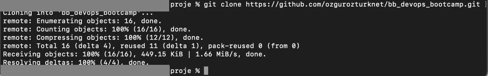
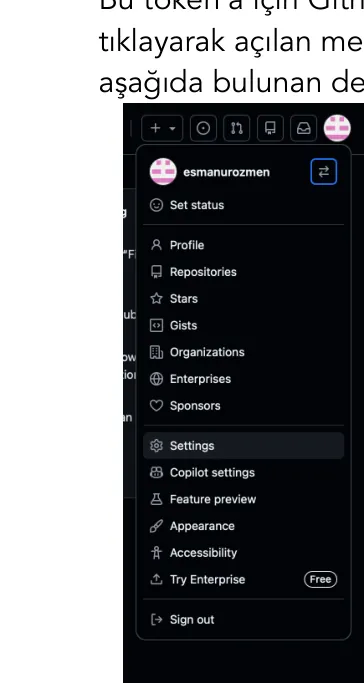
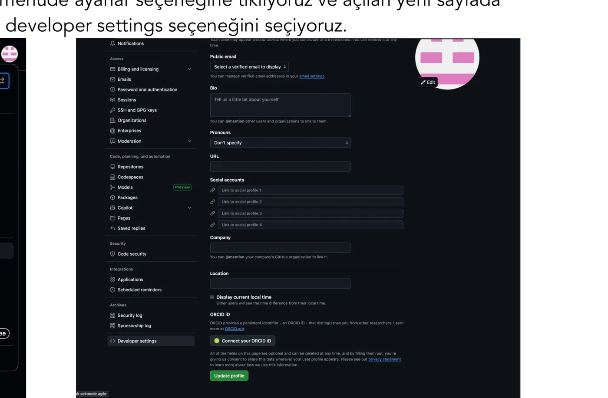
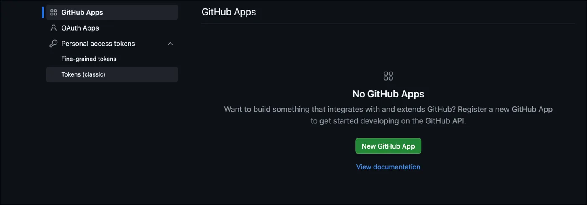
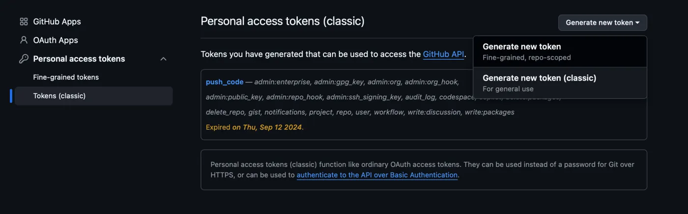
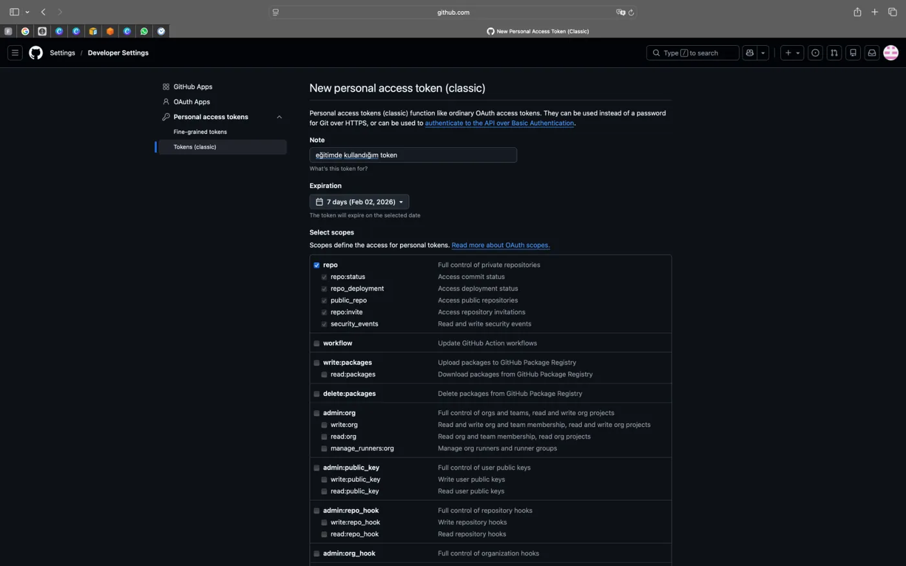
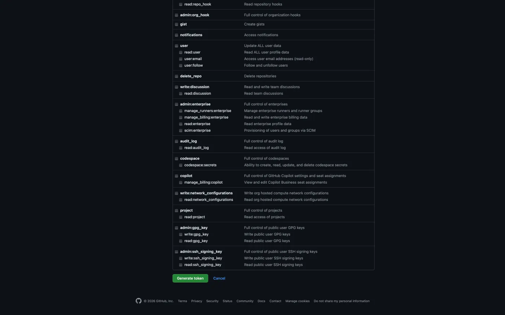
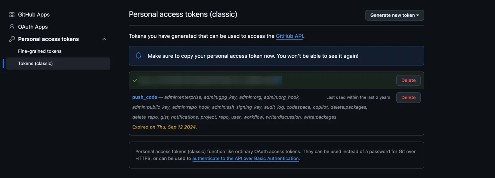
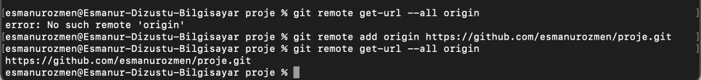
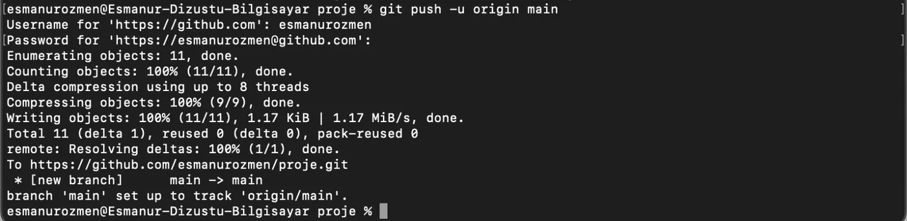

## git clone



```bash frame="terminal"
git clone https://github.com/ozgurozturknet/bb_devops_bootcamp.git
```

```text title="Çıktı"
Cloning into 'bb_devops_bootcamp'...
remote: Enumerating objects: 16, done.
remote: Counting objects: 100% (16/16), done.
remote: Compressing objects: 100% (12/12), done.
remote: Total 16 (delta 4), reused 11 (delta 1), pack-reused 0 (from 0)
Receiving objects: 100% (16/16), 449.15 KiB | 1.66 MiB/s, done.
Resolving deltas: 100% (4/4), done.
```

Mevcut bir repository'yi alıp kendi bilgisayarımıza kopyalamak istersek `git clone repository_url` komutunu kullanırız. Eğer oluşturulan repository private ise erişim yetkimizi doğrulamak için kullanıcı adı ve erişim anahtarı girmemiz gerekir.

## git push

Bilgisayarımıza indirdiğimiz repository üzerinde yaptığımız değişikliklerin ardından sırasıyla `git add` ve `git commit` komutlarını kullanarak bu değişiklikleri yerel hafızamıza kaydederiz. Daha sonra yeni değişiklikleri projenin ana sunucusuna yani GitHub’a geri göndermek için `git push` komutunu kullanırız. Ancak bu işlemin gerçekleşmesi için yetkimiz olması gerekir. Kullanıcı adı ve erişim anahtarına ihtiyaç duyarız.

:::note
Güvenlik sebebiyle GitHub artık terminal ekranında şifre yerine erişim anahtarı kullanıyor. GitHub ile iletişim kurmanın iki yolu vardır: HTTP ve SSH. HTTP yönteminde her işlemde bizden bir doğrulama (token) istenirken; SSH (Secure Shell) yöntemi, bilgisayarımız ile GitHub arasında dijital bir 'el sıkışma' gerçekleştirir. Şu an projelerimizi token kullanarak (HTTP üzerinden) yönetiyoruz. Ancak profesyonel iş hayatında, sürekli şifre/token girmemek için SSH anahtarı denilen bir yöntem kullanılır. Bilgisayar ile GitHub arasında bir kez kurulan bu güvenli bağ sayesinde, her defasında kimlik doğrulamaya gerek kalmaz. Kurulumu biraz vakit alsa da uzun vadede çok konforludur. Bir kez SSH anahtarı oluşturup GitHub'a tanıttığımızda, artık şifre veya token girmemize gerek kalmadan, güvenli ve hızlı bir şekilde veri alışverişi yapabiliriz.
:::

## Personal access token oluşturma

Bu token için GitHub hesabımıza giriş yaptıktan sonra profilimizin üzerine tıklayarak açılan menüde ayarlar seçeneğine tıklıyoruz ve açılan yeni sayfada aşağıda bulunan **Developer settings** seçeneğini seçiyoruz.













Açılan pencerede oluşturacağımız token özelliklerini (ismini, kaç gün geçerli olmasını istediğimizi, ne için kullanılacağı gibi) seçerek **Generate token** ile oluşturuyoruz.

Artık şifre yerine bize verilen token’ı kopyalayıp terminal ekranımızda kullanıcı adından sonra bunu yapıştırarak repository üzerinde yaptığımız yeni değişiklikleri projenin ana sunucusuna yani GitHub’a geri gönderebiliriz.



```text title="Tokens (classic)"
****************************************
```

## git pull

Bilgisayarımıza indirdiğimiz repository üzerinde farklı bir kullanıcının yaptığı değişiklikler bizim bilgisayarımızdaki kopyada görünmez. Karşı taraftan yapılan değişiklikleri kendi bilgisayarımıza çekmek için `git pull` komutunu kullanırız.

## HEAD kavramı

Ayrıca Git’te HEAD kavramı, Repository HEAD, projenin o anki güncel versiyonunu ifade eder. Biz bir dosya üzerinde işlem yaparken aslında deponun o andaki en uç noktasındaki verileriyle çalışırız. Bu kavram, projenin 'canlı' ve 'son onaylanmış' halini temsil eden bir etiket gibidir.

## Yerel projeyi GitHub'a yükleme

Bir projeyi GitHub’da oluşturup sistemimize çekme işlemini gördük şimdi ise yerel sistemimizde var olan bir repository'yi remote’a yani uzaktaki belli sunucuya yüklemeyi öğrenelim. Öncelikle origin adıyla kaydettiğimiz tüm uzak depo adreslerini göstermesini `git remote get-url --all origin` komutuyla isteriz.

Ardından yerelde `git init` ile başlattığımız bu projeyi GitHub'a yükleyebilmek için önce ona "nereye gideceğini" söylememiz gerekir. Bunun için şu komutu kullanırız `git remote add origin url_adresi`. Burada kullanılan origin repoya verdiğimiz bir takma isim olarak düşünülebilir. Origin yerine istenilen yazılabilir fakat origin bir standart haline gelmiştir. Bu sayede her seferinde uzun url adresini yazmaktan kurtuluruz.



```bash frame="terminal"
git remote get-url --all origin
```

```text title="Çıktı"
error: No such remote 'origin'
```

```bash frame="terminal"
git remote add origin https://github.com/ornekkullanici/proje.git
git remote get-url --all origin
```

```text title="Çıktı"
https://github.com/ornekkullanici/proje.git
```



```bash frame="terminal"
git push -u origin main
```

```text title="Çıktı"
Username for 'https://github.com': ornekkullanici
Password for 'https://ornekkullanici@github.com':
Enumerating objects: 11, done.
Counting objects: 100% (11/11), done.
Delta compression using up to 8 threads
Compressing objects: 100% (9/9), done.
Writing objects: 100% (11/11), 1.17 KiB | 1.17 MiB/s, done.
Total 11 (delta 1), reused 0 (delta 0), pack-reused 0
remote: Resolving deltas: 100% (1/1), done.
To https://github.com/ornekkullanici/proje.git
 * [new branch]      main -> main
branch 'main' set up to track 'origin/main'.
```

Böylece push komutuyla projemizi GitHub'a yüklemeye hazır hale geliriz. `git push -u origin main` komutu yereldeki tüm commit geçmişimizi GitHub’daki ana dala (main) yüklemekle kalmaz, aynı zamanda `-u` parametresi ile bu iki uç arasında kalıcı bir takip bağı (upstream) kurar. Bu parametre sayesinde Git artık hangi dalın nereye gideceğini ezberler; böylece projenin ilerleyen aşamalarında sadece `git push` yazarak değişikliklerimizi göndermemiz mümkün hale gelir. Eğer `-u` parametresini kullanmazsak, her push yapmak istediğimizde Git'e tekrar tekrar hangi adrese ve hangi dala göndereceğimizi (origin main) belirtmek zorunda kalırız. `-u` parametresi bir kez kullanılır ve 'bu iki dalı birbirine eşle' talimatı verir.

`git clone` ile sistemimize çektiğimizde yereldeki projen ile GitHub'daki ana depo (Remote) arasındaki köprü otomatik olarak kurulur. Yani klonladığımız bir projede ayrıca `git remote add origin` komutunu yazmana gerek kalmaz; Git o adresi zaten origin olarak hafızasına kaydeder.
