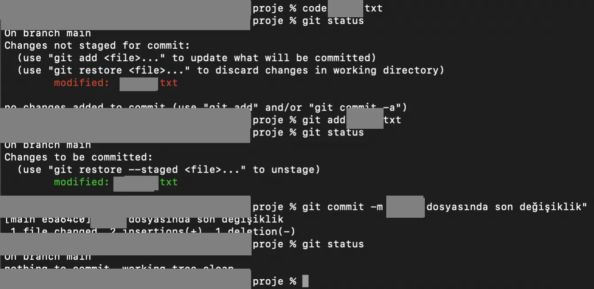
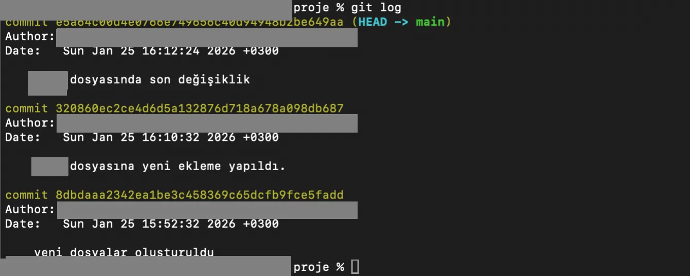

## git status



```bash frame="terminal"
code ornek.txt
git status
```

```text title="Çıktı"
On branch main
Changes not staged for commit:
  (use "git add <file>..." to update what will be committed)
  (use "git restore <file>..." to discard changes in working directory)
        modified:   ornek.txt

no changes added to commit (use "git add" and/or "git commit -a")
```

```bash frame="terminal"
git add ornek.txt
git status
```

```text title="Çıktı"
On branch main
Changes to be committed:
  (use "git restore --staged <file>..." to unstage)
        modified:   ornek.txt
```

```bash frame="terminal"
git commit -m "ornek dosyasında son değişiklik"
git status
```

```text title="Çıktı"
[main e5a64c0] ornek dosyasında son değişiklik
 1 file changed, 2 insertions(+), 1 deletion(-)
On branch main
nothing to commit, working tree clean
```

Yaptığımız bu işlemlerin durumunu yukarıda gördüğümüz gibi bir rapor halinde görmek için `git status` komutunu kullanırız.

## git log



```bash frame="terminal"
git log
```

```text title="Çıktı"
commit e5a64c00d4e0766e749656c40d94948b2be649aa (HEAD -> main)
Author: Ad Soyad <**********@*****.com>
Date:   Sun Jan 25 16:12:24 2026 +0300

    ornek dosyasında son değişiklik

commit 320860ec2ce4d6d5a132876d718a678a098db687
Author: Ad Soyad <**********@*****.com>
Date:   Sun Jan 25 16:10:32 2026 +0300

    ornek dosyasına yeni ekleme yapıldı.

commit 8dbdaaa2342ea1be3c458369c65dcfb9fce5fadd
Author: Ad Soyad <**********@*****.com>
Date:   Sun Jan 25 15:52:32 2026 +0300

    yeni dosyalar olusturuldu
```

`git log`, projenin başlangıcından bugüne kadar atılan tüm adımların dökümüdür. Kimin, ne zaman, hangi amaçla değişiklik yaptığını takip etmemizi sağlar. Bir hata oluştuğunda geçmişe dönmek veya bir özelliğin ne zaman eklendiğini bulmak için bu komut kullanılır. Daha detaylı halini görmek istersek `git log -p` opsiyonunu kullanırız.

## Dosyayı VS Code ile açma


```bash frame="terminal"
code README.md
ls
```

```text title="Çıktı"
README.md
```

Git üzerinde bir dosya oluşturup bu dosyayı Visual Studio Code editörü ile açmak istesek kullanmamız gereken komut `code dosyaadı` olmalıdır.

Yani bir dosya üzerinde çalışıp commit ile kaydettiğimizde ve daha sonra tekrar değişiklik yapıp bir kez daha commitlediğimizde bu iki kayıt arasında yapılan tüm değişiklikleri ve projenin o anki tüm halini saklamış oluruz. Log komutuyla bu geçmişe istediğimiz zaman ulaşırız.

## Akışın özeti

Anlattığımız Git işlemlerini toparlayacak olursak; bir klasörde Git kullanmaya karar verdiğimizde ilk işimiz `git init` komutunu yazmaktır. Bu komut, o klasörü Git’in denetimine sokar ve arka planda bir takip sistemi kurar. Artık bu klasörde yaptığımız her işlem Git tarafından fark edilir hale gelir.

Ancak Git, yaptığımız her değişikliği bizden habersiz kaydetmez. Bir dosyada değişiklik yaptıktan sonra, bu değişikliği onay sırasına sokmamız gerekir. İşte bu aşamada `git add` komutunu kullanırız. Bu komutla dosyayı "hazırlık alanına" (staging area) almış oluruz. Bu alan, hangi dosyaların kalıcı olarak kaydedileceğini seçtiğimiz bir bekleme odasıdır.

Son aşamada ise sıraya aldığımız bu dosyaları `git commit` komutuyla onaylarız. Bu işlem, hazırlık alanındaki tüm dosyaları alıp Git’in kendi veri tabanına kalıcı birer kayıt olarak işler. Böylece yaptığımız işler versiyonlanmış olur ve projenin o anki hali bir daha kaybolmamak üzere sisteme kaydedilir.

## Sunucu tarafı ve repository

Şimdi gelin Git’in sunucu tarafına bakalım. Daha önce bahsettiğimiz gibi Git decentralized yani dağıtık yapıdadır. Bu projenin sadece merkez bir sunucuda değil, projeye dahil olan herkesin bilgisayarında bir kopyasının bulunması anlamına gelir. Süreç şu şekilde işler: Geliştirici projenin son halini kendi makinesine indirir (clone), istediği değişiklikleri yapar ve bu değişiklikleri önce kendi yerel veri tabanına kaydeder (commit). Ancak bu kayıt henüz sunucuya gitmemiştir. Yereldeki bu kayıtları sunucuya aktarılır ve eğer geliştiricinin yetkisi varsa, gönderdiği değişiklikler merkezi projenin üzerine eklenmiş olur.

İşte bu noktada, projelerimizin ve bu kayıt geçmişimizin bulunduğu dijital depolara Repository (Depo) adını veriyoruz. Bu depoları kendi bilgisayarımızda tutabildiğimiz gibi, dünya çapında erişilebilir hale getirmek ve diğer geliştiricilerle ortak çalışabilmek için [GitHub](/git/github/) gibi bulut tabanlı platformları birer 'merkezi depo sunucusu' olarak kullanıyoruz. Repository oluşturmak aslında yeni bir proje açarak `git init` ile initialize etme işleminin GitHub’daki karşılığıdır.
