## find: dosya ve klasör arama

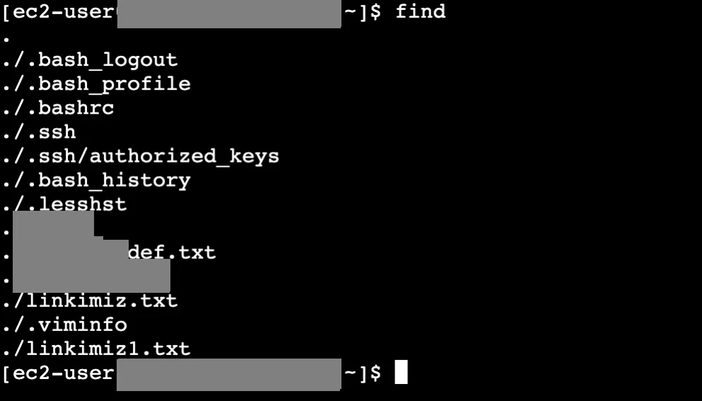

```bash frame="terminal"
find
```

```text title="Çıktı"
.
./.bash_logout
./.bash_profile
./.bashrc
./.ssh
./.ssh/authorized_keys
./.bash_history
./.lesshst
./ornek1
./ornek1/hedef.txt
./ornek1/ornek1
./linkimiz.txt
./.viminfo
./linkimiz1.txt
```

Bir dosyanın nerede olduğunu bilmiyorsak veya bu sistemin içinde bir dosyayı bulmak istiyorsak o dosyayı aramamız gerekir. Bunun için `find` komutunu kullanırız.

`find` yazıp enter dersek şu anda bulunduğumuz klasörde bulunan bütün klasör ve dosyaları listeler.

### -name ve -iname

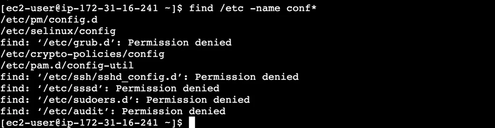

```bash frame="terminal"
find /etc -name conf*
```

```text title="Çıktı"
/etc/pm/config.d
/etc/selinux/config
find: '/etc/grub.d': Permission denied
/etc/crypto-policies/config
/etc/pam.d/config-util
find: '/etc/ssh/sshd_config.d': Permission denied
find: '/etc/sssd': Permission denied
find: '/etc/sudoers.d': Permission denied
find: '/etc/audit': Permission denied
```

`find` yazıp nerede arama yapmak istediğimizi yazarız. Eğer daha spesifik bir arama yapmak istiyorsak örneğin etc klasörü altında ilk dört harfi conf gerisi random olan bir dosyayı listelemek istediğimizde `find /etc -name conf*` komutunu kullanırız.

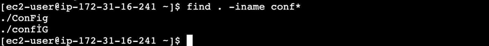

```bash frame="terminal"
find . -iname conf*
```

```text title="Çıktı"
./ConFig
./confİG
```

Linux'ta kullanılan harflerin büyük küçük olmasına göre sonuç değişir. Eğer conf harfleriyle başlayan dosyaları listelersek herhangi bir harfi büyük olursa bunu bize göstermez. Bu durumu engellemek için `find . -iname conf*` komutunu girmemiz yeterli olur.

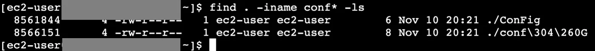

```bash frame="terminal"
find . -iname conf* -ls
```

```text title="Çıktı"
  8561844      4 -rw-r--r--   1 ec2-user ec2-user        6 Nov 10 20:21 ./ConFig
  8566151      4 -rw-r--r--   1 ec2-user ec2-user        8 Nov 10 20:21 ./conf\304\260G
```

Eğer find aramasıyla bulunan dosyaların ayrıntılarını listelemek istersek `find . -iname conf* -ls` komutunu çalıştırırız.

### Zamana, boyuta ve tipe göre arama

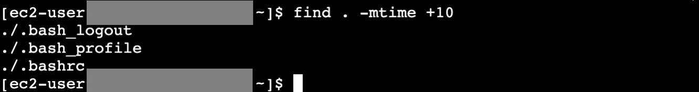

```bash frame="terminal"
find . -mtime +10
```

```text title="Çıktı"
./.bash_logout
./.bash_profile
./.bashrc
```

Bulunmasını istediğimiz dosyaların 10 günden eski olmasını istiyorsak `find . -mtime +10` komutunu kullanırız.

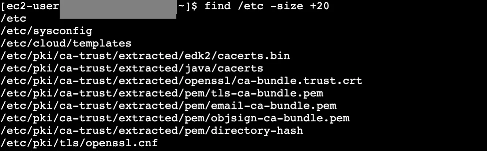

```bash frame="terminal"
find /etc -size +20
```

```text title="Çıktı"
/etc
/etc/sysconfig
/etc/cloud/templates
/etc/pki/ca-trust/extracted/edk2/cacerts.bin
/etc/pki/ca-trust/extracted/java/cacerts
/etc/pki/ca-trust/extracted/openssl/ca-bundle.trust.crt
/etc/pki/ca-trust/extracted/pem/tls-ca-bundle.pem
/etc/pki/ca-trust/extracted/pem/email-ca-bundle.pem
/etc/pki/ca-trust/extracted/pem/objsign-ca-bundle.pem
/etc/pki/ca-trust/extracted/pem/directory-hash
/etc/pki/tls/openssl.cnf
```

Ya da mesela etc altındaki boyutu 20mb'dan büyük olan dosyaları `find /etc -size +20M` komutuyla listeleriz.

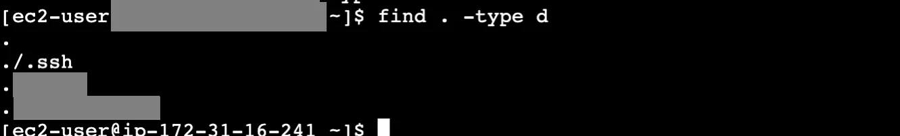

```bash frame="terminal"
find . -type d
```

```text title="Çıktı"
.
./.ssh
./ornek1
./ornek1/ornek1
```

`find . -type istediğimizdosyatipi` komutuyla istediğimiz tipte dosyaları arayabiliriz. `d` dizin, `l` link gibi.

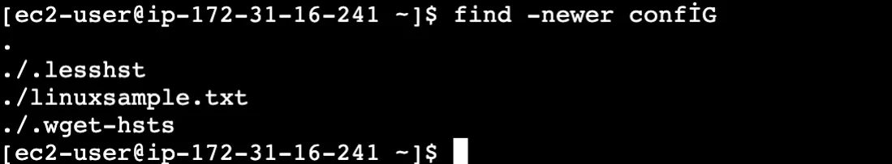

```bash frame="terminal"
find -newer confİG
```

```text title="Çıktı"
.
./.lesshst
./linuxsample.txt
./.wget-hsts
```

`find -newer config` komutu, config adlı dosyadan daha yeni bir değiştirme zamanına (modification time) sahip olan tüm dosyaları ve dizinleri bulmaya yarar. Başka bir deyişle, bu komut, config dosyası oluşturulduktan veya son değiştirildikten sonra değiştirilmiş tüm öğeleri listeler.

### -exec

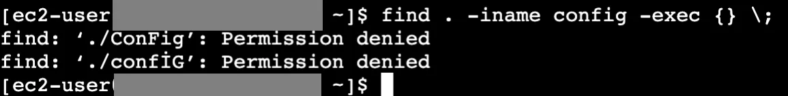

```bash frame="terminal"
find . -iname config -exec {} \;
```

```text title="Çıktı"
find: './ConFig': Permission denied
find: './confİG': Permission denied
```

`find` komutuyla bulduğumuz dosyalar üzerinde bir komut daha çalıştırmak istiyorsak bu opsiyonu `exec` komutuyla ekleriz ve kullanımı şekildedir: `find . -iname config -exec cat {} \;`

## less


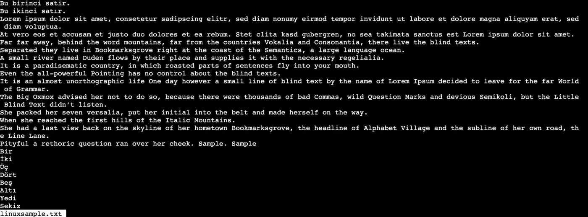

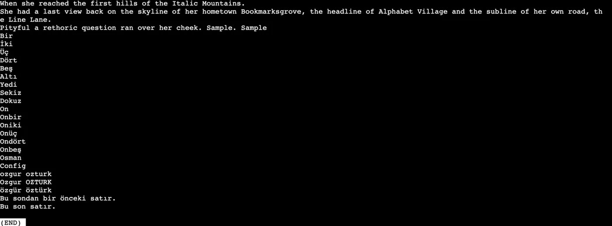

```bash frame="terminal"
less linuxsample.txt
```

```text title="Çıktı"
Bu birinci satır.
Bu ikinci satır.
Lorem ipsum dolor sit amet, consetetur sadipscing elitr, sed diam nonumy eirmod tempor invidunt ut labore et dolore magna aliquyam erat, sed diam voluptua.
...
Sekiz
linuxsample.txt
```

Açtığımız uzun bir dosyanın içeriğinin tümünü görmek için aşağı kaydırmak yerine sayfa değişerek bu verileri okumak için `less dosyaadı` komutunu kullanırız. Sayfa değişmek için `space` tuşunu kullanırız. Çıkmak için `q` tuşuna basmamız yeterlidir.

Sayfa sayfa ilerletmek yerine satır satır okuma yapmak için `space` tuşu yerine aşağı yön tuşu veya `enter` tuşunu kullanabiliriz.

## head ve tail

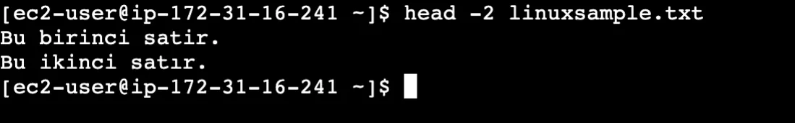

```bash frame="terminal"
head -2 linuxsample.txt
```

```text title="Çıktı"
Bu birinci satır.
Bu ikinci satır.
```

Uzun bir dosyanın en başını görmek istersek kullanacağımız komut `head dosyaadı` olmalıdır. Kaç satırı görmek istiyorsak bunu `head -2 dosyaadı` komutuyla belirtiriz.


Bunun tam tersi olarak sondan kaç satırı okumak istiyorsak `tail -3 dosyaadı` komutunu kullanırız.

`tail -f dosyaadı` komutuyla dosyaya yeni eklenen satırları eş zamanlı olarak ekranda izlemeye (takip etmeye) yarar. Bu özellik, genellikle sistem günlük dosyalarını (log files) canlı olarak takip etmek ve bir uygulamanın çalışırken ürettiği hataları veya durum güncellemelerini anında görmek için kullanılır. İşlem bittiğinde veya takibi durdurmak istediğinizde, genellikle `ctrl + c` tuş kombinasyonu ile komutu sonlandırabilirsiniz.

## vim

Linux'ta dosyaların içeriğini düzenlemek için kullanılan bazı araçlar vardır. Bunlardan ilki vim. Okuma ve edit olmak üzere iki modu vardır.

Dosya ilk açıldığında okuma moduna açılır bu moddayken dosyadan çıkmak için `:` + `x` + enter veya `:` + `q` + enter yaparız.

Navigasyon yani okuma modunda aşağıdaki tuşları kullanırız. `h` tuşu ile sola, `l` tuşu ile sağa, `j` tuşu ile aşağı ve `k` tuşu ile yukarı doğru ilerleyebiliriz. Veya yön tuşlarını da kullanabiliriz.

Yazma moduna geçebilmek için `i` harfine basmamız yeterli. `Esc` ile okuma moduna geri döneriz.

Dosyayı kaydedip çıkmak için `esc` + `:wq` + enter yaparız. `:set nu` yazarsak satır numaralarını açar. `:set nonu` yazarsak kapatır.

## nano

Diğer bir text editör aracımız nano. `nano dosyaadı` şeklinde kullanılır. `ctrl+x` ile dosyayı kaydedip çıkarız.

## diff, vimdiff ve sdiff

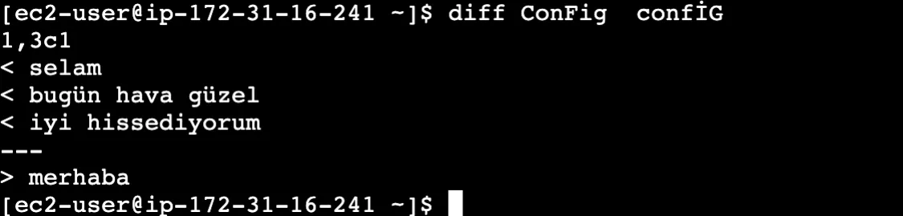

```bash frame="terminal"
diff ConFig confİG
```

```text title="Çıktı"
1,3c1
< selam
< bugün hava güzel
< iyi hissediyorum
---
> merhaba
```

Dosyaların arasındaki farkları bulmak için `diff` komutunu kullanırız. `diff dosyaadı1 dosyaadı2` şeklinde kullanılır. Çıktı olarak bize; birinci dosyada olan veriler, değişim olanlar ve ikinci dosyada olan verileri gösterir.

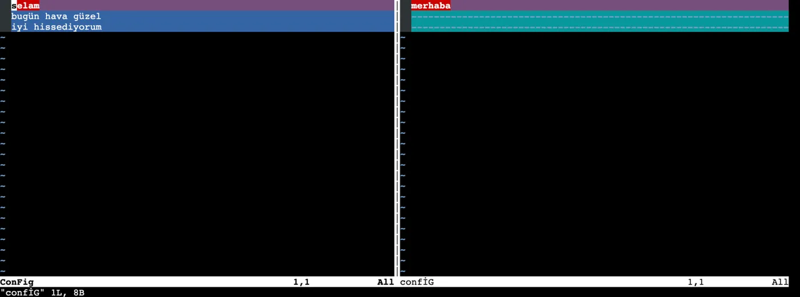

```bash frame="terminal"
vimdiff ConFig confİG
```

Bir dosyayı `vimdiff dosyaadı1 dosyaadı2` komutunu kullanarak vim içerisinde iki dosyayı açabiliriz. Çıkmak için `esc` + `:` + `w` + `q` harflerini kullanıyoruz.

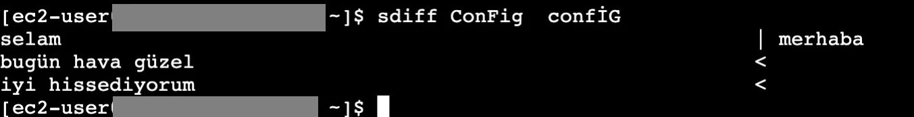

```bash frame="terminal"
sdiff ConFig confİG
```

```text title="Çıktı"
selam                                                 | merhaba
bugün hava güzel                                      <
iyi hissediyorum                                      <
```

Aynı şekilde iki dosyayı yan yana komut satırında açmak istersek `sdiff dosyaadı1 dosyaadı2` şeklinde kullanıyoruz.

## grep: dosya içinde arama

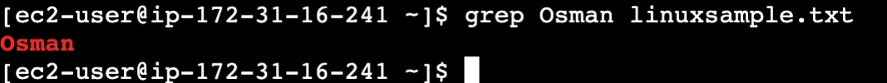

```bash frame="terminal"
grep Osman linuxsample.txt
```

```text title="Çıktı"
Osman
```

`grep` text dosyaları içerisinde arama yapmamızı sağlar. `find` sistemde dosya ve klasörleri bulmamızı sağlarken `grep`le dosya içinde arama yaparız.

Büyük - küçük harf duyarlılığı olmadan bir arama yapmak istiyorsak `grep -i aranacakkelime aranacakdosyaismi` şeklinde komutu yazmalıyız.

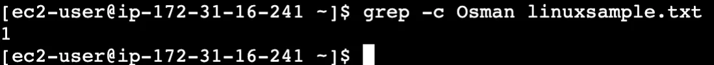

```bash frame="terminal"
grep -c Osman linuxsample.txt
```

```text title="Çıktı"
1
```

`grep -c` komutuyla kaç satırda aranan kelimeyi bulduğunu verir.

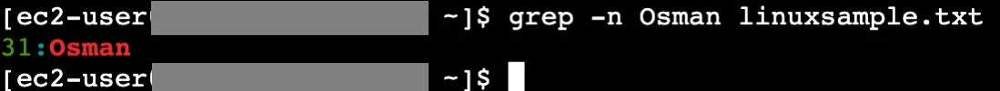

```bash frame="terminal"
grep -n Osman linuxsample.txt
```

```text title="Çıktı"
31:Osman
```

`grep -n` dersek kaç numaralı satırda aradığımız kelimeyi bulduğunu verir.

`grep -v` dersek aradığımız kelimenin bulunmadığı satırları bize gösterir.
