## Dosya boyutu: du

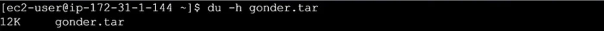

```bash frame="terminal"
du -h gonder.tar
```

```text title="Çıktı"
12K     gonder.tar
```

Dosyaların boyutunu görmek için `du` komutunu kullanırız. `-h` ekleyerek bizim anlayacağımız türden boyutları görürüz.

## Sıkıştırma: gzip, gunzip ve tar


```bash frame="terminal"
gzip gonder.tar
```


```bash frame="terminal"
du -h gonder.tar.gz
```

```text title="Çıktı"
4.0K    gonder.tar.gz
```

Dosyaları ziplemek yani sıkıştırmak için birçok araç vardır. Bunlardan ilki `gzip dosyaadı` şeklinde kullanılan komuttur.

Sıkıştırılmış olan dosyayı açmak için ise `gunzip dosyaadı` şeklinde yazmamız yeterli.

Sıkıştırılmış bir dosya oluşturmak istersek burada `tar zcf dosyaadı` şeklinde kullanmalıyız.

## alias

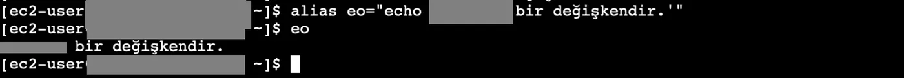

```bash frame="terminal"
alias eo="echo 'ornek bir değişkendir.'"
eo
```

```text title="Çıktı"
ornek bir değişkendir.
```

Alias kullanarak kullanmak istediğimiz bir komut için kısayol oluşturarak oluşturduğumuz kısayolu yazdığımızda esas istediğimiz kodun çalıştırılmasını sağlayabiliriz.

## Değişkenler

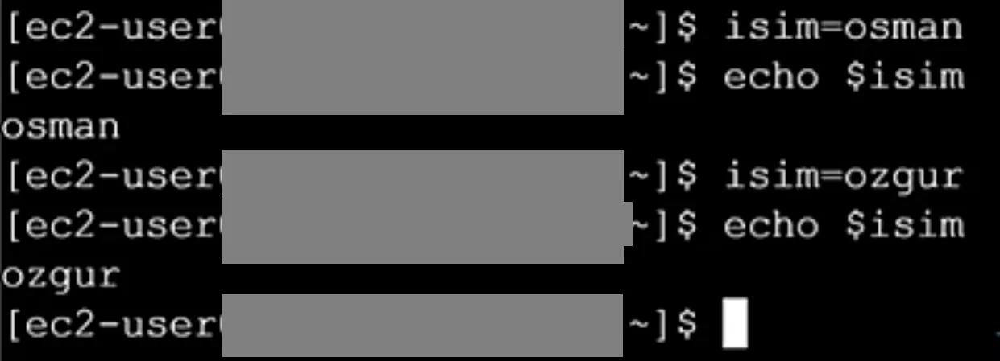

```bash frame="terminal"
isim=osman
echo $isim
isim=ozgur
echo $isim
```

```text title="Çıktı"
osman
ozgur
```

Environment variable, bir değişken tanımlayarak buna bir değer atamamızı ve bu değer yerine değişkeni çağırarak tanımladığımız değeri çağırmamızı sağlar. Bu değişkeni diğer uygulamalarda kullanabiliriz. Kullanımı `isim=deger` şeklindedir. Tanımladığımız değişkeni çağırmak için `$isim` olarak yazmamız gerekir.

### export ile environment variable

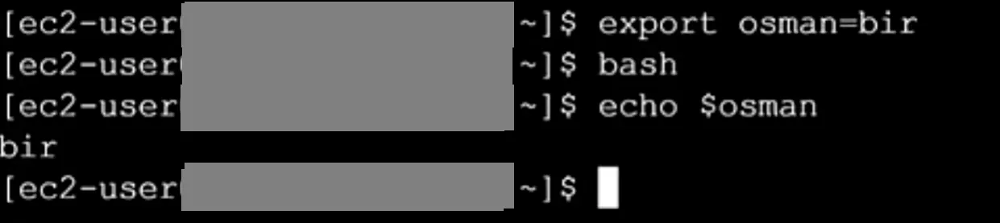

```bash frame="terminal"
export osman=bir
bash
echo $osman
```

```text title="Çıktı"
bir
```

Tanımladığımız değişkenin diğer session'larda geçerli olması için normal bir değişken olarak tanımladığımız değişkeni environment variable'a dönüştürmemiz gerekmektedir. Bunun için tanımlayacağımız değişken komutunun başına `export` yazmamız gerekir. Bu sayede oluşturduğumuz değişken bu oturumdan başlatılan diğer process'lerde de geçerli olacaktır.

### printenv ve unset

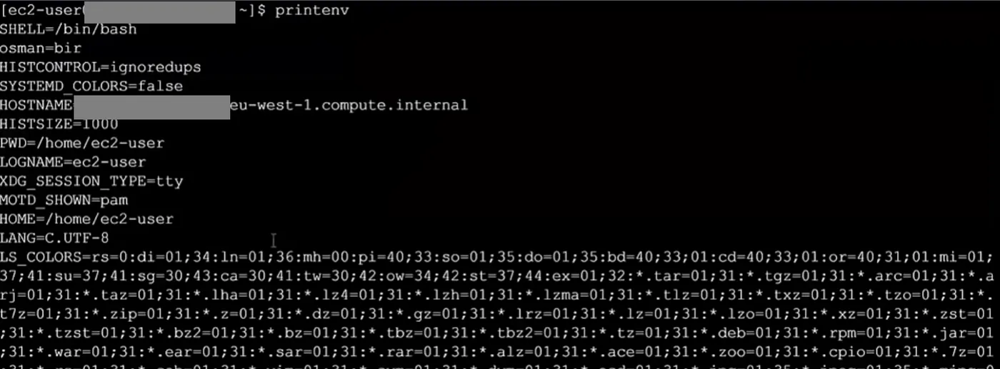

```bash frame="terminal"
printenv
```

```text title="Çıktı"
SHELL=/bin/bash
osman=bir
HISTCONTROL=ignoredups
SYSTEMD_COLORS=false
HOSTNAME=ip-172-31-0-10.eu-west-1.compute.internal
HISTSIZE=1000
PWD=/home/ec2-user
LOGNAME=ec2-user
XDG_SESSION_TYPE=tty
MOTD_SHOWN=pam
HOME=/home/ec2-user
LANG=C.UTF-8
LS_COLORS=rs=0:di=01;34:ln=01;36:mh=00:pi=40;33:so=01;35:do=01;35:bd=40;33;01:...
```

Bir sistemde bulunan environment variable'lara erişmek için `printenv` komutunu çalıştırmalıyız. Bu komutun sonuna istediğimiz değişkenin ismini yazarak değerini de bastırabiliriz. Bir environment variable'ı silmek istersek `unset degiskenadı` şeklinde yazabiliriz.

```bash frame="terminal"
unset degiskenadı
```

## Komut geçmişi: history

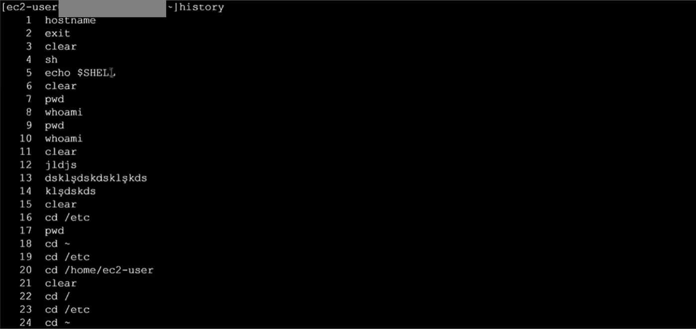

```bash frame="terminal"
history
```

```text title="Çıktı"
    1  hostname
    2  exit
    3  clear
    4  sh
    5  echo $SHELL
    6  clear
    7  pwd
    8  whoami
    9  pwd
   10  whoami
...
```

`history` komutu bash shell geçmişini görmemizi sağlar.

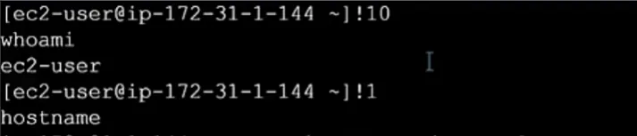

```bash frame="terminal"
!10
```

```text title="Çıktı"
whoami
ec2-user
```

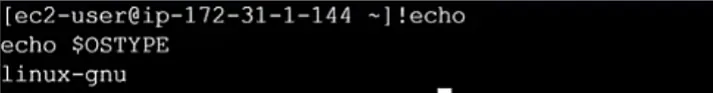

```bash frame="terminal"
!echo
```

```text title="Çıktı"
echo $OSTYPE
linux-gnu
```

Geçmişte yazdığımız en son komutu tekrarlamak için `!!` komutunu, geçmiş listesindeki 10 numaralı komutu çalıştırmak için ise `!10` komutunu kullanırız. Ünlem karakteri ile string aratırsak bu string ile kullanılan en son komutu bulur ve gösterir. Örneğin `!echo` komutuyla da en son kullandığımız echo komutunu verir.

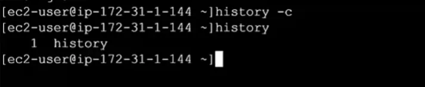

```bash frame="terminal"
history -c
history
```

```text title="Çıktı"
    1  history
```

History temizlemek istersek `history -c` komutunu kullanırız.

## Yorum ve çok satırlı komut

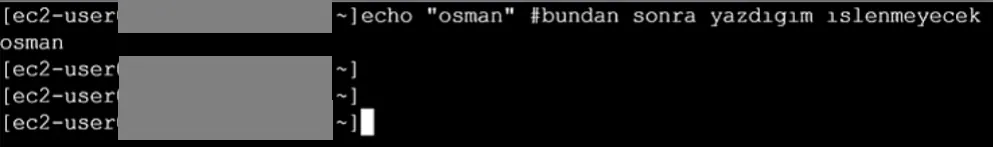

```bash frame="terminal"
echo "osman" #bundan sonra yazdigim islenmeyecek
```

```text title="Çıktı"
osman
```

`#` karakterini yorum satırı yazmak istersek kullanırız.

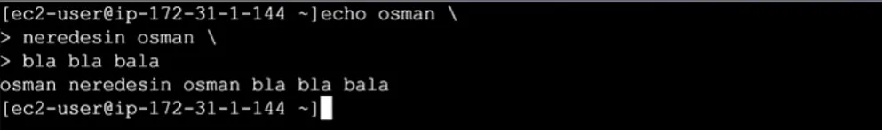

```bash frame="terminal"
echo osman \
neredesin osman \
bla bla bala
```

```text title="Çıktı"
osman neredesin osman bla bla bala
```

Eğer uzun bir komut yazıyorsak ve tek bir satırda görünmesi önemli değilse daha kolay okunabilmesi adına birden fazla satıra yazdırmak için komutun sonunda `\` karakterini kullanırız.

## Bash başlangıç dosyaları

Bir Linux sisteme bağlanırken ya interactive olarak biz terminale bağlanıyoruz ya da noninteractive olarak script çalıştırıyoruz. Interactive olarak bağlanmanın iki çeşidi var. Bunlar login ve nonlogin bağlanmadır.

Login bağlanmada, kendi terminal uygulamamız ile bash shell'e bağlanırız. Nonlogin bağlanmada, bash altında bir session ile yeni bir bash açarak bağlanmadır.

Bir terminale interactive login olarak bağlanırsak bash home directory'de duran `.bash_profile` isimli dosyanın içerisinde yazan komutları işler ve bu işlenen şeylerle o session'u açarız. Bu dosyanın içinde sadece bashrc yükleme komutları bulunmaktadır.

Bir terminale interactive nonlogin olarak bağlanırsak bash home directory'de duran `.bashrc` isimli dosyanın içerisinde yazan komutları işler ve bu işlenen şeylerle o session'u açarız.

Login shell'de ilk olarak `/etc/profile` işlenir.

Her login olduğumuzda çalışmasını istediklerimizi `.bash_profile` dosyasına yazmamız gerekir. Ama artık `.bash_profile` dosyası da `.bashrc` dosyasına bağlı olduğu için her şeyi buraya yazıyoruz. Örneğin alias ve environment variable tanımlarımız.
