## Yeni disk oluşturma ve makineye bağlama

1. EC2 menüsünden **Elastic Block Store** başlığı altında **Volumes** seçeneğine tıklıyoruz.

   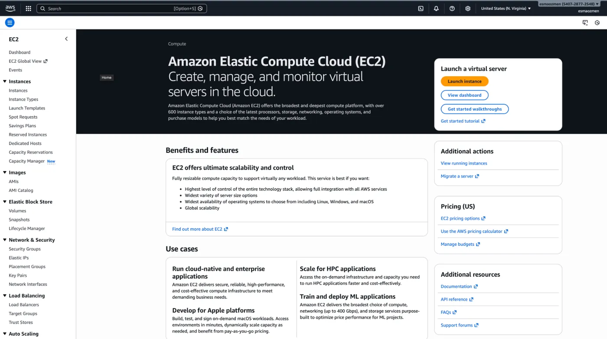

2. Açılan ekranda sağ üstte bulunan **Create volume** butonuna yeni bir disk oluşturmak için tıklıyoruz.

   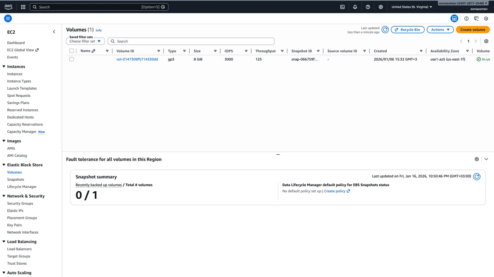

3. Oluşturacağımız diskin özelliklerini belirledikten sonra sağ altta bulunan **Create volume** butonuna tıklayarak diskimizi oluşturmuş oluruz.

   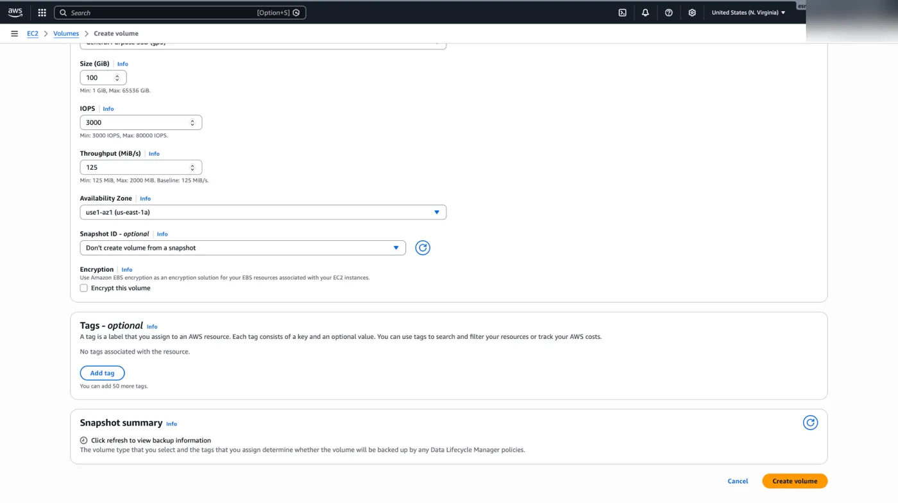

4. Oluşturduğumuz diski makineye bağlamak için diskimizi seçtikten sonra **Actions** menüsü altında **Attach volume** seçeneğine tıklıyoruz.

   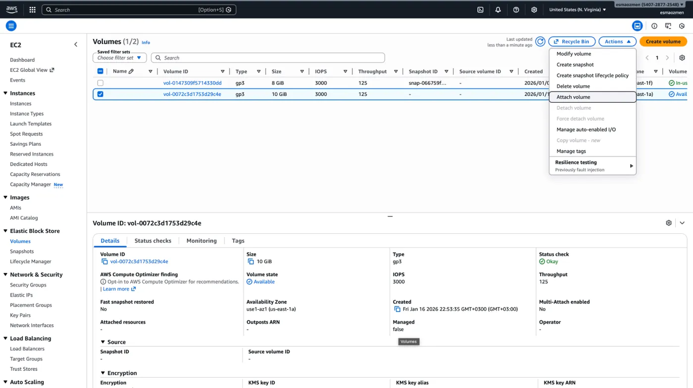

5. Açılan ekranda **Instance** altından diski hangi makineye bağlayacağımızı seçiyoruz. Ve **Attach volume** butonuna tıklıyoruz.

   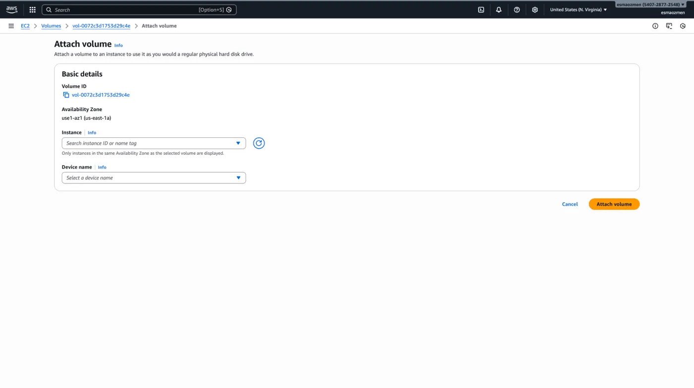

## Partition

Artık oluşturduğumuz disk sanal makinemize bağlı ancak üzerine henüz veri yazabilir durumda değiliz; çünkü üzerinde bir partition (bölümlendirme) yapısı mevcut değil. Partition; disk üzerinde verilerin yazılacağı alanın sınırlarını çizer. Yani veriyi yazmaya hangi byte’tan başlanacağı, nerede bitirileceği ve bu alanın ne kadarının kullanılabileceği gibi tanımlamaların yapılması anlamına gelir.

### lsblk

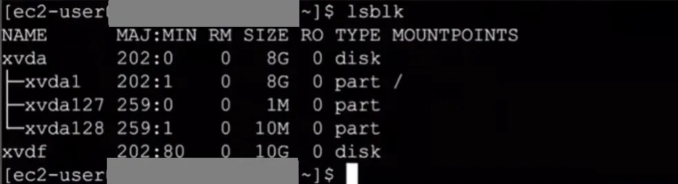

```bash frame="terminal"
lsblk
```

```text title="Çıktı"
NAME      MAJ:MIN RM SIZE RO TYPE MOUNTPOINTS
xvda      202:0    0   8G  0 disk
├─xvda1   202:1    0   8G  0 part /
├─xvda127 259:0    0   1M  0 part
└─xvda128 259:1    0  10M  0 part
xvdf      202:80   0  10G  0 disk
```

Diski bölümlere ayırmadan önce, sistemin bu yeni donanımı fiziksel olarak tanıyıp tanımadığını kontrol etmemiz gerekir. Bunun için `lsblk` (List Block Devices) komutunu kullanırız. Bu komut; sabit diskler (HDD), SSD’ler ve NVMe sürücüler gibi veriyi bloklar halinde işleyen tüm blok seviyesindeki cihazları hiyerarşik bir yapıda listeler. Bu sayede sisteme kaç tane disk takılı olduğunu, bu disklerin isimlerini (sdb, sdc gibi) ve kapasitelerini net bir şekilde görebiliriz.

### df -h

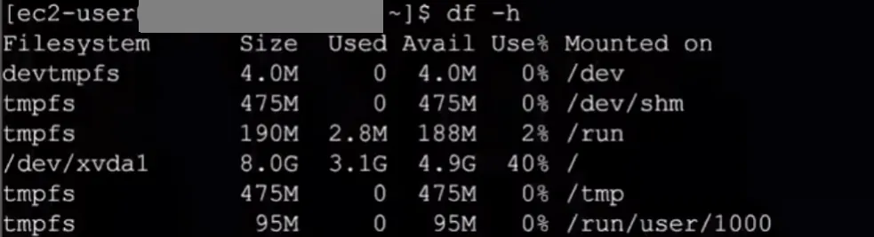

```bash frame="terminal"
df -h
```

```text title="Çıktı"
Filesystem      Size  Used Avail Use% Mounted on
devtmpfs        4.0M     0  4.0M   0% /dev
tmpfs           475M     0  475M   0% /dev/shm
tmpfs           190M  2.8M  188M   2% /run
/dev/xvda1      8.0G  3.1G  4.9G  40% /
tmpfs           475M     0  475M   0% /tmp
tmpfs            95M     0   95M   0% /run/user/1000
```

Sistemdeki fiziksel diskleri gördükten ve bölümlendirdikten sonra, son aşamada `df -h` komutunu kullanırız. Bu komut bize sadece işletim sistemine başarıyla bağlanmış (mount edilmiş) ve veri yazmaya hazır olan alanların doluluk oranlarını raporlar.

### fdisk -l

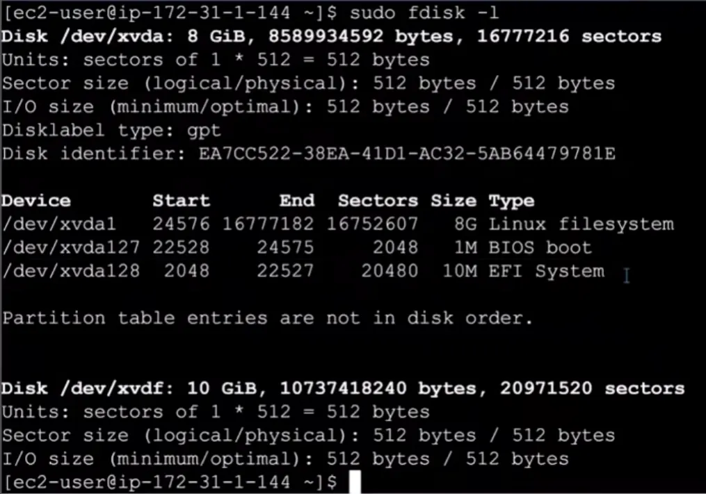

```bash frame="terminal"
sudo fdisk -l
```

```text title="Çıktı"
Disk /dev/xvda: 8 GiB, 8589934592 bytes, 16777216 sectors
Units: sectors of 1 * 512 = 512 bytes
Sector size (logical/physical): 512 bytes / 512 bytes
I/O size (minimum/optimal): 512 bytes / 512 bytes
Disklabel type: gpt
Disk identifier: EA7CC522-38EA-41D1-AC32-5AB64479781E

Device          Start      End  Sectors Size Type
/dev/xvda1      24576 16777182 16752607   8G Linux filesystem
/dev/xvda127    22528    24575     2048   1M BIOS boot
/dev/xvda128     2048    22527    20480  10M EFI System

Partition table entries are not in disk order.

Disk /dev/xvdf: 10 GiB, 10737418240 bytes, 20971520 sectors
Units: sectors of 1 * 512 = 512 bytes
Sector size (logical/physical): 512 bytes / 512 bytes
I/O size (minimum/optimal): 512 bytes / 512 bytes
```

Makinede bulunan disklerin listesine ve oluşturulan partition’lara bakmak için `sudo fdisk -l` komutunu kullanırız.

## Partition oluşturma (fdisk)

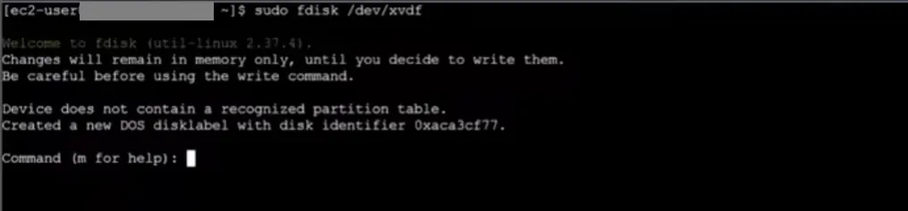

```bash frame="terminal"
sudo fdisk /dev/xvdf
```

```text title="Çıktı"
Welcome to fdisk (util-linux 2.37.4).
Changes will remain in memory only, until you decide to write them.
Be careful before using the write command.

Device does not contain a recognized partition table.
Created a new DOS disklabel with disk identifier 0xaca3cf77.

Command (m for help):
```

Bir disk üzerinde işlem yapmak için öncelikle `sudo fdisk /dev/xvdf` komutunu yazarız gelen çıktıda yapmak istediğimiz işlemi yazarız.

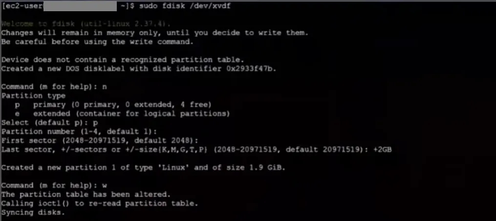

```text title="fdisk oturumu"
Command (m for help): n
Partition type
   p   primary (0 primary, 0 extended, 4 free)
   e   extended (container for logical partitions)
Select (default p): p
Partition number (1-4, default 1):
First sector (2048-20971519, default 2048):
Last sector, +/-sectors or +/-size{K,M,G,T,P} (2048-20971519, default 20971519): +2GB

Created a new partition 1 of type 'Linux' and of size 1.9 GiB.

Command (m for help): w
The partition table has been altered.
Calling ioctl() to re-read partition table.
Syncing disks.
```

1. `n` yazarak yeni bir partition oluşturmak istediğimizi söylemiş oluruz.
2. Oluşturacağımız partition’un primary veya extended olduğunu belirterek devam ederiz.
3. Ardından partition numarasını vererek devam ederiz.
4. Diskin yazacağı byte’ın neresi olduğunu yazarız.
5. `w` ile kaydedip çıkarız.

## Formatlama: dosya sistemi oluşturma

Oluşturduğumuz partition'ı, kaba inşaatı bitmiş bir evin odalarına bölünmesi gibi düşünebiliriz. Ancak bu haliyle odalar henüz kullanıma hazır değildir; hangisinin mutfak hangisinin yatak odası olduğunu belirlemek ve içine gerekli eşyaları yerleştirmek gerekir. Aynı şekilde, bir partition'ın üzerine veri yazabilmek için ona 'sen şu dosya sistemini kullanacaksın' dememiz, yani onu formatlamamız gerekir.

Buradaki dosya sistemi; verilerin disk üzerinde hangi koordinatlarda duracağına, nasıl isimlendirileceğine ve nereye yazılacağına dair hiyerarşik tabloyu oluşturan yapıdır. Bu tablo sayesinde işletim sistemi, aradığımız bir veriyi diskteki milyonlarca byte arasından saniyeler içinde bulup getirebilir.

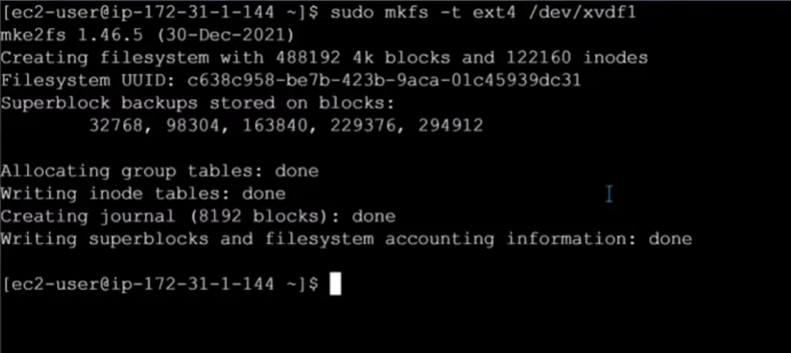

```bash frame="terminal"
sudo mkfs -t ext4 /dev/xvdf1
```

```text title="Çıktı"
mke2fs 1.46.5 (30-Dec-2021)
Creating filesystem with 488192 4k blocks and 122160 inodes
Filesystem UUID: c638c958-be7b-423b-9aca-01c45939dc31
Superblock backups stored on blocks:
        32768, 98304, 163840, 229376, 294912

Allocating group tables: done
Writing inode tables: done
Creating journal (8192 blocks): done
Writing superblocks and filesystem accounting information: done
```

Bahsettiğimiz formatlama işlemini yapmak için kullandığımız komut `sudo mkfs -t dosyasistemiismi partitionyolu` olmalıdır. Hangi dosya sistemi ile formatlayacaksak onun ismini kullanırız. Bu işlemle birlikte disk artık veri kabul etmeye hazır hale gelir. Ancak bu diski kullanabilmek için Linux'ta 'Mount' adı verilen işlemi yapmamız gerekir. Mount işlemi sayesinde, formatladığımız disk bölümünü sistemdeki boş bir klasörle bağlayarak diski kullanılabilir hale getiririz.

## Mount

Bunun için kullandığımız komut iskeleti `sudo mount -t auto kullanılacakcihaz baglanacakklasör` şeklindedir.

Örneğin `sudo mount -t auto /dev/xvdf1 /ornek/x1` komutunda `/dev/xvdf1` cihazını al `ornek` altındaki `x1` klasörüne bunu yapıştır demek istiyoruz. Bu sayede `ornek` altındaki `x1` klasörünün içine ne yazılırsa `/dev/xvdf1` partitiona da yazılmış olacak.

```bash frame="terminal"
sudo mount -t auto /dev/xvdf1 /ornek/x1
```

## df -hT ile kontrol

Şimdi `df -hT` komutuyla sistemdeki disk bölümlerinin doluluk oranlarını dosya sistemi tipiyle birlikte listeleyebiliriz.

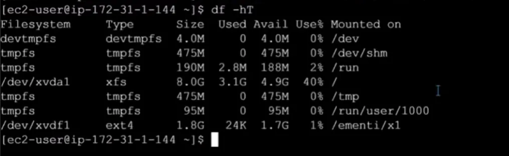

```bash frame="terminal"
df -hT
```

```text title="Çıktı"
Filesystem     Type      Size  Used Avail Use% Mounted on
devtmpfs       devtmpfs  4.0M     0  4.0M   0% /dev
tmpfs          tmpfs     475M     0  475M   0% /dev/shm
tmpfs          tmpfs     190M  2.8M  188M   2% /run
/dev/xvda1     xfs       8.0G  3.1G  4.9G  40% /
tmpfs          tmpfs     475M     0  475M   0% /tmp
tmpfs          tmpfs      95M     0   95M   0% /run/user/1000
/dev/xvdf1     ext4      1.8G   24K  1.7G   1% /ornek/x1
```

Buradaki `-h` parametresi verileri GB/MB gibi okunabilir formatta sunarken, `-T` parametresi her bir bölümün hangi veri yönetim mimarisine (teorik dosya sistemi yapısına) sahip olduğunu gösterir.
