## cp: kopyalama

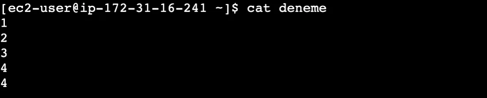

```bash frame="terminal"
cat deneme
```

```text title="Çıktı"
1
2
3
4
4
```

Deneme dosyasının içeriği yukarıdaki gibidir.

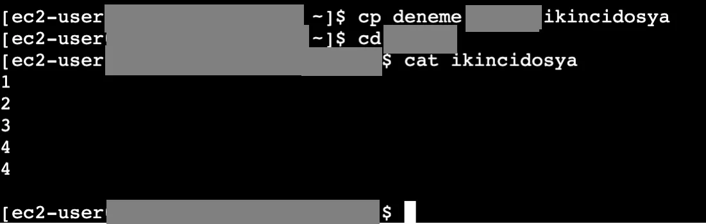

```bash frame="terminal"
cp deneme ornek1/ikincidosya
cd ornek1
cat ikincidosya
```

```text title="Çıktı"
1
2
3
4
4
```

`cp dosyaadı lokasyon` komutunu kullanarak istediğimiz bir dosyayı başka bir yere, lokasyona kopyalayabiliriz. Deneme isimli dosyayı `ornek1` altında ikincidosyaya kopyalıyoruz.

## mv: taşıma ve yeniden adlandırma

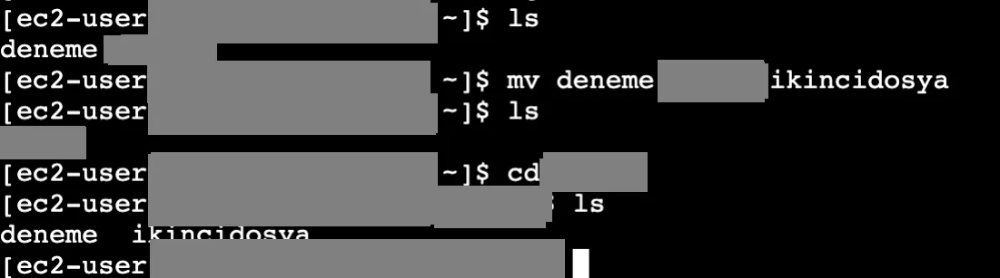

```bash frame="terminal"
ls
mv deneme ornek1/ikincidosya
ls
cd ornek1
ls
```

```text title="Çıktı"
deneme  ornek1
ornek1
deneme  ikincidosya
```

İstediğimiz bir dosyayı başka bir klasör altındaki dosyaya taşımak için `mv dosyaadı lokasyon` komutunu kullanırız. Yukarıda da göründüğü gibi başlangıçta home altında bulunan deneme dosyasını `ornek1` folder'ı altına taşıdık.

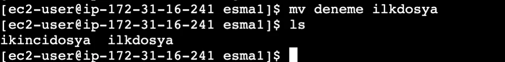

```bash frame="terminal"
mv deneme ilkdosya
ls
```

```text title="Çıktı"
ikincidosya  ilkdosya
```

`mv` komutunu dosya ismini değiştirmek için de kullanırız.

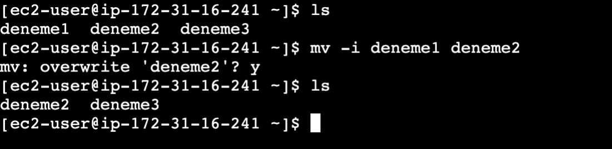

```bash frame="terminal"
ls
mv -i deneme1 deneme2
ls
```

```text title="Çıktı"
deneme1  deneme2  deneme3
mv: overwrite 'deneme2'? y
deneme2  deneme3
```

`mv -i dosyaadı dosyaadı` komutuyla dosyaları interaktif modda açabiliriz. deneme1 dosyasını taşıyorum ama deneme2 olarak yeniden adlandıracağım demiş oluyor. Onaylamak için `y` yazıp enter diyoruz.

## Kök dizin

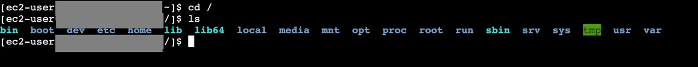

```bash frame="terminal"
cd /
ls
```

```text title="Çıktı"
bin  boot  dev  etc  home  lib  lib64  local  media  mnt  opt  proc  root  run  sbin  srv  sys  tmp  usr  var
```

Linux'ta kök dizinimiz root'tur. En üstte root vardır ve tüm klasörler onun altında şekillenir. Bu klasörlerden bazıları üstteki gibidir.

## PATH değişkeni

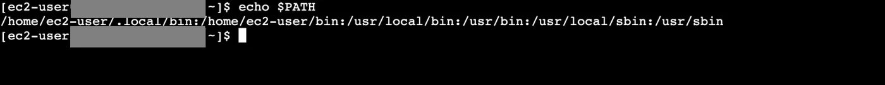

```bash frame="terminal"
echo $PATH
```

```text title="Çıktı"
/home/ec2-user/.local/bin:/home/ec2-user/bin:/usr/local/bin:/usr/bin:/usr/local/sbin:/usr/sbin
```

Linux'ta bir kod girdiğimiz zaman, linux öncelikle path environment variable'a gider. Path bize girdiğimiz komutların nerede ve hangi sırayla aranacağını söyler. Kullandığımız `cat`, `touch` gibi bazı komutlar aslında birer uygulamadır.

Bir komut girildiğinde, uygulama çalıştırılmak istendiğinde ilk olarak home altında ec2 altındaki `.local` altındaki `bin` folder'ına bakar eğer bu uygulama burada varsa burdaki path'i çalıştırır. Eğer burada bulamazsa home altında ec2 altındaki -user altında bulunan `bin` folder'ına bakar. Burda da bulunmazsa yukarıdaki çıktıda bulunan sırayı takip eder.

## which

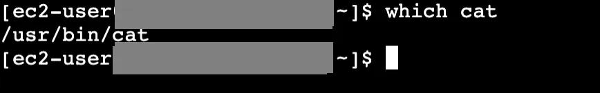

```bash frame="terminal"
which cat
```

```text title="Çıktı"
/usr/bin/cat
```

`which uygulamaadı` komutuyla çalıştırdığımız komutların dosyalarının nerede durduğunu görürüz. Verilen komutun sistemdeki dosya yolunu (konumunu) bulup göstermeye yarar.

## export: environment variable oluşturma ve değiştirme

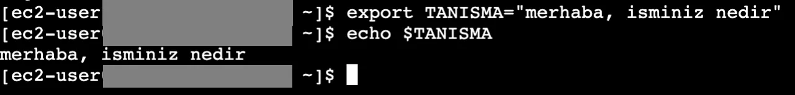

```bash frame="terminal"
export TANISMA="merhaba, isminiz nedir"
echo $TANISMA
```

```text title="Çıktı"
merhaba, isminiz nedir
```

Bir environment variable değiştirmek veya yeni bir variable oluşturmak istiyorsak `export` komutunu kullanırız. Yeni bir environment variable oluşturmak için adımları takip etmemiz yeterlidir. Oluşturduğumuz variable'ı çağırmak için `echo $variableadı` şeklinde yazarız.

Var olan bir environment variable'ı değiştirmek için ise aşağıdaki komutları yazarız. Bu komut ile var olan PATH variable'ına `ornek1` isimli klasör ekleyerek güncellemiş oluruz.

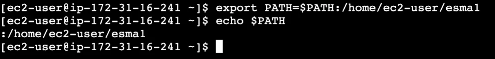

```bash frame="terminal"
export PATH=$PATH:/home/ec2-user/ornek1
echo $PATH
```

```text title="Çıktı"
...:/home/ec2-user/ornek1
```

## Linkler

### Soft link

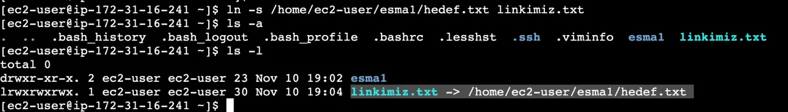

```bash frame="terminal"
ln -s /home/ec2-user/ornek1/hedef.txt linkimiz.txt
ls -a
ls -l
```

```text title="Çıktı"
.  ..  .bash_history  .bash_logout  .bash_profile  .bashrc  .lesshst  .ssh  .viminfo  ornek1  linkimiz.txt
total 0
drwxr-xr-x. 2 ec2-user ec2-user 23 Nov 10 19:02 ornek1
lrwxrwxrwx. 1 ec2-user ec2-user 30 Nov 10 19:04 linkimiz.txt -> /home/ec2-user/ornek1/hedef.txt
```

Bir dosyayı başka bir kaynağa linkleyebiliriz. Böylece linklediğimiz kaynak üzerinde yaptığımız işlemler linkin hedefi olan kaynak üzerinde yapılmış olur. Linkler ile bir dosyaya veya klasöre aynı anda birden fazla yerden erişim sağlarız. Bunu sembolik linkler ile yaparız. Soft ve hard olmak üzere iki çeşit link oluşturabiliriz. Soft link oluşturmak için `ln -s linklemekistediğimizdosyayolu linkismi` komutunu kullanırız. Eğer ana dosyayı silersek linkimiz silinmez.

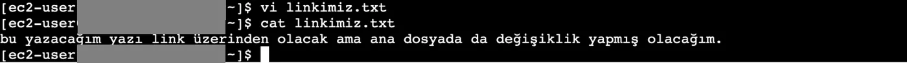

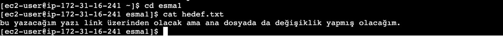

```bash frame="terminal"
vi linkimiz.txt
cat linkimiz.txt
cd ornek1
cat hedef.txt
```

```text title="Çıktı"
bu yazacağım yazı link üzerinden olacak ama ana dosyada da değişiklik yapmış olacağım.
bu yazacağım yazı link üzerinden olacak ama ana dosyada da değişiklik yapmış olacağım.
```

Yukarıda olduğu gibi daha sonra göreceğimiz komut olan [vi](/linux/arama-ve-goruntuleme/) ile linklediğimiz dosyayı açıp içine istediğimizi yazdığımızda hedef dosyanın içeriği de değişmiş oluyor.

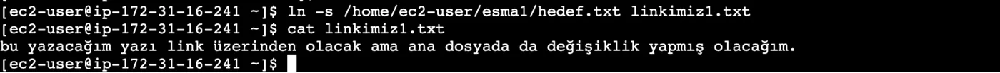

```bash frame="terminal"
ln -s /home/ec2-user/ornek1/hedef.txt linkimiz1.txt
cat linkimiz1.txt
```

```text title="Çıktı"
bu yazacağım yazı link üzerinden olacak ama ana dosyada da değişiklik yapmış olacağım.
```

Sonradan bir link oluştursak bunun da içeriği diğeriyle aynı olacaktır.

### Hard link

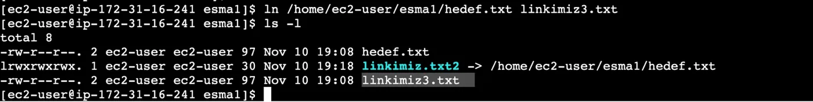

```bash frame="terminal"
ln /home/ec2-user/ornek1/hedef.txt linkimiz3.txt
ls -l
```

```text title="Çıktı"
total 8
-rw-r--r--. 2 ec2-user ec2-user 97 Nov 10 19:08 hedef.txt
lrwxrwxrwx. 1 ec2-user ec2-user 30 Nov 10 19:18 linkimiz.txt2 -> /home/ec2-user/ornek1/hedef.txt
-rw-r--r--. 2 ec2-user ec2-user 97 Nov 10 19:08 linkimiz3.txt
```

İkinci link çeşidimiz olan hard linki oluşturmak için ise `ln linklemekistediğimizdosyayolu linkismi` komutunu kullanırız. Soft linkten farkı ana dosyayı sildiğimizde linkimiz silinmez, içeriği korunur. Hard link dosya oluşturur. Gösterimi de soft linkten farklı ve yukarıdaki gibidir.

### Linkleri kaldırma

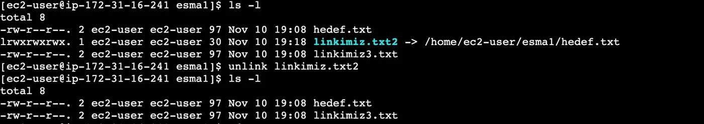

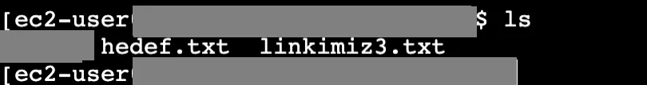

```bash frame="terminal"
ls -l
unlink linkimiz.txt2
ls -l
```

```text title="Çıktı"
total 8
-rw-r--r--. 2 ec2-user ec2-user 97 Nov 10 19:08 hedef.txt
lrwxrwxrwx. 1 ec2-user ec2-user 30 Nov 10 19:18 linkimiz.txt2 -> /home/ec2-user/ornek1/hedef.txt
-rw-r--r--. 2 ec2-user ec2-user 97 Nov 10 19:08 linkimiz3.txt
total 8
-rw-r--r--. 2 ec2-user ec2-user 97 Nov 10 19:08 hedef.txt
-rw-r--r--. 2 ec2-user ec2-user 97 Nov 10 19:08 linkimiz3.txt
```

Oluşturduğumuz soft linkleri geri almak için `unlink linkismi` komutunu yazmamız yeterli olacaktır. İkinci görselde göründüğü gibi `hedef.txt` dosyası silinmiş olmaz.

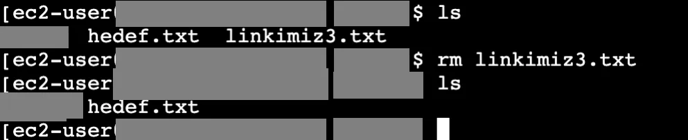

```bash frame="terminal"
ls
rm linkimiz3.txt
ls
```

```text title="Çıktı"
ornek1  hedef.txt  linkimiz3.txt
ornek1  hedef.txt
```

Hard link bir dosya olduğu için bir dosyayı nasıl siliyorsak hard linki de aynı komutla sileriz. Yani `rm linkadı` şeklinde kullanırız. Yine hedef dosyamız silinmiş olmaz.
