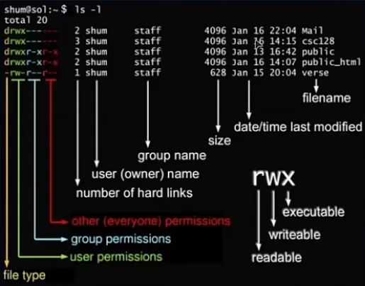
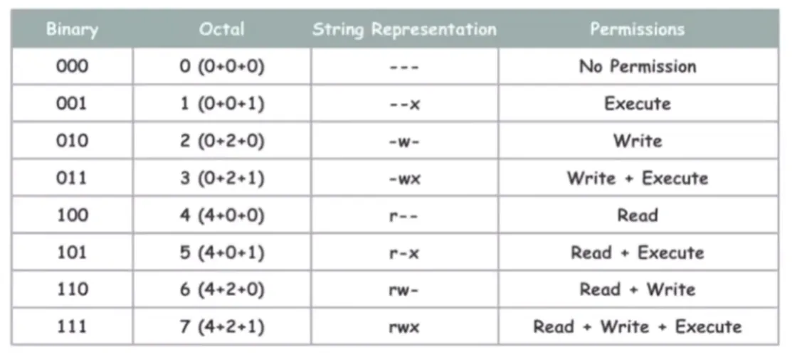
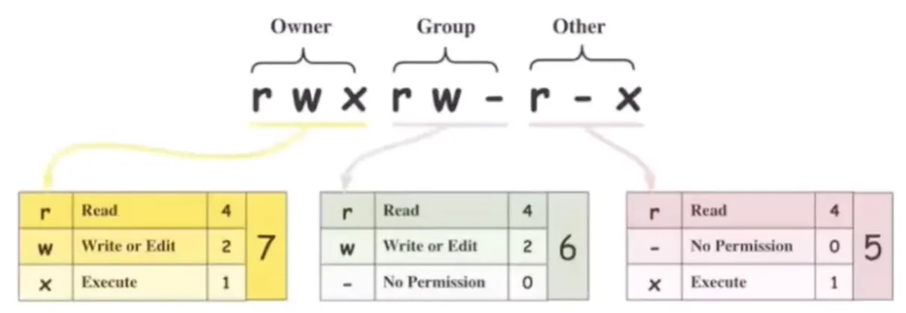
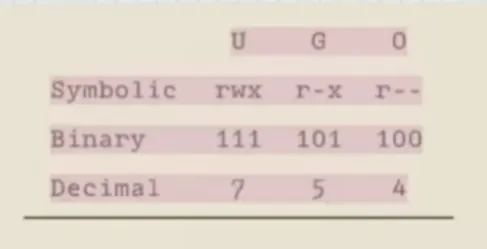
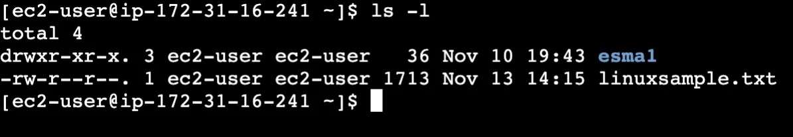
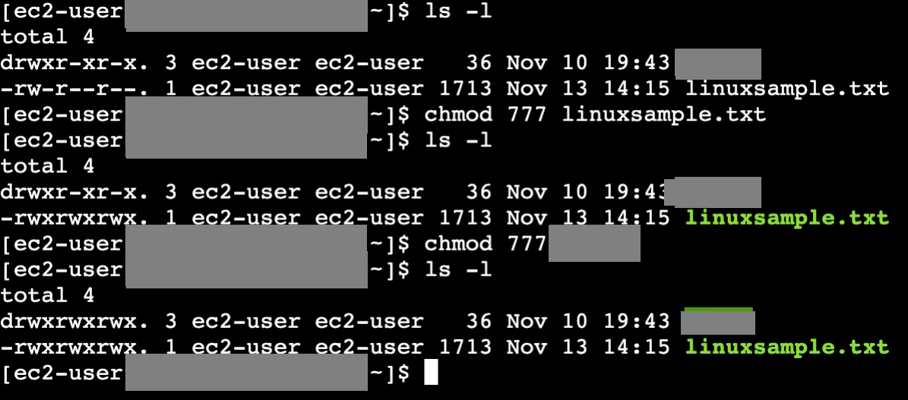
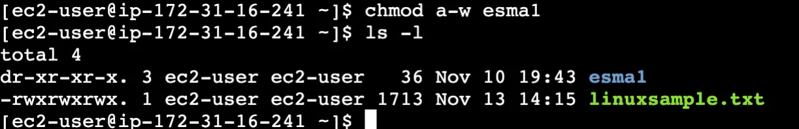

## Sembolik gösterim

Linux Dosya ve Klasör Yetkilerinin Sembolik Gösterimleri;



```text
total 20
drwx------ 2 shum staff 4096 Jan 16 22:04 Mail
drwx------ 3 shum staff 4096 Jan 16 14:15 csc128
drwxr-xr-x 2 shum staff 4096 Jan 13 16:42 public
drwxr-xr-x 2 shum staff 4096 Jan 16 14:07 public_html
-rw-r--r-- 1 shum staff  628 Jan 15 20:04 verse
```

| Sütun | Örnek | Anlamı |
| --- | --- | --- |
| 1. karakter | `d`, `-` | Dosya tipi (klasör, dosya vb.) |
| 2-4. karakterler | `rwx` | Dosya sahibinin (user) izinleri |
| 5-7. karakterler | `r-x` | Grup üyelerinin (örnekte `staff` grubu) izinleri |
| 8-10. karakterler | `r-x` | Sistemdeki diğer tüm kullanıcıların (other) izinleri |
| Sayı | `2` | Hard link sayısı |
| Kullanıcı | `shum` | Dosyanın sahibi (owner) |
| Grup | `staff` | Grup adı |
| Boyut | `4096` | Dosya boyutu |
| Tarih | `Jan 16 22:04` | Son değiştirilme tarihi |
| Ad | `Mail` | Dosya adı |

Burada gösterilen izinlerden `r` okuma, `w` yazma ve `x` ise bir executable dosyaları çalıştırabilme hakkı verir.

Sarı ile gösterilen kısım dosyanın tipi hakkında (klasör, dosya vs.) bilgi verir.

Yeşil ile gösterilen `r`, `w`, `x` harfleri yetkilerden hangilerinin bu dosyanın sahibinde olunduğunu gösterir. Mavi ile gösterilen `r`, `w`, `x` harfleri yetkilerden hangilerinin staff isimli grup üyelerinde olduğunu gösterir.

Kırmızı ile gösterilen `r`, `w`, `x` harfleri yetkilerden hangilerinin sistemde kalan diğer tüm kullanıcılarda olduğunu gösterir.

## Sayısal (numerik) gösterim

Yetkileri harfli gösterim yerine bunları numerik olarak aşağıdaki gibi gösteriyoruz.



| Binary | Octal | Sembolik | İzinler |
| --- | --- | --- | --- |
| 000 | 0 (0+0+0) | `---` | No Permission |
| 001 | 1 (0+0+1) | `--x` | Execute |
| 010 | 2 (0+2+0) | `-w-` | Write |
| 011 | 3 (0+2+1) | `-wx` | Write + Execute |
| 100 | 4 (4+0+0) | `r--` | Read |
| 101 | 5 (4+0+1) | `r-x` | Read + Execute |
| 110 | 6 (4+2+0) | `rw-` | Read + Write |
| 111 | 7 (4+2+1) | `rwx` | Read + Write + Execute |



| | Owner | Group | Other |
| --- | --- | --- | --- |
| Sembolik | `rwx` | `rw-` | `r-x` |
| Hesap | 4+2+1 | 4+2+0 | 4+0+1 |
| Sayısal | 7 | 6 | 5 |



| | U | G | O |
| --- | --- | --- | --- |
| Symbolic | `rwx` | `r-x` | `r--` |
| Binary | 111 | 101 | 100 |
| Decimal | 7 | 5 | 4 |

## İzinleri görüntüleme



```bash frame="terminal"
ls -l
```

```text title="Çıktı"
total 4
drwxr-xr-x. 3 ec2-user ec2-user   36 Nov 10 19:43 ornek1
-rw-r--r--. 1 ec2-user ec2-user 1713 Nov 13 14:15 linuxsample.txt
```

Bu izinlerin hangi dosya veya klasörlerde ne şekilde olduğunu görmek için `ls -l` komutunu kullanırız.

## chmod ile izin değiştirme



```bash frame="terminal"
chmod 777 linuxsample.txt
ls -l
chmod 777 ornek1
ls -l
```

```text title="Çıktı"
total 4
drwxr-xr-x. 3 ec2-user ec2-user   36 Nov 10 19:43 ornek1
-rwxrwxrwx. 1 ec2-user ec2-user 1713 Nov 13 14:15 linuxsample.txt
total 4
drwxrwxrwx. 3 ec2-user ec2-user   36 Nov 10 19:43 ornek1
-rwxrwxrwx. 1 ec2-user ec2-user 1713 Nov 13 14:15 linuxsample.txt
```

Bu izinleri değiştirmek için kullanacağımız komut `chmod 777 dosyaadı` komutunu



```bash frame="terminal"
chmod a-w ornek1
ls -l
```

```text title="Çıktı"
total 4
dr-xr-xr-x. 3 ec2-user ec2-user   36 Nov 10 19:43 ornek1
-rwxrwxrwx. 1 ec2-user ec2-user 1713 Nov 13 14:15 linuxsample.txt
```

Bu izinleri değiştirmenin diğer bir yolu; `u` user, `g` grup, `o` diğerleri ve `a` hepsi olmak üzere örneğin bir gruptan yazma yetkisini almak için `chmod g-w dosyaadı` komutunu kullanırız.

## umask ile varsayılan izinler

Normalde bir klasörü ilk oluşturduğumuzda otomatik olarak 777 izinleriyle, bir dosyayı ilk oluşturduğumuzda ise 666 izinleriyle oluşturuluyor. Ancak bu izinleri dosya oluştururken değiştirmemizi sağlayan umask sistemi vardır. Yeni oluşturduğumuz dosya ve klasörlerde varsayılan olarak verilmesini istediğimiz izinleri belirtiriz. Belirttiğimiz bu izinler varsayılan izinlerden (777, 666) düşürülür örneğin `umask 022` yazarsak 777 - 022 işlemi sonucunda kalan değer izin olarak atanır.

```bash frame="terminal"
umask 022
```
