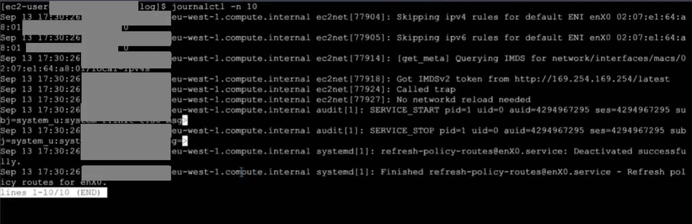
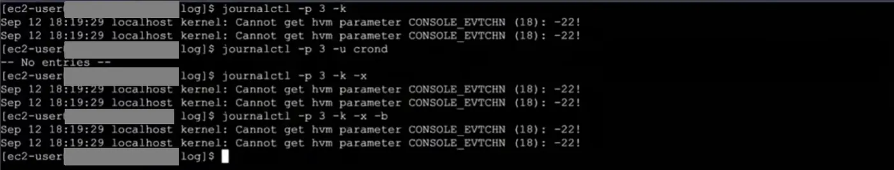

Bir Linux sistemini yönetip ayakta tutmak için bilmemiz gerekenlere göz atacak olursak;

## Monitoring kavramı

Yönettiğimiz bir sunucunun konfigüre ettiğimiz şekilde çalışıp çalışmadığını kontrol etmeliyiz yani sunucunun ayakta olup olmadığını, kaynak kullanımının ne durumda olduğunu, üzerinde çalışan uygulama düzgün şekilde çalışıyor mu gibi durumları izliyor olmamız gerekir. Bu kavrama monitoring denir.

Monitoring kavramı altında bilmemiz gereken ilk kavram metring. Bir sistemin, uygulamanın o anki bir durumla ilgili belirli bir zaman diliminde sağladığı sayısal olarak represent edilebilen veri değerine metring denir. Yani sistemde bulunan mevcut disk, cpu, memory gibi kaynakları ve bu kaynakların ne kadarının kullanıldığı bilgisini vermektedir. İkinci kavram ise kayıt anlamına gelen log. Bir sistemde uygulamalar tarafından üretilen, text tabanlı, gerçekleşen işlemlerin tutulan kayıtlarına log denir. Bu kayıtlar bir dosyaya yazılıyor da olabilir stdout çıkışına veriliyor da olabilir.

## systemd-journald ve journalctl

Uygulamalar log kayıtlarını `systemd-journald.service` aracılığı ile iletir. Varsayılan log toplama platformumuzdur. Systemd tarafından yönetilir. Bu servis, sistemin varsayılan log toplama merkezidir ve logları yüksek performanslı arama yapılabilmesi için binary (ikili) formatta saklar. Artık log dosyalarına direkt erişmiyoruz, bunun yerine `journalctl` aracılığıyla çeşitli filtrelemeler yaparak verileri log dosyalarından çekebiliyoruz.

Terminal ekranına `journalctl` komutuyla şu ana kadar oluşturulmuş tüm loglara ulaşırız.

`journalctl -f` komutuyla log kayıtlarının sonuna yapışırız ve son yapılan işlemleri anlık olarak görürüz.

### Son kayıtlar ve UTC



```bash frame="terminal"
journalctl -n 10
```

```text title="Çıktı"
Sep 13 17:30:26 ip-172-31-0-10.eu-west-1.compute.internal ec2net[77904]: Skipping ipv4 rules for default ENI enX0 02:00:00:00:00:01 0
Sep 13 17:30:26 ip-172-31-0-10.eu-west-1.compute.internal ec2net[77905]: Skipping ipv6 rules for default ENI enX0 02:00:00:00:00:01 0
Sep 13 17:30:26 ip-172-31-0-10.eu-west-1.compute.internal ec2net[77914]: [get_meta] Querying IMDS for network/interfaces/macs/02:00:00:00:00:01/local-ipv4s
Sep 13 17:30:26 ip-172-31-0-10.eu-west-1.compute.internal ec2net[77918]: Got IMDSv2 token from http://169.254.169.254/latest
Sep 13 17:30:26 ip-172-31-0-10.eu-west-1.compute.internal ec2net[77924]: Called trap
Sep 13 17:30:26 ip-172-31-0-10.eu-west-1.compute.internal ec2net[77927]: No networkd reload needed
Sep 13 17:30:26 ip-172-31-0-10.eu-west-1.compute.internal audit[1]: SERVICE_START pid=1 uid=0 auid=4294967295 ses=4294967295 subj=system_u:system_r:init_t:s0 msg=...
Sep 13 17:30:26 ip-172-31-0-10.eu-west-1.compute.internal audit[1]: SERVICE_STOP pid=1 uid=0 auid=4294967295 ses=4294967295 subj=system_u:system_r:init_t:s0 msg=...
Sep 13 17:30:26 ip-172-31-0-10.eu-west-1.compute.internal systemd[1]: refresh-policy-routes@enX0.service: Deactivated successfully.
Sep 13 17:30:26 ip-172-31-0-10.eu-west-1.compute.internal systemd[1]: Finished refresh-policy-routes@enX0.service - Refresh policy routes for enX0.
lines 1-10/10 (END)
```

Sondan itibaren görmek istediğimiz log kayıt sayısını belirterek verilere ulaşabiliriz. `journalctl -n 10` ile son 10 log kaydını görürüz. `journalctl --utc` komutu log kayıtlarının zaman damgalarını yerel saat dilimine göre değil, Koordinatlı Evrensel Zaman (UTC) dilimine göre görüntülemenizi sağlar. Eğer dünyanın farklı yerlerinde sunucularınız varsa, hepsindeki olayları aynı zaman ölçeğinde karşılaştırmak analiz yapmayı kolaylaştırır. Sistemlerimizin saat dilimleri farklılık gösterse de, analiz aşamasında ortak bir dil konuşmak gerekir.

### Filtreleme

Yalnızca belli bir servis tarafından oluşturulan log kayıtlarına ulaşmak için `journalctl -u servisinkısaadı` şeklinde komutu yazabiliriz. crond tarafından oluşturulan log dosyalarını görmek istersek `journalctl -u crond` komutunu kullanırız.

Yalnızca çekirdeğin loglarına erişmek istersek onun ismini yazmak yerine `journalctl -k` opsiyonunu kullanırız.

Belli bir tarih ve saat aralığındaki loglara ulaşmak istersek `journalctl --since tarih --until tarih` komutunu kullanırız.

Belli bir prosesin loglarını görüntülemek istersek `journalctl _PID=2090` şeklinde PID değerini kullanırız. `journalctl -p` opsiyonu ile öncelik verdiğimiz değerlerin loglarını çekebiliriz. Mesela `journalctl -p 3` komutuyla yalnızca sistemdeki errorları görebiliriz.

### Seçenekleri birleştirme



```bash frame="terminal"
journalctl -p 3 -k
journalctl -p 3 -u crond
journalctl -p 3 -k -x
journalctl -p 3 -k -x -b
```

```text title="Çıktı"
Sep 12 18:19:29 localhost kernel: Cannot get hvm parameter CONSOLE_EVTCHN (18): -22!
Sep 12 18:19:29 localhost kernel: Cannot get hvm parameter CONSOLE_EVTCHN (18): -22!
-- No entries --
Sep 12 18:19:29 localhost kernel: Cannot get hvm parameter CONSOLE_EVTCHN (18): -22!
Sep 12 18:19:29 localhost kernel: Cannot get hvm parameter CONSOLE_EVTCHN (18): -22!
Sep 12 18:19:29 localhost kernel: Cannot get hvm parameter CONSOLE_EVTCHN (18): -22!
Sep 12 18:19:29 localhost kernel: Cannot get hvm parameter CONSOLE_EVTCHN (18): -22!
```

Aynı zamanda farklı opsiyonlarla filtrelemeyi artırabiliriz. Sadece çekirdekte olan hataları görmek için `journalctl -p 3 -k` komutunu, çekirdekte olan hataları çözüm açıklamalarıyla görmek istiyorsak `journalctl -p 3 -k -x` komutunu ve son önyüklemeden itibaren çekirdekte olan hataları çözüm açıklamalarıyla birlikte `journalctl -p 3 -k -x -b` komutuyla görüntüleyebiliriz.

## sed ile metin değiştirme

Ayrıca Linux’ta bir dosya içinde string araması yapıp stringin değerini değiştirmek istiyorsak `sed 's/aranankelime/yenikelime/' dosyaadi` komutunu kullanırız. Bu komut ile dosya içinde aranan kelime olan tüm kelimeleri bulup istediğimiz yeni kelime ile değiştirmiş oluruz. Bir satırda birden fazla aranan kelimeden varsa yalnızca biri yeni kelime ile değiştirilir. Çünkü varsayılan olarak sed komutu aradığı kelimeyi her satırda bir tane bulacak şekilde arar ilk bulduğunu değiştirir sonra sonraki satıra geçer. Eğer tüm kelimelerin değişmesini istiyorsak `sed 's/aranankelime/yenikelime/g' dosyaadi` komutunu kullanırız. Bulunan satırda örneğin sadece ikinci kelimenin değişmesini istiyorsak `sed 's/aranankelime/yenikelime/2' dosyaadi` komutunu kullanırız. Ancak bunu asıl dosyadaki değerleri değiştirmez `sed 's/aranankelime/yenikelime/' dosyaadi` komutu kullanımı sonucunu sadece terminale yazdırır. Değişikliğin dosyaya kalıcı olarak işlenmesi için `-i` parametresini kullanırız ve komutu `sed -i 's/aranankelime/yenikelime/' dosyaadi` şeklinde yazarız.

## Metrikleri görüntüleme

Tanımını yapmış olduğumuz metring değerlerini görmek istersek her biri için farklı komut olduğunu görürüz.

CPU metringlerini alabilmemiz için iki aracımız var. Bunlardan ilki `top` aracıdır. Cpu kullanımını, process’lerin ne kadarlık cpu kullandığını, toplam memory değerini, bu sistemde ne kadar memory olduğunu ve ne kadarını kullandığımız gibi değerleri verir. Aynı zamanda swap değerini de gösterir. Swap, memory tamamen dolduğunda diskte memory olarak kullanabileceğimiz bir alan atanması işlemidir. Ancak diskten bir veriyi okumak memoryden okumaya kıyasla oldukça yavaş olduğundan tercih edilmemesi gereken bir işlemdir.

Memoryde ne kadar boş alanımız olduğuna bakmak için `free -w -h` komutunu kullanırız. Bu değeri saniyede bir görmek istiyorsak `vmstat 1` komutunu kullanabiliriz.

`df -h` komutuyla disk ile ilgili metringlere ulaşabiliriz.

Makinemizdeki tüm açık soketleri listelemek için `ss` komutunu, açık olan tüm tcp ve udp’leri ve hangi prosesin bu soketi kullandığını listelemek için `ss -autp` komutunu kullanırız.

```bash frame="terminal"
top
free -w -h
vmstat 1
df -h
ss -autp
```

## Merkezi izleme araçları

Bu gördüğümüz monitoring komutlarını bir makineye bağlı olduğumuz zaman anlık durumu analiz etmek istediğimizde kullanırız. Ancak profesyonel bir üretim (production) ortamında uygulamalarımızı bu şekilde izleyemeyiz. Gerçek hayatta metriklerin (metring) 7/24 düzenli olarak toplanması, geçmişe dönük kaydedilmesi ve analiz edilmesi gerekir. İşte bu yüzden metrikleri otomatik toplayan, saklayan ve belirli eşik değerleri aşıldığında bize alarm gönderen Prometheus, Grafana, Datadog veya Zabbix gibi merkezi izleme araçlarını kullanırız. Bu araçlar sayesinde toplanılan veri grafikler şeklinde bize gösterilir ve yönlendirdiğimiz yere iletilir. Bu araçlar sayesinde toplanan ham veriler, karmaşık tablolar yerine anlamlı grafikler ve paneller şeklinde sunulur; böylece sistemin geçmişteki ve anlık durumu bir bakışta analiz edilebilir. Daha da önemlisi, bu veriler sadece izlenmekle kalmaz; önceden belirlenen kritik eşikler aşıldığında Slack, E-posta veya PagerDuty gibi kanallar aracılığıyla doğrudan sorumlu ekiplere iletilerek anında müdahale şansı tanır.
