## root, normal kullanıcılar ve sudo

Linux üzerinde birden çok kullanıcı aynı anda bağlanabilir ve sistemi kullanabilir. Bu kullanıcılarla olan işlemlere bakacak olursak;

Bir linux sistem kurulduğunda ilk başta her zaman iki tane user olur. Bunlardan biri root user olarak adlandırılır ve en yetkili kullanıcıdır. Diğeri ise normal kullanıcılardır.

Normal kullanıcılarda girdiğimiz komutları root yetkisiyle yapabilmek için `sudo` kullanırız.

`sudo` komutunu kullanabilmemiz için sistemin root user'ının `sudoers` adlı dosyaya eklemiş olması gerekir. Yani `sudo` komutunu kullanacak user'ların root user tarafından belirlenmiş olması gerekir.

## Kullanıcıları listeleme

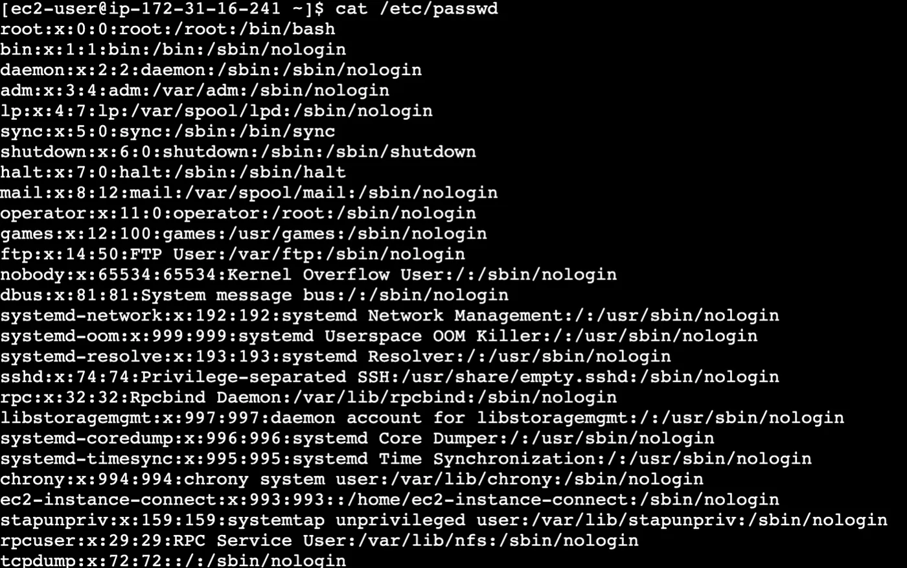

```bash frame="terminal"
cat /etc/passwd
```

```text title="Çıktı"
root:x:0:0:root:/root:/bin/bash
bin:x:1:1:bin:/bin:/sbin/nologin
daemon:x:2:2:daemon:/sbin:/sbin/nologin
adm:x:3:4:adm:/var/adm:/sbin/nologin
lp:x:4:7:lp:/var/spool/lpd:/sbin/nologin
sync:x:5:0:sync:/sbin:/bin/sync
shutdown:x:6:0:shutdown:/sbin:/sbin/shutdown
halt:x:7:0:halt:/sbin:/sbin/halt
mail:x:8:12:mail:/var/spool/mail:/sbin/nologin
...
ec2-instance-connect:x:993:993::/home/ec2-instance-connect:/sbin/nologin
stapunpriv:x:159:159:systemtap unprivileged user:/var/lib/stapunpriv:/sbin/nologin
rpcuser:x:29:29:RPC Service User:/var/lib/nfs:/sbin/nologin
tcpdump:x:72:72::/:/sbin/nologin
```

Sistemde bulunan user'ları listelemek için `cat /etc/passwd` komutunu kullanırız.

Yeni bir user oluşturmak için `useradd kullanıcıadı` komutunu kullanırız ama bu komutun çalışması için root user olmamız gerekir ya da komutun başında `sudo` yazmalıyız.

## useradd ile kullanıcı oluşturma

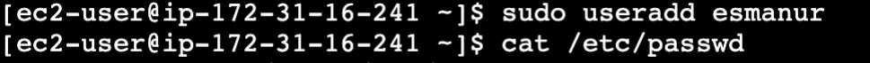

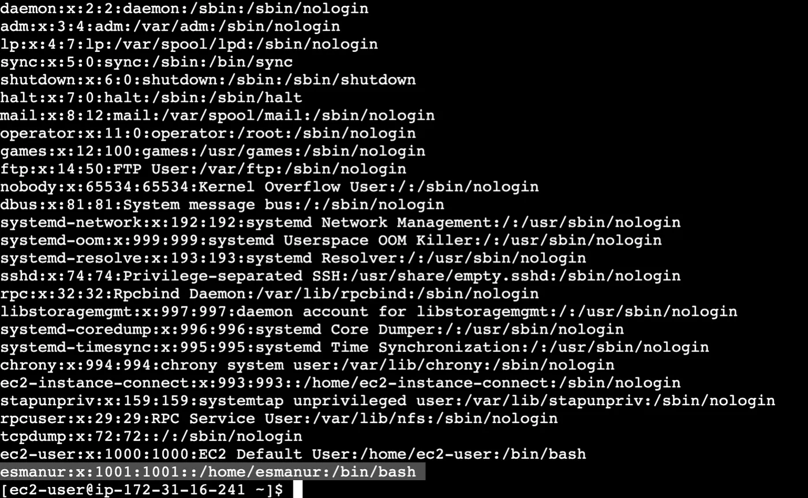

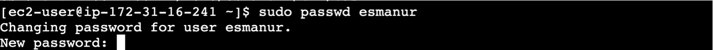

```bash frame="terminal"
sudo useradd ornekkullanici
cat /etc/passwd
```

```text title="Çıktı"
...
tcpdump:x:72:72::/:/sbin/nologin
ec2-user:x:1000:1000:EC2 Default User:/home/ec2-user:/bin/bash
ornekkullanici:x:1001:1001::/home/ornekkullanici:/bin/bash
```

Yeni bir user oluşturmak için `useradd kullanıcıadı` komutunu kullanırız ama bu komutun çalışması için root user olmamız gerekir ya da komutun başında `sudo` yazmalıyız.

## passwd ile şifre atama

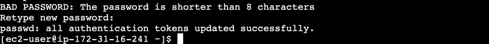

```bash frame="terminal"
sudo passwd ornekkullanici
```

```text title="Çıktı"
Changing password for user ornekkullanici.
New password:
BAD PASSWORD: The password is shorter than 8 characters
Retype new password:
passwd: all authentication tokens updated successfully.
```

Bu kullanıcıyla giriş yapmak için şifre atamamız gerekir. Şifre atamak için `sudo passwd useradı` komutunu kullanırız.

## su ile kullanıcı değiştirme

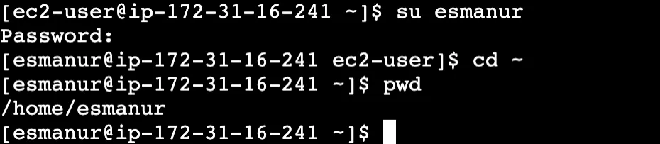

```bash frame="terminal"
su ornekkullanici
cd ~
pwd
```

```text title="Çıktı"
Password:
/home/ornekkullanici
```

Kullanıcılar arasında geçiş yapmak için `su useradı` komutunu kullanırız. Şifremizi girerek giriş yaparız.

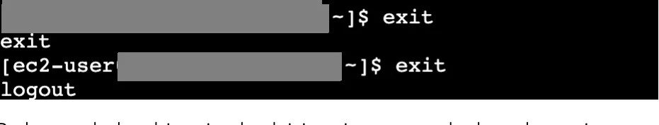

```bash frame="terminal"
exit
exit
```

```text title="Çıktı"
exit
logout
```

Bu konumdayken bir geri gelmek için `exit` yazarız ardından tekrar `exit` yazdığımızda logout oluruz.

## Gruplar

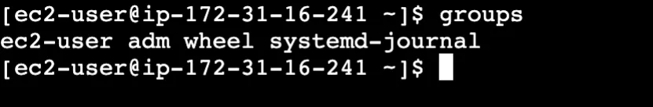

```bash frame="terminal"
groups
```

```text title="Çıktı"
ec2-user adm wheel systemd-journal
```

Her oluşturulan kullanıcının ismi ile bir grup vardır ve varsayılan olarak bu gruba dahil edilmiştir. Bunun dışında da Linux'ta birden fazla grup vardır. Sistemde bulunan bu diğer gruplardan hangilerine üye olduğumuzu görmek için `groups` komutunu kullanırız.

Gruplara kullanıcı eklemek istersek `sudo usermod -a -G ec2-user useradı` komutunu kullanırız.

Bir kullanıcıyı `wheel` grubuna eklersek otomatik olarak `sudo` yetkilerine sahip olur.

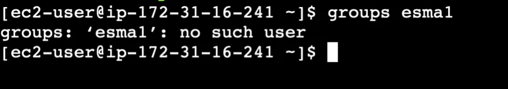

```bash frame="terminal"
groups ornek1
```

```text title="Çıktı"
groups: 'ornek1': no such user
```

Bir kullanıcının hangi gruplara dahil olduğunu görmek istersek `groups kullanıcıadı` şeklinde komutu yazarız.

### Grupları listeleme

Sistemde şu ana kadar oluşturulmuş grupları listelemek istersek `cat /etc/group` komutunu kullanırız.

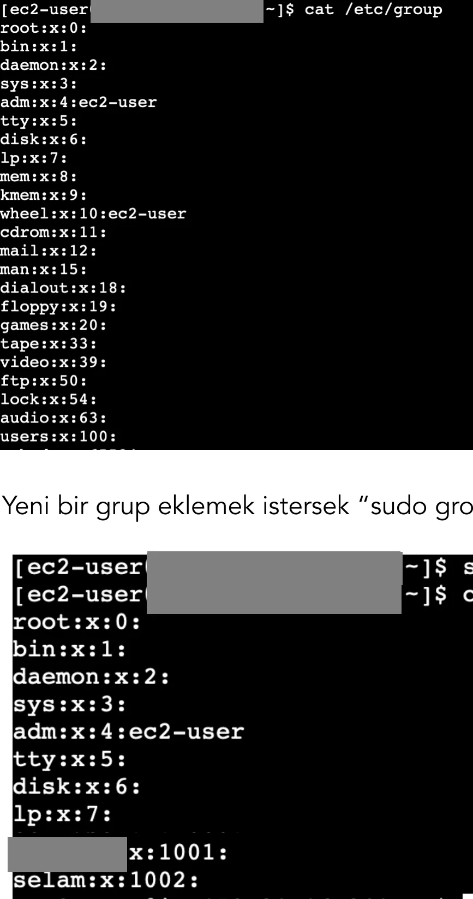

```bash frame="terminal"
cat /etc/group
```

```text title="Çıktı"
root:x:0:
bin:x:1:
daemon:x:2:
sys:x:3:
adm:x:4:ec2-user
tty:x:5:
disk:x:6:
lp:x:7:
mem:x:8:
kmem:x:9:
wheel:x:10:ec2-user
cdrom:x:11:
mail:x:12:
man:x:15:
dialout:x:18:
floppy:x:19:
games:x:20:
tape:x:33:
video:x:39:
ftp:x:50:
lock:x:54:
audio:x:63:
users:x:100:
...
```

### groupadd ile grup oluşturma

Yeni bir grup eklemek istersek `sudo groupadd grupismi` şeklinde yazarız.

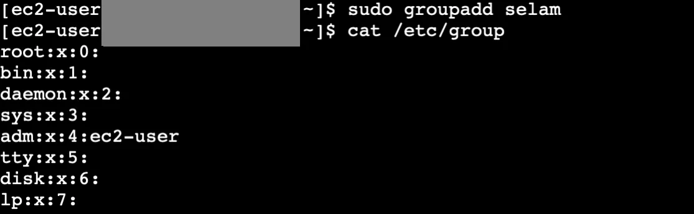

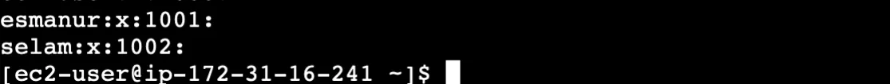

```bash frame="terminal"
sudo groupadd selam
cat /etc/group
```

```text title="Çıktı"
root:x:0:
bin:x:1:
...
ornekkullanici:x:1001:
selam:x:1002:
```

### usermod ile kullanıcıyı gruba ekleme

Kullanıcıyı bir gruba eklemek için `sudo usermod -a -G grupadı kullanıcıadı` komutunu kullanırız.

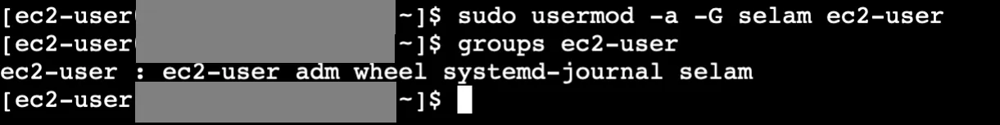

```bash frame="terminal"
sudo usermod -a -G selam ec2-user
groups ec2-user
```

```text title="Çıktı"
ec2-user : ec2-user adm wheel systemd-journal selam
```

## chgrp ve chown

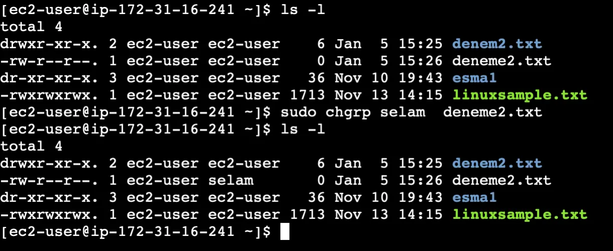

```bash frame="terminal"
ls -l
sudo chgrp selam deneme2.txt
ls -l
```

```text title="Çıktı"
total 4
drwxr-xr-x. 2 ec2-user ec2-user    6 Jan  5 15:25 denem2.txt
-rw-r--r--. 1 ec2-user ec2-user    0 Jan  5 15:26 deneme2.txt
dr-xr-xr-x. 3 ec2-user ec2-user   36 Nov 10 19:43 ornek1
-rwxrwxrwx. 1 ec2-user ec2-user 1713 Nov 13 14:15 linuxsample.txt
total 4
drwxr-xr-x. 2 ec2-user ec2-user    6 Jan  5 15:25 denem2.txt
-rw-r--r--. 1 ec2-user selam       0 Jan  5 15:26 deneme2.txt
dr-xr-xr-x. 3 ec2-user ec2-user   36 Nov 10 19:43 ornek1
-rwxrwxrwx. 1 ec2-user ec2-user 1713 Nov 13 14:15 linuxsample.txt
```

Bir dosyanın veya klasörün mevcut grubunu değiştirmek istersek `sudo chgrp grupadı dosyaadı` komutunu kullanırız.

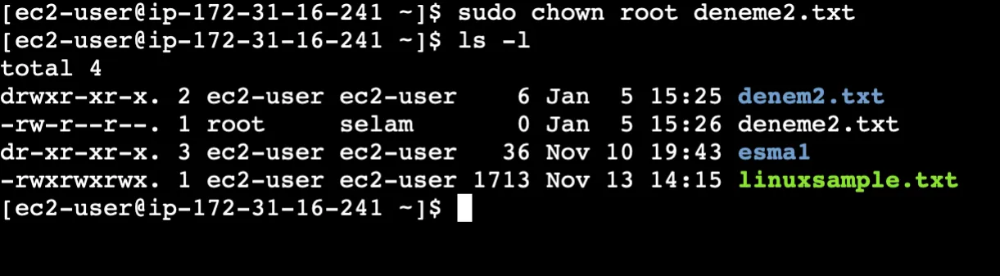

```bash frame="terminal"
sudo chown root deneme2.txt
ls -l
```

```text title="Çıktı"
total 4
drwxr-xr-x. 2 ec2-user ec2-user    6 Jan  5 15:25 denem2.txt
-rw-r--r--. 1 root     selam       0 Jan  5 15:26 deneme2.txt
dr-xr-xr-x. 3 ec2-user ec2-user   36 Nov 10 19:43 ornek1
-rwxrwxrwx. 1 ec2-user ec2-user 1713 Nov 13 14:15 linuxsample.txt
```

Bir dosyayı root kullanıcı olarak atamak istiyorsak `sudo chown root deneme2.txt` komutunu kullanırız.
