Şimdi bilgisayarı ağlar üzerinden yönetmek için kullandığımız araçlara göz atalım;

## Network adaptörleri

### ifconfig

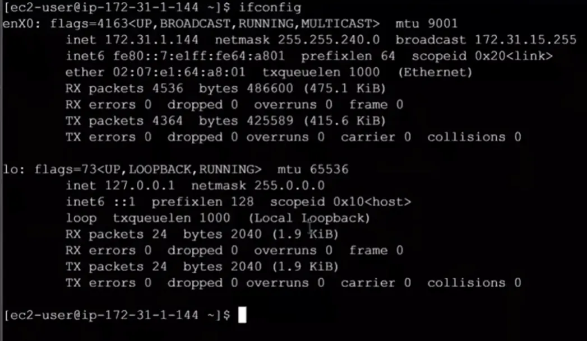

```bash frame="terminal"
ifconfig
```

```text title="Çıktı"
enX0: flags=4163<UP,BROADCAST,RUNNING,MULTICAST>  mtu 9001
        inet 172.31.0.10  netmask 255.255.240.0  broadcast 172.31.15.255
        inet6 fe80::ff:fe00:1  prefixlen 64  scopeid 0x20<link>
        ether 02:00:00:00:00:01  txqueuelen 1000  (Ethernet)
        RX packets 4536  bytes 486600 (475.1 KiB)
        RX errors 0  dropped 0  overruns 0  frame 0
        TX packets 4364  bytes 425589 (415.6 KiB)
        TX errors 0  dropped 0 overruns 0  carrier 0  collisions 0

lo: flags=73<UP,LOOPBACK,RUNNING>  mtu 65536
        inet 127.0.0.1  netmask 255.0.0.0
        inet6 ::1  prefixlen 128  scopeid 0x10<host>
        loop  txqueuelen 1000  (Local Loopback)
        RX packets 24  bytes 2040 (1.9 KiB)
        RX errors 0  dropped 0  overruns 0  frame 0
        TX packets 24  bytes 2040 (1.9 KiB)
        TX errors 0  dropped 0 overruns 0  carrier 0  collisions 0
```

Makinemize bağlı olan tüm network adaptörlerinin temel bilgilerini listelemek için `ifconfig` komutunu kullanırız.

### ip address

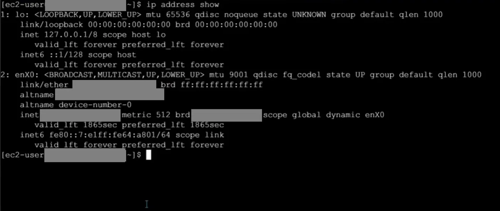

```bash frame="terminal"
ip address show
```

```text title="Çıktı"
1: lo: <LOOPBACK,UP,LOWER_UP> mtu 65536 qdisc noqueue state UNKNOWN group default qlen 1000
    link/loopback 00:00:00:00:00:00 brd 00:00:00:00:00:00
    inet 127.0.0.1/8 scope host lo
       valid_lft forever preferred_lft forever
    inet6 ::1/128 scope host
       valid_lft forever preferred_lft forever
2: enX0: <BROADCAST,MULTICAST,UP,LOWER_UP> mtu 9001 qdisc fq_codel state UP group default qlen 1000
    link/ether 02:00:00:00:00:01 brd ff:ff:ff:ff:ff:ff
    altname eni-0123456789abcdef0
    altname device-number-0
    inet 172.31.0.10/20 metric 512 brd 172.31.15.255 scope global dynamic enX0
       valid_lft 1865sec preferred_lft 1865sec
    inet6 fe80::ff:fe00:1/64 scope link
       valid_lft forever preferred_lft forever
```

Günümüzde `ifconfig` komutu yerine artık `ip address show` komutunu kullanıyoruz. `ifconfig` komutu gibi ip adresi eklememizi de sağlar. Bunun için `sudo ip address add [IP_ADRESI]/[SUBNET_MASK] dev [ARAYUZ_ISMI]` komutunu kullanırız.

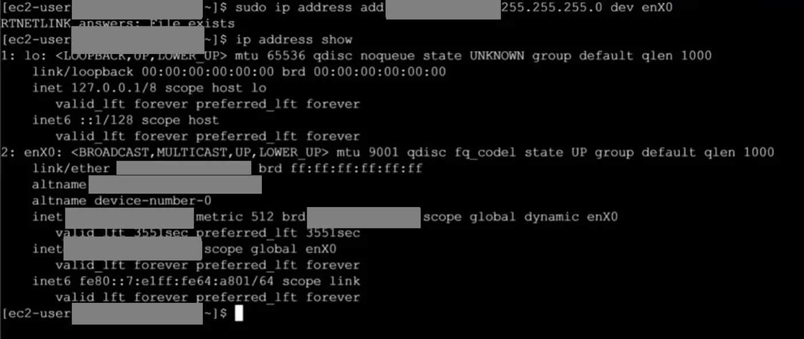

```bash frame="terminal"
sudo ip address add 192.168.1.200/255.255.255.0 dev enX0
ip address show
```

```text title="Çıktı"
...
2: enX0: <BROADCAST,MULTICAST,UP,LOWER_UP> mtu 9001 qdisc fq_codel state UP group default qlen 1000
    link/ether 02:00:00:00:00:01 brd ff:ff:ff:ff:ff:ff
    altname eni-0123456789abcdef0
    altname device-number-0
    inet 172.31.0.10/20 metric 512 brd 172.31.15.255 scope global dynamic enX0
       valid_lft 3551sec preferred_lft 3551sec
    inet 192.168.1.200/24 scope global enX0
       valid_lft forever preferred_lft forever
    inet6 fe80::ff:fe00:1/64 scope link
       valid_lft forever preferred_lft forever
```

Bunun için `sudo ip address add ipadresi/subnetmask dev networkadaptörü` komutunu kullanırız.

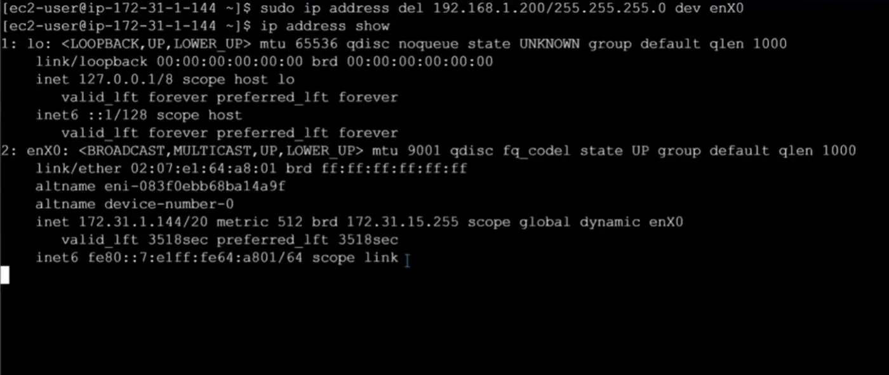

```bash frame="terminal"
sudo ip address del 192.168.1.200/255.255.255.0 dev enX0
ip address show
```

Bir ip adresini silmek istersek de `sudo ip address del ipadresi/subnetmask dev networkadaptörü` komutunu kullanırız.

## MAC adresi ve arp

Ethernet kartı, Wi-Fi adaptörü gibi ağa bağlanabilen her donanımın üretim aşamasında üzerine kalıcı olarak kazınan fiziksel adrestir. Ethernet kartlarına fiziksel olarak unique olacak şekilde basılan adreslere “MAC adresi” denir. Dünyadaki her ağ kartının MAC adresi teorik olarak eşsizdir. Bu, cihazın dijital dünyadaki parmak izi gibidir. Networke bağlanan her cihazın MAC adresi vardır.

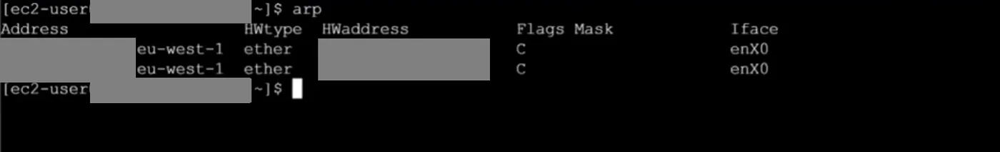

```bash frame="terminal"
arp
```

```text title="Çıktı"
Address                  HWtype  HWaddress           Flags Mask            Iface
ip-172-31-0-1.eu-west-1  ether   02:00:00:00:00:02   C                     enX0
ip-172-31-0-1.eu-west-1  ether   02:00:00:00:00:02   C                     enX0
```

MAC adreslerine `arp` komutu ile erişebiliriz. Spesifik bir ip adresi ile ilişkilendirilmiş MAC adresi olup olmadığına bakmak istersek `arp -a ipadresi` komutunu kullanırız.

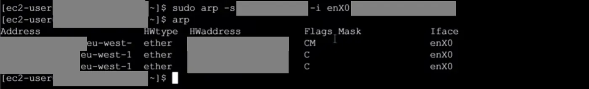

```bash frame="terminal"
sudo arp -s 192.168.0.1 -i enX0 51:53:00:17:34:09
arp
```

```text title="Çıktı"
Address                  HWtype  HWaddress           Flags Mask            Iface
ip-192-168-0-1.eu-west-  ether   51:53:00:17:34:09   CM                    enX0
ip-172-31-0-1.eu-west-1  ether   02:00:00:00:00:02   C                     enX0
ip-172-31-0-1.eu-west-1  ether   02:00:00:00:00:02   C                     enX0
```

arp tablosuna yeni bir kayıt eklemek istersek `sudo arp -s ipadresi -i networkadaptörü macadresi` komutunu kullanırız. Bu tablodan bir kaydı silmek istersek de `sudo arp -d ipadresi -i networkadaptörü` şeklinde komutu kullanırız.

## Routing table

Routing Table (Yönlendirme Tablosu), bir ağ cihazının hangi veri paketini, hangi yoldan, nereye göndermeliyim? sorularına cevap verdiği bir araçtır. Bu tablo olmazsa, bir bilgisayar aynı ağdaki arkadaşına veri gönderebilir ama internete veya farklı bir alt ağa erişemez.

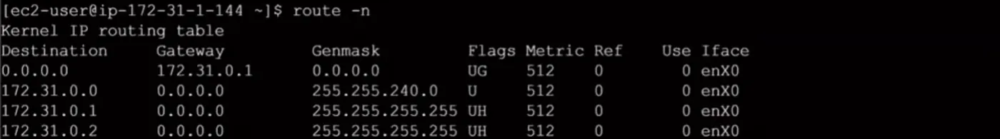

```bash frame="terminal"
route -n
```

```text title="Çıktı"
Kernel IP routing table
Destination     Gateway         Genmask         Flags Metric Ref    Use Iface
0.0.0.0         172.31.0.1      0.0.0.0         UG    512    0        0 enX0
172.31.0.0      0.0.0.0         255.255.240.0   U     512    0        0 enX0
172.31.0.1      0.0.0.0         255.255.255.255 UH    512    0        0 enX0
172.31.0.2      0.0.0.0         255.255.255.255 UH    512    0        0 enX0
```

Bilgisayarımızda tanımlı olan routing table’a erişmek için `route -n` komutunu kullanırız.

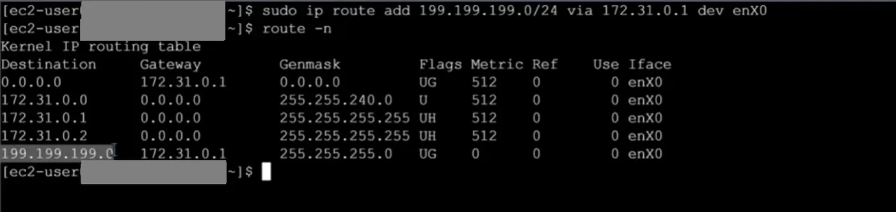

```bash frame="terminal"
sudo ip route add 199.199.199.0/24 via 172.31.0.1 dev enX0
route -n
```

```text title="Çıktı"
Kernel IP routing table
Destination     Gateway         Genmask         Flags Metric Ref    Use Iface
0.0.0.0         172.31.0.1      0.0.0.0         UG    512    0        0 enX0
172.31.0.0      0.0.0.0         255.255.240.0   U     512    0        0 enX0
172.31.0.1      0.0.0.0         255.255.255.255 UH    512    0        0 enX0
172.31.0.2      0.0.0.0         255.255.255.255 UH    512    0        0 enX0
199.199.199.0   172.31.0.1      255.255.255.0   UG    0      0        0 enX0
```

Routing table’a yeni bir route eklemek istersek `sudo ip route add hedefağ via ağgeçidi dev networkadaptörü` şeklindeki komut iskeletini kullanırız. Tablodan silmek istediğimiz bir route olursa da `sudo ip route del hedefağ via ağgeçidi dev networkadaptörü`

## Soketler: ss ve netstat

Linux'ta ağ iletişimi, soket adı verilen özel dosya yapıları üzerinden yürütülür. Bilgisayarımız tcp protokolü üzerinde bir network bağlantısı kurduğu zaman Linux’ta bir soket açılır. Bu soket sahte dosya gibi düşünülebilir. Soketin bir ucu soketi açan prosese bağlanır diğer ucu da network tarafında o soketin gitmek istediği yani bağlantı kurduğu yere bağlanır. Bu port üzerinden iletişim kurmak istediğimiz zaman process sokete yazar, gönderilir, gelen sokete yazılır, process soketin içerisinden okur.

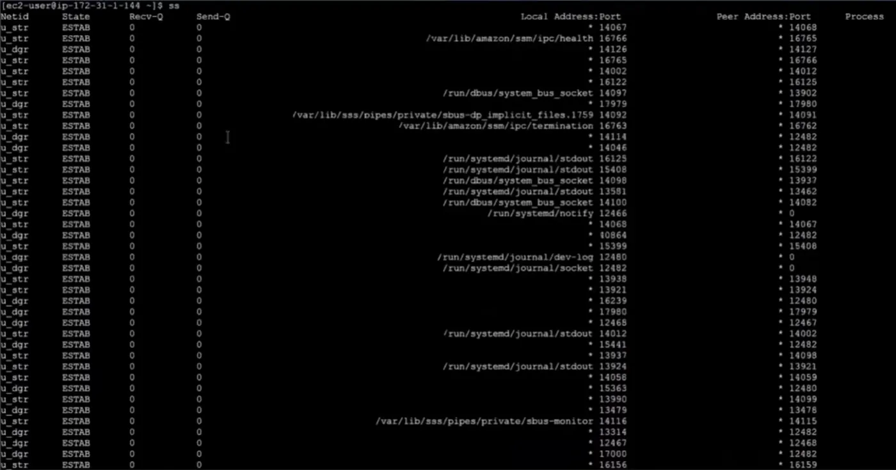

```bash frame="terminal"
ss
```

```text title="Çıktı"
Netid State Recv-Q Send-Q                          Local Address:Port   Peer Address:Port Process
u_str ESTAB 0      0                                           * 14067             * 14068
u_str ESTAB 0      0             /var/lib/amazon/ssm/ipc/health 16766             * 16765
u_dgr ESTAB 0      0                                           * 14126             * 14127
u_str ESTAB 0      0               /run/dbus/system_bus_socket 14097             * 13902
u_str ESTAB 0      0               /run/systemd/journal/stdout 16125             * 16122
u_dgr ESTAB 0      0                 /run/systemd/journal/dev-log 12480             * 0
...
```

Sistemde bulunan tüm soketleri `ss` komutu ile listeleyebiliriz.

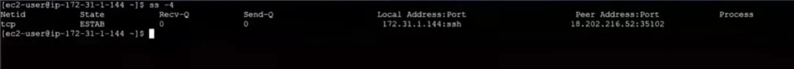

```bash frame="terminal"
ss -4
```

```text title="Çıktı"
Netid State Recv-Q Send-Q Local Address:Port Peer Address:Port Process
tcp   ESTAB 0      0      172.31.0.10:ssh    203.0.113.10:35102
```

Sadece ipv4 üzerindeki soketleri görmek istersek `ss -4` komutunu kullanırız.

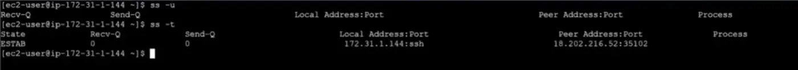

```bash frame="terminal"
ss -u
```

```text title="Çıktı"
Recv-Q Send-Q Local Address:Port Peer Address:Port Process
```

```bash frame="terminal"
ss -t
```

```text title="Çıktı"
State Recv-Q Send-Q Local Address:Port Peer Address:Port Process
ESTAB 0      0      172.31.0.10:ssh    203.0.113.10:35102
```

Sadece tcp soketlerini görmek için `ss -t` komutunu, sadece udp soketleri için `ss -u` komutunu kullanırız. Sadece dinleme yapan soketleri listelemek istersek `ss -l` komutunu kullanırız.

### netstat --help

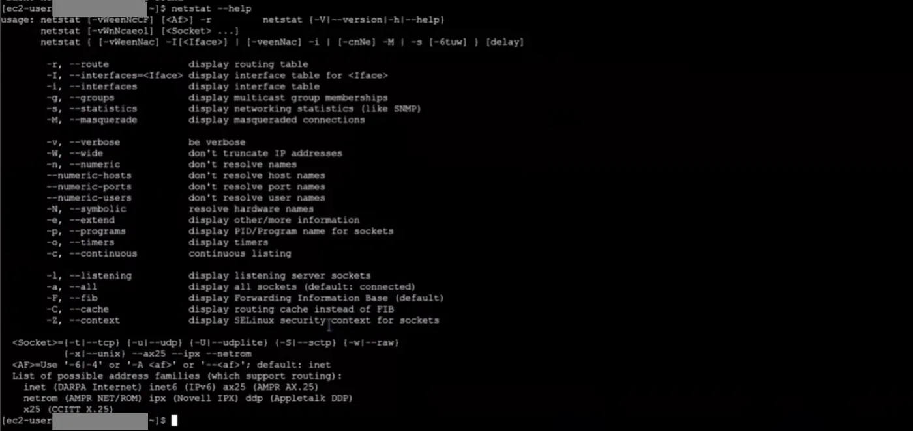

```bash frame="terminal"
netstat --help
```

```text title="Çıktı"
usage: netstat [-vWeenNcCF] [<Af>] -r         netstat {-V|--version|-h|--help}
       netstat [-vWnNcaeol] [<Socket> ...]
       netstat { [-vWeenNac] -I[<Iface>] | [-veenNac] -i | [-cnNe] -M | -s [-6tuw] } [delay]

        -r, --route              display routing table
        -I, --interfaces=<Iface> display interface table for <Iface>
        -i, --interfaces         display interface table
        -g, --groups             display multicast group memberships
        -s, --statistics         display networking statistics (like SNMP)
        -M, --masquerade         display masqueraded connections

        -v, --verbose            be verbose
        -W, --wide               don't truncate IP addresses
        -n, --numeric            don't resolve names
        --numeric-hosts          don't resolve host names
        --numeric-ports          don't resolve port names
        --numeric-users          don't resolve user names
        -N, --symbolic           resolve hardware names
        -e, --extend             display other/more information
        -p, --programs           display PID/Program name for sockets
        -o, --timers             display timers
        -c, --continuous         continuous listing

        -l, --listening          display listening server sockets
        -a, --all                display all sockets (default: connected)
        -F, --fib                display Forwarding Information Base (default)
        -C, --cache              display routing cache instead of FIB
        -Z, --context            display SELinux security context for sockets
...
```

`netstat --help` komutu, ağ istatistiklerini izlemek için kullanılan bu aracın tüm fonksiyonlarını ve parametrelerini özetleyen bir kullanım rehberidir. Karmaşık ağ analizleri yaparken hangi filtreleri kullanabileceğimizi hatırlamamıza yardımcı olan bir referans noktasıdır.

## DNS sorgusu: dig

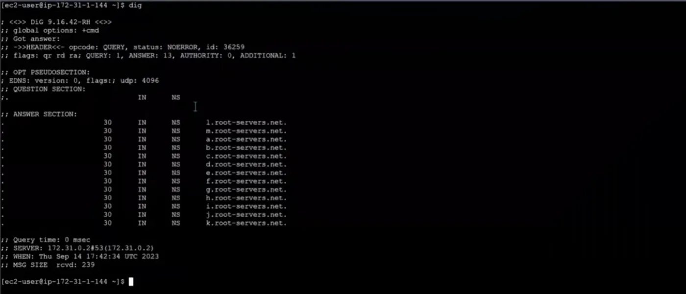

```bash frame="terminal"
dig
```

```text title="Çıktı"
; <<>> DiG 9.16.42-RH <<>>
;; global options: +cmd
;; Got answer:
;; ->>HEADER<<- opcode: QUERY, status: NOERROR, id: 36259
;; flags: qr rd ra; QUERY: 1, ANSWER: 13, AUTHORITY: 0, ADDITIONAL: 1

;; OPT PSEUDOSECTION:
; EDNS: version: 0, flags:; udp: 4096
;; QUESTION SECTION:
;.                              IN      NS

;; ANSWER SECTION:
.                       30      IN      NS      l.root-servers.net.
.                       30      IN      NS      m.root-servers.net.
.                       30      IN      NS      a.root-servers.net.
...
.                       30      IN      NS      k.root-servers.net.

;; Query time: 0 msec
;; SERVER: 172.31.0.2#53(172.31.0.2)
;; WHEN: Thu Sep 14 17:42:34 UTC 2023
;; MSG SIZE  rcvd: 239
```

DNS sorgusu yapmamızı sağlayan araçlar vardır. Bunlardan ilki `dig` komutu. `dig` komutu, bir alan adının hangi IP adresine ve hangi isim sunucularına bağlı olduğunu tüm teknik detaylarıyla sorgulamamızı sağlar ve standart root server’ların DNS adreslerinin neler olduğunu görürüz.

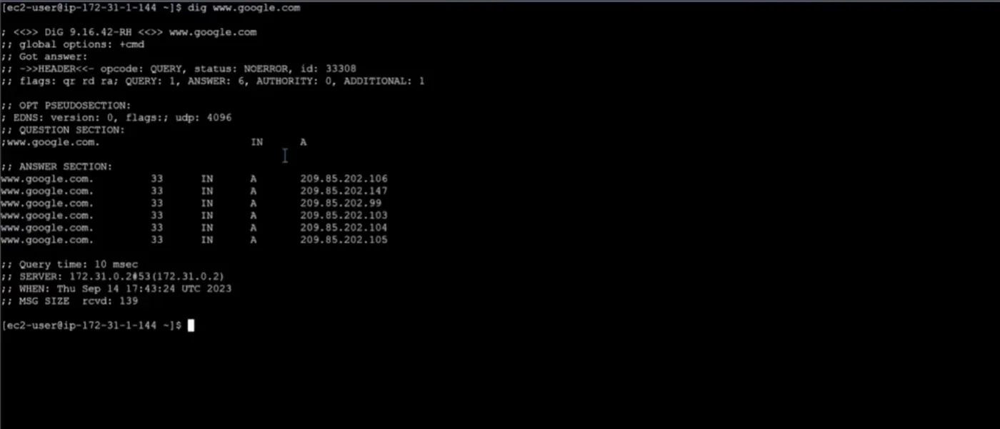

```bash frame="terminal"
dig www.google.com
```

```text title="Çıktı"
...
;; QUESTION SECTION:
;www.google.com.                        IN      A

;; ANSWER SECTION:
www.google.com.         33      IN      A       209.85.202.106
www.google.com.         33      IN      A       209.85.202.147
www.google.com.         33      IN      A       209.85.202.99
www.google.com.         33      IN      A       209.85.202.103
www.google.com.         33      IN      A       209.85.202.104
www.google.com.         33      IN      A       209.85.202.105

;; Query time: 10 msec
;; SERVER: 172.31.0.2#53(172.31.0.2)
...
```

Dig ile öğrenmek istediğimiz bir alan adının hangi ip adresine denk geldiği eşleştirmesinin sonucuna ulaşırız bunu `dig webadresi` komutuyla yapabiliriz.

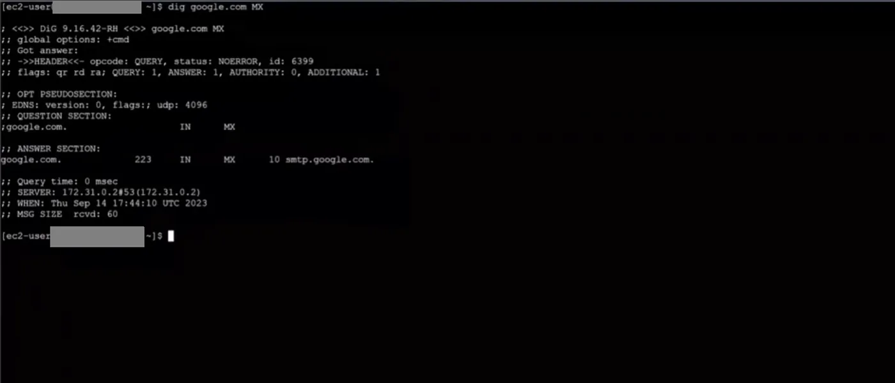

```bash frame="terminal"
dig google.com MX
```

```text title="Çıktı"
...
;; QUESTION SECTION:
;google.com.                    IN      MX

;; ANSWER SECTION:
google.com.             223     IN      MX      10 smtp.google.com.
...
```

Dig aracıyla istediğimiz bir web adresinin mail server kayıtlarına da bakabiliriz. Bunun için `dig webadresi MX` komutunu kullanırız.

## /etc/hosts ve /etc/resolv.conf

Hosts dosyası internetteki DNS sistemi devreye girmeden önce, işletim sisteminin ilk olarak kontrol ettiği yerel bir metin dosyasıdır. Linux'ta bu dosya `/etc/hosts` konumunda bulunur.

Bir web adresini tarayıcıya yazdığında, bilgisayarın bu ismin IP adresini bulmak için önce kendi içindeki hosts dosyasına bakar. Eğer aradığı ismi orada bulursa, dışarıdaki DNS sunucularına hiç sormadan doğrudan oradaki IP'ye gider.

Makinemize DNS server tanımını yapmak için öncelikle `cat /etc/resolv.conf` komutuyla dosyayı açarız ve
