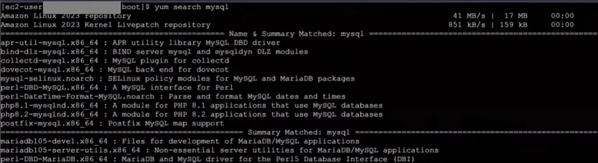
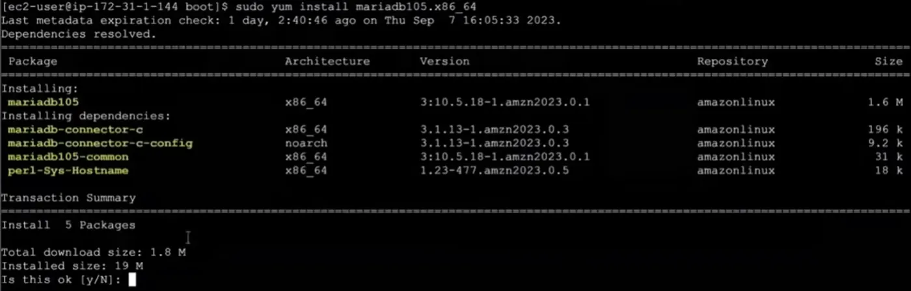
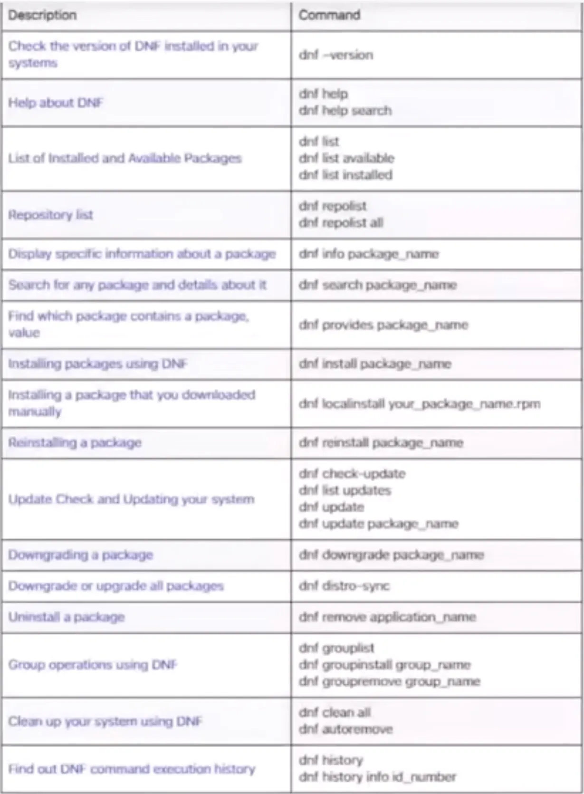

## rpm ve deb paketleri

Linux dünyasında distro'ların iki temel çeşidi vardır. Bunları birbirinden ayıran uygulamalar için kullandıkları paketleme yöntemidir. Bu paketlerin iki değişik formatı vardır. Red Hat tabanlı rpm paketleri ve Debian tabanlı deb uzantılı paketlerdir. Rpm paketlerinin içinde bilgisayara yükleyebileceğimiz uygulama dosyaları ve uygulama ile ilgili metadata bilgileri vardır.

## Repository ve package manager

Debian, Red Hat veya başka firmaların oluşturduğu uygulama repository'leri vardır. Bu uygulama repository'leri bu sistemlerde kullandığımız uygulamaları indirebileceğimiz kataloglar olarak düşünülebilir. Bu işlemi manuel olarak yapmıyoruz. Package manager uygulamaları Fedora ve Red Hat yani rpm tabanlı bilgisayarlarda iki tanedir. İlki `yum` diğeri ise `dnf`. Biz bu package manager'lar ile repository'ler ile konuşarak uygulamaları sistemlerimize indirebiliyoruz. Ubuntu tabanlılarda ise repository'leri `apt` veya `apt-get` uygulamaları ile indirebiliyoruz.

## yum ile paket arama



```bash frame="terminal"
yum search mysql
```

```text title="Çıktı"
Amazon Linux 2023 repository                        41 MB/s |  17 MB     00:00
Amazon Linux 2023 Kernel Livepatch repository      851 kB/s | 159 kB     00:00
===================== Name & Summary Matched: mysql =====================
apr-util-mysql.x86_64 : APR utility library MySQL DBD driver
bind-dlz-mysql.x86_64 : BIND server mysql and mysqldyn DLZ modules
collectd-mysql.x86_64 : MySQL plugin for collectd
dovecot-mysql.x86_64 : MySQL back end for dovecot
mysql-selinux.noarch : SELinux policy modules for MySQL and MariaDB packages
perl-DBD-MySQL.x86_64 : A MySQL interface for Perl
perl-DateTime-Format-MySQL.noarch : Parse and format MySQL dates and times
php8.1-mysqlnd.x86_64 : A module for PHP 8.1 applications that use MySQL databases
php8.2-mysqlnd.x86_64 : A module for PHP 8.2 applications that use MySQL databases
postfix-mysql.x86_64 : Postfix MySQL map support
========================= Summary Matched: mysql =========================
mariadb105-devel.x86_64 : Files for development of MariaDB/MySQL applications
mariadb105-server-utils.x86_64 : Non-essential server utilities for MariaDB/MySQL applications
perl-DBD-MariaDB.x86_64 : MariaDB and MySQL driver for the Perl5 Database Interface (DBI)
```

`yum search uygulamaadı` opsiyonu ile bağlı olduğu repository'lerde istediğimiz uygulamayı arar.

## yum ile paket kurma



```bash frame="terminal"
sudo yum install mariadb105.x86_64
```

```text title="Çıktı"
Last metadata expiration check: 1 day, 2:40:46 ago on Thu Sep  7 16:05:33 2023.
Dependencies resolved.
================================================================================
 Package                   Architecture  Version                  Repository   Size
================================================================================
Installing:
 mariadb105                x86_64        3:10.5.18-1.amzn2023.0.1 amazonlinux  1.6 M
Installing dependencies:
 mariadb-connector-c       x86_64        3.1.13-1.amzn2023.0.3    amazonlinux  196 k
 mariadb-connector-c-config noarch       3.1.13-1.amzn2023.0.3    amazonlinux  9.2 k
 mariadb105-common         x86_64        3:10.5.18-1.amzn2023.0.1 amazonlinux   31 k
 perl-Sys-Hostname         x86_64        1.23-477.amzn2023.0.5    amazonlinux   18 k

Transaction Summary
================================================================================
Install  5 Packages

Total download size: 1.8 M
Installed size: 19 M
Is this ok [y/N]:
```

`sudo yum install paketismi` komutuyla istediğimiz bir paketi sistemimize indirebiliriz. Komutu girdiğimizde yukarıdaki gibi bir onay isteyecek `y` ile onaylayıp indirmeyi başlatabiliriz. Onay istemeden direkt indirmeyi başlatmasını istiyorsak `sudo yum install -y paketadı` şeklinde kullanmalıyız.

```bash frame="terminal"
sudo yum install -y paketadı
```

## Repository dosyaları

Bilgisayarda konfigüre edilmiş repository'lerin adresi `cd /etc/yum.repos.d` dosyasının içinde bulunur. Buradaki dosyalarda repository'lerin bilgileri vardır.

## Sistemi güncelleme

`yum` komutu paket indirmenin yanında sistemi güncellemek için de kullanılır. `yum upgrade` komutunu kullanırız. Sistemde update edilecek bir şey var mı diye bakmak için de `sudo yum check-update` komutunu kullanırız.

```bash frame="terminal"
yum upgrade
```

```bash frame="terminal"
sudo yum update
```

## Sık kullanılan dnf komutları

Aşağıya bazı dnf opsiyonlarını bırakıyorum;



| Açıklama | Komut |
|---|---|
| Kurulu DNF sürümünü görme | `dnf --version` |
| DNF yardımı | `dnf help`<br/>`dnf help search` |
| Kurulu ve kurulabilir paketleri listeleme | `dnf list`<br/>`dnf list available`<br/>`dnf list installed` |
| Repository listesi | `dnf repolist`<br/>`dnf repolist all` |
| Bir paket hakkında bilgi | `dnf info package_name` |
| Paket arama ve detayları | `dnf search package_name` |
| Bir dosya/değeri hangi paketin içerdiğini bulma | `dnf provides package_name` |
| DNF ile paket kurma | `dnf install package_name` |
| Elle indirilmiş paketi kurma | `dnf localinstall your_package_name.rpm` |
| Paketi yeniden kurma | `dnf reinstall package_name` |
| Güncelleme kontrolü ve sistemi güncelleme | `dnf check-update`<br/>`dnf list updates`<br/>`dnf update`<br/>`dnf update package_name` |
| Paketi eski sürüme düşürme | `dnf downgrade package_name` |
| Tüm paketleri eşitleme (downgrade/upgrade) | `dnf distro-sync` |
| Paket kaldırma | `dnf remove application_name` |
| Grup işlemleri | `dnf grouplist`<br/>`dnf groupinstall group_name`<br/>`dnf groupremove group_name` |
| Sistemi temizleme | `dnf clean all`<br/>`dnf autoremove` |
| DNF komut geçmişi | `dnf history`<br/>`dnf history info id_number` |
