## ps ile process'leri görme

`ps` komutu ile çalışmakta olan process'leri görebiliriz.

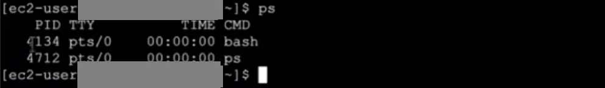

```bash frame="terminal"
ps
```

```text title="Çıktı"
    PID TTY          TIME CMD
   4134 pts/0    00:00:00 bash
   4712 pts/0    00:00:00 ps
```

Bir uygulamayı çalıştırdığımızda ilk olarak ona bir process ID (PID) atanır. Bu değer unique'tir. Bu ID ile process'lerle etkileşim kurabiliriz.

Sistem genelinde çalışan tüm process'leri görmek için `ps -e` komutunu kullanırız. Burada görülen time kısmı bu prosesin sistemde CPU'yu ne kadar süre kullandığını gösterir.

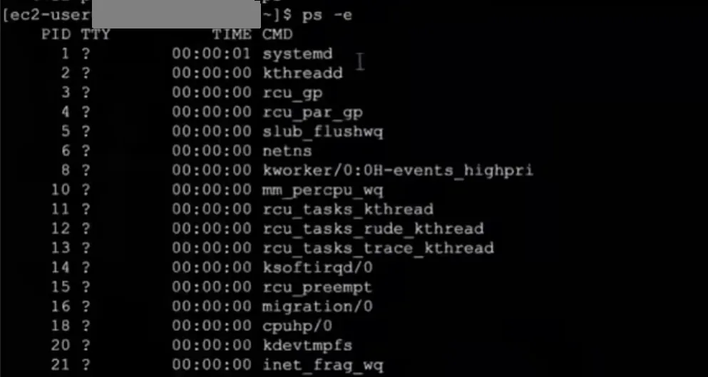

```bash frame="terminal"
ps -e
```

```text title="Çıktı"
    PID TTY          TIME CMD
      1 ?        00:00:01 systemd
      2 ?        00:00:00 kthreadd
      3 ?        00:00:00 rcu_gp
      4 ?        00:00:00 rcu_par_gp
      5 ?        00:00:00 slub_flushwq
      6 ?        00:00:00 netns
      8 ?        00:00:00 kworker/0:0H-events_highpri
...
```

Process'in başlangıç zamanını, çalışan process'in hangi komut girilerek çalıştırıldığı gibi bilgileri görmek için `ps -f` komutunu kullanırız.

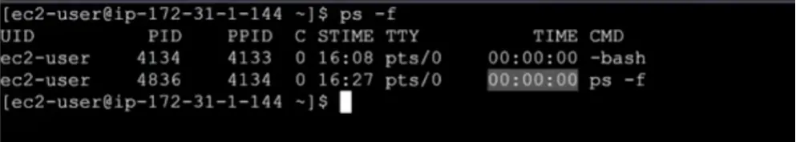

```bash frame="terminal"
ps -f
```

```text title="Çıktı"
UID          PID    PPID  C STIME TTY          TIME CMD
ec2-user    4134    4133  0 16:08 pts/0    00:00:00 -bash
ec2-user    4836    4134  0 16:27 pts/0    00:00:00 ps -f
```

İstediğimiz bir prosesin detaylarını görmek istersek PID'sini girip `ps -p 4134` şeklinde yazarız.

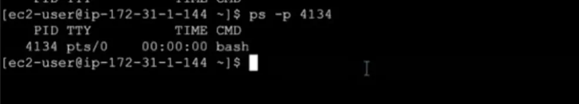

```bash frame="terminal"
ps -p 4134
```

```text title="Çıktı"
    PID TTY          TIME CMD
   4134 pts/0    00:00:00 bash
```

## Sinyaller

Process'lerle etkileşim kurup işlem yapmak için sinyaller yollarız. Çeşitli sinyaller vardır. Bunlar aşağıdaki gibidir.

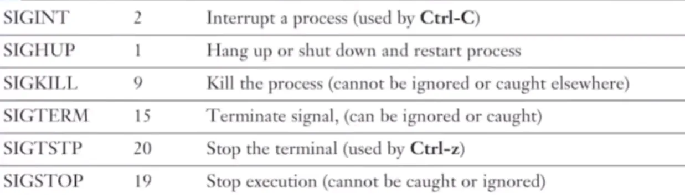

| Sinyal | Numara | Açıklama |
|---|---|---|
| SIGINT | 2 | Interrupt a process (used by Ctrl-C) |
| SIGHUP | 1 | Hang up or shut down and restart process |
| SIGKILL | 9 | Kill the process (cannot be ignored or caught elsewhere) |
| SIGTERM | 15 | Terminate signal (can be ignored or caught) |
| SIGTSTP | 20 | Stop the terminal (used by Ctrl-Z) |
| SIGSTOP | 19 | Stop execution (cannot be caught or ignored) |

SIGINT, process çalışırken gönderilir. Gönderildiği process'i bir anda kapatır. SIGHUP, bekle kapat ve process'i yeniden başlat anlamına gelir. SIGKILL, o an yapılan ne varsa sonlandırıp prosesin kendini öldürmesi anlamına gelir. SIGTERM, üzerinde yaptığın bir işlem varsa bunu tamamla sonra kendini düzgünce kapat anlamına gelir. SIGTSTP, çalışıyorken dur ama kendini kapatma anlamına gelmektedir. SIGSTOP, process'i geçici olarak dondurma emridir.

## Foreground ve background

Biz bir uygulama çalıştırdığımız zaman uygulama foreground yani ön tarafta çalışır ve terminali bloke eder. Terminali kullanamayız. Örneğin beş saniyede bir ekrana çıktı bastırıp sayı sayan bir process'i çalıştırdığımızı düşünelim. Bu durumda terminalde işlem yapamayız.

Eğer process çalışırken de işlem yapmak istersek komutumuzun sonuna `&` karakterini ekleriz böylece uygulamamız background'da çalışarak terminali bize verir. Uygulamanın çıktıları bize gelmeye devam eder.

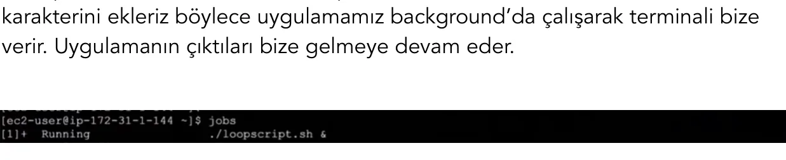

```bash frame="terminal"
jobs
```

```text title="Çıktı"
[1]+  Running                 ./loopscript.sh &
```

Sistemde arka plana atıp çalıştırdığımız işlemleri görmek için `jobs` komutunu kullanırız.

Background'da çalışan bir process'i foreground'a almak için `fg %jobID` komutunu kullanıyoruz.

## Exit kodları

Bir process'i çalıştırdığımızda ya biz hiçbir işlem yapmadan kendiliğinden kapanır ya da bizim gönderdiğimiz sinyal ile kapanır. Process'ler kapandığı zaman bir exit kodu oluşturur. Biz de oluşan exit kodlarına göre işlemler yaptırabiliyoruz. Exit kodları aşağıdaki gibidir;

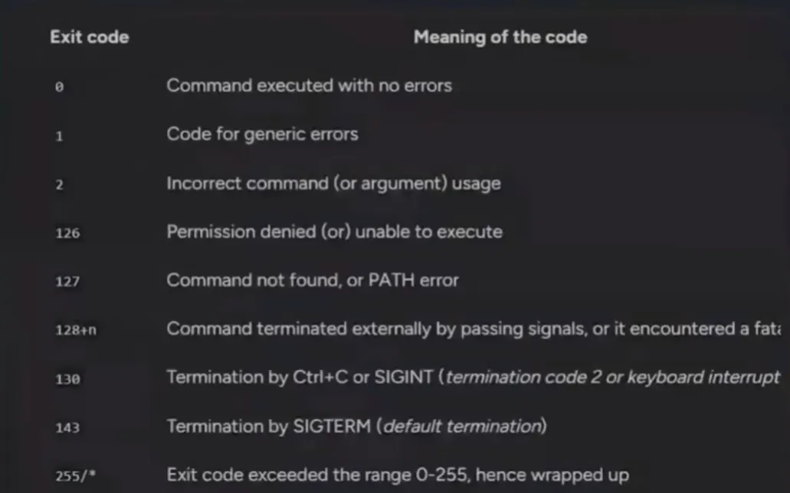

| Exit kodu | Anlamı |
|---|---|
| 0 | Command executed with no errors |
| 1 | Code for generic errors |
| 2 | Incorrect command (or argument) usage |
| 126 | Permission denied (or) unable to execute |
| 127 | Command not found, or PATH error |
| 128+n | Command terminated externally by passing signals, or it encountered a fatal error |
| 130 | Termination by Ctrl+C or SIGINT (termination code 2 or keyboard interrupt) |
| 143 | Termination by SIGTERM (default termination) |
| 255/* | Exit code exceeded the range 0-255, hence wrapped up |

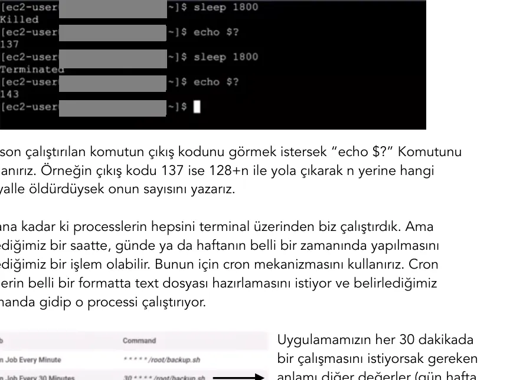

```bash frame="terminal"
sleep 1800
echo $?
```

```text title="Çıktı"
Killed
137
```

```bash frame="terminal"
sleep 1800
echo $?
```

```text title="Çıktı"
Terminated
143
```

En son çalıştırılan komutun çıkış kodunu görmek istersek `echo $?` komutunu kullanırız. Örneğin çıkış kodu 137 ise 128+n ile yola çıkarak n yerine hangi sinyalle öldürdüysek onun sayısını yazarız.

## cron ile zamanlanmış görevler

Şu ana kadarki process'lerin hepsini terminal üzerinden biz çalıştırdık. Ama istediğimiz bir saatte, günde ya da haftanın belli bir zamanında yapılmasını istediğimiz bir işlem olabilir. Bunun için cron mekanizmasını kullanırız. Cron bizlerin belli bir formatta text dosyası hazırlamasını istiyor ve belirlediğimiz zamanda gidip o process'i çalıştırıyor.

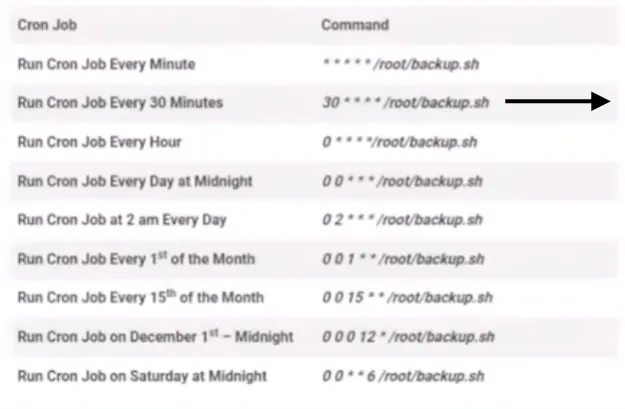

```text
* * * * * command
| | | | |
| | | | +-- Day of the Week   (0-6)
| | | +---- Month of the Year (1-12)
| | +------ Day of the Month  (1-31)
| +-------- Hour              (0-23)
+---------- Minute            (0-59)
```

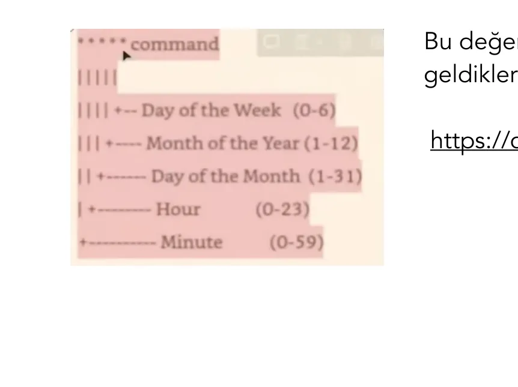

| Cron job | Satır |
|---|---|
| Her dakika | `* * * * * /root/backup.sh` |
| Her 30 dakikada bir | `*/30 * * * * /root/backup.sh` |
| Her saat | `0 * * * * /root/backup.sh` |
| Her gün gece yarısı | `0 0 * * * /root/backup.sh` |
| Her gün saat 02:00 | `0 2 * * * /root/backup.sh` |
| Her ayın 1'i | `0 0 1 * * /root/backup.sh` |
| Her ayın 15'i | `0 0 15 * * /root/backup.sh` |
| 1 Aralık gece yarısı | `0 0 1 12 * /root/backup.sh` |
| Her cumartesi gece yarısı | `0 0 * * 6 /root/backup.sh` |

Bu değerleri bizim için hesaplayıp ne anlama geldiklerini veren web sitesi;

https://crontab.cronhub.io

### crontab komutları

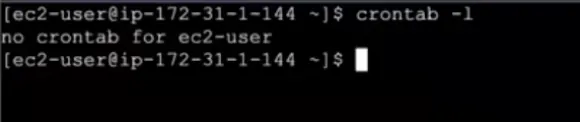

```bash frame="terminal"
crontab -l
```

```text title="Çıktı"
no crontab for ec2-user
```

Mevcut kullanıcının herhangi bir cron job'u olup olmadığına bakmak için `crontab -l` komutunu kullanırız.

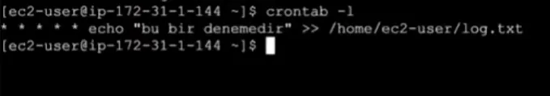

```bash frame="terminal"
crontab -l
```

```text title="Çıktı"
* * * * * echo "bu bir denemedir" >> /home/ec2-user/log.txt
```

Cron job oluşturmak için `crontab -e` komutunu kullanırız. Açılan dosyada istediğimiz zamanı, process'i ve nereye yönlendirmesini istiyorsak `* * * * * echo "bu bir denemedir" >> /home/ec2-user/log.txt` şeklinde yazarak çıkabiliriz.

## Program, process, daemon ve uygulama

Linux'ta executable dosyalara program denir. Diskte duran ve başlatıp çalıştırabildiğimiz dosyalardır.

Process bu programın çalışan haline verilen isimdir. Başlatılıyor, çalışıyor ve gözle görülemeyecek kadar hızlı bir şekilde sonlanıyor. Örneğin `ls`, `date` gibi.

Bir programı çalışmaya başlattığımızda, işlemini yapıp otomatik olarak biz onu kapatmadığımız sürece veya hata verip kendisi kapanmadığı sürece kapanmıyor çalışmaya devam ediyorsa bu tarz process'lere "daemon" denir.

Uygulama ise bir programın çalışması için gerekli diğer dosyalar bütünüdür.

Linux dünyasında uygulamaları sistemlere paketler olarak indirip yükleriz.

Package manager, bizim o paketlerle uğraşabilmemizi, sisteme yüklememizi sağlar.
