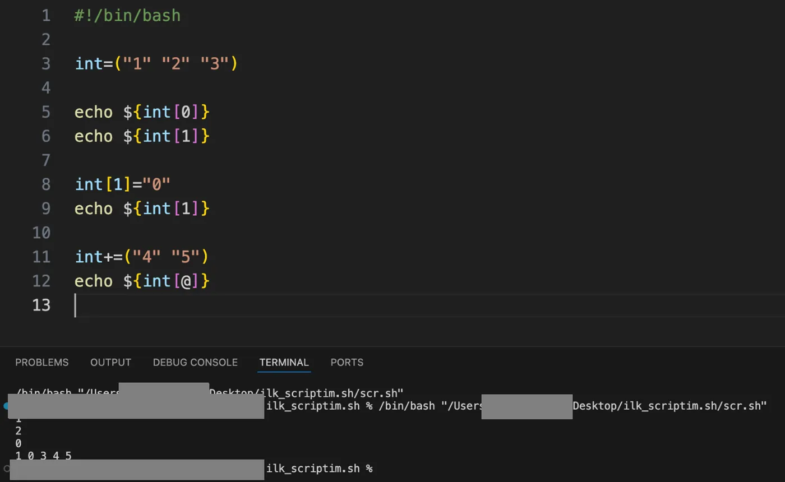
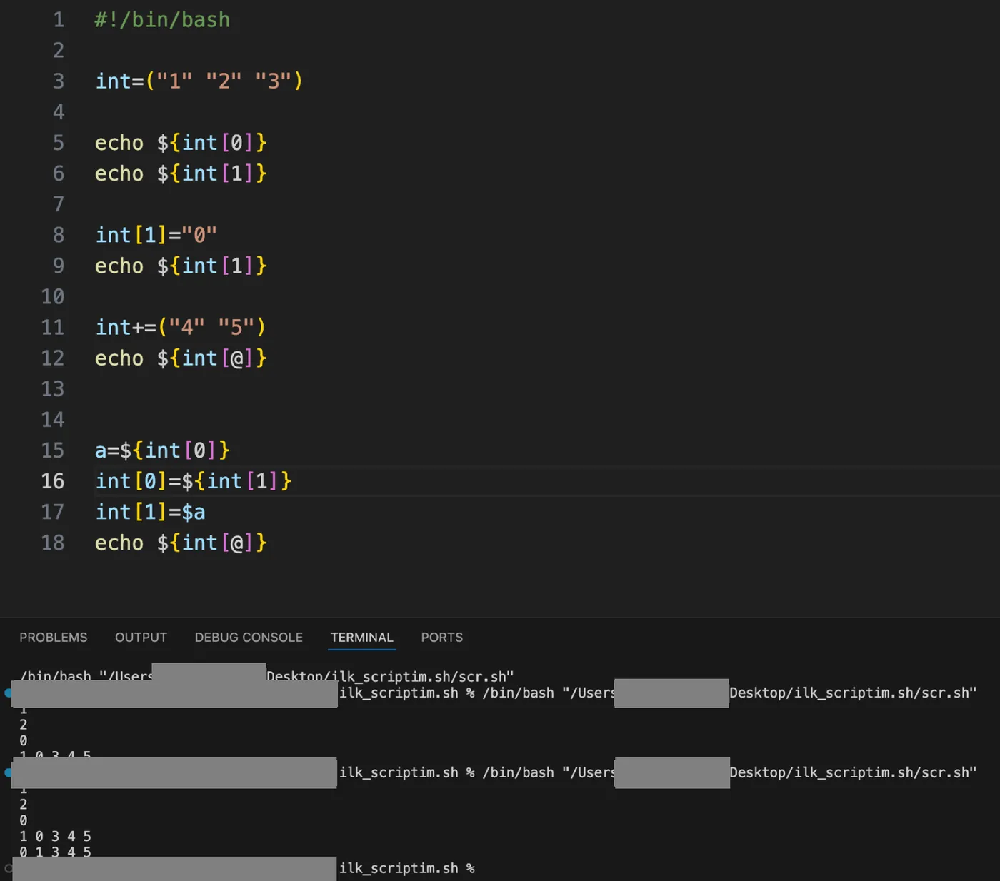

## Diziye eleman ekleme



```bash title="scr.sh"
#!/bin/bash

int=("1" "2" "3")

echo ${int[0]}
echo ${int[1]}

int[1]="0"
echo ${int[1]}

int+=("4" "5")
echo ${int[@]}
```

```text title="Çıktı"
1
2
0
1 0 3 4 5
```

Bir diziye yeni eleman eklemenin en basit yollarından biri `int+=("4" "5")` komutunu kullanmaktır. Sonda yazdığımız komutla da dizinin yeni elemanlar eklenmiş son halini ekrana yazdırırız.

## Elemanların yerini değiştirme



```bash title="scr.sh"
a=${int[0]}
int[0]=${int[1]}
int[1]=$a
echo ${int[@]}
```

```text title="Çıktı"
1
2
0
1 0 3 4 5
0 1 3 4 5
```

Yeni eklediğimiz elemanları dizinin sonuna değil de arasında bir yere eklemek istersek bu durumda indeksler arasında yer değişikliği yapabiliriz. Dizinin bu kod çalışmadan önceki halinin (1 0 3 4 5) olduğunu varsayalım:

1. `a=${int[0]}`: Dizinin 0. indeksindeki değeri (1) alıp a kutusuna koyduğumuzu düşünebiliriz. Artık `a=1` olur.
2. `int[0]=${int[1]}`: 1. indeksteki değeri (0) alıp 0. indeksin üzerine yazıyoruz. Dizinin yeni hali: (0 0 3 4 5) oldu.
3. `int[1]=$a`: Yedeklediğimiz a değerini (1) alıp 1. indekse koyuyoruz. Dizinin son hali: (0 1 3 4 5) olmuş olur.

## Eleman silme

![unset int[3] ile diziden eleman silme scripti ve çıktısı](../../../../assets/ekran/p058-1.webp)

```bash title="scr.sh"
#!/bin/bash

int=("1" "2" "3")

unset int[3]
echo ${int[@]}
```

```text title="Çıktı"
1 2 3
```

Belli bir elemanı diziden silmek istersek `unset int[3]` komutunu kullanırız.

## Eleman sayısı

![${#int[@]} ile dizinin eleman sayısının yazdırılması](../../../../assets/ekran/p058-2.webp)

```bash title="scr.sh"
#!/bin/bash

int=("1" "2" "3")

echo ${#int[@]}
```

```text title="Çıktı"
3
```

Dizideki toplam eleman sayısını vermesini istersek `echo ${#int[@]}` komutunu kullanırız.
