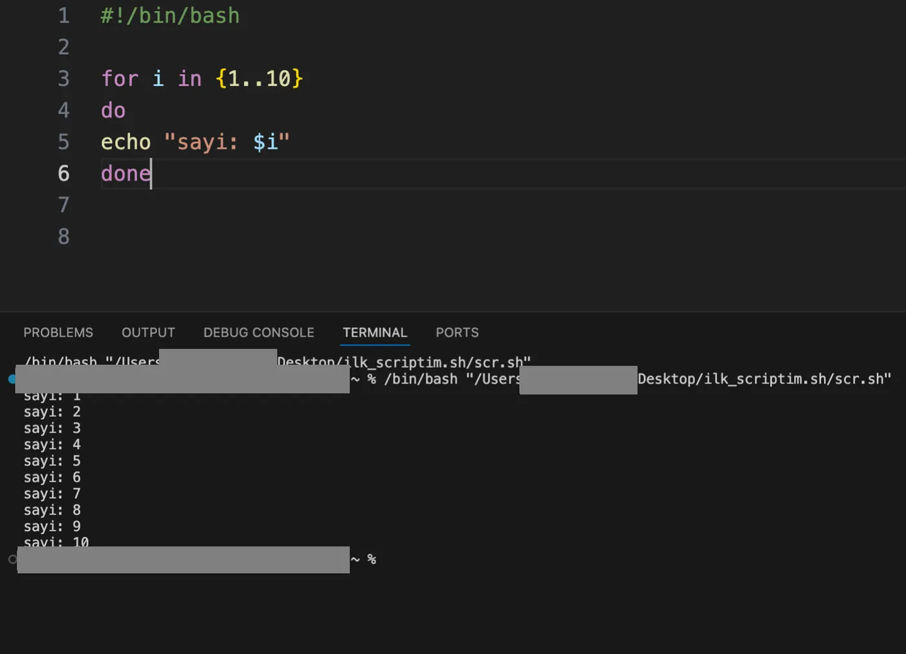
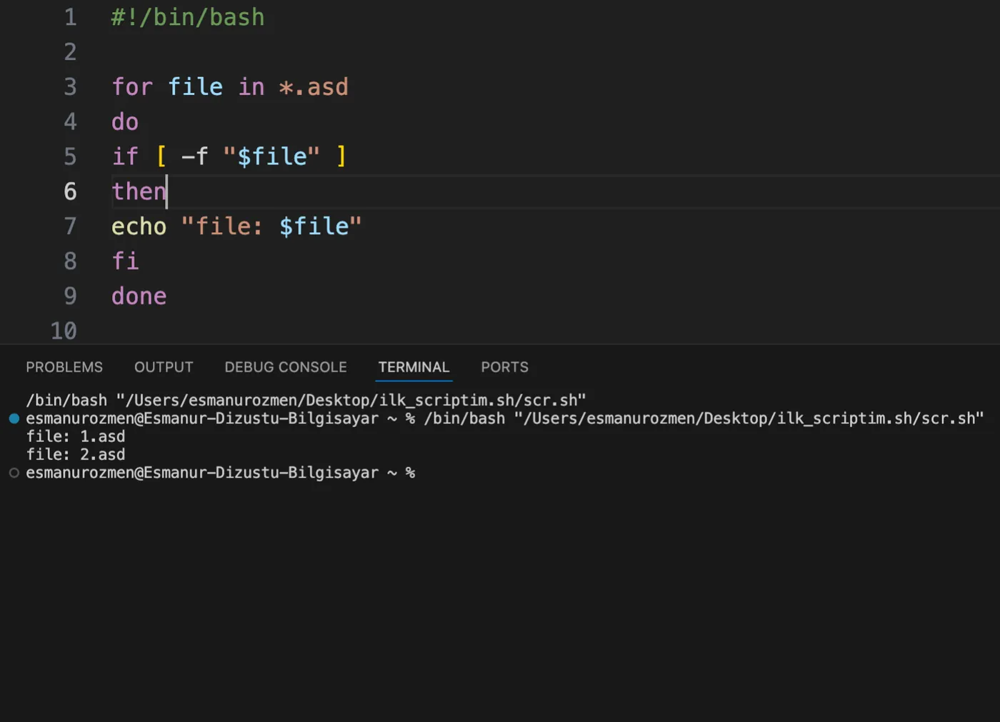
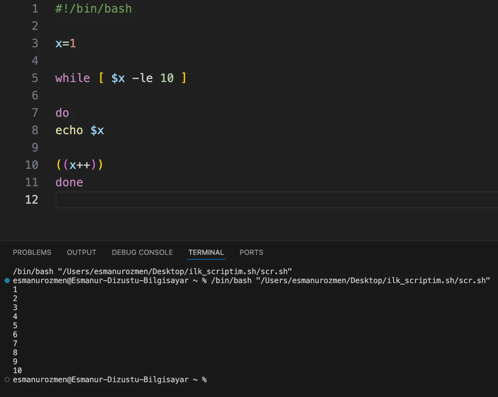
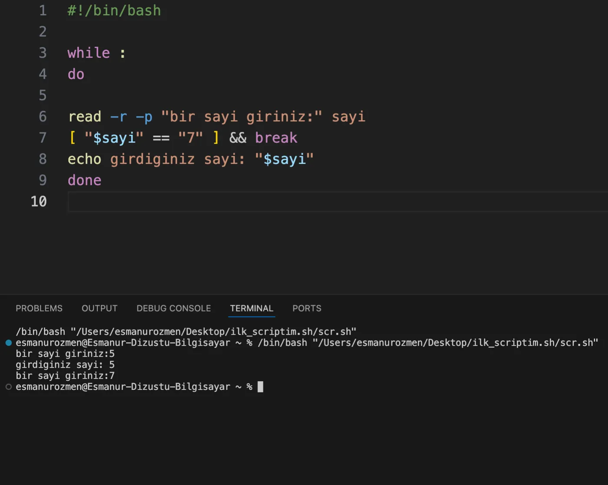
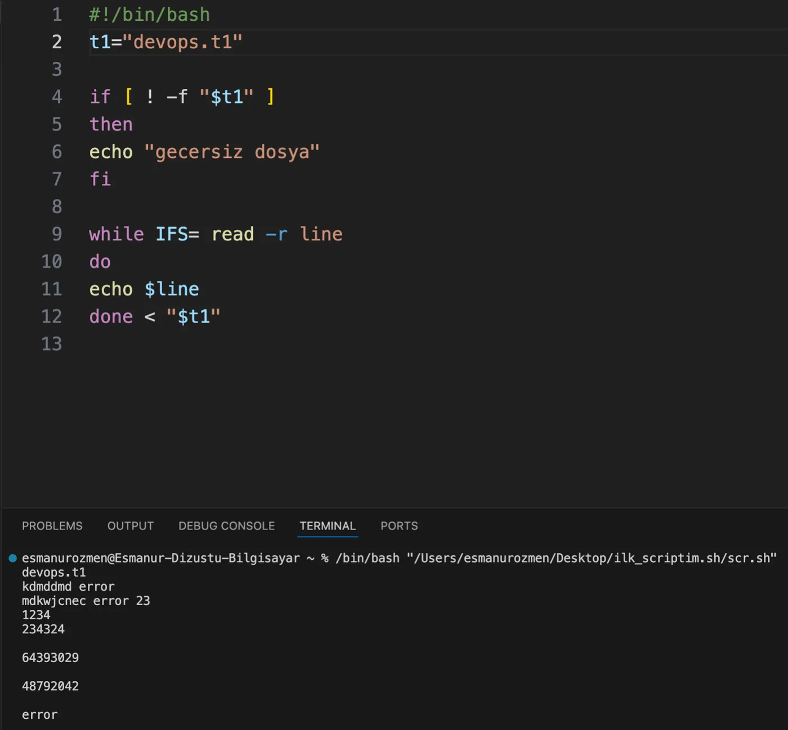
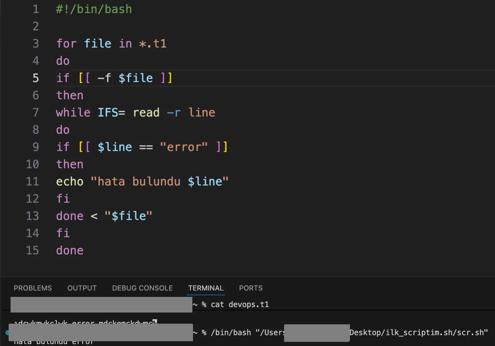

## for döngüsü



```bash title="scr.sh"
#!/bin/bash

for i in {1..10}
do
echo "sayi: $i"
done
```

```text title="Çıktı"
sayi: 1
sayi: 2
sayi: 3
...
sayi: 10
```

En basit haliyle for döngüsünün kullanımına kolay bir örnekle bakacak olursak. 1'den 10'a kadar sayıları ekrana bastırmak için yazdığımız döngü yukarıdaki gibidir.



```bash title="scr.sh"
#!/bin/bash

for file in *.asd
do
if [ -f "$file" ]
then
echo "file: $file"
fi
done
```

```text title="Çıktı"
file: 1.asd
file: 2.asd
```

Mesela bulunduğumuz dizindeki asd uzantılı tüm dosyaların kontrol edilmesini istersek yazmamız gereken for döngüsü yukarıdaki gibi olmalıdır.

## while döngüsü



```bash title="scr.sh"
#!/bin/bash

x=1

while [ $x -le 10 ]

do
echo $x

((x++))
done
```

```text title="Çıktı"
1
2
3
...
10
```

while döngüsü ile 1'den 10'a kadar sayıları bastırmak istersek yukarıdaki yolu takip edebiliriz.

### break ile döngüden çıkma



```bash title="scr.sh"
#!/bin/bash

while :
do

read -r -p "bir sayi giriniz:" sayi
[ "$sayi" == "7" ] && break
echo girdiginiz sayi: "$sayi"
done
```

```text title="Çıktı"
bir sayi giriniz:5
girdiginiz sayi: 5
bir sayi giriniz:7
```

Kullanıcıdan alınan input örneğin 7 olduğunda döngünün sonlanmasını sağlayan bir while döngüsü yukarıda verilmiştir.

## IFS ile dosyayı satır satır okuma



```bash title="scr.sh"
#!/bin/bash
t1="devops.t1"

if [ ! -f "$t1" ]
then
echo "gecersiz dosya"
fi

while IFS= read -r line
do
echo $line
done < "$t1"
```

```text title="Çıktı"
devops.t1
kdmddmd error
mdkwjcnec error 23
1234
234324

64393029

48792042

error
```

IFS, kabuğun satırları kelimelere bölerken kullandığı ayraç karakterleridir. While döngüsü içinde IFS kullanarak satırlar bitene kadar satırları okuyoruz ve line değişkenine atayarak echo ile ekrana yazdırmasını sağlıyoruz.



```bash title="scr.sh"
#!/bin/bash

for file in *.t1
do
if [[ -f $file ]]
then
while IFS= read -r line
do
if [[ $line == "error" ]]
then
echo "hata bulundu $line"
fi
done < "$file"
fi
done
```

```bash frame="terminal"
cat devops.t1
```

```text title="Çıktı"
ıdcwkmwkclwk error mdckemckdwmc
```

```text title="Script çıktısı"
hata bulundu error
```

Önceki örneğin daha genişletilmiş hali yukarıdaki gibidir. Bu komutun çalıştığı klasörde `.t1` uzantılı tüm dosyaları bir döngüye alırız. Bu uzantılı dosyanın var olup olmadığını kontrol ederiz ve IFS ile satır satır okutup error olan satır varsa "hata bulundu" çıktısını vermesini istedik.
