## Neden bash script

Neden Bash Script kullanmalıyız? Çünkü bir DevOps mühendisi veya sistem yöneticisi için 'bir işi iki kez elle yapmak' vakit kaybıdır. Bash scripting, bizi terminal başında her gün aynı komutları yazma hamallığından kurtararak süreçleri tam otomasyona dökmemizi sağlar. Bu sayede sadece zamandan tasarruf etmekle kalmayız, aynı zamanda insan hatasını da denklemin dışına iterek operasyonların her zaman kusursuz çalışmasını sağlarız. Sistemlerimize karar verme yeteneği kazandıran ve zamanlanmış görevlerle biz bilgisayar başında değilken bile çalışan bu scriptler, sunucu kurulumlarından yedeklemeye kadar her işi tek tıkla halledilebilir hale getirir.

Gelin şimdi bir bash script içeriğine temelden başlayarak göz atalım;

## Shebang: `#!/bin/bash`

Her script dosyası `#!/bin/bash` satırıyla başlar. Bu dosyanın bir script dosyası olduğunu ve bash dilinde yazıldığını gösterir. Linux çekirdeği bir dosyayı çalıştırması istendiğinde, dosyanın ilk satırına bakar. `#!` işaretini görünce bunun bir script dosyası olduğunu anlar. `/bin/bash` ise bu dosyadaki kodlar bash dilinde yazıldı, bash yorumlayıcısını çağır ve bu dosyayı ona teslim et anlamını taşır.

## Ekrana yazdırma: echo, heredoc ve printf

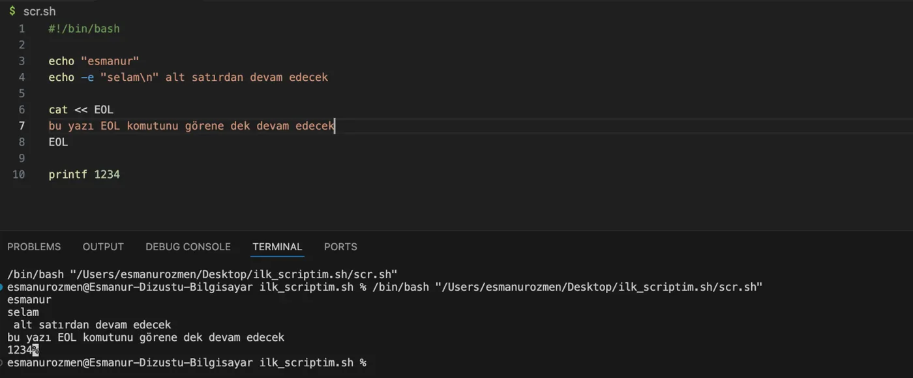

```bash title="scr.sh"
#!/bin/bash

echo "ornek"
echo -e "selam\n" alt satırdan devam edecek

cat << EOL
bu yazı EOL komutunu görene dek devam edecek
EOL

printf 1234
```

```bash frame="terminal"
/bin/bash "/Users/ornekkullanici/Desktop/ilk_scriptim.sh/scr.sh"
```

```text title="Çıktı"
ornek
selam
 alt satırdan devam edecek
bu yazı EOL komutunu görene dek devam edecek
1234
```

Ekrana bir şey yazdırmak istiyorsak bunun farklı yolları vardır. Bunlardan ilki `echo` komutudur. Kullanımı yukarıdaki gibidir. Eğer `\n` karakteri ile alt satıra geçmesini istiyorsak bunu kullanmak için `echo -e` parametresini ekleriz.

Sonraki komutta gördüğümüz `cat << EOL`: cat, bir dosyayı okuma yazma için kullanılır, devamında yazan `<<EOL` ise cat komutuna sana verdiğim girdiyi EOL kelimesini görene kadar devam edecek. Buradaki girdimiz "bu yazı EOL komutunu görene dek devam edecek" cümlesidir. Sonra 8. satırda bulunan EOL komutunu gördüğünde sonlanacaktır.

En son komut ise C dilinden de hatırlayacağımız `printf` komutu. Bu komutu kullanarak da ekrana istediğimiz çıktıyı yazdırabiliriz.

## Kullanıcıdan input alma: read

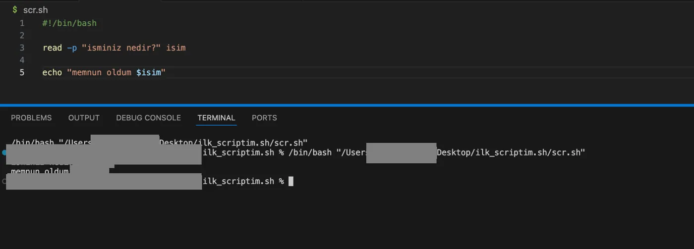

```bash title="scr.sh"
#!/bin/bash

read -p "isminiz nedir?" isim

echo "memnun oldum $isim"
```

```text title="Çıktı"
isminiz nedir?ornek
memnun oldum ornek
```

Kullanıcıdan input almaya yönelik bir kod satırı yazmamız gerekirse kullanacağımız komut `read` olur. Kullanımı `read -p 'soru' degisken_adi` şeklindedir. `-p` parametresi soruyu sorar ve cevabı (input) bekler. Kullanıcının girdiği değer `degisken_adi` isimli değişkene atanır. Kullanıcıdan aldığımız bu değeri ekrana bastırmak için `$degisken_adi` şeklinde kullanırız.

## Çok satırlı yorum

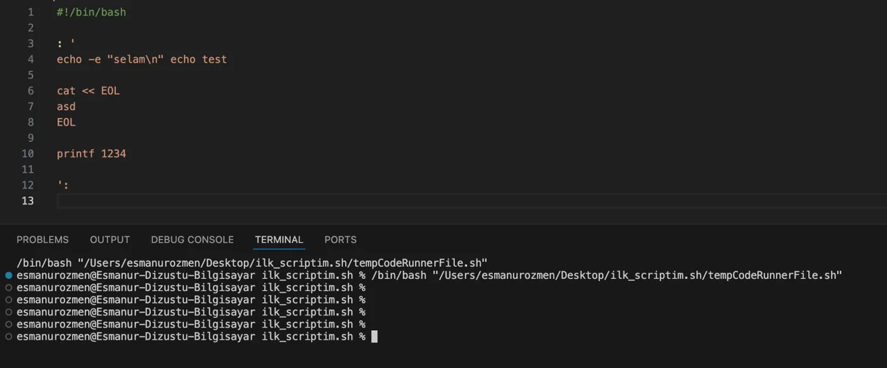

```bash title="scr.sh"
#!/bin/bash

: '
echo -e "selam\n" echo test

cat << EOL
asd
EOL

printf 1234

'
```

Çoklu satırları yorum satırı olarak belirlemek istersek başına `: '`, sonuna `'` koyarız.

## Girilen değeri gizleme: `read -s`

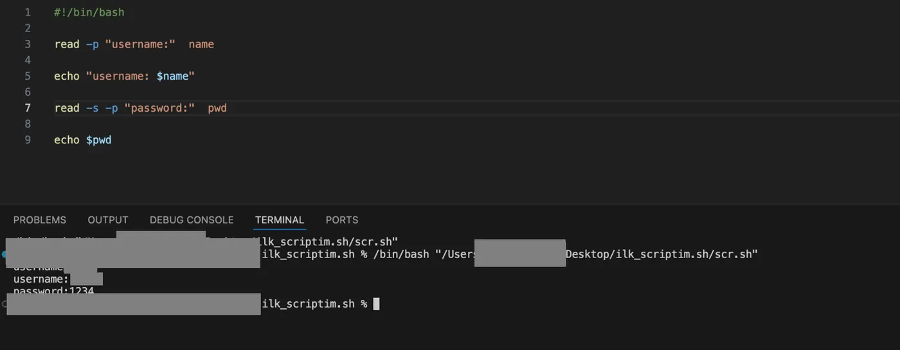

```bash title="scr.sh"
#!/bin/bash

read -p "username:"  name

echo "username: $name"

read -s -p "password:"  pwd

echo $pwd
```

```text title="Çıktı"
username:ornek
username: ornek
password:1234
```

Kullanıcının klavyeden yazdığı karakterlerin terminal ekranında görünmemesini sağlamak için `read -s` parametresini kullanırız.

## Pozisyonel parametreler

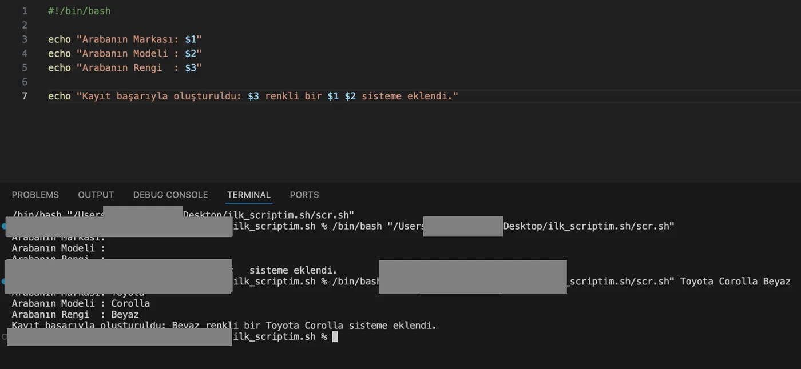

```bash title="scr.sh"
#!/bin/bash

echo "Arabanın Markası: $1"
echo "Arabanın Modeli : $2"
echo "Arabanın Rengi  : $3"

echo "Kayıt başarıyla oluşturuldu: $3 renkli bir $1 $2 sisteme eklendi."
```

```bash frame="terminal"
/bin/bash "/Users/ornekkullanici/Desktop/ilk_scriptim.sh/scr.sh"
```

```text title="Çıktı"
Arabanın Markası:
Arabanın Modeli :
Arabanın Rengi  :
Kayıt başarıyla oluşturuldu:  renkli bir   sisteme eklendi.
```

```bash frame="terminal"
/bin/bash "/Users/ornekkullanici/Desktop/ilk_scriptim.sh/scr.sh" Toyota Corolla Beyaz
```

```text title="Çıktı"
Arabanın Markası: Toyota
Arabanın Modeli : Corolla
Arabanın Rengi  : Beyaz
Kayıt başarıyla oluşturuldu: Beyaz renkli bir Toyota Corolla sisteme eklendi.
```

Kullanıcıdan birden çok parametre almamız gereken durumlarda read yerine pozisyonel parametreler kullanırız.

## Özel değişkenler

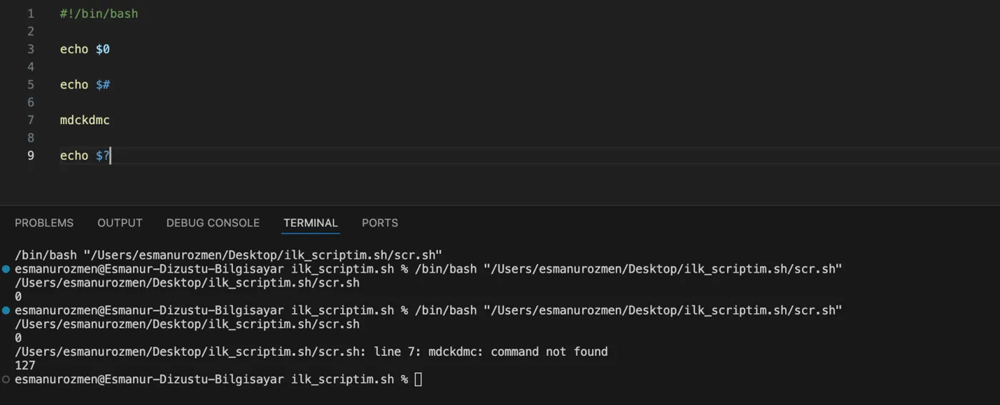

```bash title="scr.sh"
#!/bin/bash

echo $0

echo $#

mdckdmc

echo $?
```

```text title="Çıktı"
/Users/ornekkullanici/Desktop/ilk_scriptim.sh/scr.sh
0
/Users/ornekkullanici/Desktop/ilk_scriptim.sh/scr.sh: line 7: mdckdmc: command not found
127
```

Bazı özel değişkenler vardır. Mesela `$0` çalıştığımız dosyanın adını, `$#` kaç pozisyonel parametre yazdığımızın sayısını ve `$?` exit kodunu verir.

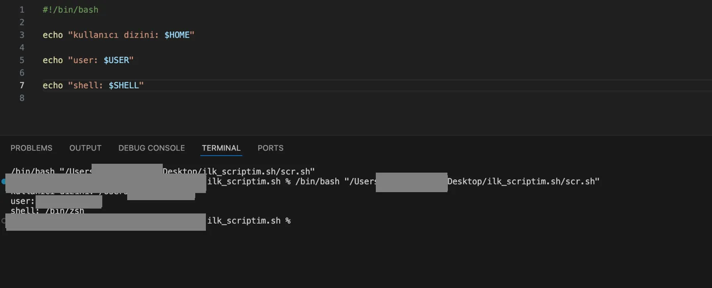

```bash title="scr.sh"
#!/bin/bash

echo "kullanıcı dizini: $HOME"

echo "user: $USER"

echo "shell: $SHELL"
```

```text title="Çıktı"
kullanıcı dizini: /Users/ornekkullanici
user: ornekkullanici
shell: /bin/zsh
```

Özel değişkenlerden bazıları yukarıdaki gibidir.

## Değişken tanımlama

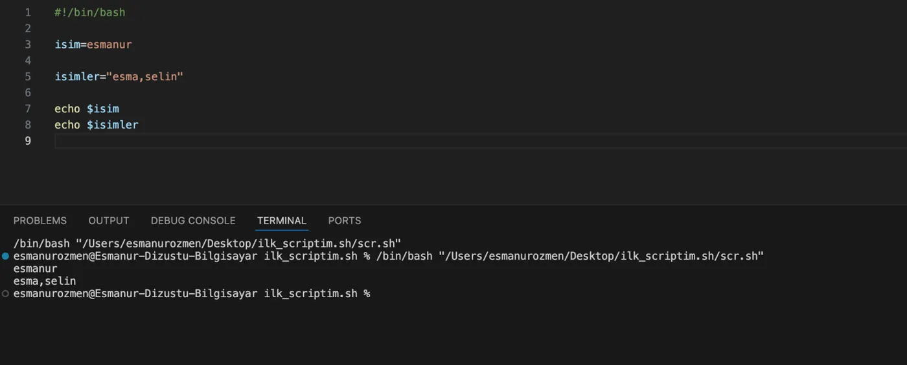

```bash title="scr.sh"
#!/bin/bash

isim=ornek

isimler="ornek,ornek2"

echo $isim
echo $isimler
```

```text title="Çıktı"
ornek
ornek,ornek2
```

Bir değişken tanımlamak istersek arada boşluk olmayacak şekilde `isim=ornek` şeklinde tanımlanır. Eğer birden fazla kelime kullanıp arada boşluk bırakacaksan tırnak kullanmamız gerekir `isimler="ornek ornek2"` olduğu gibi.

## Komut çıktısını değişkene atama

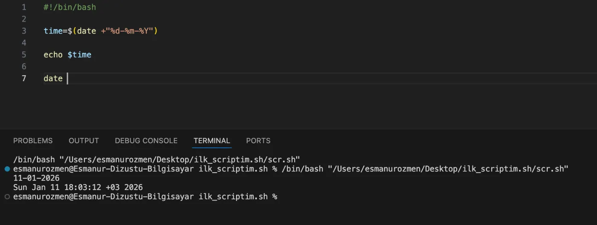

```bash title="scr.sh"
#!/bin/bash

time=$(date +"%d-%m-%Y")

echo $time

date
```

```text title="Çıktı"
11-01-2026
Sun Jan 11 18:03:12 +03 2026
```

Bir komut çıktısını alıp başka bir değişkene yönlendirmek istersek yukarıdaki gibi `date` komutunun çıktısını `time` değişkenine atayıp `time` değişkenini kullanarak `date` komutunun çıktısını yazdırmış olduk.

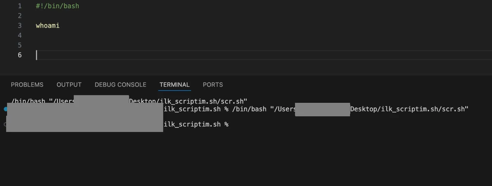

```bash title="scr.sh"
#!/bin/bash

whoami
```

```text title="Çıktı"
ornekkullanici
```

O anda terminali aktif kullanan kullanıcının adını ekrana bastırmak istersek `whoami` komutunu kullanırız.

### who çıktısını filtreleme

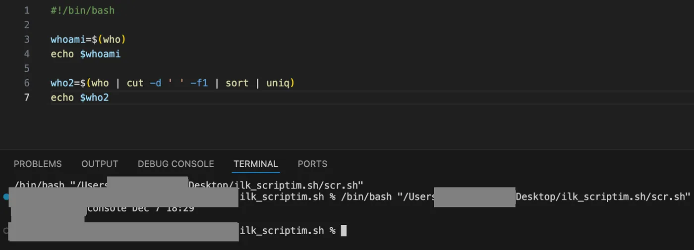

```bash title="scr.sh"
#!/bin/bash

whoami=$(who)
echo $whoami

who2=$(who | cut -d ' ' -f1 | sort | uniq)
echo $who2
```

```text title="Çıktı"
ornekkullanici console Dec 7 18:29
ornekkullanici
```

`who` komutu tarih, IP, saat gibi pek çok bilgiyi verir. Bu çıktıları alıp `whoami` değişkenine atadık. Daha sonra bu çıktıyı üç filtreden geçirmek için `(who | cut -d ' ' -f1 | sort | uniq)` komut satırını yazarız. Burada;

Burada `|` (pipe) sembolü, soldaki komutun sonucunu sağdaki komuta atar. Adım adım işlemler şunlardır:

- `who`: Ham listeyi getirir.
- `cut -d ' ' -f1`: "Sadece ilk sütunu al" der. Boşlukları sınır kabul eder ve sadece kullanıcı isimlerini ayıklar (saat ve tarih kısmını çöpe atar).
- `sort`: İsimleri alfabetik sıraya dizer.
- `uniq`: Eğer listede aynı isimden iki tane varsa (aynı kişi iki terminal açmışsa), bunları teke indirir.

## JSON'dan değer alma: jq

Binlerce satırlık bir JSON dosyasının içinde sadece tek bir değeri almak istiyorsak nokta (`.`) operatörü ile o veriye ulaşabiliriz. Örneğin bir hava durumu verisi içinden sadece dereceyi almak istiyorsak `cat hava.json | jq '.derece'` komutunu kullanırız.

```bash frame="terminal"
cat hava.json | jq '.derece'
```

Eğer bu çektiğimiz veriyi bir değişkene atayacaksak o zaman `jq -r` parametresini kullanırız. Normalde jq ile bir veriyi çektiğinde, sonuç JSON formatına sadık kalarak çift tırnak içerisinde verilir. Ancak bu veriyi bir değişkene atayıp kullanmak istediğinde o tırnaklar sıkıntı olabilir. `-r` parametresi, o tırnakları kaldırıp metni olduğu gibi temiz bir şekilde verir.
