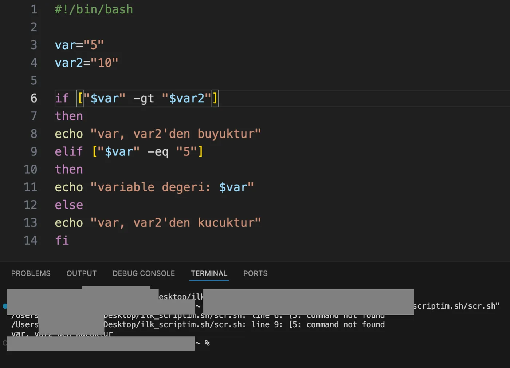
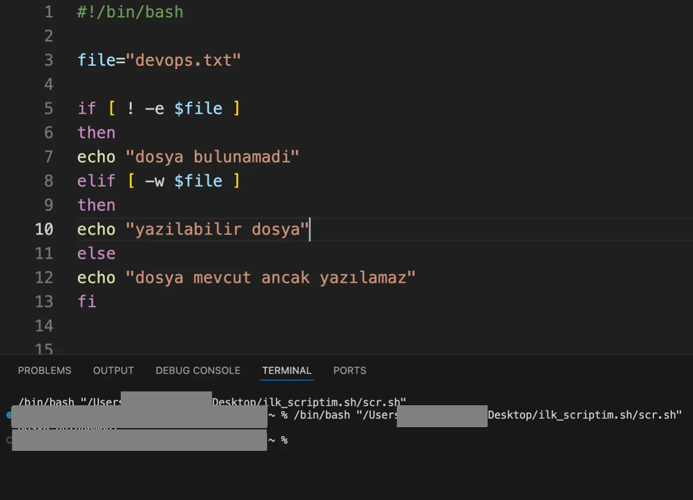

## if yapısı

if ifadesinin iskeleti yanda görüldüğü gibidir. `fi` komutu sonlandırmak için kullanılır.

```bash
if [ koşul ]
then
    # koşul doğruysa
else
    # koşul hatalıysa
fi
```

## Karşılaştırma operatörleri

Karşılaştırma operatörleri yerine kullanabileceğimiz ifadeler vardır;

| Sembol | Bash ifadesi |
|---|---|
| `<` | `-lt` |
| `>` | `-gt` |
| `==` | `-eq` |
| `>=` | `-ge` |
| `<=` | `-le` |
| `!=` | `-ne` |



```bash title="scr.sh"
#!/bin/bash

var="5"
var2="10"

if [ "$var" -gt "$var2" ]
then
echo "var, var2'den buyuktur"
elif [ "$var" -eq "5" ]
then
echo "variable degeri: $var"
else
echo "var, var2'den kucuktur"
fi
```

:::caution[Düzeltme]
`[` ile `]` karakterlerinin iç tarafında boşluk bırakılmalıdır. Notlardaki denemede `["$var" -gt "$var2"]` boşluksuz yazıldığı için script `[5: command not found` hatası verdi ve `else` dalına düştü:

```text title="Çıktı"
/Users/ornekkullanici/Desktop/ilk_scriptim.sh/scr.sh: line 6: [5: command not found
/Users/ornekkullanici/Desktop/ilk_scriptim.sh/scr.sh: line 9: [5: command not found
var, var2'den kucuktur
```
:::

## Dosya test operatörleri

Sık kullanılan bazı operatörlerden bazılarının kullanımı aşağıdaki gibidir.

| Operatör | Anlamı |
|---|---|
| `-e` | bu dosya mevcut mu diye kontrol eder |
| `-r` | bu dosya okunabilir mi |
| `-w` | dosya yazılabilir mi |
| `-x` | bu dosya çalıştırılabilir mi |
| `-f` | bu bir dosya mı |
| `-d` | bu bir dizin mi |



```bash title="scr.sh"
#!/bin/bash

file="devops.txt"

if [ ! -e $file ]
then
echo "dosya bulunamadi"
elif [ -w $file ]
then
echo "yazilabilir dosya"
else
echo "dosya mevcut ancak yazılamaz"
fi
```

```text title="Çıktı"
dosya bulunamadi
```
