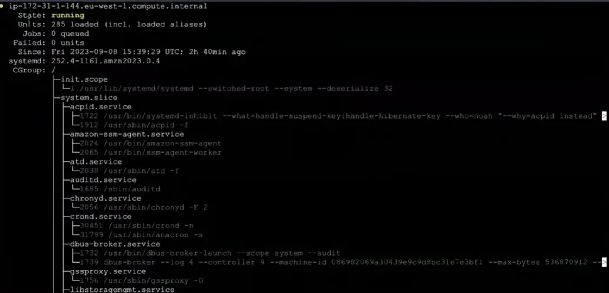
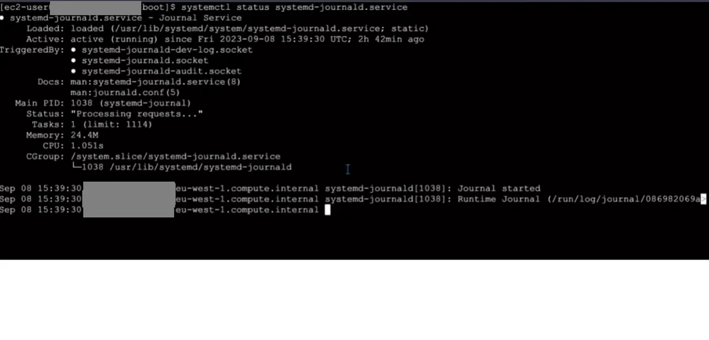
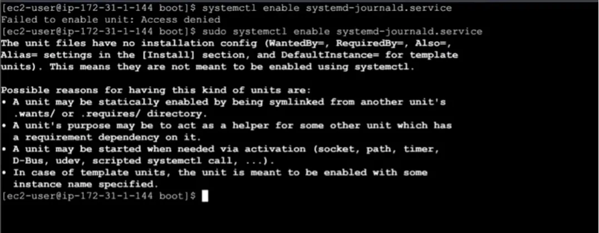

## systemd nedir

Systemd, Linux'un açıldığı andan kapandığı ana kadar her şeyin düzenli çalışmasını sağlayan orkestra şefidir. Linux yüklü bir bilgisayar açıldığı andan itibaren donanım elektriği alır, kernel hafızaya yüklenir ve tek bir programı çalıştırır bu systemd'dir. Systemd çalışmaya başladığı an elindeki listeye bakar ve geri kalan her şeyi (ekran kartı sürücüsü, internet bağlantısı, ses servisi, giriş ekranı) o başlatır. O olmasaydı, siyah ekranda sadece yanıp sönen bir imleçten fazlasını göremezdik. Servisleri yöneterek başlatır, durdurur veya yeniden başlatır. Diğer bütün programlar systemd'nin çocukları ve torunlarıdır. PID'si 1'dir.

## systemctl ile durum görüntüleme

Systemd ile etkileşim kurmak için `systemctl` aracını kullanırız. `sudo systemctl status` komutuyla sistemde şu an çalışan servisleri aşağıdaki ekranda gösterir. Çıkmak için `q`'ya basmamız gerekir.



```bash frame="terminal"
sudo systemctl status
```

```text title="Çıktı"
● ip-172-31-0-10.eu-west-1.compute.internal
    State: running
    Units: 285 loaded (incl. loaded aliases)
     Jobs: 0 queued
   Failed: 0 units
    Since: Fri 2023-09-08 15:39:29 UTC; 2h 40min ago
  systemd: 252.4-1161.amzn2023.0.4
   CGroup: /
           ├─init.scope
           │ └─1 /usr/lib/systemd/systemd --switched-root --system --deserialize 32
           ├─system.slice
           │ ├─acpid.service
           │ │ ├─1722 /usr/bin/systemd-inhibit --what=handle-suspend-key:handle-hibernate-key --who=noah "--why=acpid instead" ...
           │ │ └─1912 /usr/sbin/acpid -f
           │ ├─amazon-ssm-agent.service
           │ │ ├─2024 /usr/bin/amazon-ssm-agent
           │ │ └─2065 /usr/bin/ssm-agent-worker
           │ ├─atd.service
           │ │ └─2038 /usr/sbin/atd -f
           │ ├─auditd.service
           │ │ └─1685 /sbin/auditd
           │ ├─chronyd.service
           │ │ └─2056 /usr/sbin/chronyd -F 2
           │ ├─crond.service
           │ │ ├─30451 /usr/sbin/crond -n
           │ │ └─31799 /usr/sbin/anacron -s
...
```

Tek bir çalışan servisin durumuna bakmak istersek `systemctl status servisadi` komutunu kullanırız.



```bash frame="terminal"
systemctl status systemd-journald.service
```

```text title="Çıktı"
● systemd-journald.service - Journal Service
     Loaded: loaded (/usr/lib/systemd/system/systemd-journald.service; static)
     Active: active (running) since Fri 2023-09-08 15:39:30 UTC; 2h 42min ago
TriggeredBy: ● systemd-journald-dev-log.socket
             ● systemd-journald.socket
             ● systemd-journald-audit.socket
       Docs: man:systemd-journald.service(8)
             man:journald.conf(5)
   Main PID: 1038 (systemd-journal)
     Status: "Processing requests..."
      Tasks: 1 (limit: 1114)
     Memory: 24.4M
        CPU: 1.051s
     CGroup: /system.slice/systemd-journald.service
             └─1038 /usr/lib/systemd/systemd-journald

Sep 08 15:39:30 ip-172-31-0-10.eu-west-1.compute.internal systemd-journald[1038]: Journal started
...
```

## Servisi enable etme



```bash frame="terminal"
systemctl enable systemd-journald.service
sudo systemctl enable systemd-journald.service
```

```text title="Çıktı"
Failed to enable unit: Access denied
The unit files have no installation config (WantedBy=, RequiredBy=, Also=,
Alias= settings in the [Install] section, and DefaultInstance= for template
units). This means they are not meant to be enabled using systemctl.

Possible reasons for having this kind of units are:
• A unit may be statically enabled by being symlinked from another unit's
  .wants/ or .requires/ directory.
• A unit's purpose may be to act as a helper for some other unit which has
  a requirement dependency on it.
• A unit may be started when needed via activation (socket, path, timer,
  D-Bus, udev, scripted systemctl call, ...).
• In case of template units, the unit is meant to be enabled with some
  instance name specified.
```

Bir servisi yüklememiz, oluşturmamız o servisin otomatik başlayacağı anlamına gelmez. Bilgisayar başladığında bir servisin de otomatik olarak başlatılmasını istiyorsak enable etmemiz gerekir. Bunu `sudo systemctl enable servisadı` komutuyla yaparız.

```bash frame="terminal"
sudo systemctl enable servisadı
```

## Servis yönetim komutları

Bir sistemi başlatmak istersek `sudo systemctl start servisadı`, bir sistemi durdurmak istersek `sudo systemctl stop servisadı`, bir sistemi yeniden başlatmak istersek `sudo systemctl restart servisadı`, bir sistemin konfigürasyonunu yeniden yükleyip yenilemek istersek `sudo systemctl reload servisadı` şeklinde kullanırız.

Systemd'nin tüm konfigürasyonunu kontrol ederek her şeyi tekrar yüklemesi için `sudo systemctl daemon-reload` komutunu kullanırız.

## Unit dosyaları

Systemd neyi nereden, nasıl ve ne zaman çalıştıracağını nereden biliyor sorusunun cevabı unit mantığı üzerinden kurgular. Systemd çeşitli unit dosyaları üzerinden yönetmesini istediğimiz dosyaya gider yükler ve yapılması istenileni yapar.

Bu unit'lerin nerede bulunduğuna bakmak istersek `ls -l /lib/systemd/system` komutunu kullanırız.

```bash frame="terminal"
ls -l /lib/systemd/system
```
