## Prompt satırı

Sanal makinemize bağlandığımızda karşımıza çıkan ekranda yazan kod satırının anlamına bakacak olursak; bu bash'in varsayılanıdır isteğe bağlı değiştirilebilir.

`ec2-user` —> bağlı olduğumuz kullanıcının ismidir. Geriye kalan `@ip-172-31-0-10` kısmı ise hangi bilgisayara bağlı olduğumuzu yani bilgisayarın ismidir. Burada IP adresi şeklinde verilmiştir.

Yani bu komut satırı hangi kullanıcıyla - nereye bağlı olduğumuzu ifade eder.

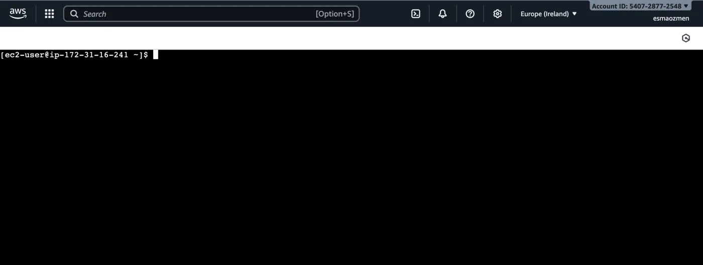

```text
[ec2-user@ip-172-31-0-10 ~]$
```

## Home klasörü ve pwd

Linux'ta her şey bir dosyadır. Linux üzerinde her kullanıcının bir home folder'ı vardır. Bu Windows'taki masaüstü olarak düşünülebilir. Değiştirilmediği sürece root altındaki home klasörünün içindeki kullanıcı adı klasörüdür. Kısaca `~` sembolü ile ifade edilir.

`~` işareti şu anda mevcut olarak hangi klasörde olduğumuzu gösterir.

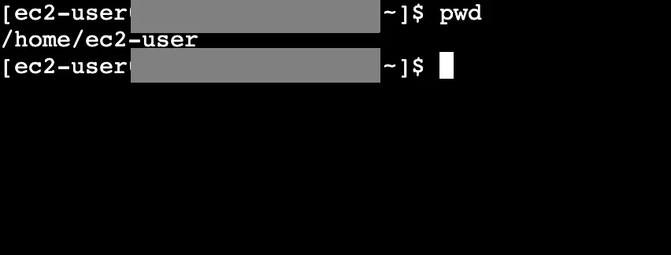

```bash frame="terminal"
pwd
```

```text title="Çıktı"
/home/ec2-user
```

`pwd` komutunu çalıştırarak şu anda mevcut olarak hangi klasörde olduğumuzu görebiliriz. Yukarıdaki çıktı bize root altındaki home klasörünün içindeki kullanıcı adı klasöründe olduğumuzu gösterir.

## whoami ve clear

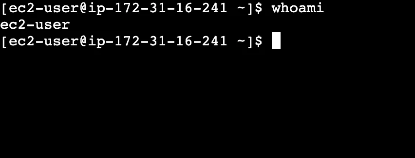

```bash frame="terminal"
whoami
```

```text title="Çıktı"
ec2-user
```

`whoami` komutunu kullanarak bu oturuma hangi kullanıcı ile bağlandığımızı verir. Yani kim olduğumuzu, bu oturuma hangi kullanıcı ile başladığımızı gösterir.

`clear` komutu ile ekrana yazdığımız komut satırlarını temizleriz.

## cd: klasör değiştirme

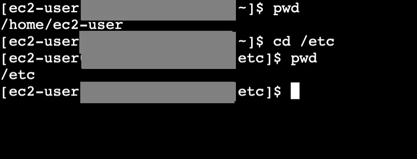

```bash frame="terminal"
pwd
cd /etc
pwd
```

```text title="Çıktı"
/home/ec2-user
/etc
```

Bir sonraki öğreneceğimiz komut `cd` komutu. Bu change directory anlamına gelir. Bu komutu yazıp gitmek istediğimiz klasörü yazarsak mevcut klasörümüz istediğimiz klasörle değiştirilmiş olur. Yukarıda görüldüğü gibi önce bulunduğumuz klasöre bakıp daha sonra etc klasörüne gittik.

Bir üst klasöre geçmek için `cd ..` komutunu ve iki üst klasöre ulaşmak için ise `cd ../..` komutunu kullanırız.

Bir komutun sonuna `.` koyarsak bu klasör anlamına gelir ve yapacağımız işlemleri bu klasörde yapacağımızı belirtir.

## ls: listeleme

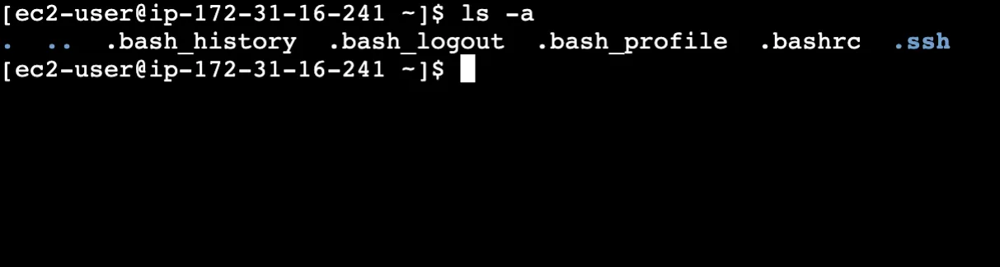

```bash frame="terminal"
ls -a
```

```text title="Çıktı"
.  ..  .bash_history  .bash_logout  .bash_profile  .bashrc  .ssh
```

Mevcut klasörde bulunan gizlenmemiş dosyaları listelemek için `ls` komutunu kullanırız. Gizlenmiş olan dosyaları da görmek için `ls -a` komutunu çalıştırırız.

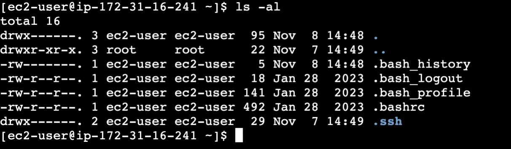

```bash frame="terminal"
ls -al
```

```text title="Çıktı"
total 16
drwx------. 3 ec2-user ec2-user  95 Nov  8 14:48 .
drwxr-xr-x. 3 root     root      22 Nov  7 14:49 ..
-rw-------. 1 ec2-user ec2-user   5 Nov  8 14:48 .bash_history
-rw-r--r--. 1 ec2-user ec2-user  18 Jan 28  2023 .bash_logout
-rw-r--r--. 1 ec2-user ec2-user 141 Jan 28  2023 .bash_profile
-rw-r--r--. 1 ec2-user ec2-user 492 Jan 28  2023 .bashrc
drwx------. 2 ec2-user ec2-user  29 Nov  7 14:49 .ssh
```

Bu çıktıyı alt alta listelemek istersek `ls -al` komutunu yazmalıyız. Burada bazı dosyaların başında `.` bulunur. Linux dünyasında bu o dosyanın gizli olduğu anlamına gelir.

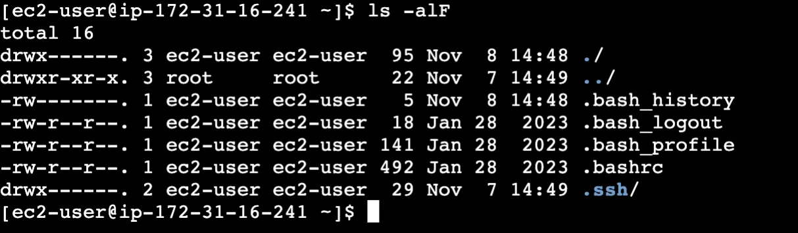

```bash frame="terminal"
ls -alF
```

```text title="Çıktı"
total 16
drwx------. 3 ec2-user ec2-user  95 Nov  8 14:48 ./
drwxr-xr-x. 3 root     root      22 Nov  7 14:49 ../
-rw-------. 1 ec2-user ec2-user   5 Nov  8 14:48 .bash_history
-rw-r--r--. 1 ec2-user ec2-user  18 Jan 28  2023 .bash_logout
-rw-r--r--. 1 ec2-user ec2-user 141 Jan 28  2023 .bash_profile
-rw-r--r--. 1 ec2-user ec2-user 492 Jan 28  2023 .bashrc
drwx------. 2 ec2-user ec2-user  29 Nov  7 14:49 .ssh/
```

Listelediğimiz dosyaların tipini görmek için `ls -alF` komutunu kullanırız.

Yukarıdaki çıktıda olduğu gibi bazı dosyaların başında `d` bazılarında ise `-` var. Dosyaların başında `d` olması bunun bir klasör olduğunu gösterir. `-` varsa bunun bir dosya olduğunu anlarız. Bazılarının başında ise `l` olur bunlar link anlamına gelir.

## echo

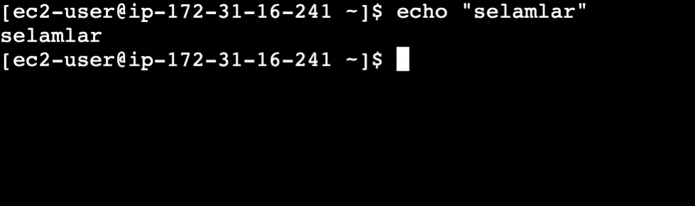

```bash frame="terminal"
echo "selamlar"
```

```text title="Çıktı"
selamlar
```

`echo "yazılmasını istediğimiz şey"` komutunu kullanarak yazdığımız yazının çıktı olarak geri dönmesini sağlarız. Tek veya çift tırnak içinde yazabiliriz. Yazdığımız yazıları dosyalara atmak için vs kullanılan bir komuttur.

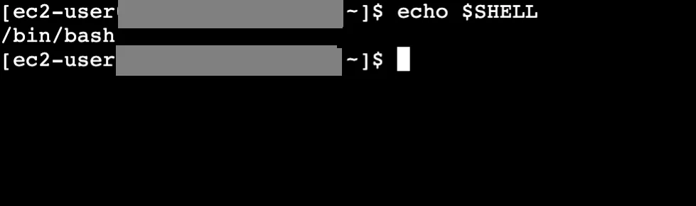

```bash frame="terminal"
echo $SHELL
```

```text title="Çıktı"
/bin/bash
```

`echo` aynı zamanda variable ile de çalışır. Örneğin yukarıda shell variable değerini öğrenmiş olduk.

## touch

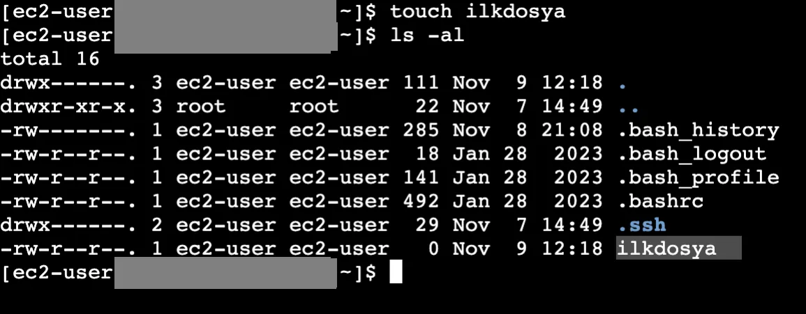

```bash frame="terminal"
touch ilkdosya
ls -al
```

```text title="Çıktı"
total 16
drwx------. 3 ec2-user ec2-user 111 Nov  9 12:18 .
drwxr-xr-x. 3 root     root      22 Nov  7 14:49 ..
-rw-------. 1 ec2-user ec2-user 285 Nov  8 21:08 .bash_history
-rw-r--r--. 1 ec2-user ec2-user  18 Jan 28  2023 .bash_logout
-rw-r--r--. 1 ec2-user ec2-user 141 Jan 28  2023 .bash_profile
-rw-r--r--. 1 ec2-user ec2-user 492 Jan 28  2023 .bashrc
drwx------. 2 ec2-user ec2-user  29 Nov  7 14:49 .ssh
-rw-r--r--. 1 ec2-user ec2-user   0 Nov  9 12:18 ilkdosya
```

Sıradaki öğreneceğimiz `touch` komutu. `touch dosyaadı` şeklinde kullanılır. İsmini girdiğimiz dosyanın modifiye edilme tarihini günceller.

Eğer o isimde bir dosya yoksa girdiğimiz isimde bir dosya oluşturur.

## cat

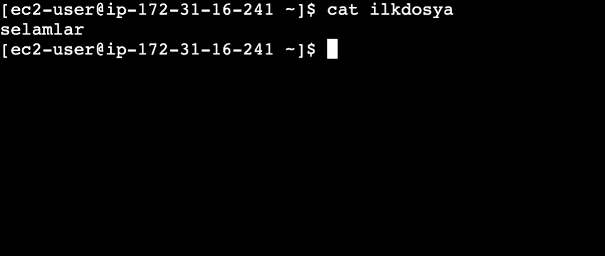

```bash frame="terminal"
cat ilkdosya
```

```text title="Çıktı"
selamlar
```

Bir text dosyasının içeriğini hızlı bir şekilde görmek istediğimizde kullanacağımız komut `cat dosyaadı` şeklinde kullanılır.

## rm: dosya silme

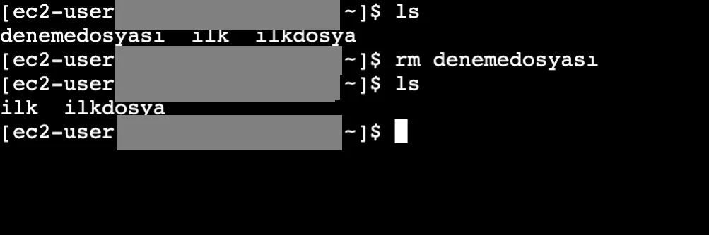

```bash frame="terminal"
ls
rm denemedosyası
ls
```

```text title="Çıktı"
denemedosyası  ilk  ilkdosya
ilk  ilkdosya
```

Bir dosyayı silmek istediğimizde `rm dosyaadı` komutunu kullanırız.

## mkdir ve rmdir: klasör oluşturma ve silme

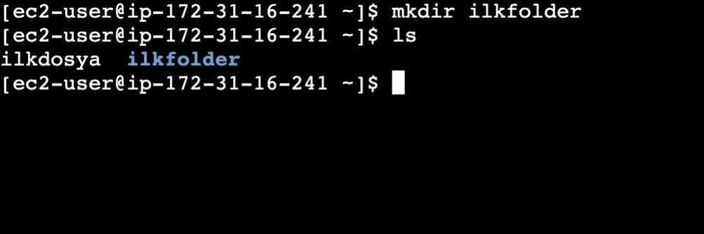

```bash frame="terminal"
mkdir ilkfolder
ls
```

```text title="Çıktı"
ilkdosya  ilkfolder
```

Klasör oluşturmak istediğimizde kullanmamız gereken komut `mkdir` olmalı. `mkdir klasöradı` şeklinde kullanılır.

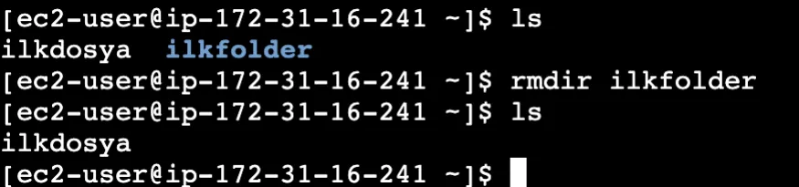

```bash frame="terminal"
rmdir ilkfolder
ls
```

```text title="Çıktı"
ilkdosya
```

İçi boş olan bir klasörü silmek için `rmdir klasöradı` komutunu kullanıyoruz.

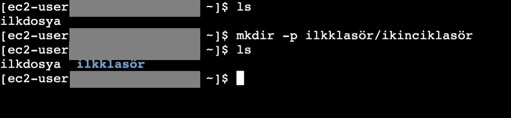

```bash frame="terminal"
mkdir -p ilkklasör/ikinciklasör
ls
```

```text title="Çıktı"
ilkdosya  ilkklasör
```

Eğer bir klasör altında başka bir klasör daha oluşturmak istersek bu sefer `mkdir -p ilkklasör/ikinciklasör` komutunu kullanırız.

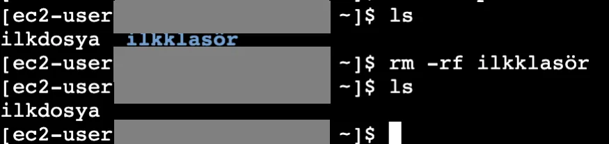

```bash frame="terminal"
rm -rf ilkklasör
ls
```

```text title="Çıktı"
ilkdosya
```

Oluşturduğumuz klasör içinde başka bir klasör daha bulunan klasörü silmek için kullandığımız komut `rm -rf klasöradı` şeklinde yazarız.

## --help ve man

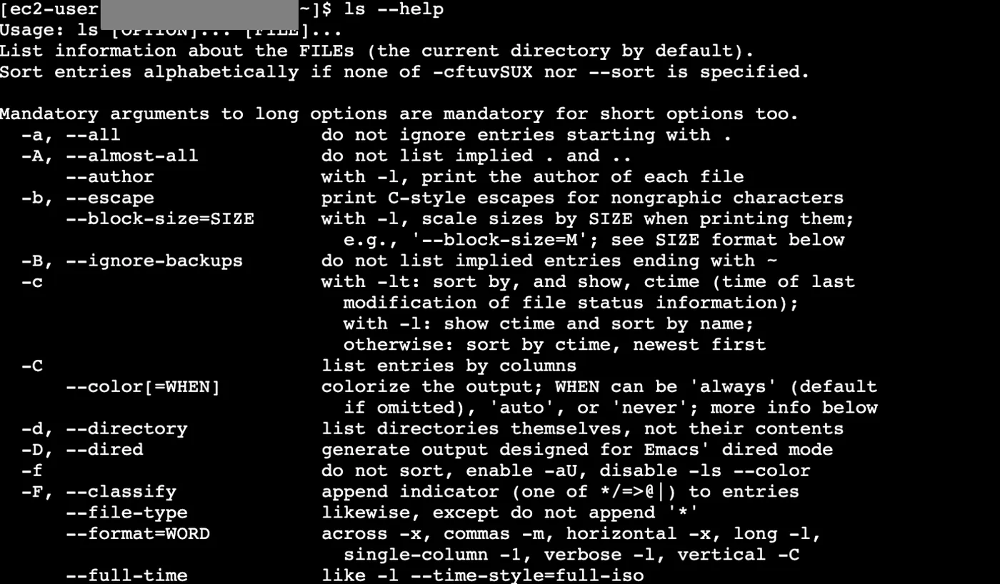

```bash frame="terminal"
ls --help
```

```text title="Çıktı"
Usage: ls [OPTION]... [FILE]...
List information about the FILEs (the current directory by default).
Sort entries alphabetically if none of -cftuvSUX nor --sort is specified.

Mandatory arguments to long options are mandatory for short options too.
  -a, --all                  do not ignore entries starting with .
  -A, --almost-all           do not list implied . and ..
      --author               with -l, print the author of each file
  -b, --escape               print C-style escapes for nongraphic characters
...
  -F, --classify             append indicator (one of */=>@|) to entries
...
```

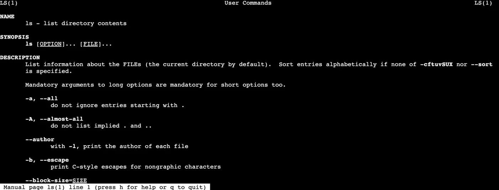

```bash frame="terminal"
man ls
```

```text title="Çıktı"
LS(1)                        User Commands                        LS(1)

NAME
       ls - list directory contents

SYNOPSIS
       ls [OPTION]... [FILE]...

DESCRIPTION
       List information about the FILEs (the current directory by default).
       Sort entries alphabetically if none of -cftuvSUX nor --sort is specified.
...
 Manual page ls(1) line 1 (press h for help or q to quit)
```

Kullanmak istediğimiz komutların opsiyonlarını, nasıl ve niçin kullanıldıklarını öğrenmek için `komutadı --help` komutunu veya `man komutadı` şeklinde kullanırız. Çıkmak için `q` harfini yazmamız yeterli.
