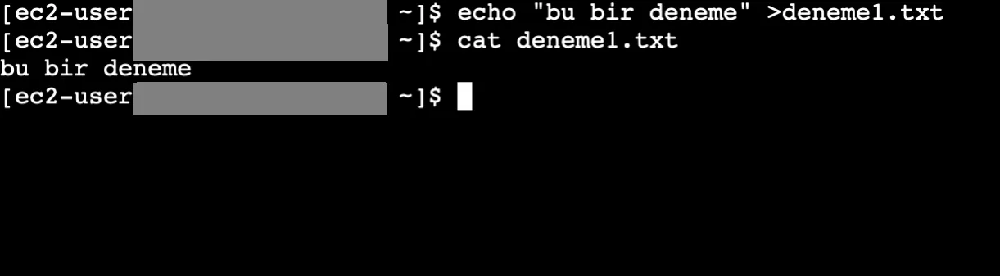
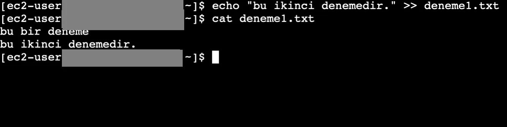
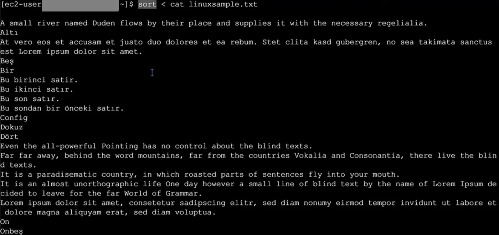
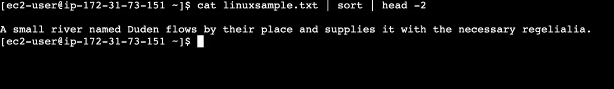
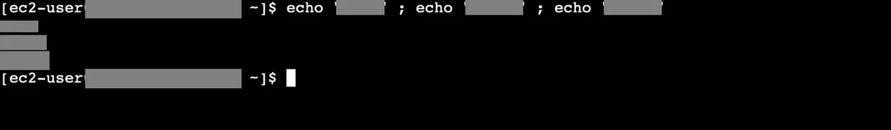
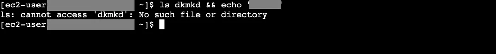
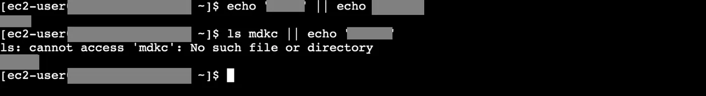
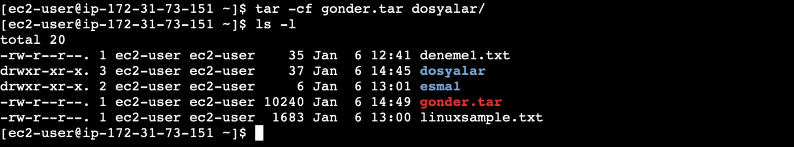
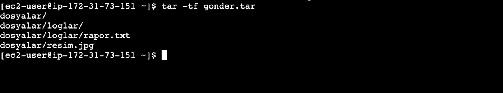
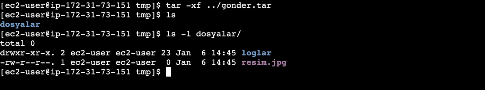

## Standart kanallar

Linux'ta bir uygulama çalıştığı zaman bunun adı process olur ve Linux'ta bir uygulama çalıştığında bu uygulamaya üç tane stream yani kanal yapıştırılır. Bu üç kanal stdin(0), stdout(1) ve stderr(2) kanallarıdır.

Stdin girişi direkt klavyeye bağlıdır. Bir prosese bir input vermek istediğimizde bu girişe göndeririz. Böylece process bu inputu alır ve işleyebilir.

Process bir bilgi çıkartacağı zaman stdout stream'a gönderir. Ekranımıza bağlıdır. Eğer bir error üretecekse de stderr stream'a gönderir. Ekranımıza bağlıdır.

## Çıktıyı dosyaya yönlendirme: `>` ve `>>`

Şimdi Linux shell'de kullanılan bazı karakterlere göz atalım. Ekrana yazdığımız bir çıktıyı istediğimiz bir dosyanın içine yazmak istersek aşağıdaki komutu kullanmamız gerekir. Buradaki karakterimiz `>`



```bash frame="terminal"
echo "bu bir deneme" >deneme1.txt
cat deneme1.txt
```

```text title="Çıktı"
bu bir deneme
```

`>>` karakterini kullanarak soluna yazdığımız çalışan uygulamanın processi ana mesajını sağdaki dosyaya gönder demiş oluruz. Dosyada yazan veriler varsa bunun en sonuna bu mesajı ekler.



```bash frame="terminal"
echo "bu ikinci denemedir." >> deneme1.txt
cat deneme1.txt
```

```text title="Çıktı"
bu bir deneme
bu ikinci denemedir.
```

## Çıktıyı yok etmek: `/dev/null`

Bir script çalışırken çıktılarını terminale göndermesini istemiyorsak bu çıktıları bir yere yönlendirmemiz gerekir. Bunun için `ls -al > /dev/null` komutuyla çıktılarımızı dev full cihazına göndeririz. Bu cihaz kara delik gibi düşünülebilir. Yolladığımız verileri yok eder göstermez.

```bash frame="terminal"
ls -al > /dev/null
```

Bir komutun çıktısını dev null cihazına hata alırsa bunu da dev full cihazına gönder demek için `komut > /dev/null 2>&1` şeklinde yazabiliriz.

```bash frame="terminal"
komut > /dev/null 2>&1
```

:::caution[Düzeltme]
Bu komutlarda çıktı `/dev/null` cihazına gider. `/dev/full` ayrı bir cihazdır (yazmaya çalışınca "disk dolu" hatası verir). `2>&1`, stderr'i stdout'un gittiği yere, yani yine `/dev/null`'a yönlendirir.
:::

## Girişi dosyadan almak: `<`



```bash frame="terminal"
sort < linuxsample.txt
```

```text title="Çıktı"
A small river named Duden flows by their place and supplies it with the necessary regelialia.
Altı
At vero eos et accusam et justo duo dolores et ea rebum. Stet clita kasd gubergren, no sea takimata sanctus est Lorem ipsum dolor sit amet.
Beş
Bir
Bu birinci satır.
Bu ikinci satır.
Bu son satır.
Bu sondan bir önceki satır.
Config
Dokuz
Dört
...
```

Büyüktür karakterini kullanmak yerine aynı görevi gören küçüktür karakterini de şu şekilde kullanabiliriz. `sort < cat linuxsample.txt` bu komut `cat linuxsample.txt > sort` komutuyla aynı görevi üstlenecektir. Küçüktürün anlamı sağdakinin standart outputunu soldakinin standart inputuna attır. Ayrıca buradaki sort komutu verilen inputu sıralamaya yarar.

:::caution[Düzeltme]
Doğru yazım `sort < linuxsample.txt` şeklindedir (`<` sağına komut değil dosya alır). Bu komut `cat linuxsample.txt | sort` ile aynı işi yapar. `cat linuxsample.txt > sort` ise çıktıyı `sort` adında bir dosyaya yazar.
:::

## Pipe: `|`



```bash frame="terminal"
cat linuxsample.txt | sort | head -2
```

```text title="Çıktı"

A small river named Duden flows by their place and supplies it with the necessary regelialia.
```

`|` karakterini kullanarak en sağda yazdığımız processi çalıştır standart outputunu solundakine standart input olarak ver ve bunu da çalıştırarak standart outputunu solundakine standart input olarak ver demiş oluruz. Şu şekilde kullanırız: `cat linuxsample.txt | sort | head -2`

:::caution[Düzeltme]
Pipe soldan sağa çalışır: en soldaki komutun standart outputu sağındaki komutun standart inputu olur. Örnekte `cat` çıktısı `sort`'a, `sort` çıktısı da `head -2`'ye gider.
:::

## Komut zincirleme

### `;` ile sıralı çalıştırma



```bash frame="terminal"
echo "ornek" ; echo "ornek1" ; echo "ornek2"
```

```text title="Çıktı"
ornek
ornek1
ornek2
```

Birden fazla komut girmemiz gerektiğinde bu komutları `;` ile ayırarak yan yana yazıp çalıştırabiliriz. Girdiğimiz komutlar birbiri ile ilişkili değildir. Sadece sırayla çalışırlar. Herhangi bir komutta hata almamız diğer komutların çalışmasına engel değildir.

### `&&`: ilki başarılıysa çalıştır



```bash frame="terminal"
ls dkmkd && echo "ornek6"
```

```text title="Çıktı"
ls: cannot access 'dkmkd': No such file or directory
```

Birden fazla komutu girerek ikinci komutun çalışmasını birinin çalışması şartına bağlayarak yazmak istiyorsak `&&` karakterini kullanırız. İlk yazdığımız komut hata verirse ikinci yazdığımız çalışmaz.

### `||`: ilki başarısızsa çalıştır



```bash frame="terminal"
echo "ornek" || echo "ornek3"
```

```text title="Çıktı"
ornek
```

```bash frame="terminal"
ls mdkc || echo "ornek3"
```

```text title="Çıktı"
ls: cannot access 'mdkc': No such file or directory
ornek3
```

Soldaki komutun çalışmaması durumunda sağdaki komutun çalışmasını istiyorsak `||` karakterini kullanırız.

## tar ile arşivleme



```bash frame="terminal"
tar -cf gonder.tar dosyalar/
ls -l
```

```text title="Çıktı"
total 20
-rw-r--r--. 1 ec2-user ec2-user    35 Jan  6 12:41 deneme1.txt
drwxr-xr-x. 3 ec2-user ec2-user    37 Jan  6 14:45 dosyalar
drwxr-xr-x. 2 ec2-user ec2-user     6 Jan  6 13:01 ornek1
-rw-r--r--. 1 ec2-user ec2-user 10240 Jan  6 14:49 gonder.tar
-rw-r--r--. 1 ec2-user ec2-user  1683 Jan  6 13:00 linuxsample.txt
```



```bash frame="terminal"
tar -tf gonder.tar
```

```text title="Çıktı"
dosyalar/
dosyalar/loglar/
dosyalar/loglar/rapor.txt
dosyalar/resim.jpg
```



```bash frame="terminal"
tar -xf ../gonder.tar
ls
ls -l dosyalar/
```

```text title="Çıktı"
dosyalar
total 0
drwxr-xr-x. 2 ec2-user ec2-user 23 Jan  6 14:45 loglar
-rw-r--r--. 1 ec2-user ec2-user  0 Jan  6 14:45 resim.jpg
```

Sistemde birden fazla dosyayı arşivleyerek arşiv oluşturmak için `tar` komutunu kullanırız. `tar -c` ile bir tar arşivi oluştururuz. Bir tar dosyasından çıkarmak için `tar -x` komutunu, içeriklerini görüntülemek için `tar -t` komutunu ve `tar -f` komutuyla da hangi dosya üzerinde çalışmak istediğimizi belirtebiliriz.
