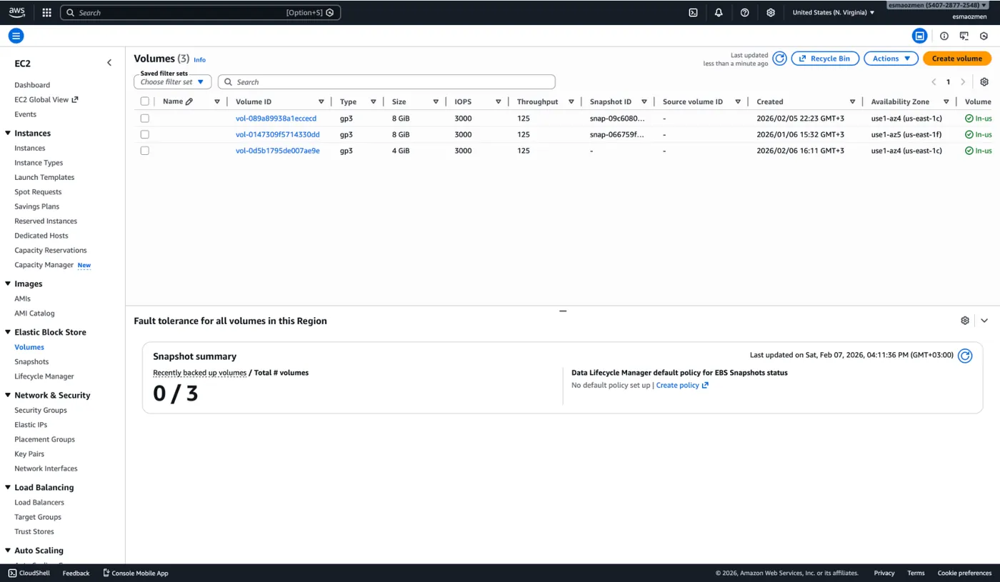
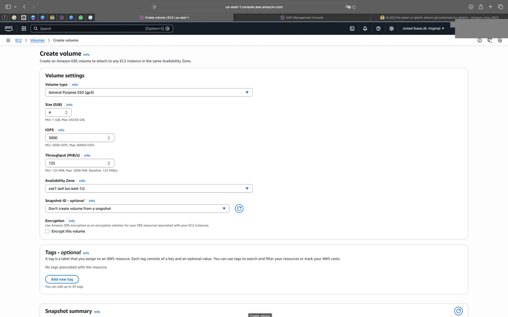
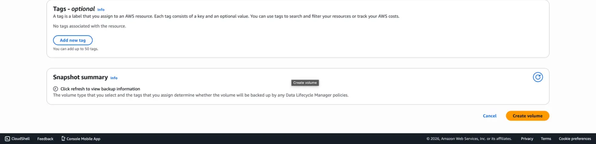
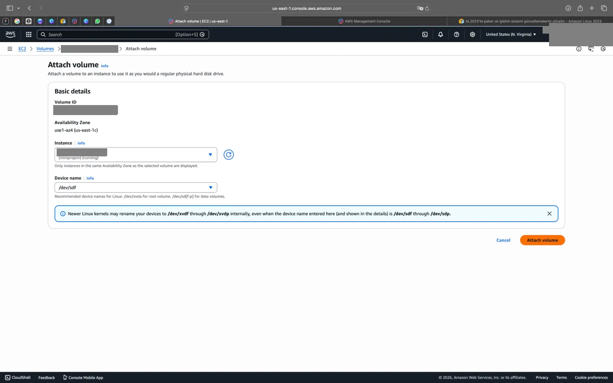
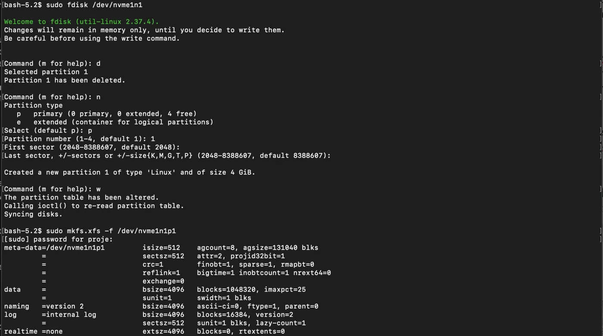

## Görev 10: EBS volume oluşturma ve formatlama

> 10-) 4gb boyutunda bir EBS Volume yaratın ve bunu oluşturduğunuz instance'a bağlayın. Bunun üzerinde tüm disk boyutunu kullanan tek bir partition yaratın ve xfs dosya sistemiyle formatlayın.

### Volume oluşturma

1. Öncelikle bir volume oluşturmak için solda bulunan menü üzerinden **Elastic Block Store** altında **Volumes** seçeneğine tıklıyoruz.
2. Açılan ekranda **Create volume** diyerek devam ediyoruz.

   

3. Oluşturacağımız volume boyutunu ve özelliklerini belirledikten sonra sağ alttan **Create volume** diyerek yeni volume yaratıyoruz.

   

   

### Volume'ü instance'a bağlama

Oluşturduğumuz volume'e bağlanıyoruz.



### Partition oluşturma ve xfs ile formatlama

Şimdi bunun üzerinde tüm disk boyutunu kullanan tek bir partition oluşturalım bunun için `sudo fdisk cihaz_yolu` komutunu kullanırız ardından xfs dosya sistemiyle formatlamak için de `sudo xfs-f xfs cihaz_yolu` komutunu çalıştırıyoruz.

:::caution[Düzeltme]
Formatlama komutu `sudo mkfs.xfs -f cihaz_yolu` şeklindedir ve cihaz yolu olarak diskin kendisi değil, fdisk ile oluşturulan partition verilir (örnekte `/dev/nvme1n1p1`).
:::



```bash frame="terminal"
sudo fdisk /dev/nvme1n1
```

```text title="fdisk oturumu"
Welcome to fdisk (util-linux 2.37.4).
Changes will remain in memory only, until you decide to write them.
Be careful before using the write command.

Command (m for help): d
Selected partition 1
Partition 1 has been deleted.

Command (m for help): n
Partition type
   p   primary (0 primary, 0 extended, 4 free)
   e   extended (container for logical partitions)
Select (default p): p
Partition number (1-4, default 1): 1
First sector (2048-8388607, default 2048):
Last sector, +/-sectors or +/-size{K,M,G,T,P} (2048-8388607, default 8388607):

Created a new partition 1 of type 'Linux' and of size 4 GiB.

Command (m for help): w
The partition table has been altered.
Calling ioctl() to re-read partition table.
Syncing disks.
```

```bash frame="terminal"
sudo mkfs.xfs -f /dev/nvme1n1p1
```

```text title="Çıktı"
meta-data=/dev/nvme1n1p1         isize=512    agcount=8, agsize=131040 blks
         =                       sectsz=512   attr=2, projid32bit=1
         =                       crc=1        finobt=1, sparse=1, rmapbt=0
         =                       reflink=1    bigtime=1 inobtcount=1 nrext64=0
         =                       exchange=0
data     =                       bsize=4096   blocks=1048320, imaxpct=25
         =                       sunit=1      swidth=1 blks
naming   =version 2              bsize=4096   ascii-ci=0, ftype=1, parent=0
log      =internal log           bsize=4096   blocks=16384, version=2
         =                       sectsz=512   sunit=1 blks, lazy-count=1
realtime =none                   extsz=4096   blocks=0, rtextents=0
```
