## Görev 3: Sistemi güncelleme

> 3-) Sistemi ve sistemde yüklü paketleri güncelleyin.

Sistemi güncellemek için `sudo dnf update -y` komutunu kullanıyoruz.

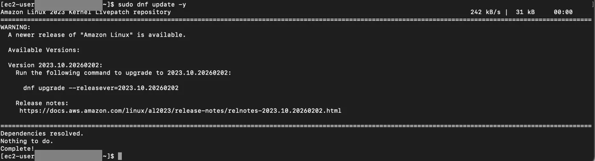

```bash frame="terminal"
sudo dnf update -y
```

```text title="Çıktı"
Amazon Linux 2023 Kernel Livepatch repository                  242 kB/s |  31 kB     00:00
=============================================================================================
WARNING:
  A newer release of "Amazon Linux" is available.

  Available Versions:

  Version 2023.10.20260202:
    Run the following command to upgrade to 2023.10.20260202:

      dnf upgrade --releasever=2023.10.20260202

    Release notes:
     https://docs.aws.amazon.com/linux/al2023/release-notes/relnotes-2023.10.20260202.html

=============================================================================================
Dependencies resolved.
Nothing to do.
Complete!
```

## Görev 4: Git kurulumu

> 4-) Git uygulamasını yükleyin.

Sistemimize git uygulamasını yüklemek için kullanmamız gereken komut `sudo dnf install git -y` şeklinde olmalıdır. Ardından `git --version` yazarak aşağıdaki çıktıyı aldığımızdan emin olalım.

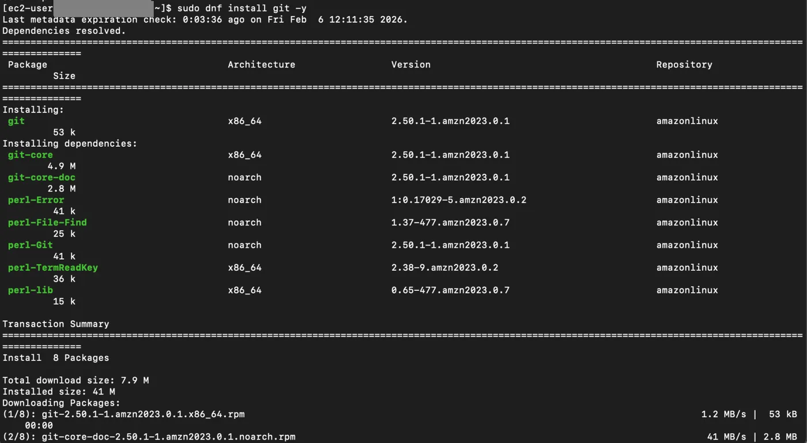

```bash frame="terminal"
sudo dnf install git -y
```

```text title="Çıktı"
Last metadata expiration check: 0:03:36 ago on Fri Feb  6 12:11:35 2026.
Dependencies resolved.
=============================================================================================
 Package               Architecture     Version                       Repository        Size
=============================================================================================
Installing:
 git                   x86_64           2.50.1-1.amzn2023.0.1         amazonlinux       53 k
Installing dependencies:
 git-core              x86_64           2.50.1-1.amzn2023.0.1         amazonlinux      4.9 M
 git-core-doc          noarch           2.50.1-1.amzn2023.0.1         amazonlinux      2.8 M
 perl-Error            noarch           1:0.17029-5.amzn2023.0.2      amazonlinux       41 k
 perl-File-Find        noarch           1.37-477.amzn2023.0.7         amazonlinux       25 k
 perl-Git              noarch           2.50.1-1.amzn2023.0.1         amazonlinux       41 k
 perl-TermReadKey      x86_64           2.38-9.amzn2023.0.2           amazonlinux       36 k
 perl-lib              x86_64           0.65-477.amzn2023.0.7         amazonlinux       15 k

Transaction Summary
=============================================================================================
Install  8 Packages

Total download size: 7.9 M
Installed size: 41 M
Downloading Packages:
...
```

```bash frame="terminal"
git version
```

```text title="Çıktı"
git version 2.50.1
```

## Görev 5: Yeni kullanıcı ve sudo yetkisi

> 5-) Yeni bir kullanıcı ekleyin. Bu kullanıcının şifre sormadan sudo yapabilmesini sağlayın.

Yeni bir kullanıcı eklemek için öncelikle `sudo useradd kullanıcı_adı` komutunu kullanırız ve şifre belirlemek için `sudo passwd kullanıcı_adı` komutunu gireriz. Şifremizi girip, onaylamak için tekrar girdikten sonra şifre sorulmadan sudo yetkilerini vermek için `sudo usermod -a -G wheel kullanıcı_adı` komutunu kullanırız ve sistemdeki en yetkili gruplardan biri olan ve yönetici (root) yetkilerine erişim sağlayan "wheel" grubuna ikincil bir üye olarak güvenli bir şekilde dahil etmiş oluruz.

:::caution[Düzeltme]
`wheel` grubuna eklemek sudo yetkisi verir ama Amazon Linux'ta varsayılan kural (`%wheel ALL=(ALL) ALL`) şifre sorar. Şifre sormadan sudo için ayrıca bir sudoers kuralı gerekir, örneğin `sudo visudo -f /etc/sudoers.d/proje` ile dosyaya `proje ALL=(ALL) NOPASSWD: ALL` satırı eklenir.
:::

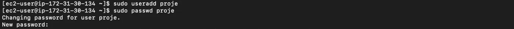

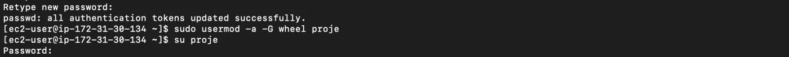

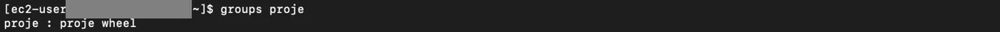

```bash frame="terminal"
sudo useradd proje
sudo passwd proje
```

```text title="Çıktı"
Changing password for user proje.
New password:
Retype new password:
passwd: all authentication tokens updated successfully.
```

```bash frame="terminal"
sudo usermod -a -G wheel proje
su proje
groups proje
```

```text title="Çıktı"
Password:
proje : proje wheel
```

## Görev 6: /evim klasörü ve home directory

> 6-) Root'da /evim diye bir klasör oluşturun. Bu klasörün owner ve grup değerlerini bu yeni oluşturduğunuz kullanıcı ve bu kullanıcının ana grubu olarak değiştirin. Ardından bu kullanıcının home directory'sinin /evim klasörü olmasını sağlayacak işlemi yapın.

Root dizininde /evim adlı klasörü oluşturmak için öncelikle `sudo mkdir /evim` komutunu kullanırız. Klasörün owner (sahip) değerini yeni oluşturduğumuz kullanıcıya devretmek için `sudo chown proje /evim` komutunu, grup değerini o kullanıcının ana grubuna atamak için ise `sudo chgrp proje /evim` komutunu çalıştırırız. Bu işlemlerle klasör üzerindeki tüm mülkiyet haklarını root kullanıcısından alıp yeni kullanıcıya ve grubuna aktarmış oluruz. Son aşamada, kullanıcının home directory değerini bu yeni klasörle eşleştirmek için `sudo usermod -d /evim proje` komutunu uygulayarak işlemi tamamlarız.

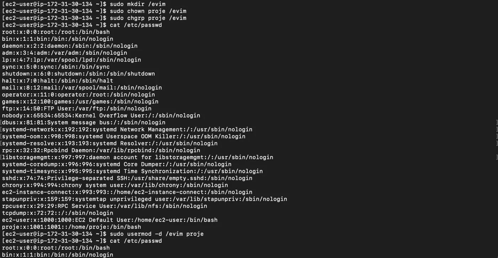

```bash frame="terminal"
sudo mkdir /evim
sudo chown proje /evim
sudo chgrp proje /evim
cat /etc/passwd
```

```text title="Çıktı"
root:x:0:0:root:/root:/bin/bash
bin:x:1:1:bin:/bin:/sbin/nologin
...
ec2-user:x:1000:1000:EC2 Default User:/home/ec2-user:/bin/bash
proje:x:1001:1001::/home/proje:/bin/bash
```

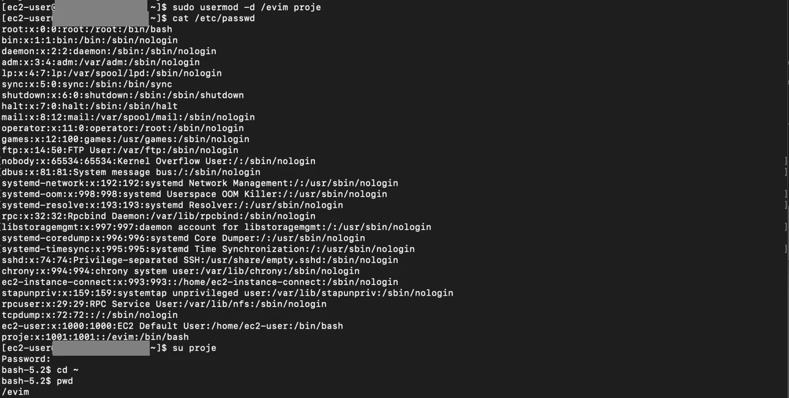

```bash frame="terminal"
sudo usermod -d /evim proje
cat /etc/passwd
```

```text title="Çıktı"
root:x:0:0:root:/root:/bin/bash
bin:x:1:1:bin:/bin:/sbin/nologin
...
ec2-user:x:1000:1000:EC2 Default User:/home/ec2-user:/bin/bash
proje:x:1001:1001::/evim:/bin/bash
```

```bash frame="terminal"
su proje
cd ~
pwd
```

```text title="Çıktı"
Password:
/evim
```

## Görev 7: Network interface ekleme

> 7-) AWS üstünden yeni bir network interface ekleyin ve bunu makinenize attach edin. Sonra bu interface'e 10.10.10.10/255.255.255.0 ip adresini ekleyin.

### Interface oluşturma

1. Bu işlemi gerçekleştirmek için soldaki menü üzerinden **Network & Security** altından **Network Interfaces** seçeneğine tıklıyoruz.

   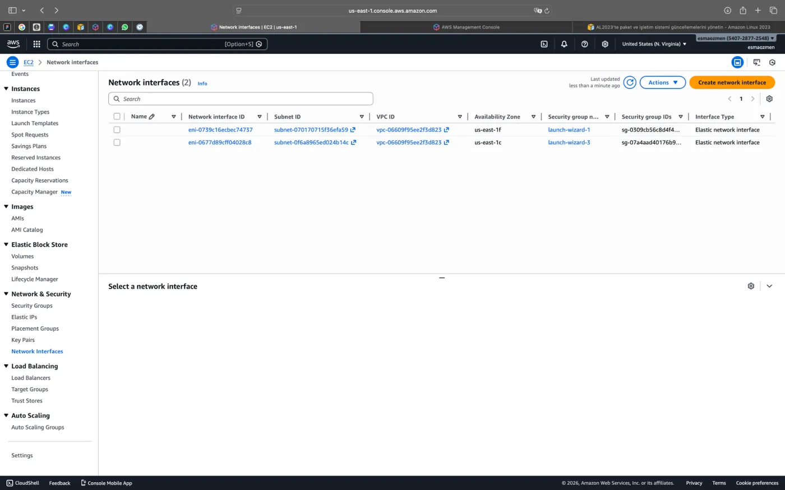

2. Açılan ekranda sağ üstte bulunan **Create network interface** diyerek devam ediyoruz.

   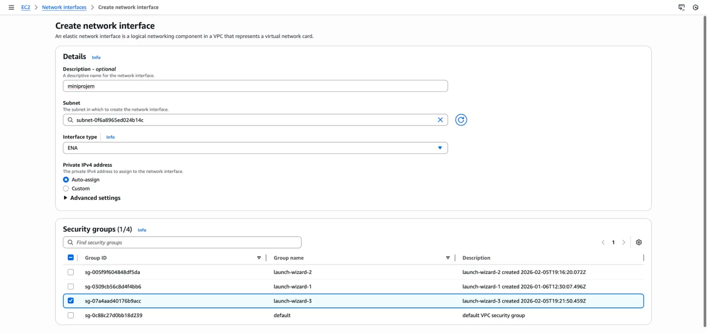

3. Gerekli boşlukları doldurup aşağıda bulunan **Create network interface** butonu ile işlemi tamamlıyoruz.

   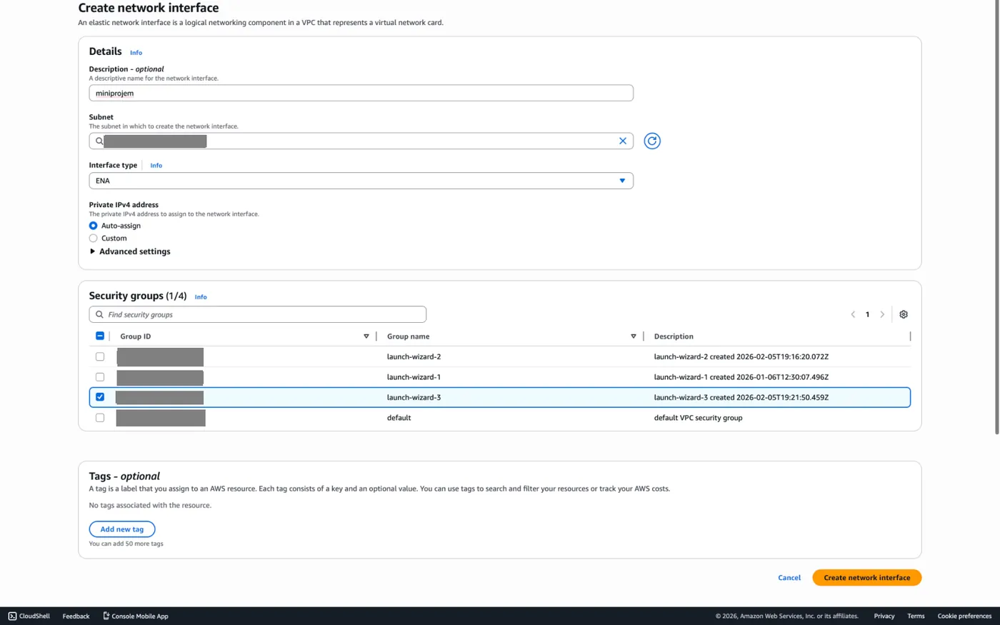

### Instance'a bağlama

Oluşturduğumuz network'ü seçip **Actions** menüsü altından **Attach** diyerek bağlanıyoruz.

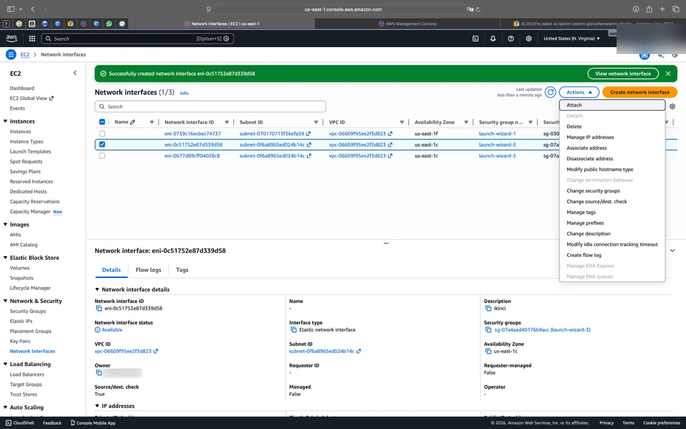

### IP adresini ekleme

AWS arayüzündeki işlemlerimizi hallettikten sonra terminale dönerek `sudo ip address add 10.10.10.10/255.255.255.0 dev ens5` komutuyla ip adresini eklemiş oluyoruz.

```bash frame="terminal"
sudo ip address add 10.10.10.10/255.255.255.0 dev ens5
```

:::caution[Düzeltme]
`ens5` instance'ın ilk (birincil) interface'idir. Yeni attach edilen interface genellikle farklı bir adla görünür (ör. `ens6`); adı `ip link` ile kontrol edip komutta o adı kullanın. Aynı durum Görev 8'deki route komutu için de geçerlidir.
:::

## Görev 8: Route tanımı

> 8-) 199.199.199.0/24 adreslerine giderken bu yeni interface üstünden gitmesini sağlayacak route tanımı yapın.

Bu işlem için kullanmamız gereken komut ise `sudo ip route add 199.199.199.0/24 dev ens5` olmalıdır.

```bash frame="terminal"
sudo ip route add 199.199.199.0/24 dev ens5
```

## Görev 9: Apache Web Server (httpd)

> 9-) Apache Web Server (httpd) servisini sisteme yükleyin. Bilgisayar yeniden başlatıldığında bu servisin de otomatik olarak çalışmasını sağlayacak ayarı da yapın.

### Kurulum

Yüklemeyi yapmak için `sudo dnf install -y httpd` komutunu kullanıyoruz.

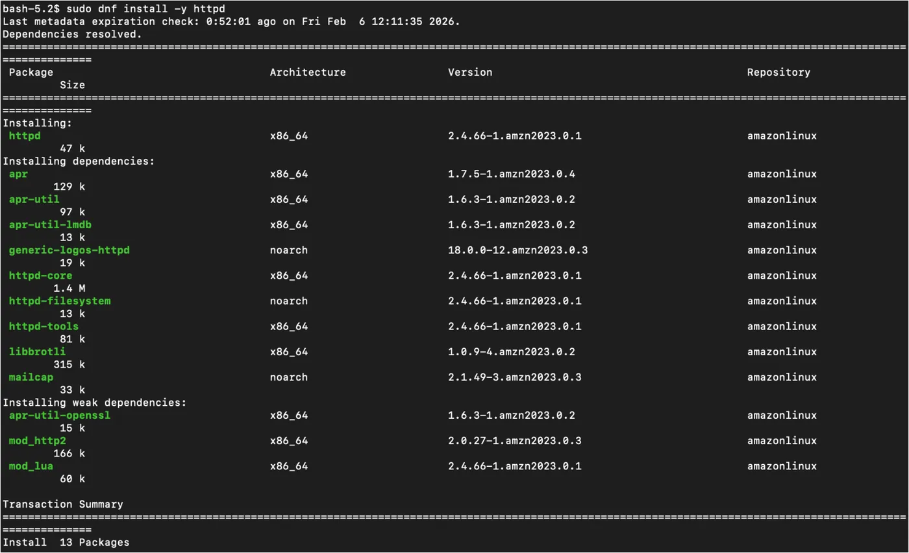

```bash frame="terminal"
sudo dnf install -y httpd
```

```text title="Çıktı"
Last metadata expiration check: 0:52:01 ago on Fri Feb  6 12:11:35 2026.
Dependencies resolved.
=============================================================================================
 Package                 Architecture   Version                     Repository        Size
=============================================================================================
Installing:
 httpd                   x86_64         2.4.66-1.amzn2023.0.1       amazonlinux       47 k
Installing dependencies:
 apr                     x86_64         1.7.5-1.amzn2023.0.4        amazonlinux      129 k
 apr-util                x86_64         1.6.3-1.amzn2023.0.2        amazonlinux       97 k
 apr-util-lmdb           x86_64         1.6.3-1.amzn2023.0.2        amazonlinux       13 k
 generic-logos-httpd     noarch         18.0.0-12.amzn2023.0.3      amazonlinux       19 k
 httpd-core              x86_64         2.4.66-1.amzn2023.0.1       amazonlinux      1.4 M
 httpd-filesystem        noarch         2.4.66-1.amzn2023.0.1       amazonlinux       13 k
 httpd-tools             x86_64         2.4.66-1.amzn2023.0.1       amazonlinux       81 k
 libbrotli               x86_64         1.0.9-4.amzn2023.0.2        amazonlinux      315 k
 mailcap                 noarch         2.1.49-3.amzn2023.0.3       amazonlinux       33 k
Installing weak dependencies:
 apr-util-openssl        x86_64         1.6.3-1.amzn2023.0.2        amazonlinux       15 k
 mod_http2               x86_64         2.0.27-1.amzn2023.0.3       amazonlinux      166 k
 mod_lua                 x86_64         2.4.66-1.amzn2023.0.1       amazonlinux       60 k

Transaction Summary
=============================================================================================
Install  13 Packages
```

### Servisi etkinleştirme ve başlatma

Sistemin o anki durumuna aktif olup olmadığına bakmak için `sudo systemctl status httpd.service` komutunu ve bilgisayar yeniden açıldığında bu servisin de otomatik çalışmasını sağlamak için `sudo systemctl enable httpd.service` komutunu çalıştırırız. Ardından web sunucusunu çalıştırmak için `sudo systemctl start httpd.service` komutunu ve çalıştır komutumuzun yerine getirilip getirilmediğini kontrol etmek için de `sudo systemctl status httpd.service` komutunu kullanıyoruz.

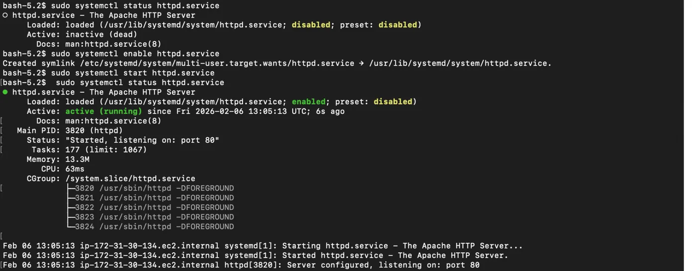

```bash frame="terminal"
sudo systemctl status httpd.service
```

```text title="Çıktı"
○ httpd.service - The Apache HTTP Server
     Loaded: loaded (/usr/lib/systemd/system/httpd.service; disabled; preset: disabled)
     Active: inactive (dead)
       Docs: man:httpd.service(8)
```

```bash frame="terminal"
sudo systemctl enable httpd.service
```

```text title="Çıktı"
Created symlink /etc/systemd/system/multi-user.target.wants/httpd.service → /usr/lib/systemd/system/httpd.service.
```

```bash frame="terminal"
sudo systemctl start httpd.service
sudo systemctl status httpd.service
```

```text title="Çıktı"
● httpd.service - The Apache HTTP Server
     Loaded: loaded (/usr/lib/systemd/system/httpd.service; enabled; preset: disabled)
     Active: active (running) since Fri 2026-02-06 13:05:13 UTC; 6s ago
       Docs: man:httpd.service(8)
   Main PID: 3820 (httpd)
     Status: "Started, listening on: port 80"
      Tasks: 177 (limit: 1067)
     Memory: 13.3M
        CPU: 63ms
     CGroup: /system.slice/httpd.service
             ├─3820 /usr/sbin/httpd -DFOREGROUND
             ├─3821 /usr/sbin/httpd -DFOREGROUND
             ├─3822 /usr/sbin/httpd -DFOREGROUND
             ├─3823 /usr/sbin/httpd -DFOREGROUND
             └─3824 /usr/sbin/httpd -DFOREGROUND

Feb 06 13:05:13 ip-172-31-0-10.ec2.internal systemd[1]: Starting httpd.service - The Apache HTTP Server...
Feb 06 13:05:13 ip-172-31-0-10.ec2.internal systemd[1]: Started httpd.service - The Apache HTTP Server.
Feb 06 13:05:13 ip-172-31-0-10.ec2.internal httpd[3820]: Server configured, listening on: port 80
```

### Yerel test

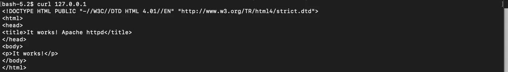

```bash frame="terminal"
curl 127.0.0.1
```

```text title="Çıktı"
<!DOCTYPE HTML PUBLIC "-//W3C//DTD HTML 4.01//EN" "http://www.w3.org/TR/html4/strict.dtd">
<html>
<head>
<title>It works! Apache httpd</title>
</head>
<body>
<p>It works!</p>
</body>
</html>
```

Son olarak `curl 127.0.0.1` komutu, sunucunun dış dünyaya açılmadan önce kendi üzerindeki web servisine bir istek göndererek sistemin doğru çalışıp çalışmadığını kontrol etmesini sağlar. Buradaki `127.0.0.1` adresi, her bilgisayarın "kendisini" ifade eden özel localhost adresidir; `curl` ise bu adresteki web içeriğini terminal ekranına metin olarak dökmemize yarayan bir araçtır.
