Gelin ilk olarak bir sunucu kuralım ve bunun üstünde gerekli ayarları yapalım. Bunun için ilk olarak [https://aws.amazon.com/tr/console/](https://aws.amazon.com/tr/console/) adresinden oturum açalım ve bizden istenilen ilk talimata göz atalım.

## Görev 1: EC2 instance oluşturma

> 1-) Amazon Linux 2023 AMI'dan bir adet t3.micro tipinde EC2 instance yaratın. Key pair login seçeneğiyle yeni bir keypair oluşturun. Dış dünyadan bu oluşturduğunuz instance'a SSH22 ve HTTP80 portlarından erişilebilir olsun.

### Instances ekranına gitme

1. Hesabımıza log in olduktan sonra açılan sayfada **EC2** butonuna tıklayalım.

   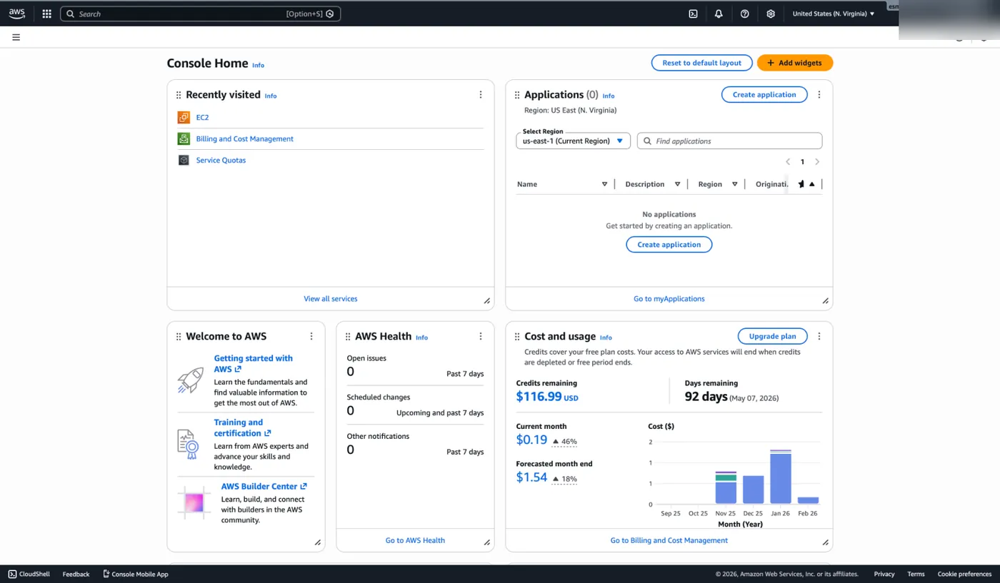

   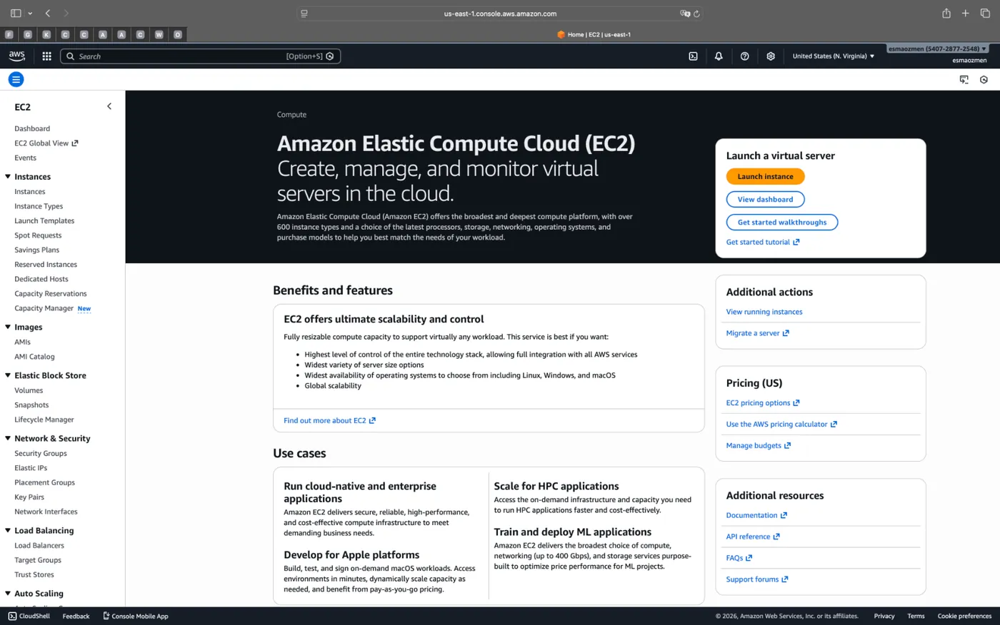

2. Ardından soldaki menüden **Instances** yazan yere tıklayalım.

   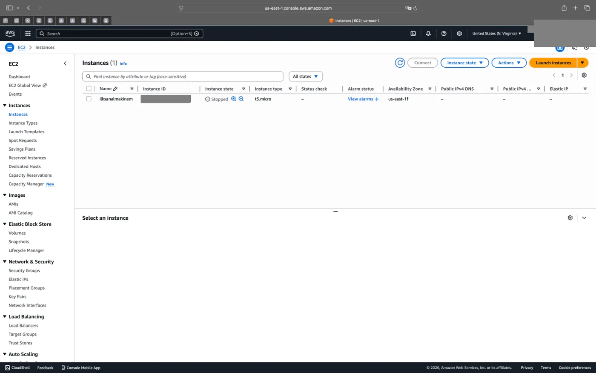

3. Burada var olan sanal makinelerimizin durumunu görebilir yeni bir sanal makine oluşturabiliriz. Sağ üstte bulunan **Launch instances** butonuna tıklayarak yeni bir sanal makine oluşturma adımlarına geçelim.

   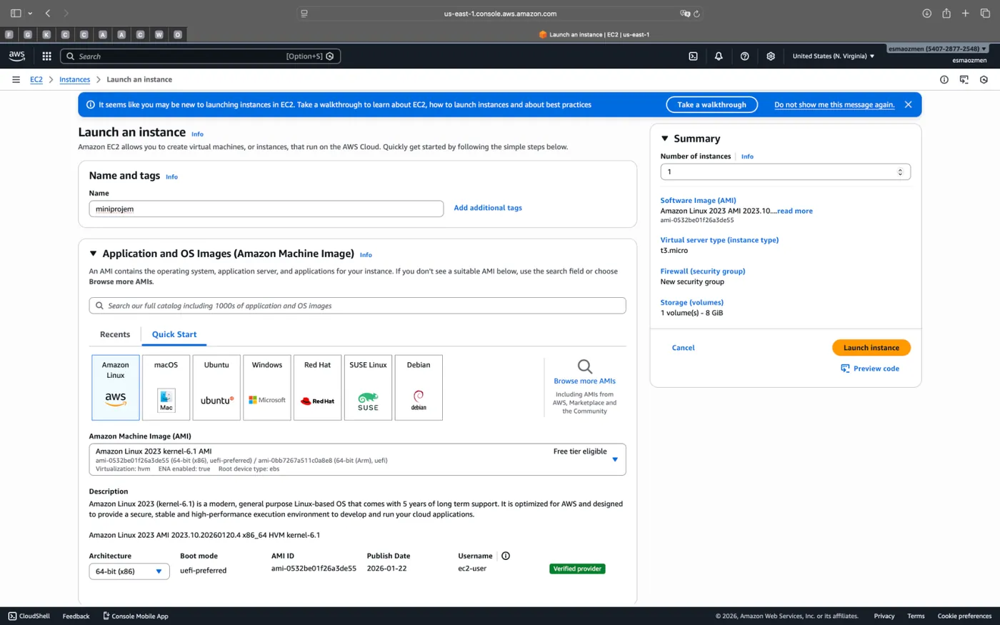

### Launch an instance ayarları

1. Sanal makinemize isim verelim. Ekranda görülen diğer ayarlara dokunmayalım.

   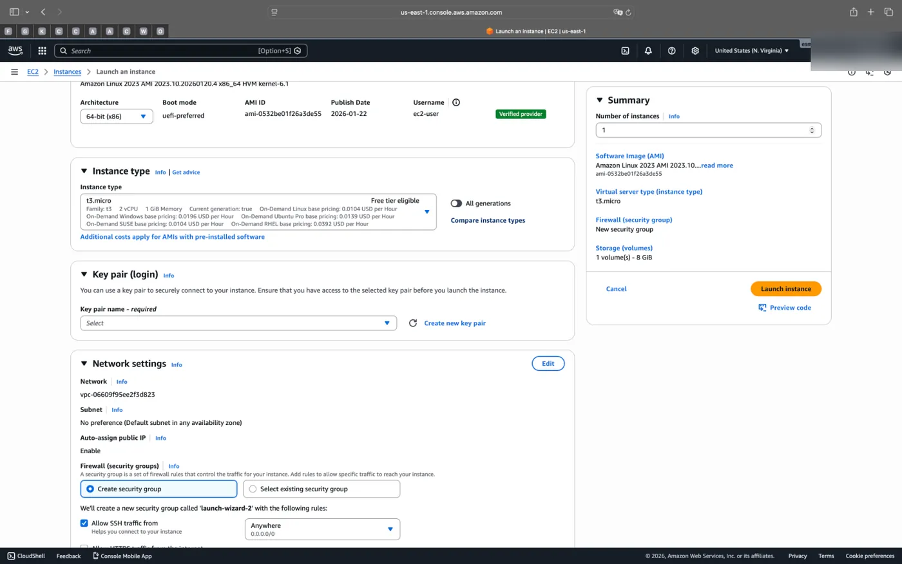

2. Makinemizin tipini `t3.micro` olarak seçelim ve **Create key pair** seçeneğine tıklayarak yeni bir key pair oluşturup isim verelim.

   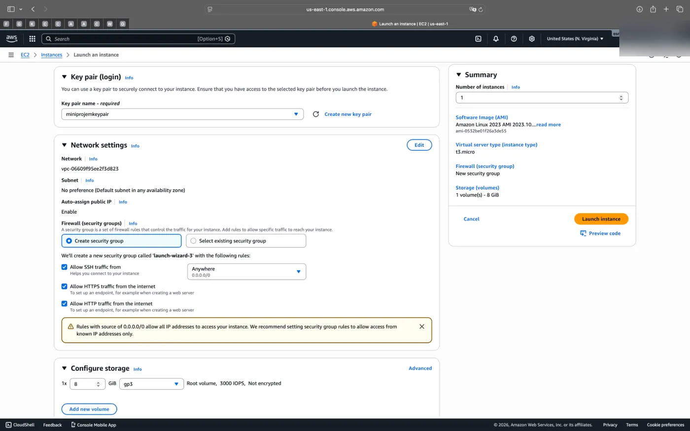

3. Son olarak network menüsünden görünen seçenekleri seçip sağdaki **Launch instance** butonundan sanal makinemizi ayağa kaldıralım.

## Görev 2: SSH ile bağlanma

> 2-) Oluşturduğunuz bu makineye kendi makinenizden ssh aracılığıyla bağlanın.

### Connect ekranı

1. Bunun için ilk olarak sanal makinemize tıklıyoruz.

   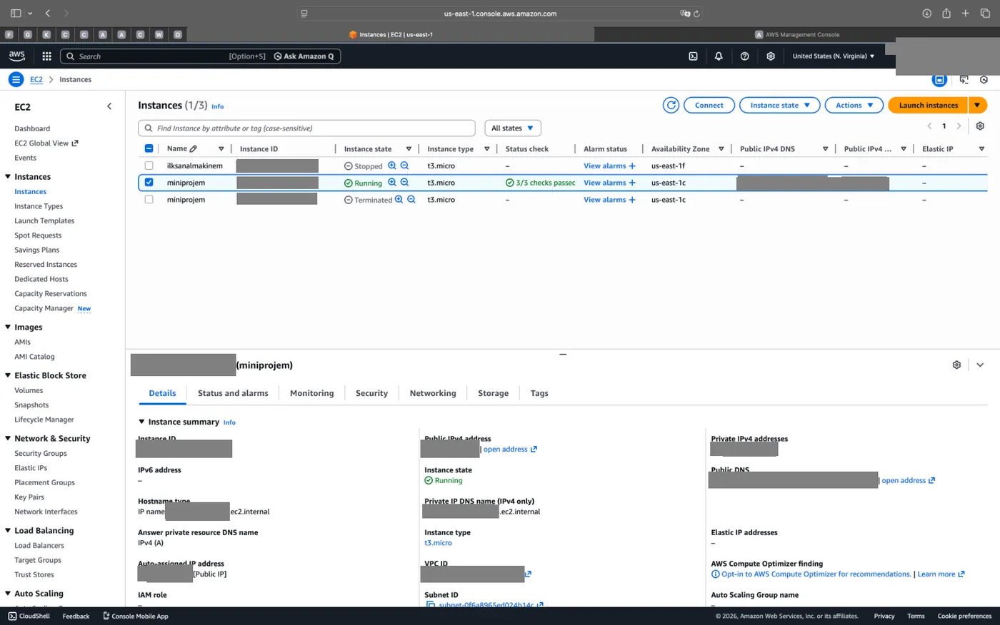

   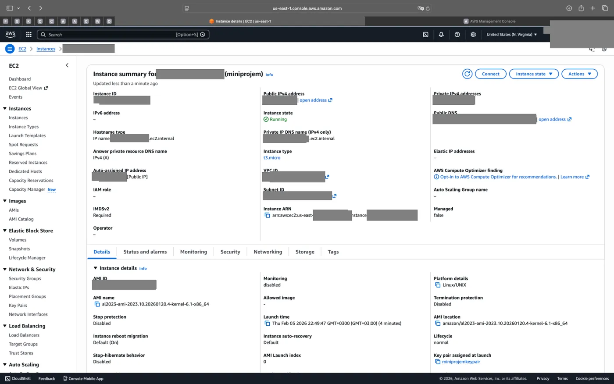

2. Açılan ekranda sağ üstte bulunan **Connect** butonuna tıklıyoruz.

   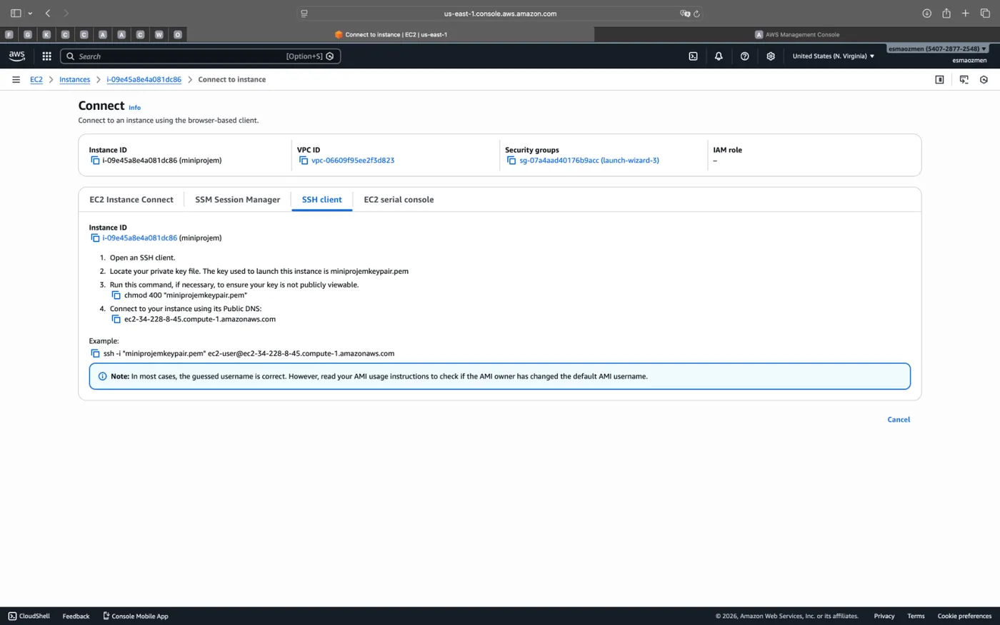

3. Burada **SSH client** menüsünü açıyoruz ve buradaki adımları takip ederek bilgisayarımızdaki terminalde komutları uyguluyoruz.

### Anahtar dosyasının izinleri

Öncelikle key pair oluşturduğumuzda bilgisayarımıza indirilen dosyayı çalıştığımız proje klasörünün içine masaüstünden sürüklüyoruz. `ls` ile dosyanın burada olduğundan emin olduktan sonra `chmod 400 "miniprojemkeypair.pem"` komutunu kullanıyoruz çünkü SSH protokolü, anahtar dosyanızın başkaları tarafından okunabilir olmasını büyük bir güvenlik açığı olarak gördüğü için kısıtlanmamış anahtarlarla bağlantı kurmanıza izin vermez. Bu nedenle `chmod 400` komutunu kullanarak, kritik anahtar dosyanızı bilgisayardaki diğer tüm kullanıcı ve gruplara kapatıp sadece kendi erişiminize özel (salt okunur) hale getirirsiniz. Bu işlemi yapmak sisteme "bu dijital anahtar güvenli bir şekilde korunuyor" onayı verir.

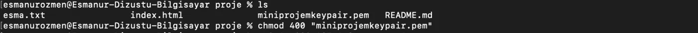

```bash frame="terminal"
ls
```

```text title="Çıktı"
ornek.txt             index.html            miniprojemkeypair.pem   README.md
```

```bash frame="terminal"
chmod 400 "miniprojemkeypair.pem"
```

### Bağlantı

Sıradaki komutla ise yerel bilgisayarımızdaki dijital anahtar dosyasını (`miniprojemkeypair.pem`) bir kimlik kartı gibi kullanarak buluttaki sunucuyla aramızda şifreli ve güvenli bir iletişim tüneli kurduk. İşlem sonucunda kendi bilgisayarımızın terminalinden çıkıp, kilometrelerce uzaktaki sanal makinemizin komut satırına (CLI) doğrudan bağlanarak onu kontrol etme yetkisi kazandık.

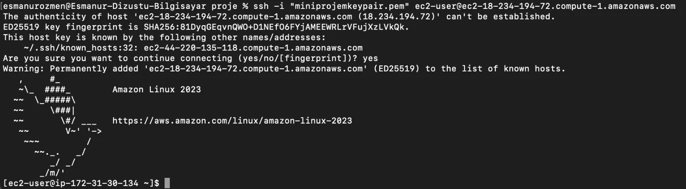

```bash frame="terminal"
ssh -i "miniprojemkeypair.pem" ec2-user@ec2-203-0-113-10.compute-1.amazonaws.com
```

```text title="Çıktı"
The authenticity of host 'ec2-203-0-113-10.compute-1.amazonaws.com (203.0.113.10)' can't be established.
ED25519 key fingerprint is SHA256:<HOST_KEY_FINGERPRINT>.
This host key is known by the following other names/addresses:
    ~/.ssh/known_hosts:32: ec2-203-0-113-11.compute-1.amazonaws.com
Are you sure you want to continue connecting (yes/no/[fingerprint])? yes
Warning: Permanently added 'ec2-203-0-113-10.compute-1.amazonaws.com' (ED25519) to the list of known hosts.
   ,     #_
   ~\_  ####_        Amazon Linux 2023
  ~~  \_#####\
  ~~     \###|
  ~~       \#/ ___   https://aws.amazon.com/linux/amazon-linux-2023
   ~~       V~' '->
    ~~~         /
      ~~._.   _/
         _/ _/
       _/m/'
```
